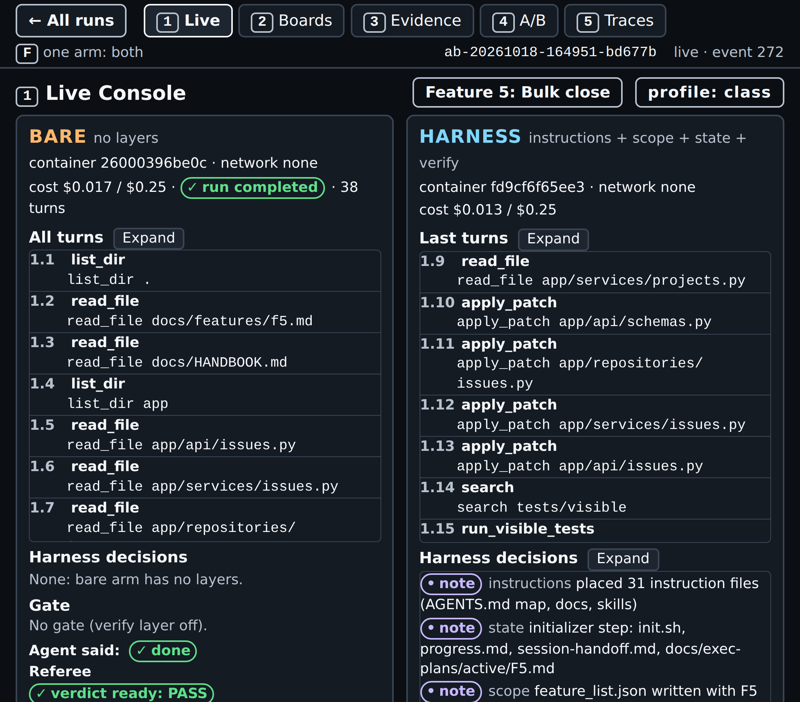
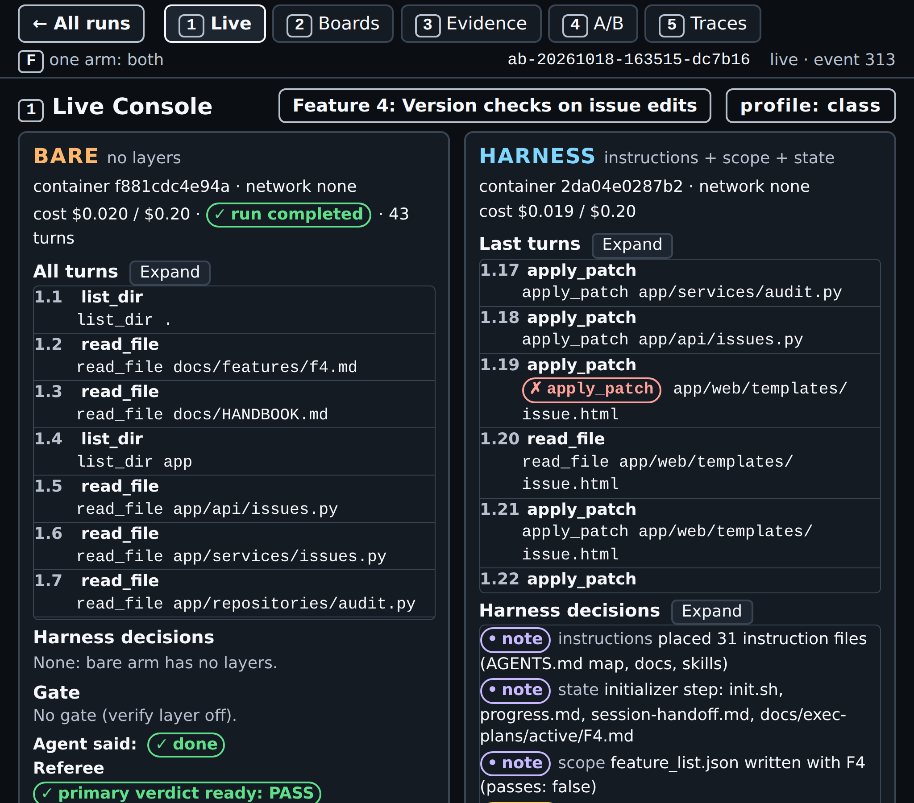
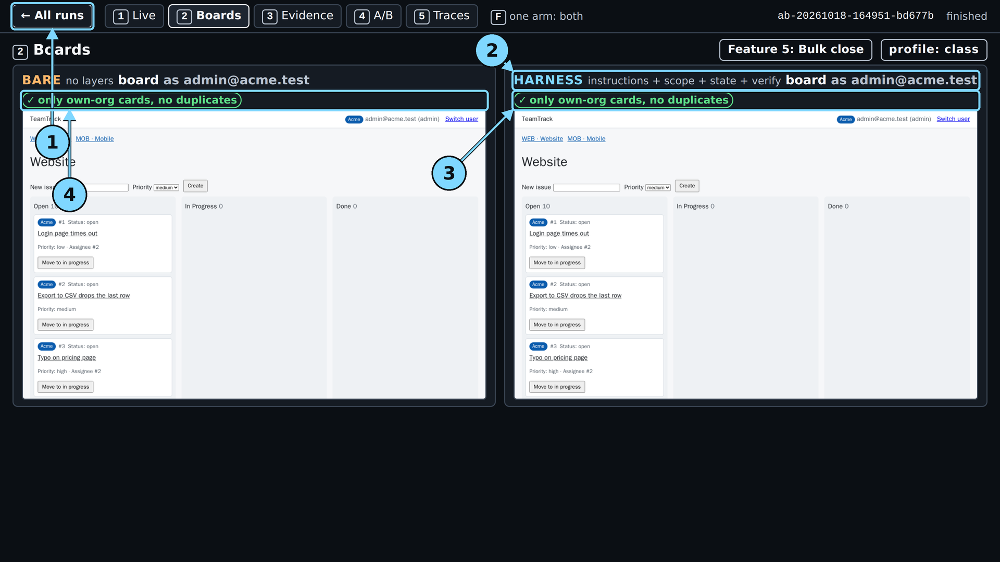
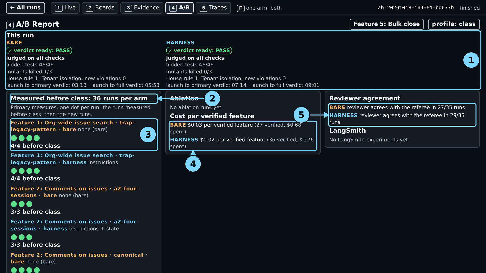
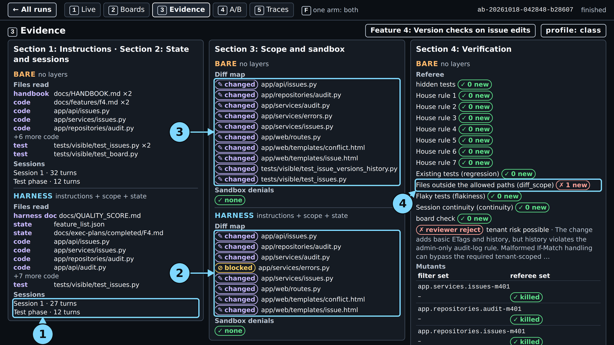

# Module 1: Harness Engineering for Coding Agents

[](https://github.com/ANI-IN/harness-engineering-session/actions/workflows/ci.yml)

New here? [Start here](docs/start-here.md): the learning path in order, with the time each step
takes.

This module teaches you to build the harness around a coding agent, and to measure whether each part
of it helps.

## The problem

Your team gives a week of tickets on a multi-tenant issue tracker to a coding agent. On Monday the agent copies an old handler that has no tenant filter. The tests pass, and one customer can now read another customer's issues. On Tuesday a session stops halfway through a database migration. The next session cannot see what the first one did, and it writes a second migration for the same table. On Wednesday a fix for one endpoint lands in shared middleware, and an older feature breaks. On Thursday the agent reports "done" on an edit-conflict feature that still loses updates, and the only evidence is the agent's word.

Each of these costs more than the ticket saved: a data leak, a blocked deploy, a regression, and a
review that rests on trust.

> **Terms on this page**
>
> - **Harness**: the files and code around the agent that decide what it sees and may do.
> - **Harness layer**: one part of the harness: instructions, state, scope, or verification.
> - **Bare arm**: an agent run with the ticket and the repository, and no harness.
> - **Harness arm**: the same run with the harness turned on.
> - **A/B**: bare arm and harness arm on the same ticket, scored the same way.
> - **Referee**: the program that scores each run after the agent stops.
> - **Primary verdict**: the referee's answer to the one question the section asks.
> - **Ticket**: the task the agent gets, written like a work ticket.
> - **Console**: the browser page that shows a run live, on five screens.
> - **Hidden tests**: tests the agent never sees; the referee runs them after the agent stops.
> - **Mutant**: a copy of the code with one small bug planted on purpose; good tests catch it.
> - **Gate**: the check that must pass before a feature counts as done.
>
> Every other course term is in the [glossary](docs/glossary.md).

## Why it happens

Each failure in the story has a cause that the sources describe.

1. **The agent cannot follow a rule it never sees.** "From the agent’s point of view, anything it
   can’t access in-context while running effectively doesn’t exist."
   ([OpenAI, Harness engineering](https://openai.com/index/harness-engineering/))
2. **Each session starts from nothing.** "each new session begins with no memory of what came
   before."
   ([Anthropic, Effective harnesses](https://www.anthropic.com/engineering/effective-harnesses-for-long-running-agents))
3. **Agents copy what they find, and can do damage that is hard to undo.** "Codex replicates
   patterns that already exist in the repository—even uneven or suboptimal ones." (OpenAI, same
   article). Anthropic runs its long agent loop with the note "(Run this in a container, not your
   actual machine)"
   ([Anthropic, Building a C compiler](https://www.anthropic.com/engineering/building-c-compiler)).
4. **The agent grades its own work too kindly.** "agents reliably skew positive when grading their
   own work"
   ([Anthropic, Harness design](https://www.anthropic.com/engineering/harness-design-long-running-apps)).

The finding ids behind these quotes are on the [evidence page](docs/evidence/general.md#sources).

## The harness

A harness is the environment around the agent, not a better prompt.
[OpenAI](https://openai.com/index/harness-engineering/) describes the work as to
"design environments, specify intent, and build feedback loops". This module builds it in four
layers, one per section.


*Each layer acts at one point of the loop; the sandbox is the same for both arms.*

- **Instructions** ([Section 1: Instructions](section-1-instructions/README.md)). A short AGENTS.md acts as a map that
  points to one document per topic. The agent reads only what the ticket needs.
- **State and sessions** ([Section 2: State and sessions](section-2-state-lifecycle/README.md)). A progress file, an
  execution plan, and a handoff carry the work across a session stop. The next session reads them
  before it touches code.
- **Scope and sandbox** ([Section 3: Scope and sandbox](section-3-scope-sandbox/README.md)). The harness lists the files each
  phase may change and blocks the rest. Every run sits in a container with no network.
- **Verification** ([Section 4: Verification](section-4-verification/README.md)). The agent's own tests must pass five
  filters, and a gate checks the work before "done" counts. The harness, not the agent, marks a
  feature as passing.

Every layer costs turns, time, and money.
[Anthropic](https://www.anthropic.com/engineering/harness-design-long-running-apps) puts it this way: "every component in a harness
encodes an assumption about what the model can't do on its own, and those assumptions are worth
stress testing". So the module measures each layer: the same agent, model, ticket, and sandbox, with
and without the harness, scored by the same referee.

## The class plan

The class runs 240 minutes on TeamTrack, a small multi-tenant issue tracker. Every demo is a live
model run, watched on the console.

| Time | Block | What you see | Command, launched at |
|---|---|---|---|
| 0:00-0:10 | Opening | The four failures, the harness, a console tour | none |
| 0:10-1:00 | Section 1: Instructions | The agent reads the map, then only the documents it needs | `make show-1` at 0:11 |
| 1:00-1:10 | Break | | |
| 1:10-2:00 | Section 2: State and sessions | A session stops, writes a handoff, and the next one resumes | `make show-2 SESSION_BUDGET=12,38` at 1:11 |
| 2:00-2:50 | Section 3: Scope and sandbox | A live A/B: the scope layer blocks a file the bare arm changes | `make demo-3 FEATURE=version-checks` at 2:01 |
| 2:50-2:55 | Break | | |
| 2:55-3:40 | Section 4: Verification | The poll picks the final feature; test filters and the gate on "done" | `make show-4` and `make final FEATURES=watchers,bulk-close` at 2:57 |
| 3:40-4:00 | Final | The final A/B on every screen, then all results | none |

Each section launches its run on its start slide, so the run has the whole section to finish. The
class has one poll, at the start of Section 4, which picks the feature of the final A/B. The story
and the four ideas fill the time while the run proceeds. The demo then walks through the code and
the finished run on every screen. The instructor's plan is in the [instructor guide](docs/instructor-guide.md).

> Your output will differ: run times, ids, and the agent's wording change on every run.



*Screen 1 during a run: each arm's turns, cost against its cap, and the harness decisions as they happen.*



*The primary verdict appears as soon as its checks finish, even while the other arm still works. The full verdict follows when the secondary checks end.*



*Screen 2 shows each arm's running app as one customer sees it, and flags cards from another org.*



*Screen 4 puts the runs measured before class on one page, one dot per run, filled when it passed; new runs join as new dots.*

## What we measured

Before class the course ran its own A/Bs on TeamTrack, three per section per round, plus one round
with the class settings. The table counts runs that passed each section's primary measure.

| Section and primary measure | Bare arm | Harness arm | Result |
|---|---|---|---|
| 1: no new tenant leak | 7 of 7 | 7 of 7 | No measurable difference |
| 2: no work lost across a session stop | 7 of 7 | 7 of 7 | No measurable difference |
| 3: no file outside the allowed paths | 7 of 7 | 7 of 7 | No measurable difference |
| 3, confirmation on a second ticket | 0 of 3 | 3 of 3 | Harness ahead |
| 4: every hidden test and mutant | 0 of 4 | 0 of 4 | Both fail |

On this model and these tickets, the instructions, state, and verification layers did not show on
their measures. The scope layer did: on a ticket where every bare arm changed a file outside its
allowed paths, the harness arm was blocked from doing so in 3 of 3 runs. That result is why Section
3 runs a live A/B in class.



*In the bare arm the shared errors file is changed; in the harness arm the same file is blocked.*

The harness also costs something. Counted after the results were known, harness arms ran longer
(median 302 s against 190 s) and cost more (median $0.0123 against $0.0103 per arm).
[OpenAI](https://openai.com/index/harness-engineering/) warns
that its own results should "not be assumed to generalize without similar investment". The same
holds here: one model, one ticket per section (two in Section 3), a few runs per arm. The tools in this repository let
you run the same measurement on your own model and code. Every run id and count:
[evidence](docs/evidence.md).

### Known limitations

Read the results with these limits in mind:

- **One model.** Every run used gpt-6-luna for the agent and gpt-5.6-luna for the reviewer. Another
  model may behave differently.
- **A small number of runs.** Three A/Bs per section per round, so a few runs per arm. A small
  difference between arms could be chance.
- **These tasks only.** The results are specific to TeamTrack and one ticket per section (two in
  Section 3). They do not say what the harness does on your code.
- **macOS setup not tested on a Mac.** The [macOS page](setup/macos.md) follows the official install
  pages; Windows (through WSL2) and Ubuntu were tested.
- **The harness text was renamed after the measurements.** The harness files were changed to the
  plain course names, such as "House rule 1: Tenant isolation", after the runs were measured. The
  [evidence page](docs/evidence/general.md#harness-rename) says so.

## Quick start

If git, make, uv, and Docker are installed and you have an OpenAI key and a LangSmith key, five
commands take you to a live run. Run them in a Linux or macOS terminal, or in Ubuntu on WSL2.

```bash
git clone https://github.com/ANI-IN/harness-engineering-session.git ~/shipharness
cd ~/shipharness && make setup
make doctor
make console
make show-1
```

Before `make doctor`, open `.env` and fill in `OPENAI_API_KEY`, `LANGSMITH_API_KEY`, and
`SHIPHARNESS_CLASS_DATE` (today, as `YYYY-MM-DD`). `make doctor` must end with `result: + ready`.
`make console` keeps running: open http://127.0.0.1:8765/ in a browser and run `make show-1` in a
second terminal. One `make show-1` costs at most $0.24 at the caps in `.env.example`; measured
2026-10-18, three runs cost $0.021 to $0.023 each and reached the full verdict 7 to 11 minutes after
launch. The [costs page](docs/costs.md) has every command and assignment.

Nothing installed yet? Start at [setup](setup/README.md). It covers Windows, macOS, and Linux from
an empty machine, including both accounts.

## Where next

- [Start here](docs/start-here.md): the learning path in order, with times.
- [Setup](setup/README.md): install everything and run your first live demo.
- [Live Demo Guide](guide/README.md) ([PDF](guide/Harness%20Engineering%20Demo%20Guide.pdf)): the five live demos, one command and one
  screen at a time, with what to say in class.
- [Section 1: Instructions](section-1-instructions/README.md): the first layer, with its demo and
  assignment.
- [Use it in your repo](use-in-your-repo/README.md): the starter kit, four skills, and a guide for
  your own code.
- [Final project](final-project/README.md): the whole harness on a new feature, then your own
  repository.
- [Reference](docs/reference.md): every make target, setting, cap, and folder.
- [Troubleshooting](docs/troubleshooting.md): the exact messages and their fixes.
- [After class](docs/after-class.md) and [optional extras](docs/extras.md).
- [Glossary](docs/glossary.md), [FAQ](docs/faq.md), and [costs](docs/costs.md): every term, the
  common questions, and what each command costs.

### Getting help

- **Program channels**: raise a support ticket on Uplevel (the program's learning platform) at any
  time, bring questions to the
  Wednesday technical coaching, learn with peers on Discord, and ask the teaching assistants (TAs)
  during the live class.
  Bring the exact terminal message, never your `.env` or a key.
- **Review session**: it goes through each assignment, with the reference solution and common
  mistakes. Bring your self-check output and one question per assignment.
- **Security problems**: report them privately, as [SECURITY.md](SECURITY.md) explains.

License: MIT, see [LICENSE](LICENSE).

## Sources

- Source 1: Harness engineering: leveraging Codex in an agent-first world, <https://openai.com/index/harness-engineering/>, Ryan Lopopolo (OpenAI), 2026-02-11
- Source 2: Effective harnesses for long-running agents, <https://www.anthropic.com/engineering/effective-harnesses-for-long-running-agents>, Justin Young (Anthropic), 2025-11-26
- Source 3: Building a C compiler with a team of parallel Claudes, <https://www.anthropic.com/engineering/building-c-compiler>, Nicholas Carlini (Anthropic), 2026-02-05
- Source 4: Harness design for long-running application development, <https://www.anthropic.com/engineering/harness-design-long-running-apps>, Prithvi Rajasekaran (Anthropic), 2026-03-24
