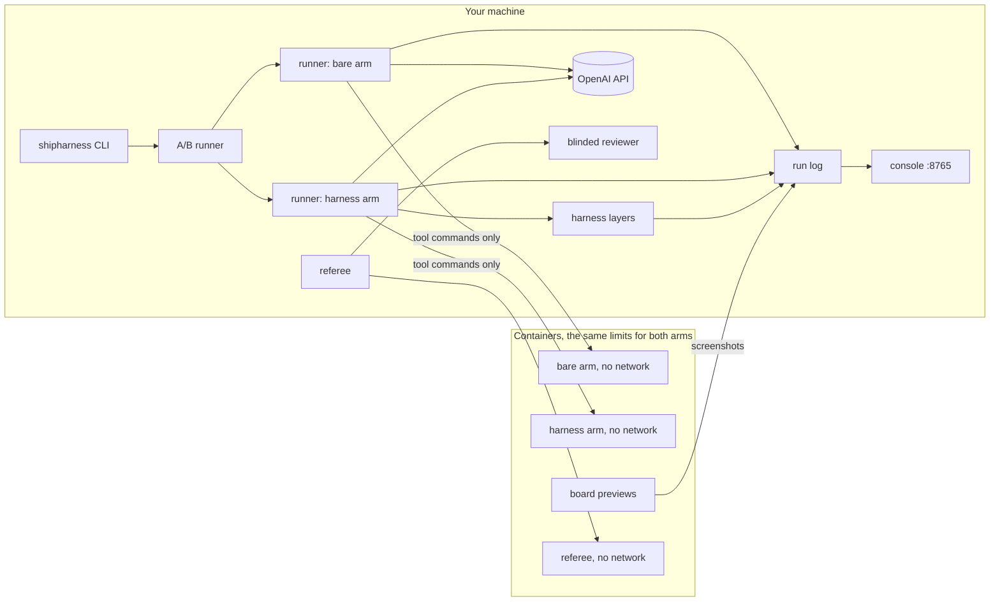
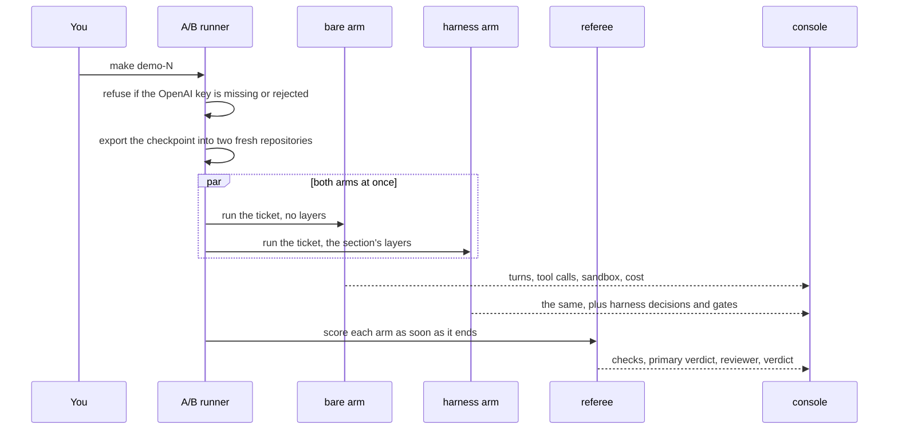

# Architecture

> **Terms on this page**
>
> - **Harness layer**: one part of the harness: instructions, state, scope, or verification.
> - **Bare arm**: an agent run with the ticket and the repository, and no harness.
> - **Harness arm**: the same run with the harness turned on.
> - **A/B**: bare arm and harness arm on the same ticket, scored the same way.
> - **Referee**: the program that scores each run after the agent stops.
> - **Primary verdict**: the referee's answer to the one question the section asks.
> - **Checkpoint**: a git tag that marks the TeamTrack code a section starts from.
> - **Hidden tests**: tests the agent never sees; the referee runs them after the agent stops.
> - **Mutant**: a copy of the code with one small bug planted on purpose; good tests catch it.
> - **Turn budget**: the most turns (model replies) one session may use before it is stopped.
> - **Gate**: the check that must pass before a feature counts as done.
> - **Progressive disclosure**: the agent first sees only short names and pointers, and opens the
>   full text when a task needs it.
> - **Context reset**: a new session that starts with an empty context and carries over only what
>   was written to files.

This page shows how shipharness is put together: what runs on your machine, what runs in containers,
how one A/B flows from the command to the console, and where each file ends up.

## The big picture



The agent loop, the API keys, and LangSmith tracing stay on your machine. Only each arm's tool
commands (`run`, `run_visible_tests`, and so on) run inside that arm's container. The referee scores
each arm's code in its own container, on a fresh copy of the checkpoint. The console reads only the
run log and `exports/`.

## Rules that hold everywhere

- **No key in any container.** No host environment variable is passed into a container, and names
  that contain `KEY`, `TOKEN`, or `SECRET` are refused (`platform/sandbox/README.md`).
- **The same sandbox for both arms.** The sandbox is never what an A/B compares. Every run prints
  its policy at the start. With the class profile:

  > Your output will differ: run times, ids, and the agent's wording change on every run.

  ```text
  Sandbox policy (identical for both arms)
    network: none
    cpus: 2.0
    memory: 1024 MB (swap: 0 MB)
    pids: 256
    user: 1000:1000
    read-only root: yes
    writable: /work, /tmp
    capabilities dropped: ALL
    tool timeout: 120 s; run timeout: 420 s
    refused commands: 6 rules (network access)
  ```

  This follows Anthropic's practice of running a long agent loop in a container without internet
  access ([Building a C compiler with a team of parallel Claudes](https://www.anthropic.com/engineering/building-c-compiler)).
  The code is `platform/src/shipharness/sandbox/policy.py`.
- **Agent code never runs on your machine**, except in the labelled fallback without Docker
  (`SANDBOX_MODE=none`), where every screen shows `UNSANDBOXED — results not official`.
- **Each arm gets its own fresh git repository**, exported from `platform/teamtrack/` at the
  checkpoint tag. It is not a worktree of the course repository, so the hidden tests, the referee's
  mutants, and the reference code cannot be reached through git
  (`platform/src/shipharness/ab/workspace.py`).
- **Both arms get the same inputs**: the same code and rules (the bare arm finds every rule in
  `docs/HANDBOOK.md`), ticket, model, reasoning effort, tools, turn budgets, cost cap, and sandbox.
  The harness changes how knowledge, state, scope, and checks are organised and enforced. It adds no
  fact the bare arm cannot read.

## One A/B, step by step

This is what `make demo-N` does, and each feature of `make final`.



1. `shipharness ab` checks the OpenAI key first, with a model metadata request that uses no tokens.
   It refuses before any arm starts if the key is missing or rejected. There is no scripted
   fallback; `make replay` is the explicit fallback, labelled RECORDING.
2. The checkpoint is exported into two new repositories. For example, the tag `m1-s1-start` is
   the TeamTrack code that Section 1: Instructions starts from.
3. Both arms run at the same time. The harness arm runs its section's layers; the bare arm runs none.
4. The referee scores each arm as soon as that arm ends.
5. One score record per arm goes to `exports/scores/`, and the terminal prints one line per arm and
   a cost line.

`make show-N` runs the same path with `--arms harness`: only the harness arm runs and is scored. Its
record is marked as single-arm and stays out of every bare-versus-harness comparison.

## Packages

The code is in `platform/src/shipharness/`.

| Package | What it does |
|---|---|
| `config/` | Settings from `.env`, prices from `platform/config/prices.toml`, the class profile |
| `cost/` | The cost tracker: tokens times prices, cap checks before every model call |
| `events/` | Typed events, the event bus, the run log, the replay reader |
| `sandbox/` | Containers, commands with time limits, denials, the policy |
| `runner/` | The agent loop on the OpenAI Responses API, the seven tools, sessions |
| `harness/instructions/` | Places the AGENTS.md map and the skills |
| `harness/state/` | `init.sh`, the progress file, the execution plan, the handoff at a session stop |
| `harness/scope/` | `feature_list.json`, allowed paths per phase, blocks and reverts, the `passes` field |
| `harness/verify/` | The test-phase filters and the gate on "done" |
| `filters/` | Filters 1 to 5 (the test filters) and the mutant runner |
| `checks/` | House rules 1 to 7, existing and hidden tests, diff scope, flakiness |
| `reviewer/` | The blinded reviewer |
| `ab/` | Arm setup, the referee, swap test, replay, warm, report, experiments |
| `console/` | The five screens, streamed from the run log |
| `tracing/` | LangSmith wrappers and trace links |
| `testgen/`, `kit/`, `skills_cli/` | `shipharness testgen`, `init`, and `skills validate` |
| `cli.py` | The entry point for every command |

The harness layers reach the runner only through hooks. The referee reaches a build only through
its checks. The console reads only events.

## The harness layers

`--layers` takes `none`, `all`, or a comma list of `instructions,state,scope,verify`. `-<layer>`
removes one layer from the stack, for example `make demo-2 LAYERS=-state`.

| Demo | Harness arm layers | What the added layer does |
|---|---|---|
| `demo-1` | instructions | A short AGENTS.md map in the context, skills loaded when needed |
| `demo-2` | instructions, state | An initializer step, a getting-up-to-speed routine, a progress file, a handoff |
| `demo-3` | instructions, state, scope | One feature at a time, allowed paths per phase, `passes` set only by the harness |
| `demo-4` | all four | Five test filters, a gate on "done" the agent does not control, a clean state |
| `final` | all four | The whole harness |

The layers follow the sources: the map and progressive disclosure from
[Harness engineering](https://openai.com/index/harness-engineering/); the initializer,
progress file, and feature list from
[Effective harnesses for long-running agents](https://www.anthropic.com/engineering/effective-harnesses-for-long-running-agents);
the test filters from [Automated Unit Test Improvement using Large Language Models at Meta](https://arxiv.org/abs/2402.09171) and
[Mutation-Guided LLM-based Test Generation at Meta](https://arxiv.org/abs/2501.12862).

Two choices are course design. First, Anthropic's harness lets the agent set `passes` after careful
testing; this course moves that decision to the harness. It follows the separation of the agent that
does the work from the one that judges it in
[Harness design for long-running application development](https://www.anthropic.com/engineering/harness-design-long-running-apps).
Second, the forced session stop is a session turn budget smaller than the feature; it produces what
that article calls a context reset.

## The referee

The referee runs in a fresh container with no network, on a fresh export of the checkpoint with the
arm's diff applied. Neither arm ever sees the hidden tests or the referee's mutants.

1. Apply the diff, and mark each changed file as allowed or out of scope for its phase.
2. Run the existing tests: existing tests keep passing.
3. Probe House rules 1 to 7 against every endpoint in the app's API description. A house rule is
   what OpenAI calls a golden principle: a team convention checked by code.
4. Run the hidden tests for the feature; some combine features.
5. Run the referee's mutants against the arm's own tests.
6. Re-run each shipped test five times for flakiness (a test that passes on some runs and fails on
   others), as [TestGen-LLM](https://arxiv.org/abs/2402.09171) does.
7. Check the board, with screenshots.
8. Measure continuity across sessions from the run log.
9. Ask the blinded reviewer, which sees the diff and the ticket with arm names removed
   (`platform/src/shipharness/reviewer/blind.py`). Its agreement is counted; it does not decide the
   verdict.
10. Write one score record per arm, and a verdict with "agent said" next to the referee's result.

Each section has one primary measure, fixed before any run:

- Section 1: new breaks of House rule 1: Tenant isolation.
- Section 2: State and sessions: a continuity failure.
- Section 3: Scope and sandbox: out-of-scope files or source edits in the test phase.
- Section 4: Verification: hidden tests passed and referee mutants killed.

The final features have none and are read as counts.

The steps the primary measure needs run first. As soon as they finish, the referee sends that arm's
`primary_verdict`, and the console shows it while the other steps run. The order changes no score:
every step scores the same build with the same inputs.

## Events, the console, and replays

Every part of a run writes typed events to one run log, `events.jsonl`: `run_start`, `turn`,
`tool_call`, `tool_result`, `harness_decision`, `blocked`, `session_stop`, `session_resume`,
`check_result`, `mutant_result`, `primary_verdict`, `verdict`, `cost`, `screenshot`, `run_end`, and
others (`platform/src/shipharness/events/models.py`).

The console server folds the events per arm and streams the five screens to the browser. The
screens and their keys are listed in the [reference](reference.md#the-console).

`make replay RUN=<id>` re-emits a recorded run's events under a new id, applies the recorded diffs,
and runs the referee again. Every screen of a replay carries a red RECORDING badge. `make swap-N`
re-scores a recorded A/B with each arm's diff under the other arm's label, with no agent and no
reviewer. It shows that the referee scores code, not labels.

## Cost tracking and caps

Before each model call, the cost tracker reserves the call's worst case against every active cap,
under one lock, and settles it to the real cost afterwards. Commands running at the same time read
each other's ledger entries, so a shared cap holds across them. When a call would cross a cap, the
run ends as `ABORTED: cap`, and the referee still scores and shows it. The caps are listed in the
[reference](reference.md#caps-and-limits).

## Files on disk

| Path | Written by | What it holds |
|---|---|---|
| `.env` | you (`make setup` copies `.env.example`) | Keys and settings; git-ignored |
| `.shipharness/runs/<ab id>/events.jsonl` | every A/B | The run log of both arms and the referee |
| `.shipharness/runs/<ab id>/ab.json` | every A/B | Task, section, checkpoint commit, both arms' settings and results |
| `.shipharness/runs/<ab id>/<arm>/diff.patch` | every A/B | What the arm shipped |
| `.shipharness/runs/<ab id>/screenshots/<arm>/` | board previews | Board screenshots for screen 2 |
| `.shipharness/ledger.jsonl` | the cost tracker | One line per model call |
| `exports/scores/<run id>.json` | the referee | One score record per arm |
| `exports/report.html` | `uv run shipharness report` | Dot plots per feature, from `exports/` only |

`RUNS_DIR` and `EXPORTS_DIR` in `.env` move the run folders and the exports.

## Check it on your machine

`make -n` prints what a target runs, without calling a model or starting a container:

```bash
make -n demo-1
```

It prints:

```text
uv run shipharness ab --section demo-1 --feature org-search   --purpose class \
  --profile class
```

`org-search` there is Feature 1: Org-wide issue search, which `demo-1` runs; the CLI turns the
name into the code the dataset uses.

`make -n show-1` prints the same command with `--arms harness`. When a run fails, the messages and
fixes are in [troubleshooting](troubleshooting.md#running-an-ab).

## Sources

- Source 1: Building a C compiler with a team of parallel Claudes,
  <https://www.anthropic.com/engineering/building-c-compiler>, Nicholas Carlini (Anthropic),
  2026-02-05
- Source 2: Harness engineering: leveraging Codex in an agent-first world,
  <https://openai.com/index/harness-engineering/>, Ryan Lopopolo (OpenAI), 2026-02-11
- Source 3: Effective harnesses for long-running agents,
  <https://www.anthropic.com/engineering/effective-harnesses-for-long-running-agents>,
  Justin Young (Anthropic), 2025-11-26
- Source 4: Automated Unit Test Improvement using Large Language Models at Meta (TestGen-LLM),
  <https://arxiv.org/abs/2402.09171>, Alshahwan et al. (Meta), 2024-02-14
- Source 5: Mutation-Guided LLM-based Test Generation at Meta (ACH),
  <https://arxiv.org/abs/2501.12862>, Foster et al. (Meta), 2025-01-22
- Source 6: Harness design for long-running application development,
  <https://www.anthropic.com/engineering/harness-design-long-running-apps>,
  Prithvi Rajasekaran (Anthropic), 2026-03-24
