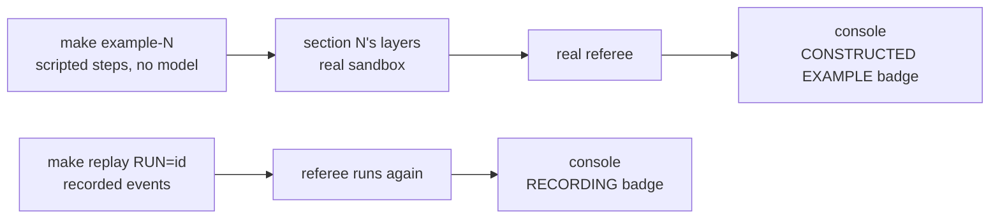

# Optional extras

> **Terms on this page**
>
> - **Harness layer**: one part of the harness: instructions, state, scope, or verification.
> - **Referee**: the program that scores each run after the agent stops.
> - **Console**: the browser page that shows a run live, on five screens.
> - **Constructed example**: a run whose agent turns are scripted steps, with no model.
> - **House rule 1: Tenant isolation**: a user sees only their own organization's data.
> - **Gate**: the check that must pass before a feature counts as done.
> - **Hidden tests**: tests the agent never sees; the referee runs them after the agent stops.
> - **Mutant**: a copy of the code with one small bug planted on purpose; good tests catch it.
> - **Turn budget**: the most turns (model replies) one session may use before it is stopped.

**Optional.** Nothing on this page is part of the class. Every demo in class is a live model run.
These extras show a harness layer catching a mistake without a live model run. Use them after class,
to see a failure the live runs did not happen to produce, or to study one mistake slowly.

| Extra | Command | Model calls | Badge on every screen |
|---|---|---|---|
| Constructed example | `make example-1` to `make example-4` | None, $0 | `CONSTRUCTED EXAMPLE: scripted steps, no model` |
| Replay of a recorded run | `make replay RUN=<id> PURPOSE=pilot` | None without the reviewer | `● RECORDING` |

Neither is ever counted in a result. `make replay` is also the class's emergency fallback: if a live
run fails for a reason outside the experiment (Docker, the network, OpenAI), the instructor replays a
recording, and every screen says RECORDING.



## Constructed examples

A constructed example runs section N's harness layers on its TeamTrack task, in the real sandbox,
scored by the real referee. The agent's turns are scripted steps that make the mistake the layer
exists to catch. There is no model and no API key, and it costs $0. Its score stays in the run folder
and never reaches `exports/`, so no report counts it.

| Command | Layers | The scripted mistake | What catches it |
|---|---|---|---|
| `make example-1` | instructions | Ships a search query without the org filter | The referee's check for House rule 1, and `⚠ other org` marks on screen 2 |
| `make example-2` | instructions, state | Runs out of turns in session 1 | The handoff at the stop; session 2 resumes from it |
| `make example-3` | instructions, state, scope | Edits shared middleware, then runs `pip install requests` | The scope layer blocks the patch; the sandbox denies the network command |
| `make example-4` | all four | Claims done while its own test fails | The gate refuses the first claim and accepts the second |

Docker must be running: `make doctor` shows `+ ok` on the `container runtime` line. Then, in two
terminals in the repository folder:

```bash
make console
make example-1
```

`make example-1` runs `uv run shipharness example --section demo-1 --profile class`. On the course
machine it printed these lines, among others, after the run id line:

> Your output will differ: run times, ids, and the agent's wording change on every run.

```text
  harness  completed         agent said done · House rule 1: Tenant isolation, new violations: 1 · primary measure failed · hidden tests 9 of 52 · mutants killed 0 of 4 · reviewer not run · cost $0.0000
What it demonstrates: the referee's R1 check reports the cross-org leak, and the board shows the other org's cards.
  instructions: agent read AGENTS.md
  instructions: agent read docs/design-docs/api-conventions.md
  agent: finish(done) in the build phase
  agent: finish(done) in the test phase
  referee: primary r1_new_violations>=1 FAIL {'r1_new_violations': 1}
  referee: Files outside the allowed paths (diff_scope), 1 new: violation app/web/routes.py is outside the allowed paths
Cost: $0.000000 (constructed example: scripted steps, no model calls)
```

`R1` and `r1_new_violations` in this output stand for House rule 1: the check counts
new places where one org can see another org's data.

The key lines of `make example-2` and `make example-3`, from the same day:

```text
  state: session 1 handoff written to session-handoff.md
  runner: session 1 stopped (turn_budget)
  runner: session 2 resumed
```

```text
  sandbox: DENIED network: pip install requests (the sandbox has no network; dependencies are already installed in the image)
```

In `make example-4` the gate's first answer is `verify: GATE FAIL`, with 1 of 11 items failed
(visible tests); after the test is fixed, the second answer is `verify: GATE PASS`.

How to check it worked: the last line is the `Cost: $0.000000 (constructed example: ...)` line, the
exit code is 0, and every console screen of the run carries the CONSTRUCTED EXAMPLE badge. A
constructed example says nothing about how often a real agent makes the mistake. It shows only that
the layer catches it when it happens.

How long it takes: on the course machine the four took from about 3 to about 12 minutes each, while
other runs shared the machine ([evidence](evidence/general.md#extras)).

## Replays of recorded runs

`make replay RUN=<id>` re-emits a recorded run's events with the RECORDING badge, applies the
recorded diffs, and runs the referee again. Without `--reviewer` it makes no model calls.

Four recorded test runs show a real mistake and what caught it. Their run folders exist only on the
instructor's machine, because `.shipharness/` is git-ignored; their ids are on the
[evidence page](evidence/general.md#extras).

| Section | What the recorded run shows |
|---|---|
| 1 | A harness arm added tenant leaks, which the tenant isolation check reports |
| 2 | A harness arm gave up after a short first session (since fixed) |
| 3 | The bare arm changed 2 files outside its allowed paths; the harness arm none |
| 4 | The bare arm claimed done with 68 of 69 hidden tests; the referee fails it |

On your machine, replay your own runs the same way. Take the id from the console's run list:

```bash
make replay RUN=<id> PURPOSE=pilot
```

It runs `uv run shipharness replay <id> --purpose pilot`. Without `PURPOSE`, replay runs as a class
command and needs `SHIPHARNESS_CLASS_DATE` in `.env`.

How to check it worked: the console lists a new run whose every screen carries the red
`● RECORDING` badge, and the referee's checks appear again on screen 3.

## If it fails

| Symptom | Fix |
|---|---|
| `make example-N` stops with a line starting `x` before any step | Usually no container runtime: start Docker, then `make doctor` |
| `! replay needs RUN=<ab or run id>` | Add `RUN=<id>` |
| `make replay` asks for `SHIPHARNESS_CLASS_DATE` | Add `PURPOSE=pilot` |
| Screen 2 of a replay shows broken images | [Troubleshooting, replay](troubleshooting.md#replay-and-swap-test) |
