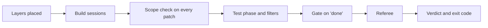

# Final project walkthrough: one live A/B, end to end

> **Terms on this page**
>
> - **Harness layer**: One part of the harness: instructions, state, scope, or verification.
> - **Bare arm**: An agent run with the ticket and the repository, and no harness.
> - **Harness arm**: The same run with the harness turned on.
> - **Referee**: The program that scores each run after the agent stops.
> - **Gate**: The checks the verify layer runs when the agent says done; the agent cannot skip them.
> - **Test phase**: The last session of an arm, in which the agent may only write tests.

## What this code does

`make final FEATURES=bulk-close` calls `shipharness ab --section final`. That one command runs the whole
course in one A/B: both arms start at the same time, the harness arm gets all four layers, and the
referee judges each arm as soon as it stops. This page follows one run through the code, in the
order things happen, with one short excerpt per step.



Each excerpt is quoted exactly from the file named in its first line. Where the code is marked as a
walkthrough anchor, `uv run python platform/scripts/anchors.py extract` followed by the anchor id
prints the whole marked block, for example `uv run python platform/scripts/anchors.py extract S3:allowed_paths`.

## The code, explained

### Step 1: two arms, one difference

```python
# platform/src/shipharness/ab/demo.py (lines 53-59)
SECTION_STACKS: dict[str, tuple[LayerName, ...]] = {
    "demo-1": ("instructions",),
    "demo-2": ("instructions", "state"),
    "demo-3": ("instructions", "state", "scope"),
    "demo-4": LAYER_ORDER,
    "final": LAYER_ORDER,
}
```

The final uses every layer, like Section 4: Verification. `LAYERS=-scope` removes one, which is how you test
whether a layer earns its place.

```python
# platform/src/shipharness/ab/demo.py (lines 443-452), anchor Opening:two_arms
        def run_and_judge(arm: Arm) -> tuple[AgentRunResult, ScoreRecord]:
            result = run_arm(task, specs[arm], deps, bus, run_dir)
            baseline.join()
            referee.baseline()  # computed by the thread (or now, if the thread failed)
            return result, _judge(referee, specs[arm], result, bus, run_dir)

        try:
            with ThreadPoolExecutor(max_workers=2, thread_name_prefix="arm") as pool:
                futures = {arm: pool.submit(run_and_judge, arm) for arm in arms}
                done = {arm: future.result() for arm, future in futures.items()}
```

Both arms run in parallel threads, each in its own container. Each arm is judged the moment it
stops, so a slow arm never holds back the other arm's verdict on screen 1.

### Step 2: the layers are placed

Before turn 1, each layer writes its files into the harness arm's workspace. The files are in
[harness/](harness/), byte for byte. The verify layer also records today's house-rule violations, so
the gate later counts only new ones:

```python
# platform/src/shipharness/harness/verify/layer.py (lines 175-187)
        cached = self._baseline_cache_path(ctx)
        if cached is not None and cached.is_file():
            self.baseline_json = cached.read_text(encoding="utf-8")
            note = "gate baseline reused (same checkpoint commit)"
            return [HarnessDecision(kind="note", layer="verify", message=note)]
        self.baseline_json = self._baseline(ctx)
        if self.baseline_json and cached is not None:
            cached.parent.mkdir(parents=True, exist_ok=True)
            partial = cached.with_suffix(".part")
            partial.write_text(self.baseline_json, encoding="utf-8")
            partial.replace(cached)
        note = "gate baseline recorded" if self.baseline_json else "gate baseline unavailable"
        return [HarnessDecision(kind="note", layer="verify", message=note)]
```

`make warm` fills this cache. Without it, the baseline runs every house-rule check in the arm's
container before the agent's first turn, and that time counts against `HARNESS_TIMEOUT_S` (900 s in
the class profile, `platform/src/shipharness/config/profiles.py`; 120 s in `.env.example`). Screen 1 shows which branch ran: "gate baseline reused", "recorded", or
"unavailable".

### Step 3: sessions end with a handoff

Feature 6: Watchers and Feature 7: Labels stop the build after the first session's turn budget (the most turns a session
may take); every feature ends its build with a
session stop before the test phase. The state layer writes the handoff and commits it:

```python
# platform/src/shipharness/harness/state/lifecycle.py (lines 100-111), anchor S2:stop_resume
    ws: Path = ctx.workspace
    summary, tests = machine_summary(ctx, result, files_changed, timeout_s)
    template = (ASSETS / HANDOFF).read_text(encoding="utf-8")
    write_file(ws, HANDOFF, handoff.merge(read_text(ws, HANDOFF), template, summary).encode())
    log = read_text(ws, PROGRESS) or (ASSETS / PROGRESS).read_text(encoding="utf-8")
    entry = progress.session_entry(result, len(files_changed), tests, claim)
    write_file(ws, PROGRESS, progress.append_session_entry(log, entry).encode())
    commit_paths(
        ctx.sandbox,
        [HANDOFF, PROGRESS],
        f"harness: session {result.index} handoff for {ctx.spec.feature_id}",
    )
```

The next session starts with an empty context. Its first message points at `session-handoff.md`,
so the work survives the stop. On screen 1 this is the "session stop" decision.

### Step 4: every patch passes the scope check

```python
# platform/src/shipharness/harness/scope/guard.py (lines 68-78), anchor S3:allowed_paths
    def reason(self, path: str) -> str | None:
        """None if the agent may change `path`; otherwise the reason it sees."""
        rel = normalise(path)
        if rel in HARNESS_ONLY:
            return HARNESS_ONLY[rel]
        if self.state_files and any(glob_matches(rel, p) for p in STATE_FILES):
            return None
        if self.allowed is None or any(glob_matches(rel, p) for p in self.allowed):
            return None
        listed = ", ".join(self.allowed) or "(none)"
        return f"{rel} is outside the allowed paths for the {self.phase} phase ({listed})"
```

The allowed paths come from the task, per phase (see [tasks/](tasks/f5-bulk-close.md)). A refused
patch is never applied; the agent sees the reason. `feature_list.json` is in `HARNESS_ONLY`: only the
harness sets `passes`.

### Step 5: the test phase and its filters

In the test phase the agent may only write tests. Each test it proposes goes through the filters,
and the first failure discards it:

```python
# platform/src/shipharness/filters/pipeline.py (lines 64-70), anchor S4:filters
            if not result.reason:
                result = result.model_copy(update={"reason": f"filter {flt.number}: no reason"})
            results.append(result)
            if bus is not None:
                bus.publish("test_filter_result", result, run_id=run_id, arm=arm)
            if not result.passed:
                break  # discarded: later (more expensive) filters never run
```

The five filters are Filter 1: Builds and collects, Filter 2: Passes five runs, Filter 3: Adds
coverage or catches a mutant (a mutant is a copy of the code with one planted bug), Filter 4: Real
assertions, and Filter 5: No source changes. Only kept tests ship.

### Step 6: the gate runs when the agent says done

```python
# platform/src/shipharness/harness/verify/gate.py (lines 170-179), anchor S4:gate
    clean = clean_state_check(
        sandbox, base_sha, cfg.limit(120), migrations=cfg.migrations, ruff_select=cfg.ruff_select
    )
    items.append(clean)
    if clean.status == "fail":
        lines.append(f"FAIL clean state: {clean.detail}")
    sandbox.exec(f"rm -rf {root}", cfg.limit(60))
    passed = not any(i.status == "fail" for i in items)
    feedback = "" if passed else _feedback(gate_id, items, lines)
    result = GateResult(gate_id=gate_id, items=items, passed=passed, feedback=feedback)
```

Before these lines, the gate runs the visible tests and, in the build phase, the seven house rules. If any item
fails, the agent gets the feedback instead of a finished run. The item names per phase are in
[harness/gate-items-build.txt](harness/gate-items-build.txt) and
[harness/gate-items-test.txt](harness/gate-items-test.txt).

### Step 7: the referee judges what shipped

```python
# platform/src/shipharness/ab/referee.py (lines 586-594)
        product = strip(diff)  # harness artifacts are state, not product changes
        patch = rdir / "product.patch"
        patch.write_bytes(product)
        apply_error = _apply(build, patch)
        restore_judge_config(build, config)  # the arm never configures how it is judged
        paths = [p for p in diff_paths(product) if p != "/dev/null"]
        allowed = self.task.allowed_paths
        scope_globs = [*allowed.get("build", []), *allowed.get("test", [])]
        out_of_scope = [p for p in paths if scope_globs and not _allowed(p, scope_globs)]
```

The referee starts from a fresh copy of the checkpoint, applies only the arm's product diff, and
puts its own test configuration back. Then it runs the house rules, the existing tests, the hidden
tests, and the mutants. It is the same code for both arms, and an aborted arm is judged too.

### Step 8: the verdict and the exit code

```python
# platform/src/shipharness/ab/commands.py (lines 172-175)
def _exit_code(statuses: list[str]) -> int:
    if any(s == "ERROR" for s in statuses):
        return 1
    return 2 if any(s.startswith("ABORTED") for s in statuses) else 0
```

Terminal 2 prints one line per arm and a cost line. Exit code 2 means an arm hit a time or cost
limit; it is still judged and shown. Exit code 1 means an arm could not run at all.

## If you copy this into your repo

- Keep the referee separate from the agent. It should start from a clean copy and apply only the
  diff, so the agent cannot change how it is judged.
- Cache anything expensive the harness does before turn 1, and give harness work its own time
  limit. Otherwise setup time is charged to the agent, as Step 2 shows.
- Judge both arms with one code path, and count aborted runs. Dropping them hides failures.
- Your own repository has no A/B runner. [your-repo/](your-repo/README.md) shows the parts that run
  anywhere: the kit, the house-rule check, and testgen with its filters.
