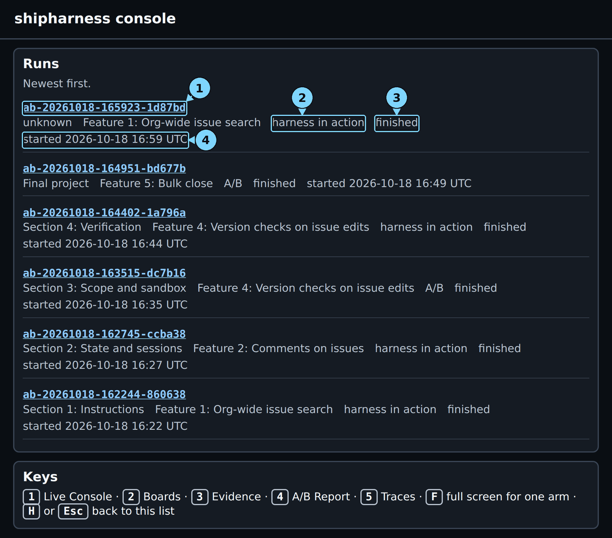
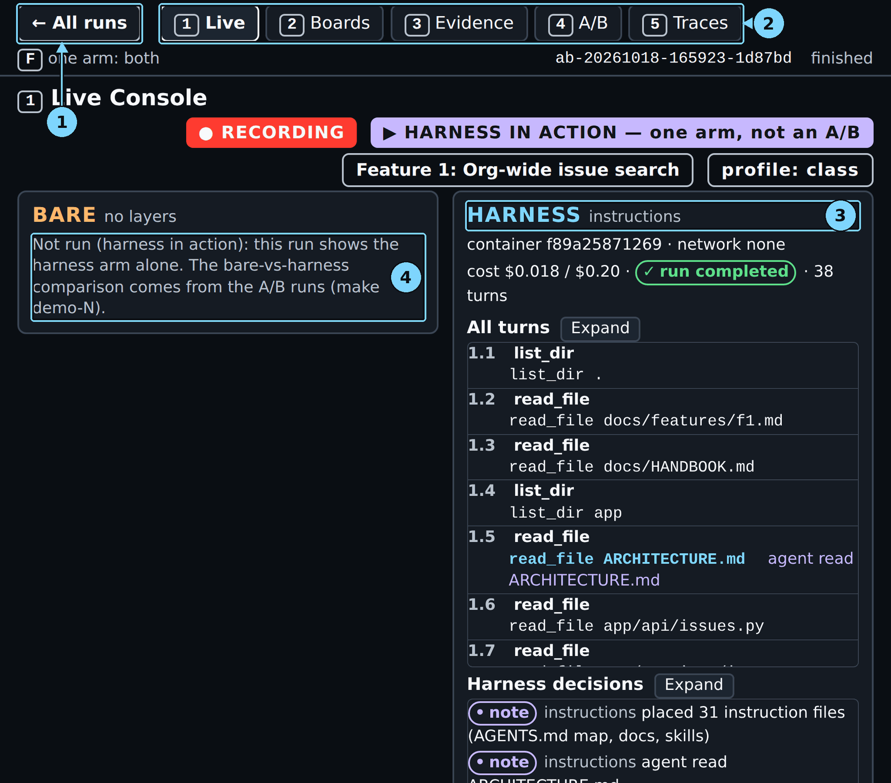

# Appendix: Cheat sheet, troubleshooting, glossary and fallback

## Command cheat sheet

Every command this guide uses, in the order the guide uses it. A demo's time is a range over two
runs of the command on 2026-10-18, with the class profile, each run alone on the machine: this
guide's run and a second run by a reviewer on a fresh clone. It runs from launch to the last arm's
full verdict; the command ends a few seconds later. The reviewer's runs have no recorded launch
time, so their times count from the run's first event plus the 6 to 8 s that the same command took
to write its first event in this guide's run. Two demos running at once make both slower. "At most"
is the cap from `.env.example`.

| Command | Where | What it does | Time and cost |
|---|---|---|---|
| `wsl -d Ubuntu`, then `cd ~/shipharness` | PowerShell | Opens Ubuntu in your copy | No cost |
| `uv run shipharness verify --tag class-v1` | Terminal 2 | Checks your copy against the class release | Seconds, no cost |
| `make doctor PURPOSE=pilot` | Terminal 2 | Checks tools, Docker, keys, models, prices | 6 s, no cost |
| `make warm PURPOSE=pilot` | Terminal 2 | Builds changed images, caches baselines | 431 s the first time, then about 2 s; no cost |
| `make console` | Terminal 1 | Serves the console on port 8765 | Runs until Ctrl+C; no cost |
| `make console VERBOSE=1` | Terminal 1 | The same, with one line per request | No cost |
| `make console CONSOLE_PORT=8766` | Terminal 1 | The console on another port | No cost |
| `make show-1 PURPOSE=pilot` | Terminal 2 | Chapter 1 demo: harness arm alone | 3:37 to 4:45; $0.020 to $0.021; at most $0.24 |
| `make show-2 SESSION_BUDGET=12,38 PURPOSE=pilot` | Terminal 2 | Chapter 2 demo: two sessions | 5:52 to 7:11; $0.036 to $0.044; at most $0.24 |
| `make demo-3 FEATURE=version-checks PURPOSE=pilot` | Terminal 2 | Chapter 3 demo: an A/B | 5:14 to 8:24; $0.050 to $0.056; at most $0.48 |
| `make show-4 PURPOSE=pilot` | Terminal 2 | Chapter 4 demo: harness arm alone | 5:32 to 8:02; $0.026 to $0.028; at most $0.24 |
| `make final FEATURES=bulk-close PURPOSE=pilot` | Terminal 2 | Chapter 5 demo: the final A/B | 7:25 to 9:10; $0.038 to $0.042; at most $0.58 |
| `make replay RUN=<run id> PURPOSE=pilot` | Terminal 2 | Shows a recorded run again | 2:06 (one run); $0, no model calls |

Console keys: `1` Live, `2` Boards, `3` Evidence, `4` A/B report, `5` Traces; `F` one arm full
width; "← All runs", `H` or Esc back to the run list. Reload the run list to see a new run.

## Troubleshooting

Find what you see in the first column. Every live command prints a `Cost:` line at the end; an exit
code of 2 after the results means an arm hit a cap or a time limit, and the run is still complete.

| Symptom | Cause | Fix |
|---|---|---|
| Console text or panels look cut off or too large | Browser zoom | Press `Ctrl+0`, then reload with `Ctrl+F5` |
| Console looks squeezed on a laptop screen | Windows display scaling | Nothing should be cut: press `Ctrl+0`, reload with `Ctrl+F5` |
| Console shows an older design | The browser cached the old style | Hard reload with `Ctrl+F5` |
| `address already in use` from `make console` | Another server holds port 8765 | `make console CONSOLE_PORT=8766`, then open port 8766 |
| The console header shows `reconnecting` | The console server stopped | Run `make console` again in Terminal 1, then reload |
| A new run is not in the run list | The list does not refresh by itself | Reload the page; the newest run is first |
| `No runs yet. Start one with make demo-1.` | The console started in another folder | Start `make console` in the repository folder |
| `permission denied` on `/var/run/docker.sock` | Your user is not in the `docker` group yet | `sudo usermod -aG docker $USER`, then `wsl.exe --shutdown` in PowerShell and reopen Ubuntu |
| `x SHIPHARNESS_CLASS_DATE is not set` | Class commands need the class day | Add `SHIPHARNESS_CLASS_DATE=YYYY-MM-DD` to `.env`, or add `PURPOSE=pilot` |
| `x missing agent model` from `make doctor` | The key cannot use the course model | Use the key from the program's email, or your own on the Build tier |
| `x OpenAI refused the key: ...; no arm was started` | Key invalid, model missing, or OpenAI unreachable | `make doctor` names the problem |
| `ABORTED: timeout` in a result line | The arm used its agent time (420 s) or harness time (900 s) | Nothing: the arm is scored and shown; read its verdict |
| `ABORTED: cap` in a result line | A model call would have crossed a cost cap | Nothing: scored and shown; the caps are in `.env.example` |
| `ERROR` with `docker run failed` | Docker stopped, or an image is missing | `sudo systemctl start docker`, then `make warm PURPOSE=pilot` |
| `make: command not found` | You are in PowerShell, not Ubuntu | Open the Ubuntu app (Part 0, Step 1) |
| `uv: command not found` | The terminal started before uv was installed | Open a new Ubuntu terminal |
| Screen 2 says `No board screenshot yet` all run long | The preview container did not start | Display only: the referee's board checks still run |
| Screen 4 does not show a `make show-N` run | A single-arm run has nothing to compare | Expected |
| `make replay` asks for `SHIPHARNESS_CLASS_DATE` | `make replay` uses the class purpose by default | Add `PURPOSE=pilot` |
| A replay's screen 2 shows broken images | Replay does not copy the board screenshots | Copy the recorded run's `screenshots/` folder into the replay's run folder, then reload |

Every other message, with the file that prints it, is in `docs/troubleshooting.md`.

## Glossary

- **A/B**: bare arm and harness arm on the same ticket, scored the same way.
- **Arm**: one agent run in an A/B. The bare arm has no harness; the harness arm has it.
- **Bare arm**: an agent run with the ticket and the repository, and no harness.
- **Baseline**: the results on the unchanged app, recorded once, so later checks count only new problems.
- **Blinded reviewer**: a separate model that reads a diff without knowing which arm wrote it.
- **Cap**: the most money a run, a review, or a session may spend on model calls.
- **Checkpoint tag**: a git tag such as `m1-s1-start` that marks the code a section starts from.
- **Class date**: the class day in `.env`; it names the LangSmith project and keys the session cap.
- **Class profile**: the settings of the live class runs, the same for both arms: low reasoning effort, the Fast tier, 2 CPUs, a 420 s agent time limit, a 900 s harness work limit.
- **Console**: the browser page that shows a run live, on five screens.
- **Cost line**: the `Cost:` line every live command prints at the end.
- **Full verdict**: the primary verdict plus every other check: hidden tests, mutants and review.
- **Gate**: the checks that run when the agent says done; a failure sends the claim back.
- **Harness**: the files and code around the agent that decide what it sees and may do.
- **Harness arm**: the same run with the harness turned on.
- **Harness in action**: the harness arm alone, live, scored by the referee (`make show-N`); not an A/B.
- **Harness layer**: one part of the harness: instructions, state, scope, or verification.
- **Hidden tests**: tests the agent never sees; the referee runs them after the agent stops.
- **LangSmith**: the tracing service that records every model call of a run.
- **Map**: a short `AGENTS.md` that says where each rule lives, instead of holding every rule.
- **Mutant**: a copy of the code with one small bug planted on purpose; a good test fails on it.
- **Pill**: a status badge on console screen 1, such as the primary verdict.
- **Primary measure**: the one question a section's run answers, fixed in writing before any run.
- **Primary verdict**: the referee's answer to the primary measure for one arm: PASS or FAIL.
- **Purpose**: the make variable that picks the LangSmith project and the cost session.
- **Recording**: a run shown again by `make replay`; every screen carries a `RECORDING` badge.
- **Referee**: the program that scores each run after the agent stops.
- **Replay**: showing a recorded run again and judging it again, with no model calls.
- **Sandbox**: the container the agent's commands run in, with no network, the same for both arms.
- **Session**: one stretch of agent work that starts with a fresh context.
- **Session turn budget**: the number of turns a session gets before the runner stops it.
- **Test filters**: the checks a test from the test phase must pass to be kept.
- **Ticket**: the task the agent gets, written like a work ticket.
- **Trace**: the recorded steps of a run, each model call and tool call, in LangSmith.
- **Turn**: one model reply, with the tool calls it makes.

## Fallback: replay a recorded run

Use this when a live run cannot start in class: no network, a key problem, or no time left. A
replay shows a run recorded earlier on every screen, and the referee judges it again. It makes no
model calls and costs nothing; the blinded reviewer does not run. Here you replay the run of
Section 1: Instructions that Chapter 1 follows.

### Step 1: Find the run id of the recorded run

**Where:** browser, the console's run list

**Type:** Press `H` to go to the run list, and find the card of the Section 1 run: type "harness
in action", Feature 1: Org-wide issue search.

**You should see:** the card with its run id and start time. Every copy has its own ids: in this
guide's runs it was `ab-20261018-162244-860638`, started 16:22 UTC, and on your copy it is the id
of your own Chapter 1 run. The same id is on the `A/B ab-…` line that Terminal 2 printed at the end
of Chapter 1.

**Look at:** the run id: it starts with `ab-`, then the date and time of the run. Write it down;
the next two steps use it as the recorded id.

**What it means:** every run keeps its events, diff and scores in its own folder under
`.shipharness/runs/`, named by its run id, so it can be shown again.

> [!CHECKPOINT]
> You have the id of a finished run.

> [!IFDIFFERENT]
> No Section 1 run in the list → use any finished run; the replay works the same on every run.

> [!INSTRUCTOR]
> Pick the fallback run before class and write its id in your notes, so you never search for it
> live.

### Step 2: Start the replay

**Where:** Terminal 2

**Type:** put your recorded id from Step 1 in a shell variable, then start the replay. Replace
`<recorded id>` with that id, angle brackets included:

```bash
REC=<recorded id>
make replay RUN=$REC PURPOSE=pilot
```

**You should see:** a `RECORDING:` line with the new run id, then, when the referee is done, the
arm's result line and the cost line. It took 2:06 in this guide's run, where the recorded id was
`ab-20261018-162244-860638`:

> Your output will differ: run times, ids, and the agent's wording change on every run.

```text
uv run shipharness replay ab-20261018-162244-860638 --purpose pilot
RECORDING: replay ab-20261018-165923-1d87bd of ab-20261018-162244-860638 (195 events)
  harness  completed         agent said done · House rule 1: Tenant isolation, new violations: 0 · primary measure passed · hidden tests 52 of 52 · mutants killed 3 of 4 · reviewer not run · cost $0.0178
Cost: $0.000000 (this command: no calls; session $0.183679 of $2.50; build $0.183679 of $15.00 ($14.816321 left))
```

**Look at:** `reviewer not run` in the result line, and `this command: no calls` in the cost line.
Then the `RECORDING:` line: the id after `replay` is the replay id, which Step 3 needs
(`ab-20261018-165923-1d87bd` in this guide's run).

**What it means:** the replay plays the 195 recorded events into a new run folder, marked as a
recording, and the referee judges the same diff again. The `cost $0.0178` in the result line is
what the agent cost when it was recorded; this command spent $0.

> [!CHECKPOINT]
> The cost line says `this command: no calls`, and the `RECORDING:` line names the new run id.

> [!IFDIFFERENT]
> `x no recorded A/B for` that id → the id is not in your `.shipharness/runs/`, for example an id copied from this guide. Copy the id from your own run list, set `REC` again, and rerun.
> `RUN=` is empty → `REC` is not set in this terminal; run the `REC=` line again.
> It asks for `SHIPHARNESS_CLASS_DATE` → add `PURPOSE=pilot` as above.

> [!INSTRUCTOR]
> Say it plainly: "This is a recording of a real run, not a live one." The console says so too.
> The referee's verdict matches the recorded one: 52 of 52 hidden tests, 3 of 4 mutants killed.

### Step 3: Copy the board screenshots into the replay

**Where:** Terminal 2

**Type:** in the same terminal, so `REC` is still set, put the replay id from the `RECORDING:`
line in a second variable, then copy. Replace `<replay id>` with that id, angle brackets included:

```bash
NEW=<replay id>
cp -a .shipharness/runs/$REC/screenshots .shipharness/runs/$NEW/
```

**You should see:** no output; the prompt comes back.

**Look at:** the two ids: `REC` is the recorded run (Step 1, the run list card), `NEW` is the
replay (the `RECORDING:` line, or the top card of the run list after a reload).

**What it means:** a replay does not copy the board screenshots that screen 2 shows. This command
copies them from the recorded run.

> [!CHECKPOINT]
> The command prints nothing and returns at once.

> [!IFDIFFERENT]
> `No such file or directory` → check both ids with `echo $REC $NEW`; the second one is the id after `replay` on the `RECORDING:` line.

> [!INSTRUCTOR]
> Do this right after the replay ends, before you open screen 2.

### Step 4: Open the replay from the run list

**Where:** browser, the console's run list

**Type:** Reload the page with `F5`, then click the run id on the top card.

**You should see:** the replay as the newest card:



*The replay is a new run at the top of the list; the recorded Section 1 run stays at the bottom.*

1. Run id: open the run
2. Type: harness in action or A/B
3. Status
4. Start time

**Look at:** the type, "harness in action", and the status, "finished".

**What it means:** the replay is a run of its own, with its own id, next to the run it plays.

> [!CHECKPOINT]
> The top card has the id from the `RECORDING:` line.

> [!IFDIFFERENT]
> The card's section reads "unknown" → this is how the run list labels a replay; the feature and type are right.
> No new card → reload again; the list does not refresh by itself.

> [!INSTRUCTOR]
> Point at the top card and the bottom card: the replay and the run it plays are the same agent
> run.

### Step 5: Walk the screens of the recording

**Where:** browser, the console

**Type:** Press `1`, then `2` to `5` as in Chapter 1.

**You should see:** the same screens as a live run, each with the red `● RECORDING` badge in its
header:



*Screen 1 of the replay: the badge says RECORDING, and the panels show the finished run.*

1. ← All runs: back to the run list
2. Screen tabs 1 to 5
3. Harness arm line: its layers
4. Bare arm: Not run (harness in action)

**Look at:** the `● RECORDING` badge next to the screen title, on every screen.

**What it means:** every screen reads the recorded events, so you can teach the chapter as written,
screen by screen.

> [!CHECKPOINT]
> Every screen shows the `● RECORDING` badge, and screen 2 shows the board screenshots.

> [!IFDIFFERENT]
> Screen 2 shows broken images → do Step 3, then reload.

> [!INSTRUCTOR]
> Follow Chapter 1 from "Open the run" onwards. Skip the waiting steps: a recording shows the
> finished state at once.
