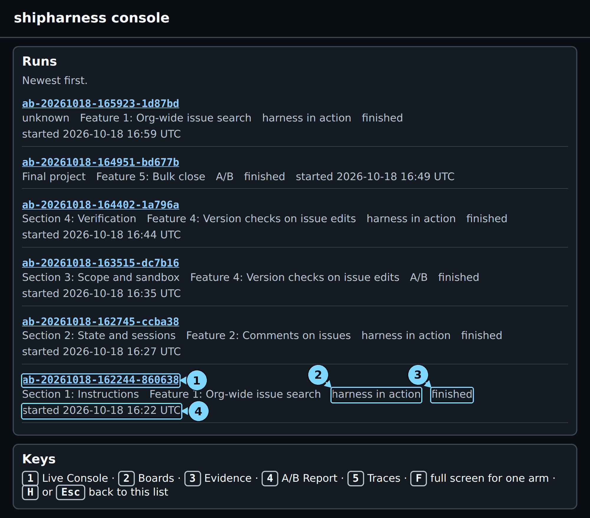
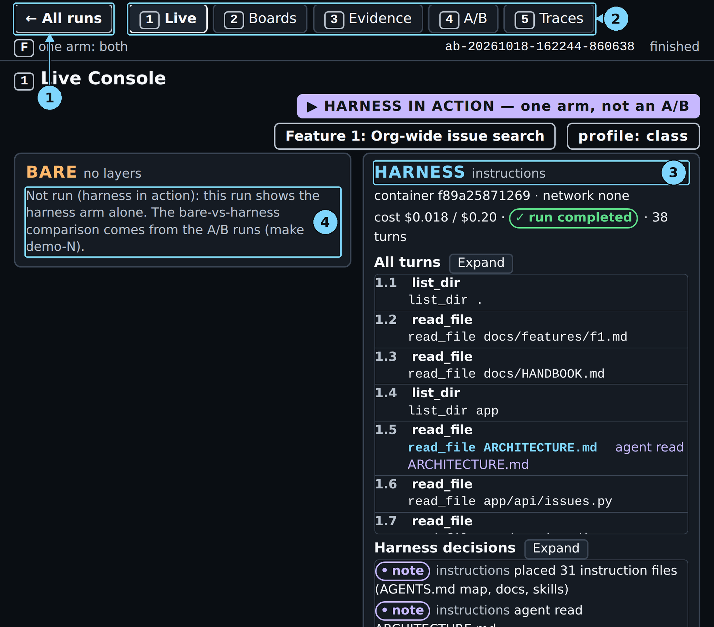
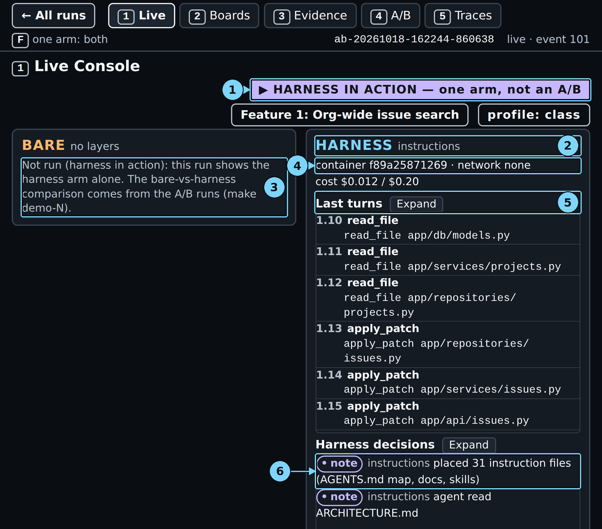
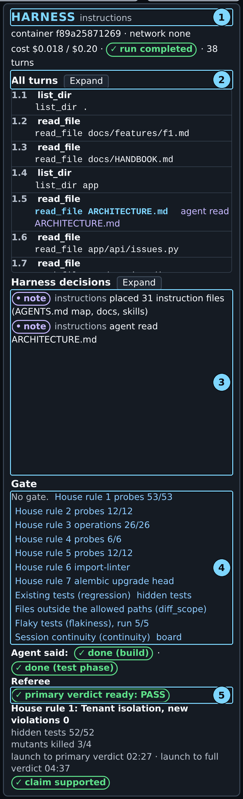
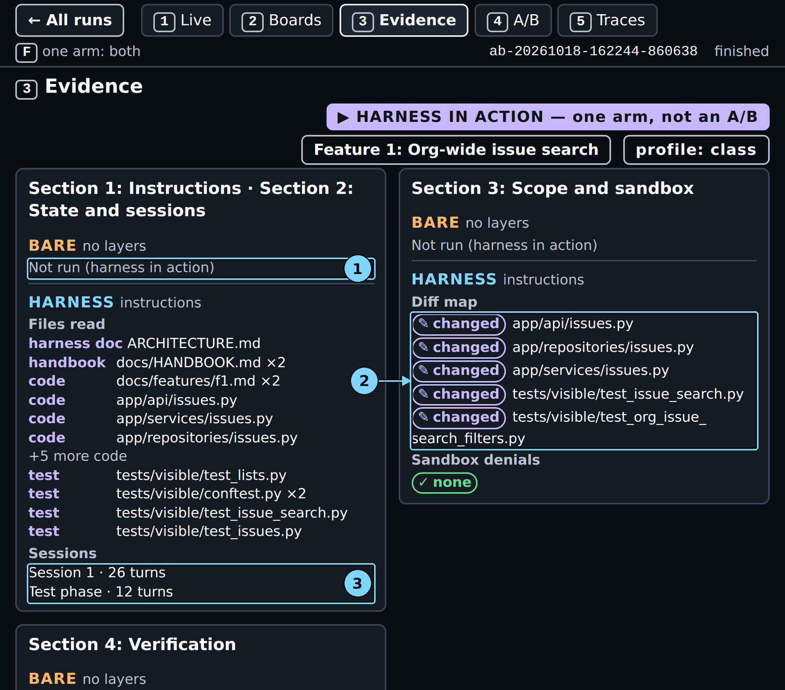
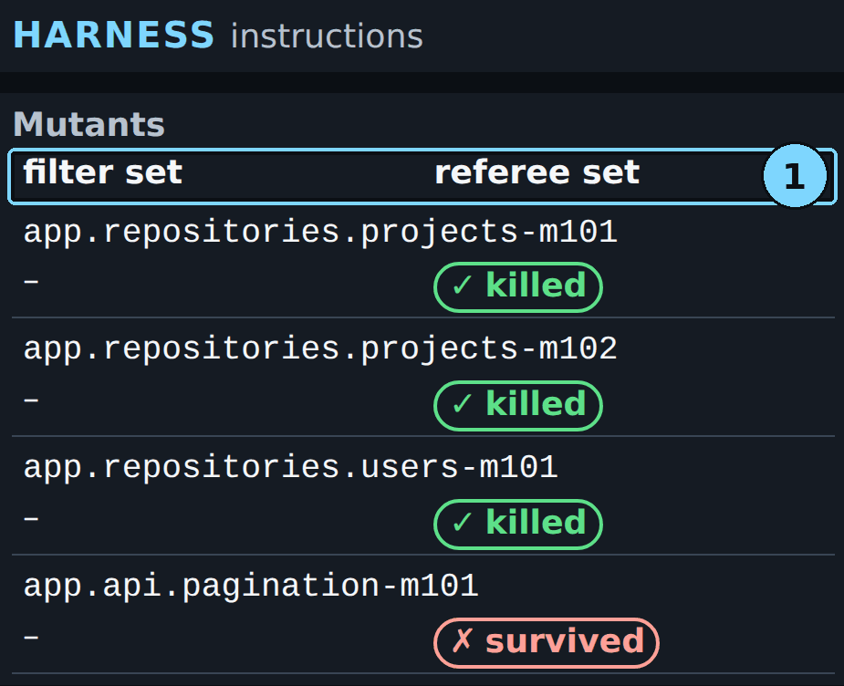
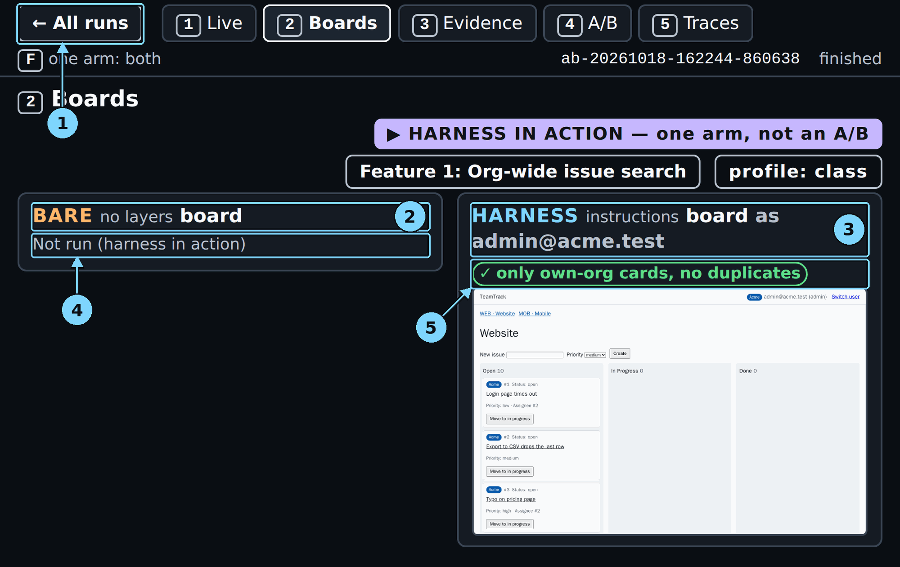
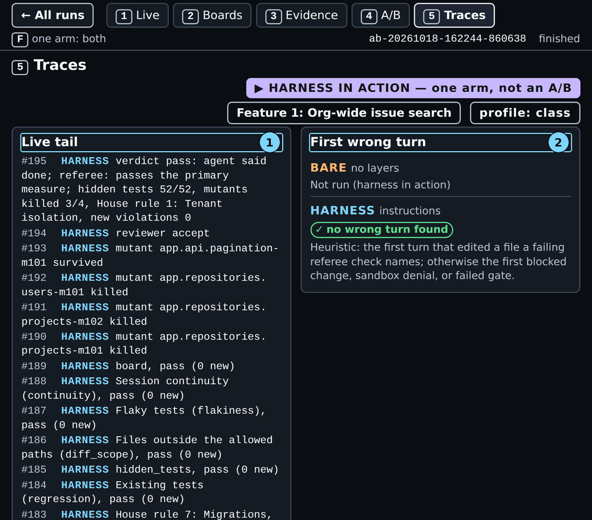
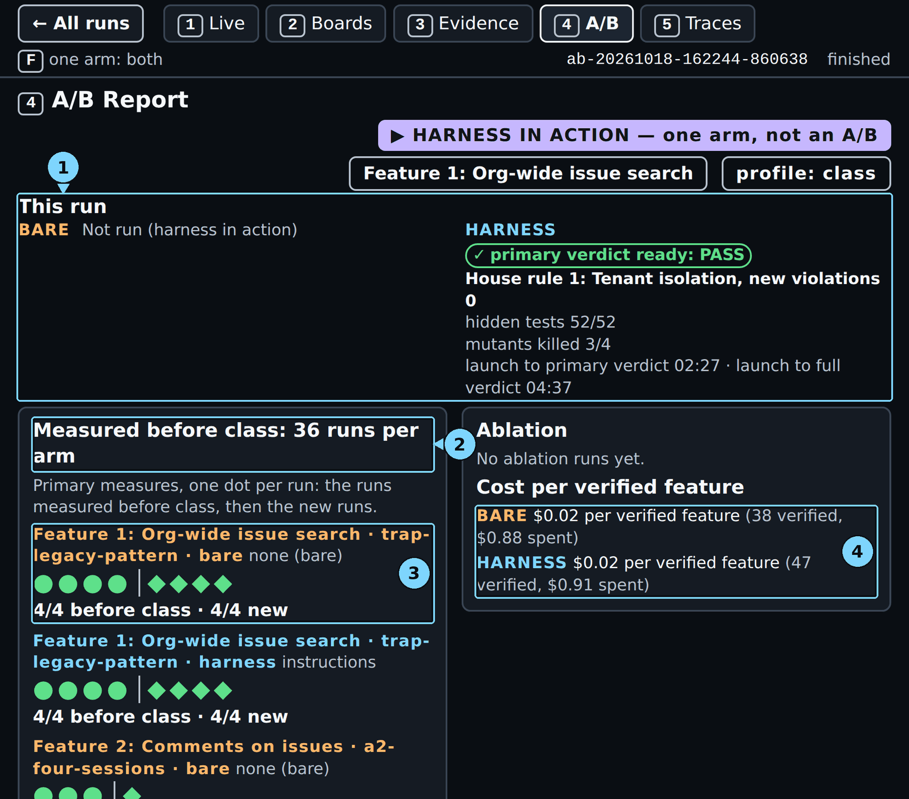

# Chapter 1: Section 1: Instructions

A coding agent is asked to add an org-wide issue search to a multi-tenant tracker. It finds an old list handler with no org filter and copies it, and the tests still pass. One customer can then see another customer's issues. In this chapter you run `make show-1`: the harness arm alone, live, on Feature 1: Org-wide issue search, with the instructions layer on (a short `AGENTS.md` map, focused documents, and one skill). You watch which files the agent opens. Then you read the referee's answer to one question: did the change add a new violation of House rule 1: Tenant isolation (another org's resource answers 404, never 403)?

Every number, quote and screenshot in this chapter comes from one live run of `make show-1 PURPOSE=pilot` on 2026-10-18, run `ab-20261018-162244-860638`, with nothing else running on the machine.

> Your output will differ: run times, ids, and the agent's wording change on every run.

### Step 1: Check the console and the run list

**Where:** browser, the console's run list

**Type:** Click the console tab in your browser. If it shows a run, click "← All runs" or press H.

**You should see:** the page "shipharness console", with the "Runs" panel ("Newest first.") and the "Keys" panel.

**Look at:** the top card in "Runs". Note its start time, so you can tell the new run apart in Step 4.

**What it means:** Terminal 1 still runs `make console` (Part 0). The console reads the run folders on disk, so a new run appears as soon as it writes its first event.

> [!CHECKPOINT]
> The run list loads, and the "Keys" panel lists 1 Live Console to 5 Traces.

> [!IFDIFFERENT]
> - The page does not load → Terminal 1 stopped. Run `make console` again there, then reload.
> - `address already in use` in Terminal 1 → another program holds port 8765. Run `make console CONSOLE_PORT=8766` and open that port.

> [!INSTRUCTOR]
> Put this tab and Terminal 2 side by side on the shared screen. Say: "One terminal starts the run; the browser shows it."

### Step 2: Start the run

**Where:** Terminal 2, in the repository folder

**Type:**

```bash
make show-1 PURPOSE=pilot
```

**You should see:** make prints the command it runs, then nothing more for a few minutes:

```text
uv run shipharness ab --section demo-1 --feature org-search --arms harness   --purpose pilot \
  --profile class
```

**Look at:** `--arms harness`. Only the harness arm runs.

**What it means:** `make show-1` starts one agent in a container on the Feature 1 ticket. The map, the documents and the skill are placed in its workspace. When the agent stops, the referee scores what it shipped, House rule 1 first, then everything else. `PURPOSE=pilot` sends the traces to the practice project in LangSmith (the tracing service). In class, set `SHIPHARNESS_CLASS_DATE` in `.env` and run `make show-1` alone.

> [!CHECKPOINT]
> The `uv run shipharness ab` line appears and the prompt does not come back.

> [!IFDIFFERENT]
> - `x OpenAI refused the key`, no arm started → fix `OPENAI_API_KEY` in `.env`, then run `make doctor`.
> - `x SHIPHARNESS_CLASS_DATE is not set` → add the class day to `.env`, or add `PURPOSE=pilot`.
> - The prompt comes back at once with `docker run failed` → start Docker (`sudo systemctl start docker`), then run `make warm`.

> [!INSTRUCTOR]
> Launch on the Section 1 start slide, one minute in. This run took 4 min 45 s (two runs that ran alone: 3:37 to 4:45), so it ends long before the DEMO slide. One run costs at most $0.24: the per-arm cap plus the per-review cap, both in `.env.example`.

### Step 3: Wait while it runs

**Where:** Terminal 2

**Type:** Nothing. Leave Terminal 2 alone.

**You should see:** no new lines until the end. In this run the command ended 4 min 45 s after launch.

**Look at:** the browser instead (next step).

**What it means:** the command prints the run id only at the end, so you find the run through the console's run list.

> [!CHECKPOINT]
> No error line in Terminal 2.

> [!IFDIFFERENT]
> - Nothing seems to happen for several minutes → run `docker ps` in another terminal. The agent and referee containers stay listed while the run works.

> [!INSTRUCTOR]
> At section minute 15, glance at Terminal 2 for the `Cost:` line. If it is not there yet, carry on teaching.

### Step 4: Reload the run list

**Where:** browser, run list

**Type:** Reload the page (Ctrl+R).

**You should see:** a new card at the top of "Runs", with the type "harness in action" and the status "running".



*The show-1 card after the run finished. It is at the bottom here because five later runs started after it.*

1. Run id: open the run
2. Type: harness in action or A/B
3. Status
4. Start time

**Look at:** the type and the status on the new card.

**What it means:** "harness in action" means one arm, not an A/B. Its result stays out of every bare-versus-harness comparison.

> [!CHECKPOINT]
> The top card says "Section 1: Instructions", "Feature 1: Org-wide issue search", "harness in action" and "running", with today's start time.

> [!IFDIFFERENT]
> - No new card → wait 10 seconds and reload again; the card appears with the run's first event.
> - The top card is an older run → compare the start time with Step 1, and check Terminal 2 for an error.

> [!INSTRUCTOR]
> Say: "This list does not refresh by itself. Reload after every launch."

### Step 5: Open the run

**Where:** browser, run list

**Type:** Click the run id on the top card, then press 1.

**You should see:** screen 1, "Live Console", with the badges "HARNESS IN ACTION — one arm, not an A/B", "Feature 1: Org-wide issue search" and "profile: class".



*Screen 1 of this run. The left panel is the bare arm, the right panel the harness arm.*

1. ← All runs: back to the run list
2. Screen tabs 1 to 5
3. Harness arm line: its layers
4. Bare arm: Not run (harness in action)

**Look at:** the left panel, BARE: "Not run (harness in action): this run shows the harness arm alone. The bare-vs-harness comparison comes from the A/B runs (make demo-N)."

**What it means:** in a single-arm run no bare agent starts. Every screen says "Not run (harness in action)" for the bare arm instead of an empty result. The comparison with the bare arm comes from the runs before class, on screen 4.

> [!CHECKPOINT]
> The right panel, HARNESS instructions, shows a container line ("container … · network none") and a cost line ("cost … / $0.20").

> [!IFDIFFERENT]
> - "no container yet" → the container is still starting; wait a few seconds.
> - The keys do nothing → click once on the page so it has focus, then press 1.

> [!INSTRUCTOR]
> Point at the bare panel: "No bare arm today. Before class we compared both arms on this ticket and found no measurable difference. Today shows the map at work."

### Step 6: Read the first harness notes

**Where:** browser, screen 1, right panel

**Type:** Press 1, if you are on another screen.

**You should see:** under "Harness decisions": "• note instructions placed 31 instruction files (AGENTS.md map, docs, skills)".



*Early in the run (the run's log replayed to event 101): the agent has read the documents and starts writing code.*

1. HARNESS IN ACTION badge, or the feature
2. Harness arm line: its layers
3. Bare arm: Not run (harness in action)
4. Container line
5. Last turns
6. Harness decisions: the layer notes

**Look at:** the note "placed 31 instruction files".

**What it means:** before the agent's first turn, the instructions layer copied the map, the documents and the skill into the workspace. The map goes into the agent's context in every session. The documents and the skill body stay on disk until the agent opens them.

> [!CHECKPOINT]
> "placed 31 instruction files" is the first harness decision.

> [!IFDIFFERENT]
> - "Harness decisions: None yet." → the first note comes about a second after the container starts; wait.

> [!INSTRUCTOR]
> Say: "The map is about 100 lines and points outward. The bare arm has every rule too, in one long handbook."

### Step 7: Watch which files the agent opens

**Where:** browser, screen 1, right panel

**Type:** Click "Expand" next to "Last turns" ("All turns" once the run has ended). Scroll inside the list.

**You should see:** one row per tool call. In this run: `1.2 read_file docs/features/f1.md`, `1.3 read_file docs/HANDBOOK.md`, `1.4 list_dir app`, then `1.5 read_file ARCHITECTURE.md`, highlighted, with "agent read ARCHITECTURE.md" next to it. The code reads follow: `app/api/issues.py`, `app/services/issues.py`, and more. At turn 1.13 the agent starts writing code with `apply_patch`.

**Look at:** the highlighted row 1.5 and the matching second note under "Harness decisions": "agent read ARCHITECTURE.md".

**What it means:** a highlighted row is a read of a file the layer placed. The layer adds a note the first time the agent reads each such file. A note never blocks the agent. In this run the agent read the architecture document the map points to, and did not open the skill. A file read through a shell command, such as `cat`, does not appear.

> [!CHECKPOINT]
> At least one "agent read …" note under "Harness decisions".

> [!IFDIFFERENT]
> - Only the "placed" note → the agent read nothing the layer placed. That is a result: say so.
> - The list does not scroll → click inside it first, or click "Expand".

> [!INSTRUCTOR]
> Say: "Watch which files it opens before it writes code." In this run it read the architecture document, not the skill. If a run opens the skill, the note reads "agent read skill add-endpoint (tier 2)". If it does not, say that the map offered the skill and the agent did not need it.

### Step 8: Read the gate area

**Where:** browser, screen 1, right panel

**Type:** Scroll the right panel down to "Gate".

**You should see:** "No gate." and then the referee's checks as they run: "House rule 1 probes 53/53", "House rule 2 probes 12/12", "House rule 3 operations 26/26", "House rule 4 probes 6/6", "House rule 5 probes 12/12", "House rule 6 import-linter", "House rule 7 alembic upgrade head", "Existing tests (regression)", "hidden tests", "Files outside the allowed paths (diff_scope)", "Flaky tests (flakiness), run 5/5", "Session continuity (continuity)", "board". <!-- check-style: allow SC22 quoted console labels, full names in Step 14 -->

**Look at:** "No gate." and the first label, "House rule 1 probes 53/53".

**What it means:** Section 1 has no verification layer, so nothing checks the agent's "done" before it stops. The labels after "No gate." are the referee's checks after the run. House rule 1 runs first, because it decides the primary verdict.

> [!CHECKPOINT]
> "No gate." is shown and, after the run ends, "House rule 1 probes" comes first.

> [!IFDIFFERENT]
> - A "Gate refused 'done'" line → you opened a Section 4: Verification run. Press H and open the Section 1 card.

> [!INSTRUCTOR]
> Say: "No gate here. The agent decides when it is done. Section 4 adds the gate."

### Step 9: Read "Agent said"

**Where:** browser, screen 1, right panel

**Type:** Look below "Gate".

**You should see:** "Agent said: ✓ done (build) · ✓ done (test phase)". The cost line above reads "cost $0.018 / $0.20 · ✓ run completed · 38 turns".

**Look at:** the "Agent said:" pills, one per phase.

**What it means:** this is the agent's own claim, per phase. After it said done in the build phase, the agent had a short test phase in which it may only add tests, and it said done again; then the run ended. A run that claims in the build phase only reads just "Agent said: ✓ done". The claim is not the score; the referee decides.

> [!CHECKPOINT]
> "Agent said:" shows "done", "not done" or "no claim", with "(build)" and "(test phase)" when the agent also claimed in the test phase.

> [!IFDIFFERENT]
> - "– no claim" → the agent stopped without saying done (turn limit or time limit). The referee still scores what it shipped.

> [!INSTRUCTOR]
> If it says "no claim": "The agent never said done. The referee scores the code anyway. A missing claim is not a House rule 1 failure."

### Step 10: Read the primary verdict

**Where:** browser, screen 1, right panel

**Type:** Look at "Referee", next to "Agent said".

**You should see:** "✓ primary verdict ready: PASS", then "House rule 1: Tenant isolation, new violations 0".

**Look at:** the referee pill.

**What it means:** the referee called every endpoint as an Acme user with Globex ids and expected 404. PASS means no new endpoint shows another org's data. The legacy `/v1/issues` leak is in the starting code, so it does not count as new.

> [!CHECKPOINT]
> The pill says "primary verdict ready", with PASS or FAIL.

> [!IFDIFFERENT]
> - "⏳ referee pending" → the agent is still running or the referee is starting; wait.
> - "primary verdict ready: FAIL" → a real result. Go to screen 3 to see which check failed.

> [!INSTRUCTOR]
> On PASS: "No new tenant leak. One run shows the layer ran, not that it helped." On FAIL: "A leak shipped with the map in place. That is a result." Show screen 3 next. Do not rerun to get a PASS.

### Step 11: Read the full verdict

**Where:** browser, screen 1, right panel

**Type:** Wait until "secondary checks running" is replaced by the full verdict.

**You should see:** "hidden tests 52/52", "mutants killed 3/4", "launch to primary verdict 02:27 · launch to full verdict 04:37", and the pill "✓ claim supported".



*The harness panel at the end: two notes, no gate, the claim and the referee.*

1. Harness arm line: its layers
2. Turns list
3. Harness decisions
4. Gate list
5. Referee pill (harness)

**Look at:** the hidden tests count and "claim supported".

**What it means:** hidden tests are tests the agent never sees. A mutant is a copy of the code with one small bug planted on purpose; a good test catches (kills) it. "Claim supported" means the agent's "done" matches the referee's result. The console counts its times from the run's first event, which came 8 seconds after you pressed Enter, so the times from the moment you launch are 2 min 35 s and 4 min 45 s.

> [!CHECKPOINT]
> Both times are shown, and "claim supported" or "claim not supported" appears.

> [!IFDIFFERENT]
> - "claim not supported" → the agent said done and the referee disagrees. Say so; that is the Section 4 story.

> [!INSTRUCTOR]
> Say: "This is one harness arm on one run. It tells us the layer ran; it cannot tell us the layer helped. That needs the A/B."

### Step 12: Open screen 3, files read and sessions

**Where:** browser, screen 3 (press 3), left column

**Type:** Press 3.

**You should see:** the column "Section 1: Instructions · Section 2: State and sessions". Under BARE: "Not run (harness in action)". Under HARNESS: "Files read" by group, then "Sessions": "Session 1 · 26 turns" and "Test phase · 12 turns".



*Screen 3: what the agent read, its sessions, and what it changed.*

1. Bare arm: Not run (harness in action)
2. Diff map (harness)
3. Sessions, including the test phase

**Look at:** the first rows of "Files read": "harness doc ARCHITECTURE.md" and "handbook docs/HANDBOOK.md ×2". There is no skill row.

**What it means:** "Files read" lists only `read_file` calls, grouped as harness doc, handbook, code and test. This agent read the architecture document from the map and also the long handbook that both arms have. The test phase is the short second session after the build.

> [!CHECKPOINT]
> At least one "harness doc" or "skill" row under "Files read".

> [!IFDIFFERENT]
> - "Nothing read yet." → the run has not started its first turn; go back to screen 1.

> [!INSTRUCTOR]
> Say: "This list explains a result; it does not score it. The score is what the referee finds in the shipped code."

### Step 13: Screen 3, what the agent changed

**Where:** browser, screen 3, middle column "Section 3: Scope and sandbox"

**Type:** Look at the middle column.

**You should see:** "Diff map" with five "✎ changed" rows: `app/api/issues.py`, `app/repositories/issues.py`, `app/services/issues.py`, `tests/visible/test_issue_search.py`, `tests/visible/test_org_issue_search_filters.py`. Below: "Sandbox denials ✓ none".

**Look at:** that every changed file is an issues API, service or repository file, or a test.

**What it means:** the agent changed only the files the ticket needs. Section 1 has no scope layer; the referee checks the paths after the run.

> [!CHECKPOINT]
> "Sandbox denials ✓ none".

> [!IFDIFFERENT]
> - A "⊘ denied" row → the sandbox refused a command, for example a network call. Read the reason code on the row.

> [!INSTRUCTOR]
> Keep this short; Section 3 is about this column.

### Step 14: Screen 3, the referee checks and the reviewer

**Where:** browser, screen 3, right column "Section 4: Verification"

**Type:** Look at the right column, then scroll down to "Mutants".

**You should see:** one row per referee check, each with "✓ 0 new": House rule 1 to House rule 7, "Existing tests (regression)", "hidden tests", "Files outside the allowed paths (diff_scope)", "Flaky tests (flakiness)", "Session continuity (continuity)", "board check". Then "✓ reviewer accept tenant risk none · The new GET /issues endpoint implements org-scoped, cursor-paginated issue search with the required filters and validation. …". Then the mutants table: three "✓ killed", and `app.api.pagination-m101` "✗ survived".



*The mutants table. Section 1 has no test filters, so the filter set column shows a dash.*

1. Mutants (harness): filter set and referee set

**Look at:** the House rule 1 row, then the reviewer line.

**What it means:** the seven house rules are House rule 1: Tenant isolation, House rule 2: Roles, House rule 3: API conventions, House rule 4: Safe retries, House rule 5: Audit log, House rule 6: Layering and House rule 7: Migrations. The referee is a program: it probes, runs tests and counts. The reviewer is a model that reads the change blinded (it does not know which arm wrote it) and gives its own verdict and reason. Here both agree. One mutant in the pagination code survived: the referee's test run did not catch that planted bug.

> [!CHECKPOINT]
> The House rule 1 row reads "✓ 0 new".

> [!IFDIFFERENT]
> - A row with "✗ … new" → that check found new violations. Hover the row for the full name and the number of probes.
> - No reviewer line → the review is still running, or it hit its cost cap.

> [!INSTRUCTOR]
> If the reviewer rejects: "The reviewer and the referee disagree. The referee's score stands; the reviewer's reason is a lead for code review." Point at "tenant risk". In this run it accepted, with tenant risk none.

### Step 15: Open screen 2, the board

**Where:** browser, screen 2 (press 2)

**Type:** Press 2.

**You should see:** BARE "Not run (harness in action)". HARNESS "board as admin@acme.test", the pill "✓ only own-org cards, no duplicates", and the TeamTrack board with Acme cards only.



*Screen 2: no card from another org on the board.*

1. ← All runs: back to the run list
2. Bare board heading
3. Harness board heading: signed in as one user
4. Bare arm: Not run (harness in action)
5. Harness board marks

**Look at:** the pill above the screenshot.

**What it means:** the console takes a board screenshot as an Acme user every 5 seconds. A card from another org would carry a "⚠ other org" mark. Feature 1 changes no board pixels, so the board shows one frame.

> [!CHECKPOINT]
> "only own-org cards, no duplicates".

> [!IFDIFFERENT]
> - "No board screenshot yet" → the preview container has not taken one; wait 5 seconds.

> [!INSTRUCTOR]
> Say: "This feature changes no board pixels, so there is one frame. The board matters in later sections."

### Step 16: Open screen 5, traces

**Where:** browser, screen 5 (press 5)

**Type:** Press 5.

**You should see:** "Live tail", whose newest line is "#195 HARNESS verdict pass: agent said done; referee: passes the primary measure; …". "First wrong turn" shows "✓ no wrong turn found". "LangSmith" shows an agent link and a referee link.



*Screen 5: where you look for the first wrong turn.*

1. Live tail
2. First wrong turn

**Look at:** "First wrong turn".

**What it means:** the console marks the first turn that edited a file a failing check names. With no failing check, there is none. The LangSmith links open every model call of the agent and of the referee's review.

> [!CHECKPOINT]
> Two LangSmith links under HARNESS: "agent" and "referee".

> [!IFDIFFERENT]
> - "No trace link yet." → the links arrive at the start of the run and of the referee; reload the page.

> [!INSTRUCTOR]
> On a FAIL, this screen names the turn to open. Click the agent link and go to that turn.

### Step 17: Open screen 4, the comparison from before class

**Where:** browser, screen 4 (press 4)

**Type:** Press 4. Scroll the left panel to see all features.

**You should see:** "This run" at the top: BARE "Not run (harness in action)" and HARNESS with the same referee lines as screen 1. Below, "Measured before class: 36 runs per arm", one dot per run. The two Feature 1 rows (`trap-legacy-pattern`, the ticket with the legacy handler) each show four filled dots and "4/4 before class".



*Screen 4: the comparison comes from the runs before class, not from this run.*

1. This run
2. Measured before class
3. Dots per run
4. Cost per verified feature

**Look at:** the two Feature 1 rows: 4/4 for the bare arm and 4/4 for the harness arm.

**What it means:** this run is not a dot. The dots are the runs before class. On this ticket both arms passed in every run: no measurable difference on this task with this model.

> [!CHECKPOINT]
> "This run" matches screen 1, and both Feature 1 rows are shown.

> [!IFDIFFERENT]
> - No dots → the console has no before-class records to read. Check that `docs/evidence/scores/` exists in the repository (`exports/` holds only your own new runs). The run is still valid; use the "What we measured" slide.

> [!INSTRUCTOR]
> Say: "No measurable difference on this task with this model. Here the assumption did not hold: the bare arm applied House rule 1 from the handbook."

### Step 18: Read the final lines in Terminal 2

**Where:** Terminal 2

**Type:** Nothing. The command has ended and the prompt is back.

**You should see:** the A/B line, the harness arm's line and the `Cost:` line:

```text
A/B ab-20261018-162244-860638 (Feature 1: Org-wide issue search, layers=['instructions'], profile=class, harness in action)
  harness  completed         agent said done · House rule 1: Tenant isolation, new violations: 0 · primary measure passed · hidden tests 52 of 52 · mutants killed 3 of 4 · reviewer accept · cost $0.0178
Cost: $0.020302 (this command: gpt-5.6-luna $0.002464, gpt-6-luna $0.017838; session $0.020302 of $2.50; build $0.020302 of $15.00 ($14.979698 left))
```

**Look at:** the arm line: "completed", "agent said: done (build) · done (test phase)", "House rule 1: Tenant isolation, new violations: 0", "primary measure passed". Then the first figure of the `Cost:` line and the session figure.

**What it means:** the arm line repeats screen 1 in plain words. The arm cost ($0.0178) is the agent alone. The `Cost:` line is the whole command, agent plus review: $0.020302. The session figure is the running total against the class cap of $2.50. The command exits with 0 when the arm completed.

> [!CHECKPOINT]
> The arm line says "completed" and the prompt is back.

> [!IFDIFFERENT]
> - `ABORTED: timeout` or `ABORTED: cap` → the time limit or a cost cap. Keep the run and read its verdict as usual; the exit code is 2.
> - `ERROR` → the exit code is 1 and make prints an error line. Check Docker, then see the troubleshooting table.

> [!INSTRUCTOR]
> Read the session figure aloud: "$0.020302 of $2.50 so far."

## Result summary

| Item | This run |
|---|---|
| Agent said | done (build) · done (test phase) |
| House rule 1, new violations | 0 (PASS) |
| Hidden tests | 52 of 52 |
| Mutants killed | 3 of 4 |
| Reviewer | accept, tenant risk none |
| Claim | supported |
| Turns | 26 build, 12 test phase |
| Files changed | 5 |

## Time and cost

The run ran alone on the machine.

| Moment | This run, from launch | Console shows | Range, two runs, 2026-10-18 |
|---|---|---|---|
| Primary verdict | 2 min 35 s | 02:27 | 1:45 to 2:35 |
| Full verdict | 4 min 45 s | 04:37 | 3:37 to 4:45 |
| Command ended | 4 min 45 s | | |
| Cost of the command | $0.020302 | | $0.020 to $0.021 |

The console counts from the run's first event, 8 seconds after launch. The command cost $0.020302: $0.017838 for the agent and $0.002464 for the review. The cap is $0.24.

The range covers this run and a second run of the same command by a reviewer on a fresh clone, both on 2026-10-18 and each alone on the machine (`ab-20261018-175605-9471af`). That run has no recorded launch time, so its times count from its first event plus this run's 8 s. Running two demos at once makes both slower.

## What to say in class

- "The map is short and points outward. Watch which files the agent opens before it writes code: here, the architecture document, not the skill."
- "No new tenant leak in this run. One run shows the layer ran, not that it helped."
- "The referee scores; the blinded reviewer gives an opinion. Here they agree."
- "Before class both arms passed on this ticket every time: no measurable difference on this task with this model."
- "What would have to be true of a model or a ticket for the map to earn its place?"
