# Chapter 2: State and sessions

When a coding agent's session ends, the next one starts with an empty context. If the first session left half a feature and no note, the second one has to guess. It may write a second migration for a table that already exists, or build again what was already there. In this chapter you run Feature 2: Comments on issues with the harness's state layer on. Session 1 gets only 12 turns, so it stops partway through the ticket. The harness writes the handoff at the stop. A fresh 38-turn session then reads those files first and carries on. Afterwards the referee answers one question: did session 2 break or redo session 1's work?

The numbers and screenshots in this chapter come from the run `ab-20261018-162745-ccba38`, started on 2026-10-18 at 16:27 UTC. No other run shared the machine with it.

> Your output will differ: run times, ids, and the agent's wording change on every run.

### Step 1: Go back to the run list

**Where:** Terminal 1 and the browser, run list

**Type:** Click "← All runs", or press H.

**You should see:** the run list, with "Runs", "Newest first.", and one card for each run from the earlier chapters.

**Look at:** Terminal 1. It is still running `make console`, with no error.

**What it means:** the console serves every run in the run folder, whether live or finished. You start the new run from Terminal 2, and the console finds it without any extra step.

> [!CHECKPOINT]
> The run list loads at the address Terminal 1 printed (http://127.0.0.1:8765/ by default).

> [!IFDIFFERENT]
> - The page does not load → Terminal 1 stopped. Run `make console` again in Terminal 1.
> - `address already in use` → another program holds the port. Run `make console CONSOLE_PORT=8766` and open that port.

> [!INSTRUCTOR]
> Say: "Section 1: Instructions ran one session. This section cuts the work into two sessions on purpose and watches what crosses the gap."

### Step 2: Start the run

**Where:** Terminal 2

**Type:**

```bash
make show-2 SESSION_BUDGET=12,38 PURPOSE=pilot
```

**You should see:** the make target prints the command it runs. After that, Terminal 2 stays quiet for about seven minutes.

```text
uv run shipharness ab --section demo-2 --feature comments --arms harness  --session-budget=12,38 --purpose pilot \
  --profile class
```

The `A/B ab-…` line and the result lines come only at the end (Step 21).

**Look at:** `--arms harness`, `--session-budget=12,38`, and `--profile class` in the printed command.

**What it means:** `SESSION_BUDGET=12,38` sets the session turn budget (the fixed number of turns a session gets before the runner stops it). Session 1 gets 12 turns and session 2 gets 38. Without the setting, session 1 gets the ticket's own 20 turns. The command runs the harness arm alone, with two harness layers: instructions (from Section 1) and state (this section). In class, drop `PURPOSE=pilot` and put the class day in `.env` instead (Part 0).

> [!CHECKPOINT]
> The printed command contains `--arms harness`, `--session-budget=12,38`, and `--profile class`.

> [!IFDIFFERENT]
> - `x SHIPHARNESS_CLASS_DATE is not set`, exit 2 → put the class day in `.env`, or add `PURPOSE=pilot` outside class.
> - `x OpenAI refused the key`, exit 2 → fix the key in `.env`, then run `make doctor`.
> - The arm ends `ERROR` with `docker run failed` → Docker is not running. Run `sudo systemctl start docker`, then `make warm`.

> [!INSTRUCTOR]
> Launch at section minute 1, on the start slide. This run took 7 min 12 s from launch to the last line, so it is finished long before the demo block. Say: "This run cuts the agent off after 12 turns. Let's see what the next session finds."

### Step 3: Wait for the run to start

**Where:** Terminal 2

**Type:** nothing. Wait about 10 seconds.

**You should see:** Terminal 2 stays quiet. It prints the result only after the referee has finished (Step 21).

**Look at:** Terminal 2 shows no line that starts with `x`.

**What it means:** the runner is starting the container and writing the harness files. The console shows the run from its first event onwards.

> [!CHECKPOINT]
> Terminal 2 shows no error after 10 seconds.

> [!IFDIFFERENT]
> - The command returned to the prompt at once → read the last line. It names the missing key, the missing date, or the Docker problem (Step 2).

> [!INSTRUCTOR]
> Go on with the section's story slides. Come back to the console for the demo block, or show the stop live at about minute 1 if the room wants to see it.

### Step 4: Reload the run list

**Where:** browser, run list

**Type:** Reload the page (Ctrl+R).

**You should see:** a new card at the top, with the run id and then "Section 2: State and sessions", "Feature 2: Comments on issues", "harness in action", the status ("running" while it runs, "finished" at the end), and the start time.

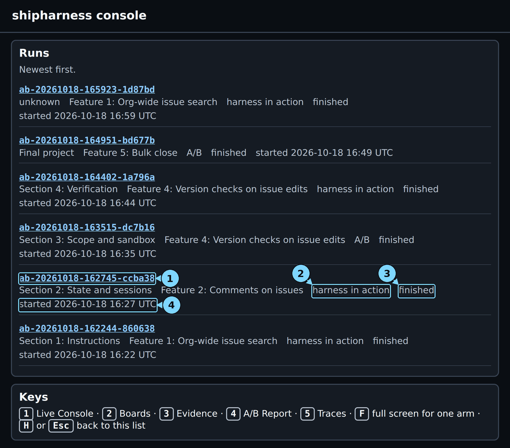

*The run list after the run finished. The Section 2 card is fifth here, because four later runs started after it.*

1. Run id: open the run
2. Type: harness in action or A/B
3. Status
4. Start time

**Look at:** the type "harness in action" and the start time.

**What it means:** "harness in action" means a single-arm run, with the harness arm alone. The comparison between the bare arm and the harness arm comes from runs measured before class (Step 19).

> [!CHECKPOINT]
> The newest card names Feature 2: Comments on issues and says "harness in action".

> [!IFDIFFERENT]
> - No new card → wait 10 seconds and reload again. The card appears with the run's first event.
> - A card shows "unknown" in every field → the run has only just started. Reload again in a few seconds.

> [!INSTRUCTOR]
> Read the card aloud: "Section 2, comments on issues, the harness arm alone."

### Step 5: Open the run on screen 1

**Where:** browser, screen 1 (Live)

**Type:** Click the newest run id, then press 1.

**You should see:** two arm panels. The bare panel says "Not run (harness in action): this run shows the harness arm alone." The harness panel shows "instructions + state", the container line, the cost against the $0.20 cap, "Last turns", and "Harness decisions".

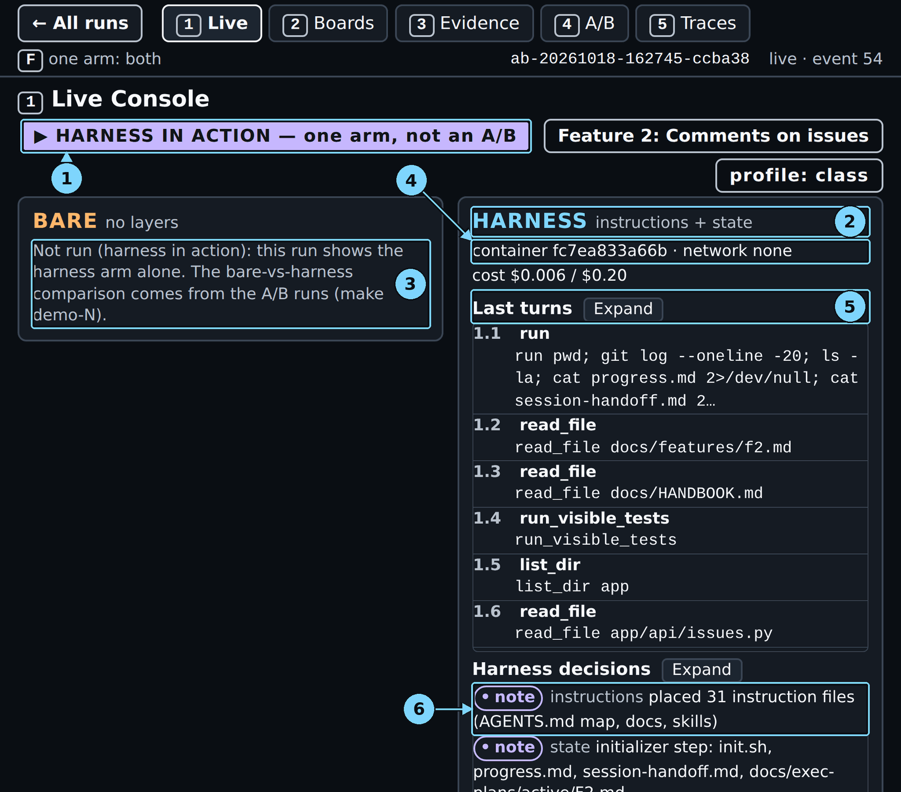

*Screen 1 during session 1, showing the first turns and the two layer notes.*

1. HARNESS IN ACTION badge, or the feature
2. Harness arm line: its layers
3. Bare arm: Not run (harness in action)
4. Container line
5. Last turns
6. Harness decisions: the layer notes

**Look at:** "Harness decisions". The first line is the instructions layer's "placed 31 instruction files (AGENTS.md map, docs, skills)". The second is the state layer's "initializer step: init.sh, progress.md, session-handoff.md, docs/exec-plans/active/F2.md".

**What it means:** the state layer writes four files and commits them before session 1 starts:

- `init.sh` starts the app and runs a basic test.
- `progress.md` records what was done and what comes next, and keeps a session log.
- `session-handoff.md` is the handoff to the next session.
- `docs/exec-plans/active/F2.md` is the exec plan, with the steps and decisions.

The initializer step is plain code, so it makes no model call.

> [!CHECKPOINT]
> "Harness decisions" contains the initializer step line.

> [!IFDIFFERENT]
> - No initializer step line → the run has no state layer. Check that you ran `make show-2`, not `make show-1`.
> - "No turns yet." → the container is still starting. Wait a few seconds; the page updates itself.

> [!INSTRUCTOR]
> Point at the initializer line. Say: "These four files are the whole state layer. The next session knows only what is in them, or in git."

### Step 6: Watch session 1 work

**Where:** browser, screen 1, harness panel, the turn list

**Type:** nothing. Watch the rows 1.1 to 1.12.

**You should see:**

- Turn 1.1 runs `pwd; git log --oneline -20; ls -la; cat progress.md; cat session-handoff.md; cat docs/exec-plans/active/F2.md; bash init.sh`.
- Turns 1.2 to 1.10 read the ticket's spec (`docs/features/f2.md`) and the house rules (`docs/HANDBOOK.md`), run the visible tests, and read the issue code.
- Turn 1.11 patches `progress.md`, `docs/exec-plans/active/F2.md`, and `session-handoff.md`.
- Turn 1.12 commits those three files.

**Look at:** turn 1.1, then turns 1.11 and 1.12.

**What it means:** turn 1.1 is the routine every session starts with, called Getting up to speed: `pwd`, the progress file and the git log, the handoff and the plan, then `bash init.sh`. With three turns left, the runner sends a wrap-up message. The agent uses its last turns to write down what it learned and to commit it. Session 1 changed no product code.

> [!CHECKPOINT]
> The turns count 1.1, 1.2, and so on, up to 1.12.

> [!IFDIFFERENT]
> - The turns go past 1.12 → `SESSION_BUDGET=12,38` was left out. Let it run; the stop comes at turn 20.
> - Session 1 ends before 1.12 with `claim_done` → the agent said done in session 1. Read the run as one that never faced the stop.

> [!INSTRUCTOR]
> Say: "Twelve turns is not enough for this ticket. This session spends almost all of them reading, then writes down what it found. That is normal for a first session."

### Step 7: See session 1 stop

**Where:** browser, screen 1, harness panel, the turn list and "Harness decisions"

**Type:** nothing. The stop came 1 min 10 s into the run.

**You should see:** a new harness decision, "session stop · state · session 1 handoff written to session-handoff.md". After turn 1.12, the turn list shows the marker "Session 1 stopped · ended by turn_budget; handoff session-handoff.md".

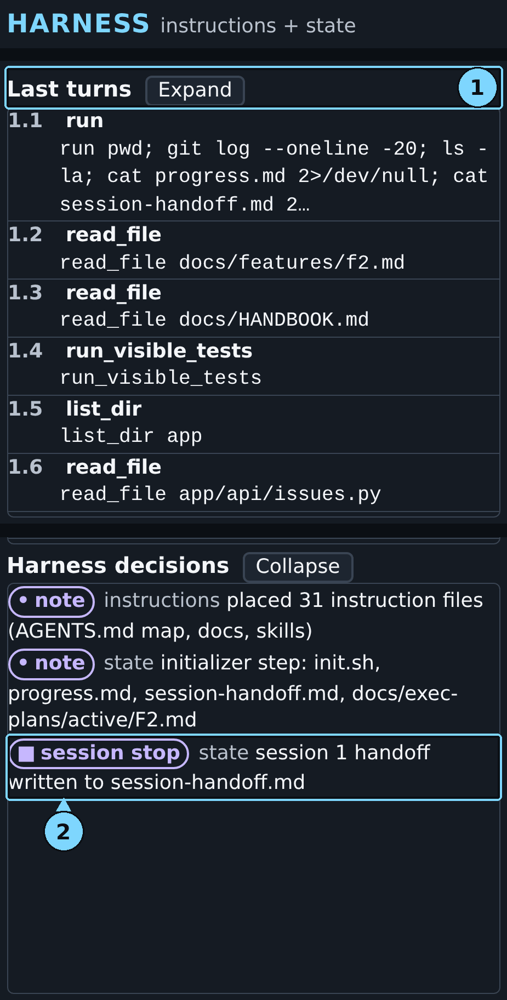

*Session 1 stops: the state layer writes the handoff that session 2 reads first.*

1. Turns list
2. Handoff written to session-handoff.md

**Look at:** "ended by turn_budget" and "handoff written to session-handoff.md".

**What it means:** the runner stopped session 1 because its 12 turns were used up. "turn_budget" is the session turn budget at work. In an A/B run, both arms hit the same stop, which is what lets the course compare them.

> [!CHECKPOINT]
> "Harness decisions" contains the "session stop" line for session 1.

> [!IFDIFFERENT]
> - The marker says `claim_not_done` → the agent ended session 1 itself with `finish(claim="not_done")`. Session 2 still runs, so read on.
> - No marker at all → the agent said done in session 1, or a cap ended the run. Check Terminal 2 at the end.

> [!INSTRUCTOR]
> Say: "This is the gap. Anthropic's team calls it a context reset with a structured handoff: a clean session, plus a file that carries the state across."

### Step 8: Read what was written at the stop

**Where:** browser, screen 1, harness panel, "Harness decisions"

**Type:** Click "Expand" next to "Harness decisions".

**You should see:** the three harness decisions so far: the two notes from Step 5 and the session stop from Step 7. The session stop names `session-handoff.md` and `progress.md`.

**Look at:** the files the stop names. Compare them with the four state files:

| State file | Written in session 1 by | What it holds at the stop |
|---|---|---|
| `progress.md` | The agent, then the harness | Done, In progress, Next; a log line |
| `session-handoff.md` | The harness and the agent | Machine summary; the agent's notes |
| `docs/exec-plans/active/F2.md` | The agent | Steps with times; two decisions |
| `feature_list.json` | Nobody | Not in this run |

**What it means:** at the stop, the state layer reads the repository and writes the machine summary into `session-handoff.md`. The summary lists the last commits, the files changed, the visible test result, open TODO markers, and the migration heads. The layer also appends one line to the session log in `progress.md`, then commits both files. The commit message is `harness: session 1 handoff for F2`, where `F2` is Feature 2: Comments on issues. The harness writes these facts whatever the agent did.

The agent's notes sit under "Notes from the agent". In this run they list what it read, what is left ("exactly one migration", the three endpoints, seed comments, the board form), and the house rules to watch. `feature_list.json` belongs to the scope layer, which starts in Section 3: Scope and sandbox, so this run has none.

> [!CHECKPOINT]
> The session stop decision names `session-handoff.md` and `progress.md`.

> [!IFDIFFERENT]
> - No session stop decision → the run has no state layer, or session 1 never stopped (Step 7).

> [!INSTRUCTOR]
> Say: "The handoff has two owners. The harness writes the facts it can read from git, and the agent writes notes. If the agent runs out of turns before writing its notes, the facts are still there."

### Step 9: See session 2 resume and read the state files first

**Where:** browser, screen 1, harness panel, the turn list

**Type:** nothing. Read the rows under the stop marker.

**You should see:** the second marker, "Session 2 resumed · prefix: core, instructions, state", and then turn 2.1. Turn 2.1 began 1 min 12 s into the run. Its call and the start of its output:

```text
2.1 run pwd; cat progress.md; git log --oneline -20; cat session-handoff.md;
    cat docs/exec-plans/active/F2.md; bash init.sh
exit=0
/work
# Progress
...
## Done
- Read feature spec and handbook; initialization and existing test suite verified.
## In progress
- Implement comments API, persistence, migration, ...
```

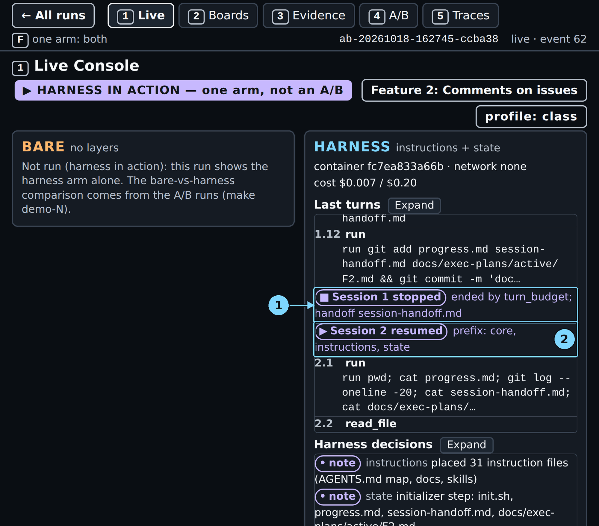

*The key moment: session 1 stops, and session 2's first call reads the state files.*

1. Session 1 stopped
2. Session 2 resumed

**Look at:** the tool target of turn 2.1. It reads `progress.md`, the git log, `session-handoff.md`, and the exec plan, then runs `init.sh`.

**What it means:** session 2 has no memory of session 1. Its first call, before it changes any code, reads the files the last session left. It sees session 1's notes: what was done, what is in progress, what comes next. "prefix: core, instructions, state" means the harness added its own resume text after the runner's neutral resume sentence.

> [!CHECKPOINT]
> Turn 2.1 reads `progress.md` and `session-handoff.md`.

> [!IFDIFFERENT]
> - Turn 2.1 reads product files first → the agent skipped the routine. Note it; the referee still checks continuity.

> [!INSTRUCTOR]
> This is the moment of the section. Say: "This is a fresh session with an empty context. Its first move is to read the progress file, the git log, and the handoff. That is the Getting up to speed routine from Anthropic's harness."

### Step 10: Watch session 2 build the feature

**Where:** browser, screen 1, harness panel, the turn list

**Type:** nothing. Scroll the turn list with the mouse wheel.

**You should see:**

- Turns 2.2 to 2.17 read the spec, the house rules, the issue code, the existing migration, and the add-endpoint skill.
- Turn 2.18 patches `app/db/models.py` and adds `migrations/versions/0002_comments.py`.
- Turns 2.19 to 2.29 add the comments repository, service, and API, and register the router in `app/main.py`. They also patch `app/seed.py`, the board route, and the issue page.
- Turns 2.30 to 2.37 run the migration and the tests, write `tests/visible/test_comments.py`, and fix it.
- Turn 2.38 updates the three state files.

A red tool name marks a call that failed. Turns 2.21 and 2.24 are patches that did not apply, and the agent retried both.

**Look at:** turn 2.18, the one migration, and the last turn, 2.38.

**What it means:** session 2 writes the product code that session 1 only planned. Watch for one migration, not two: two migration heads is the failure this section is about. Session 2 used all 38 turns and never called `finish`, so the run records "agent said: no claim". Its last turns are the wrap-up again.

> [!CHECKPOINT]
> Session 2 ends at turn 2.38 with a session stop, "session 2 handoff written to session-handoff.md".

> [!IFDIFFERENT]
> - The run ends `ABORTED: timeout` → the agent time limit ended the arm. The referee still judges it (Step 21).
> - Session 2 ends early with `finish done` → normal too. The agent said done, and the test phase follows.

> [!INSTRUCTOR]
> Say: "Session 2 did not start over. It read the plan and built on it, with one migration."

### Step 11: See the test phase

**Where:** browser, screen 1, harness panel, the turn list

**Type:** nothing.

**You should see:** after session 2's stop, the rows 3.1 to 3.12. This is the test phase. Turn 3.1 runs the same Getting up to speed routine. Turn 3.10 writes `tests/visible/test_comments_rules.py`, and the agent's own runs of that test file fail in turns 3.11 and 3.12. The run then ends, and the panel header shows "run completed · 62 turns".

**Look at:** the header line "run completed · 62 turns".

**What it means:** after the build sessions, a separate test phase writes more tests in a new session, and it reads the same state files first. Here its new test fails on the agent's code. The referee runs it five times and counts it as failing every time, not as flaky.

> [!CHECKPOINT]
> The header says "run completed".

> [!IFDIFFERENT]
> - "run aborted" → a time or cost cap ended the arm. The verdicts still come.

> [!INSTRUCTOR]
> Skip this step in class if time is short; it is the same routine a third time.

### Step 12: Read the primary verdict

**Where:** browser, screen 1, harness panel, under "Referee"

**Type:** nothing. The pill appears a few seconds after the run ends.

**You should see:** "Agent said: – no claim", then the pill "✓ primary verdict ready: PASS", then "continuity failure no". "secondary checks running" shows until the full verdict arrives.

**Look at:** the pill, and the time line under it, "launch to primary verdict".

**What it means:** the primary verdict checks continuity. It fails in three cases:

- two migration heads, or a failed fresh upgrade (House rule 7: Migrations);
- a table created by two migrations;
- session 2 removing 30% or more of the lines session 1 added.

PASS means none of the three happened. It does not mean the feature works; the hidden tests answer that. This verdict came 5:18 after launch. The console's own clock starts a few seconds after launch, so it reads a little lower (05:11 here).

> [!CHECKPOINT]
> The pill reads "primary verdict ready: PASS" or "primary verdict ready: FAIL".

> [!IFDIFFERENT]
> - "secondary checks running" stays for about two minutes → that is normal. The other checks run after the primary one (Step 13).

> [!INSTRUCTOR]
> On PASS say: "Session 2 picked up the work. No continuity failure." On FAIL say: "The handoff did not carry the work. Screen 3 shows how." Then add: "Session 1 wrote no product code in this run, so there was little to redo."

### Step 13: Read the full verdict

**Where:** browser, screen 1, harness panel, under "Referee"

**Type:** nothing. Wait about two more minutes.

**You should see:** under the pill, "hidden tests 56/56", "mutants killed 1/4", "House rule 1: Tenant isolation, new violations 0", and "launch to primary verdict 05:11 · launch to full verdict 07:05".

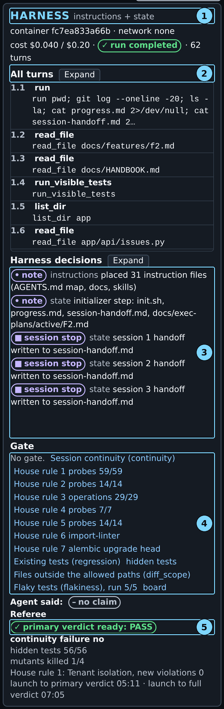

*The harness panel at the end: three session stops under Harness decisions, then the verdict.*

1. Harness arm line: its layers
2. Turns list
3. Harness decisions
4. Gate list
5. Referee pill (harness)

**Look at:** "hidden tests 56/56", "mutants killed 1/4", and the "launch to full verdict" time. The full verdict came 7:11 after launch; the console's clock, which starts a few seconds later, shows 07:05.

**What it means:** the full verdict adds every other check. Hidden tests are tests the agent never saw. A mutant is a copy of the code with one small bug planted on purpose, and good tests catch (kill) it. Here every hidden test passed, and the agent's tests caught 1 of the 4 mutants.

> [!CHECKPOINT]
> The referee lists hidden tests, mutants killed, and the launch-to-full-verdict time.

> [!IFDIFFERENT]
> - Hidden tests 3 of 56 → the arm built nothing. Those 3 tests already pass on the starting code, so the continuity check cannot fail.

> [!INSTRUCTOR]
> Say: "Two numbers answer two questions. Continuity asks whether session 2 broke session 1's work. The hidden tests ask whether the feature works."

### Step 14: Open screen 3 and read the sessions

**Where:** browser, screen 3 (Evidence), left panel

**Type:** Press 3.

**You should see:** under "Sessions", the rows "Session 1 · 12 turns · turn_budget", "Session 2 · 38 turns", and "Test phase · 12 turns".

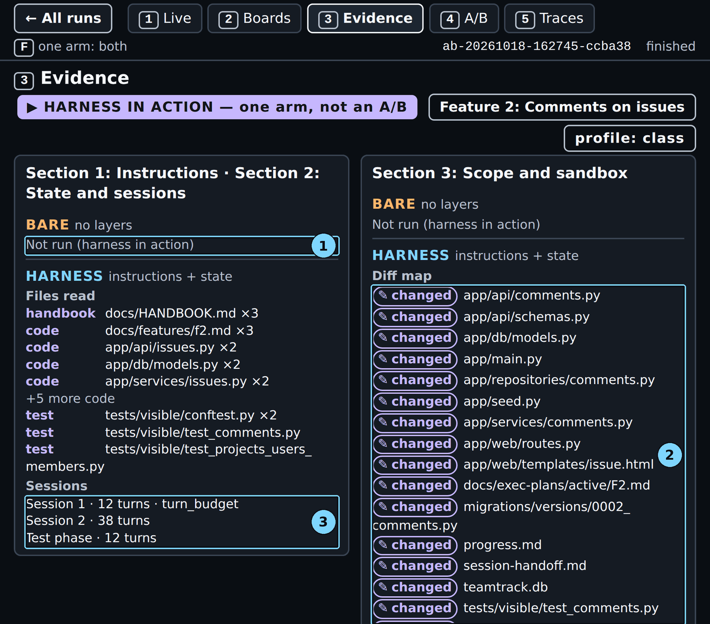

*Screen 3: two build sessions and the test phase, and the files the agent changed.*

1. Bare arm: Not run (harness in action)
2. Diff map (harness)
3. Sessions, including the test phase

**Look at:** each session row, and whether any row has a "↺ redone" mark under it.

**What it means:** "turn_budget" is the stop from Step 7. The console prints the end reason only on the first row. "Test phase" is the session after the build. A "↺ redone" mark names a file that a later session changed again. The state files never count as redone work, because they are meant to change every session; the referee leaves them out too. Those files are `progress.md`, `session-handoff.md`, the exec plan, and `feature_list.json`. In this run no row has a redone mark.

> [!CHECKPOINT]
> Three rows: Session 1, Session 2, and Test phase. None has a "↺ redone" mark.

> [!IFDIFFERENT]
> - Only one row → session 1 never stopped (Step 7).
> - A row reads "Session 3" instead of "Test phase" → the console is older than this guide. Update the repository and restart `make console`.

> [!INSTRUCTOR]
> Say: "Twelve turns, then a fresh session with 38. No product file was changed by two sessions."

### Step 15: Read the files the agent opened

**Where:** browser, screen 3, left panel, "Files read"

**Type:** nothing. The list is above "Sessions".

**You should see:** the files the agent opened with its file tools, grouped by kind. In this run: "handbook docs/HANDBOOK.md ×3", "code docs/features/f2.md ×3", `app/api/issues.py` ×2, `app/db/models.py` ×2, `app/services/issues.py` ×2, "+5 more code", and three test files.

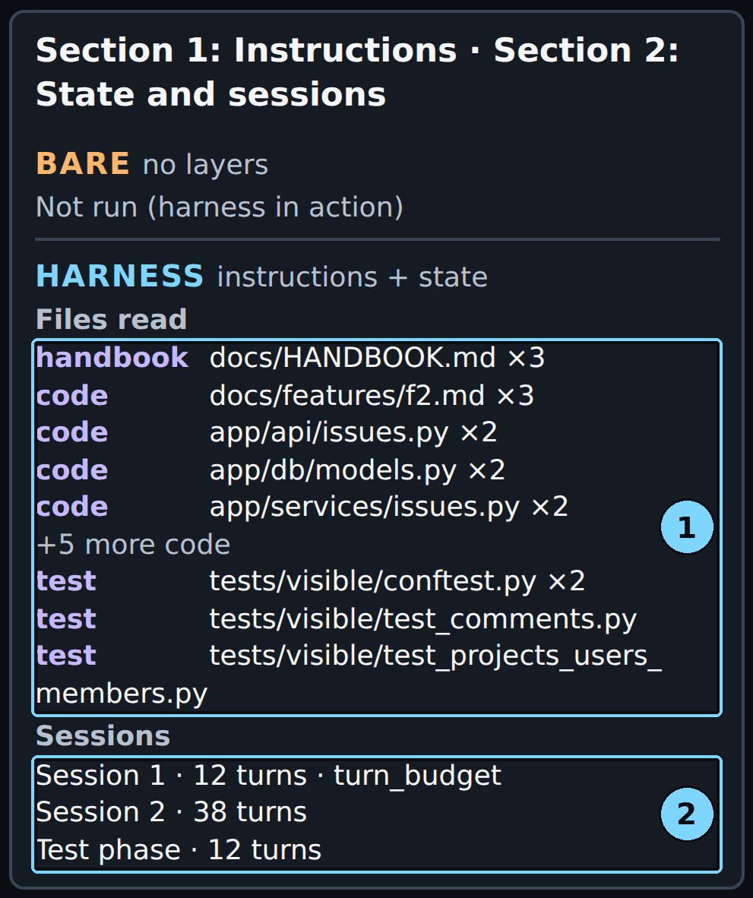

*Files read and Sessions for the harness arm.*

1. Files read
2. Sessions

**Look at:** "×3" after `docs/HANDBOOK.md` and `docs/features/f2.md`.

**What it means:** "×3" means each of the three sessions opened the house rules and the spec. The state files are not in this list. The agent read them with `cat` inside a `run` call (turns 1.1, 2.1, and 3.1), and this list shows only files opened with the file tools. Screen 1 is where you see the state files being read.

> [!CHECKPOINT]
> `docs/HANDBOOK.md` and `docs/features/f2.md` each show "×3".

> [!IFDIFFERENT]
> - You expected `progress.md` here → see "What it means" above. Show turn 2.1 on screen 1 instead.

> [!INSTRUCTOR]
> Say: "Every session read the rules and the spec again. That costs turns. The state files tell it where to look; they do not replace the reading."

### Step 16: Read the diff map

**Where:** browser, screen 3, middle panel, "Diff map"

**Type:** nothing.

**You should see:** "✎ changed" next to each file the arm changed. The product files are `app/api/comments.py`, `app/api/schemas.py`, `app/db/models.py`, `app/main.py`, `app/repositories/comments.py`, `app/seed.py`, `app/services/comments.py`, `app/web/routes.py`, `app/web/templates/issue.html`, and `migrations/versions/0002_comments.py`. Next to them are the state files, the local database `teamtrack.db`, and two test files. Under the list, "Sandbox denials" shows "✓ none".

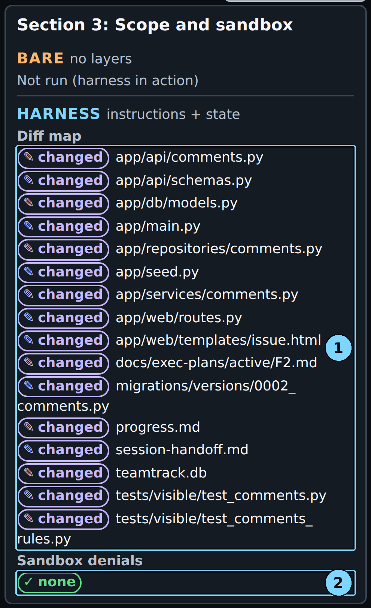

*The diff map: one migration file, and no command refused by the sandbox.*

1. Diff map (harness)
2. Sandbox denials (harness)

**Look at:** `migrations/versions/0002_comments.py`. It is the only new migration.

**What it means:** one new migration means one Alembic head (the newest migration in the chain). "Sandbox denials: none" means the container refused no command.

> [!CHECKPOINT]
> Exactly one new file under `migrations/versions/`.

> [!IFDIFFERENT]
> - Two new migrations → read House rule 7 in Step 17. That is the failure this section looks for.

> [!INSTRUCTOR]
> Point at the migration. Say: "One migration, one head. The opening story had two."

### Step 17: Read the referee checks

**Where:** browser, screen 3, right panel, "Referee"

**Type:** nothing.

**You should see:** one row per check, each with its result:

- "Session continuity (continuity)" ✓ 0 new
- "House rule 1" to "House rule 7", each ✓ 0 new
- "Existing tests (regression)" ✓ 0 new
- "hidden tests" ✓ 0 new
- "Files outside the allowed paths (diff_scope)" ✓ 0 new
- "Flaky tests (flakiness)" ✓ 0 new
- "board check" ✓ 0 new
- "✓ reviewer accept · tenant risk none · The diff implements the comment API, persistence, migration, seed data, board UI, authorization, validation, pagination, idempotency, and audit behavior. …"

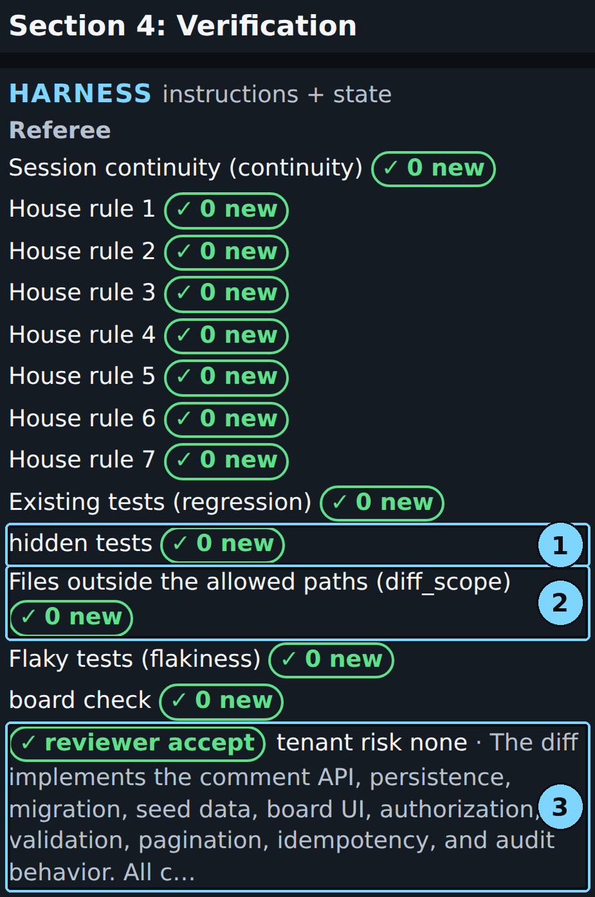

*The referee panel: every check at 0 new, and the reviewer accepts.*

1. hidden tests (harness)
2. Files outside the allowed paths (diff_scope), harness
3. Blinded reviewer's reason (harness)

**Look at:** "Session continuity (continuity)", then "House rule 7", then "Files outside the allowed paths (diff_scope)", then the reviewer line.

**What it means:** "Session continuity (continuity)" is the primary measure from Step 12. "House rule 7" checks for one migration head and a working fresh upgrade. "Files outside the allowed paths (diff_scope)" is 0 new, so the agent stayed in the ticket's allowed paths. Nothing would have stopped it otherwise, because the scope layer starts in Section 3. The reviewer line is a blinded model review of the diff, and you can hover it to read the whole reason.

> [!CHECKPOINT]
> "Session continuity (continuity)" shows "0 new".

> [!IFDIFFERENT]
> - "Session continuity (continuity)" shows "1 new" → that is a continuity failure. Hover the row to see the probes, and see "Reading a FAIL or a reviewer reject" below.

> [!INSTRUCTOR]
> Say: "Continuity: 0 new. One migration head. The agent also stayed in scope this time, but only by choice. Nothing in this section stops it."

### Step 18: Open screen 2 and read the board

**Where:** browser, screen 2 (Boards)

**Type:** Press 2.

**You should see:** the harness arm's board as admin@acme.test, with the mark "✓ only own-org cards, no duplicates". The bare panel says "Not run (harness in action)".

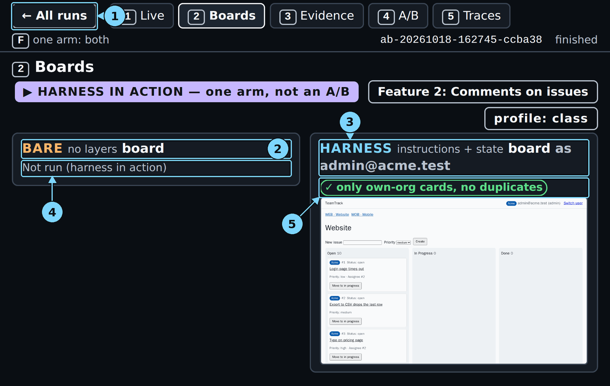

*Screen 2: no other org's data on the board.*

1. ← All runs: back to the run list
2. Bare board heading
3. Harness board heading: signed in as one user
4. Bare arm: Not run (harness in action)
5. Harness board marks

**Look at:** the mark above the screenshot.

**What it means:** the board shows only the cards of the signed-in user's org. The comments panel is on the issue page, which this preview does not open. The hidden board tests judge it instead.

> [!CHECKPOINT]
> The mark reads "only own-org cards, no duplicates".

> [!IFDIFFERENT]
> - "No board screenshot yet" → the preview takes a screenshot every 5 seconds. Wait, and the page updates.

> [!INSTRUCTOR]
> Say: "No other org's data on the board. The hidden tests check the comments themselves."

### Step 19: Open screen 4 and read the comparison

**Where:** browser, screen 4 (A/B Report)

**Type:** Press 4.

**You should see:** "This run" at the top, with the same verdict as screen 1. Below it is "Measured before class: 36 runs per arm", with one row of dots for each feature, ticket version, and arm. "Feature 2: Comments on issues · canonical" shows 4 green dots and "4/4 before class" for both the bare arm and the harness arm.

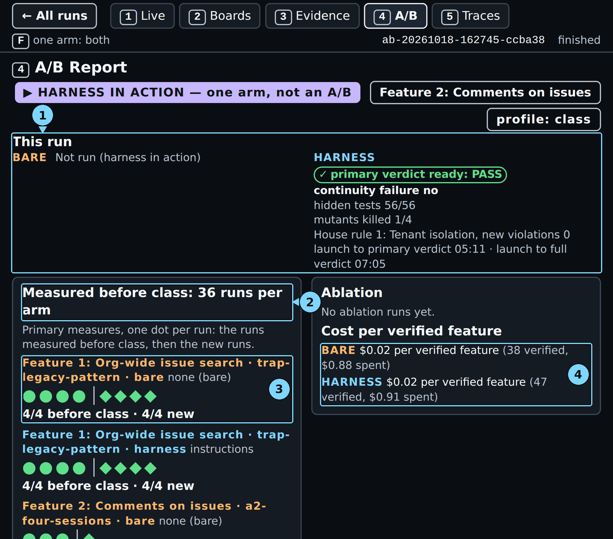

*Screen 4: the comparison comes from the runs measured before class, not from this run.*

1. This run
2. Measured before class
3. Dots per run
4. Cost per verified feature

**Look at:** the two "Feature 2: Comments on issues · canonical" rows. Scroll down in the left panel to reach them.

**What it means:** this is where the answer to bare against harness comes from: many runs, one dot each. Before class, no run of either arm failed continuity on this ticket. The course therefore reports "no measurable difference on this task with this model". Your run sits above the dots, not inside the comparison.

> [!CHECKPOINT]
> Both Feature 2 canonical rows show "4/4 before class".

> [!IFDIFFERENT]
> - No dots → the console has no before-class records to read. Check that `docs/evidence/scores/` exists in the repository (`exports/` holds only your own new runs).

> [!INSTRUCTOR]
> Say: "Before class, neither arm failed continuity. The measure cannot fail when session 1 leaves nothing to redo. In the medium- and low-effort rounds, 6 of 12 arms built nothing."

### Step 20: Open screen 5 and read the traces

**Where:** browser, screen 5 (Traces)

**Type:** Press 5.

**You should see:** three panels:

- "Live tail": the last events, ending with "verdict pass: agent said none; referee: passes the primary measure; …";
- "First wrong turn": "✓ no wrong turn found" for the harness arm;
- "LangSmith": an agent trace link and a referee trace link.

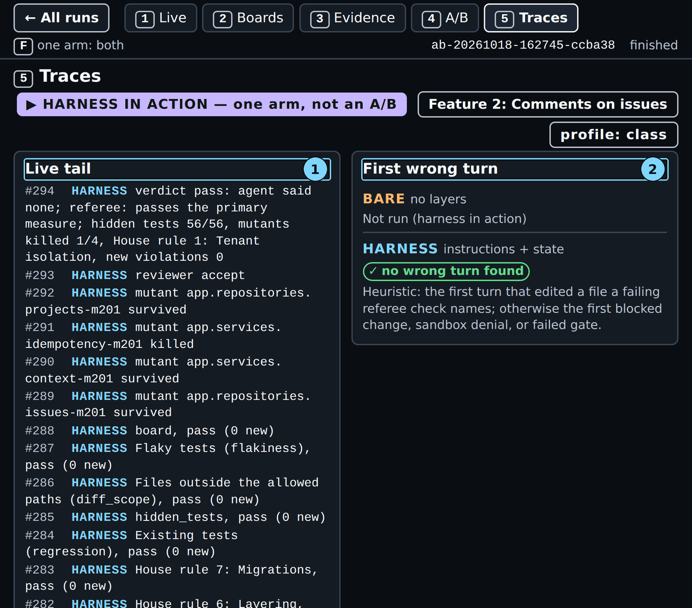

*Screen 5: this run has no first wrong turn, and the live tail ends with the full verdict.*

1. Live tail
2. First wrong turn

**Look at:** "First wrong turn", then the agent link under "LangSmith".

**What it means:** "First wrong turn" is a heuristic: the first turn that edited a file named by a failing referee check. No check failed in this run, and nothing was blocked or denied, so it finds no wrong turn.

> [!CHECKPOINT]
> The LangSmith panel lists an "agent:" link and a "referee:" link.

> [!IFDIFFERENT]
> - "No trace link yet." → the LangSmith key is missing or was rejected. Run `make doctor`.

> [!INSTRUCTOR]
> Open the agent trace and show session 2's first calls. Say: "This is the moment the fresh session read the handoff."

### Step 21: Read the terminal's final lines

**Where:** Terminal 2

**Type:** nothing. The command ends a few seconds after the full verdict.

**You should see:**

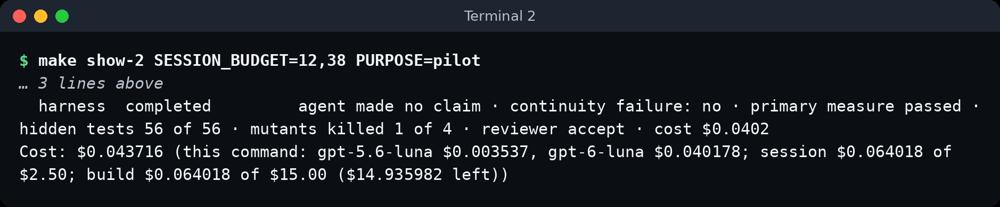

*Terminal 2 at the end: one record line for the harness arm, then the cost.*

```text
A/B ab-20261018-162745-ccba38 (Feature 2: Comments on issues, layers=['instructions', 'state'], profile=class, harness in action)
  harness  completed         agent made no claim · continuity failure: no · primary measure passed · hidden tests 56 of 56 · mutants killed 1 of 4 · reviewer accept · cost $0.0402
Cost: $0.043716 (this command: gpt-5.6-luna $0.003537, gpt-6-luna $0.040178; session $0.064018 of $2.50; build $0.064018 of $15.00 ($14.935982 left))
```

**Look at:** the record line. It gives "completed", "agent said: no claim", "continuity failure: no", "primary measure passed", the hidden tests, the mutants, the reviewer, and the arm's cost. Then read the `Cost:` line.

**What it means:** the record line repeats screen 1's verdict in one line. "agent said: no claim" means session 2 used its 38 turns without calling `finish`. The command exits with 0 when the arm completed, 2 when it ended `ABORTED`, and 1 on `ERROR`; this one exited with 0. The `Cost:` line gives the command's cost, split into the reviewer model and the agent model. It also shows how much of the day's $2.50 session cap is spent.

> [!CHECKPOINT]
> The record line starts with "harness  completed", and the prompt returns.

> [!IFDIFFERENT]
> - `ABORTED: timeout` and `make: *** [...] Error 2` → the agent time limit ended the arm. Keep the run, because its verdicts are valid.
> - `ERROR` → read the line above it. The cause is usually Docker or a key.

> [!INSTRUCTOR]
> Read the session figure on the `Cost:` line aloud. Say: "That is the meter for the whole class."

### Reading a FAIL or a reviewer reject

A FAIL or a reject is a result, not a broken demo. Say what the referee found, then show where.

- **Primary verdict FAIL.** Say: "The handoff did not carry the work. Screen 3 shows how." On screen 3, look for a "↺ redone" mark under Session 2, two new migrations in the diff map, or "House rule 7" with "1 new".
- **PASS, with hidden tests below 56 of 56.** Say: "Session 2 did not break session 1's work, and the feature is not finished. Those are two different questions." With 3 of 56, the arm built nothing, and the continuity check had nothing to judge.
- **Reviewer reject.** Read the one-line reason on screen 3 aloud. The reviewer sees only the diff and the ticket, not the referee's results. A reject next to a PASS means the reviewer found a problem the continuity check does not look for. In an earlier test run, for example, the reviewer rejected because the board's comment form skipped the API's 1 to 5000 character check.
- **Files outside the allowed paths, 1 new.** Nothing stops this in Section 2: the scope layer starts in Section 3. Say: "Remember this line. In the next section the harness blocks it."
- **No "Session 1 stopped" marker.** The agent said done inside 12 turns, so this run never faced the stop. Say so, and use the evidence in Steps 14 and 19 instead.

## Result summary

| Measure | This run |
|---|---|
| Session 1 | 12 turns, ended by turn budget |
| Session 2 | 38 turns, no claim |
| Test phase | 12 turns |
| Primary verdict | PASS, no continuity failure |
| House rule 7: Migrations | 0 new (one head) |
| Hidden tests | 56 of 56 |
| Mutants killed | 1 of 4 |
| Files outside the allowed paths | 0 new |
| Reviewer | accept |

## Time and cost

| Moment | This run, from launch | Range, two runs, 2026-10-18 |
|---|---|---|
| Primary verdict | 5:18 | 4:11 to 5:18 |
| Full verdict | 7:11 | 5:52 to 7:11 |
| Last line in Terminal 2 | 7:12 | |
| Cost of the command | $0.043716 | $0.036 to $0.044 |

The range covers this run and a second run of the same command by a reviewer on a fresh clone (`ab-20261018-180027-32942a`), each alone on the machine. That run has no recorded launch time, so its times count from its first event plus this run's 6 s. Running two demos at once makes both slower.

The console's own clock starts a few seconds after launch, so it reads a little lower: on screen 1, session 1 stopped at 1:10, the run completed at 5:07, and the verdicts showed 05:11 and 07:05.

The command took 7 min 12 s from launch to the last line, and no other run shared the machine. It cost $0.043716: $0.040178 for the agent and $0.003537 for the review. One run costs at most $0.24, which is the per-arm cap plus the per-review cap. Before class, three runs of the same command took 3:21 to 5:20 from launch to the primary verdict and 5:10 to 6:59 to the full verdict. Each cost $0.036 to $0.038. This run's full verdict came 12 s later than the slowest of those runs.

## What to say in class

- "Every session starts with no memory. Session 2 can know what session 1 did only if it is in the repository."
- "The harness writes the facts at the stop: commits, changed files, tests, and migration heads. The agent writes notes. Neither overwrites the other."
- "Session 2's first call read the progress file, the git log, and the handoff, before it touched any code."
- "PASS means session 2 did not break or redo session 1's work. To see whether the feature works, read the hidden tests."
- "Before class, neither arm failed continuity on this ticket. On this model, the state files changed nothing the referee measures. That is a result about one bet."
