# Chapter 4: Section 4: Verification

A coding agent adds version checks to issue edits: an `ETag` on read and an `If-Match` check on write. The header is optional, so every existing test passes whether the check works or not. The agent sees a green suite and says "done". In this chapter you run `make show-4`: the harness arm alone, with all four layers, on Feature 4: Version checks on issue edits. You watch the verify gate (the checks that run when the agent says done), the test phase, and the test filters. Then the referee scores the run with 69 hidden tests and 4 planted faults the agent never sees. The lesson fits on one screen: the gate can say yes while the referee says no.

> Your output will differ: run times, ids, and the agent's wording change on every run.

The numbers, quotes and screenshots come from a live run of `make show-4` on 2026-10-18 that ran alone on the machine. Two things did not happen in that run: the gate never refused a "done", and the agent wrote no tests in the test phase, so the filters had nothing to check. Steps 8 and 18 to 20 show what you see when those happen, taken from two recorded runs of the same command and marked as such.

> **Terms in this chapter**
>
> - **Verify gate**: The checks that run in the agent's container when it claims done; a failure sends the claim back.
> - **Test phase**: A short second phase in which the agent writes tests for the feature it built.
> - **Test filters**: Five checks a test from the test phase must pass to be kept.
> - **Hidden tests**: Held-out tests: the agent never sees them; the referee runs them after the agent stops.
> - **Mutant**: A copy of the code with one small planted fault; a test that fails on it catches it.
> - **Referee mutants**: Planted faults the agent never sees; the referee counts how many the shipped tests catch.
> - **Blinded reviewer**: A second model that reads the diff without knowing which arm wrote it, and says accept or reject.

### Step 1: Check that the console is running

**Where:** Terminal 1 and the browser

**Type:** Nothing new. The console from Part 0 is still running in Terminal 1. If it is not, start it:

```bash
make console
```

**You should see:** Terminal 1 shows `Console: http://127.0.0.1:8765/`. The browser tab shows the runs list.

**Look at:** The last line in Terminal 1. It has no error, and the browser page loads.

**What it means:** The console reads the run's event log as it grows. Start it before you launch, so you can open the run within seconds.

> [!CHECKPOINT]
> The runs list loads in the browser. Terminal 2 is free, in the repository root.

> [!IFDIFFERENT]
> - `address already in use` → another program holds port 8765: run `make console CONSOLE_PORT=8766` and open that port.
> - The page does not load → Terminal 1 was closed: start `make console` again.

> [!INSTRUCTOR]
> In class this section opens with the one poll of the day (2:55 to 2:57). It picks the final feature. Close the poll before you launch.

### Step 2: Start the run

**Where:** Terminal 2

**Type:**

```bash
make show-4 PURPOSE=pilot
```

**You should see:** make prints the command it runs, then nothing more until the end:

```text
uv run shipharness ab --section demo-4 --feature version-checks --arms harness   --purpose pilot \
  --profile class --max-tests=3
```

The `A/B ab-…` line and the result line come only at the end (Step 14).

**Look at:** `--arms harness` (one arm only) and `--max-tests=3`.

**What it means:** `make show-4` runs the harness arm alone, with the class profile. `--max-tests=3` is a demo setting: the filters check only the first three tests the test phase proposes. Any further test is removed with the reason "not filtered: this demo filters only the first 3 proposed tests" and counts as discarded. `make show-4 MAX_TESTS=` filters every test.

> [!CHECKPOINT]
> Terminal 2 shows the command and no `x` error line. In the live run the command took 5 min 33 s; a second run that also ran alone took 8 min 3 s.

> [!IFDIFFERENT]
> - `x SHIPHARNESS_CLASS_DATE is not set` → a class run needs the class day: set it in `.env`, or keep `PURPOSE=pilot`.
> - `x OpenAI refused the key` → the key is missing or rejected: fix `OPENAI_API_KEY` in `.env`, then run `make doctor`.
> - The arm ends `ERROR` with `docker run failed` → Docker is not running: `sudo systemctl start docker`, then `make warm`.

> [!INSTRUCTOR]
> Say what `MAX_TESTS=3` is before anyone asks: a demo setting that saves minutes, disclosed, not a comparison. In class, the plan in `docs/instructor-guide.md` launches the final A/B right after this command, in a third Ubuntu window opened like Terminal 2 (Part 0, Step 2). Every time in this guide was measured with each demo running alone; two runs at once make both slower.

### Step 3: Open the new run

**Where:** Browser, runs list

**Type:** Reload the page (Ctrl+R). Click the newest card.

**You should see:**

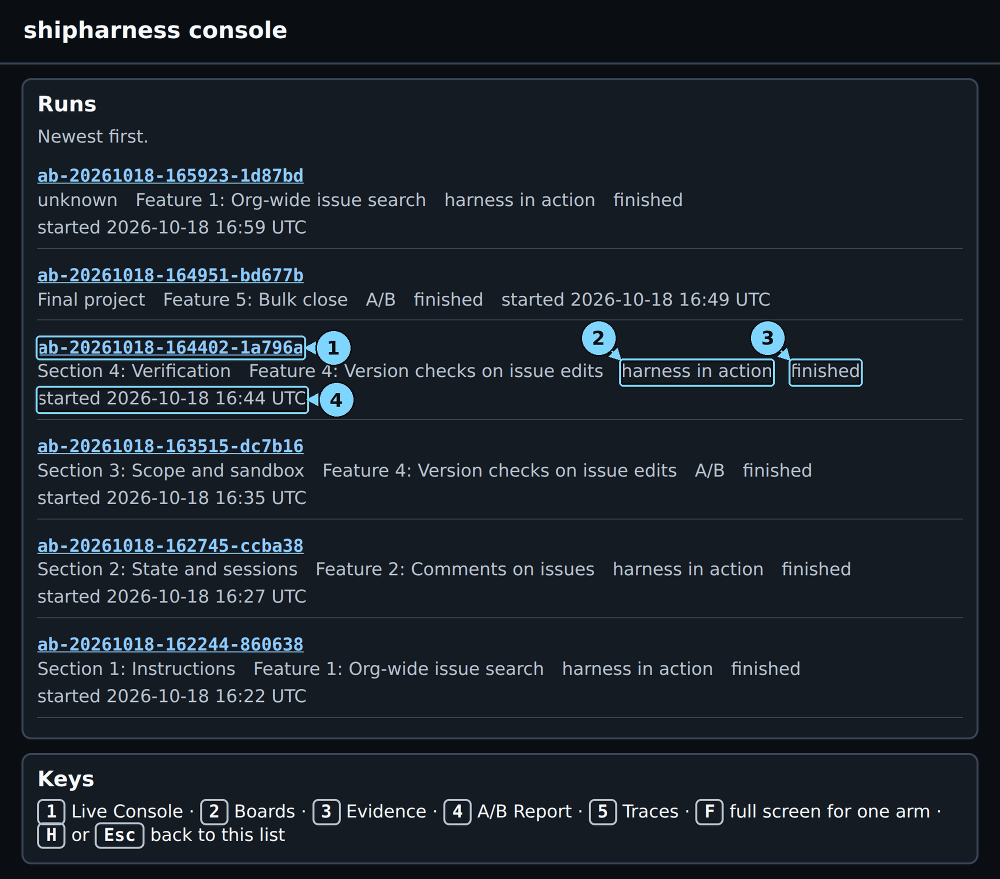

*In class the new run is the top card. This picture was taken later, so two newer runs sit above it.*

1. Run id: open the run
2. Type: harness in action or A/B
3. Status
4. Start time

**Look at:** The type on the new run's card. It says "harness in action", not "A/B".

**What it means:** One arm runs. This run shows the mechanism; it measures nothing.

> [!CHECKPOINT]
> The run opens. The run id at the top right matches the `ab-...` id that Terminal 2 prints in its `A/B` line.

> [!IFDIFFERENT]
> - No new card → the list does not refresh by itself: reload again after 10 to 20 seconds.
> - Two new cards → the final A/B started too: pick the card with "harness in action".

> [!INSTRUCTOR]
> Open this run before you launch anything else. The list puts the newest card first, and a second launch pushes this one down.

### Step 4: Read the header of screen 1

**Where:** Browser, screen 1 Live

**Type:** Press 1

**You should see:**

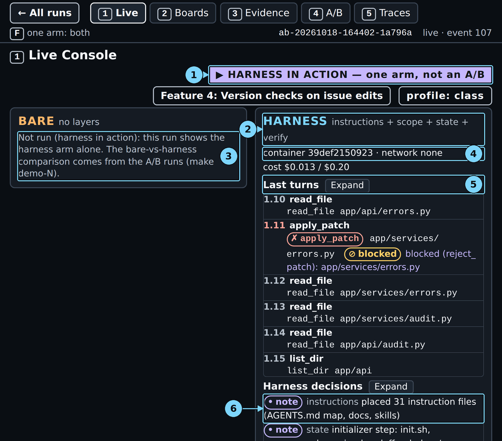

*Screen 1, about one minute in.*

1. HARNESS IN ACTION badge, or the feature
2. Harness arm line: its layers
3. Bare arm: Not run (harness in action)
4. Container line
5. Last turns
6. Harness decisions: the layer notes

**Look at:** The four layer names next to HARNESS (callout 2).

**What it means:** Every layer from the course is on. The verify layer is the new one in this section.

> [!CHECKPOINT]
> The HARNESS column shows a container id, "network none" and a cost counter out of $0.20.

> [!IFDIFFERENT]
> - "no container yet" for more than a minute → the image is missing: stop the command (Ctrl+C), run `make warm`, start again.

> [!INSTRUCTOR]
> Point at the empty BARE column: "The comparison was made before class. Today we watch the harness work."

### Step 5: Read the first harness decisions

**Where:** Browser, screen 1, "Harness decisions"

**Type:** Nothing. The notes appear within seconds of the container start.

**You should see:**

```text
note instructions placed 31 instruction files (AGENTS.md map, docs, skills)
note state initializer step: init.sh, progress.md, session-handoff.md, docs/exec-plans/active/F4.md
note scope feature_list.json written with F4 (passes: false)
note verify gate baseline reused (same checkpoint commit)
note instructions agent read ARCHITECTURE.md
```

**Look at:** The note from the verify layer.

**What it means:** The gate counts only new problems. It compares against the starting commit, so a problem that was already there does not block the agent.

> [!CHECKPOINT]
> The notes are there, and the turn list fills with turns `1.1`, `1.2`, and so on.

> [!IFDIFFERENT]
> - Fewer notes → scroll the decisions list, or click Expand next to "Harness decisions".

> [!INSTRUCTOR]
> One sentence per layer, then move on. The audience has seen the first three layers in the earlier sections.

### Step 6: Watch the scope layer block a write

**Where:** Browser, screen 1, the turn list and "Harness decisions"

**Type:** Nothing. In the live run this came 36 seconds after launch, at turn `1.11`.

**You should see:**

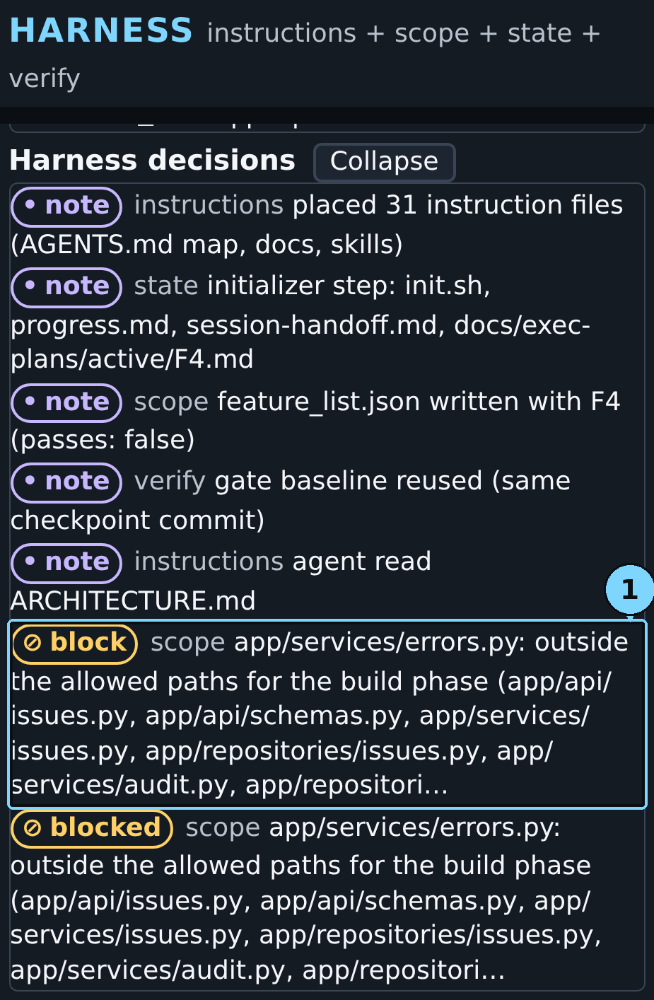

*Screen 1: the scope layer refuses a patch outside the allowed files.*

1. Turns list

**Look at:** The block decision: `app/services/errors.py: outside the allowed paths for the build phase (...); patch not applied`.

**What it means:** The agent tried to change a shared error module that the ticket does not need. The scope layer from Section 3: Scope and sandbox kept the change out. The agent goes on inside the allowed files.

> [!CHECKPOINT]
> One block decision appears. The run keeps going.

> [!IFDIFFERENT]
> - No block → the agent stayed in scope this time. Nothing is wrong; say so and go on.
> - A different file is blocked → the agent chose another file. Read the file name aloud.

> [!INSTRUCTOR]
> Keep this short: "Section 3's layer, still at work." The new part comes next.

### Step 7: Watch the agent claim done

**Where:** Browser, screen 1, "Gate"

**Type:** Nothing. In the live run the agent called `finish done` at turn `1.30`, 2 min 5 s after launch.

**You should see:**

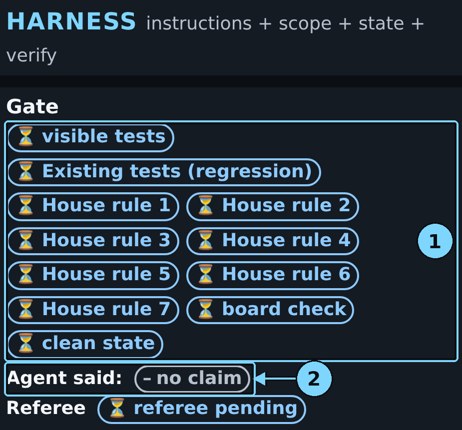

*Right after the done claim: every gate item is pending. "Agent said" shows the claim once the run ends.*

1. Gate list: checks pending
2. Agent said

**Look at:** The row of pending pills: visible tests, Existing tests (regression), House rule 1: Tenant isolation to House rule 7: Migrations (one pill each), board check, clean state.

**What it means:** The agent said done. The verify layer does not take its word. It copies the work and runs eleven checks in the agent's container. The hidden tests and the referee mutants are not among them.

> [!CHECKPOINT]
> The pills turn from pending to ✓ or ✗ within about a minute.

> [!IFDIFFERENT]
> - No pills by the end → the agent never claimed done: go to Step 12 and read the referee counts.
> - Every pill fails with `check runner failed` → the harness time limit ran out during the gate: keep the run and say what happened.

> [!INSTRUCTOR]
> Say: "The harness runs checks the agent does not control. A failure goes back to the agent with the first three reasons."

### Step 8: If the gate refuses "done"

**Where:** Browser, screen 1, below the turn list

**Type:** Nothing.

**You should see:** In the live run the first claim passed, so there is no refusal line. When the gate refuses, a red line appears here. This one is from a recorded run of the same command:

```text
refused Gate refused 'done' (build phase, attempt 1): clean state: ruff: app/web/routes.py:193:8: F821 Undefined name `version` → passed on attempt 2
```

**Look at:** The failed item ("clean state"), its reason, and what came next ("passed on attempt 2").

**What it means:** One failed item fails the gate. The agent gets "Not accepted." plus a short summary and the first three failures. It fixes them, commits, and calls `finish` again. In that recorded run the second claim passed every item.

> [!CHECKPOINT]
> Either no refusal line (the gate passed at once, as in the live run), or a refusal line that ends with "passed on attempt 2".

> [!IFDIFFERENT]
> - The line ends "still refused on attempt 2" → the agent did not fix it in time: keep going, the referee still judges the run.
> - The line ends "no further attempt" → the run ended before a second claim: same as above.

> [!INSTRUCTOR]
> If you see a refusal, stop here for ten seconds: "done" came back with a reason, and the agent fixed it. If you see none, say: "This time the first claim passed. When it does not, a red line appears right here."

### Step 9: Read the passed gate

**Where:** Browser, screen 1, "Gate" and "Harness decisions"

**Type:** Nothing. In the live run every item passed 3 min 7 s after launch.

**You should see:**

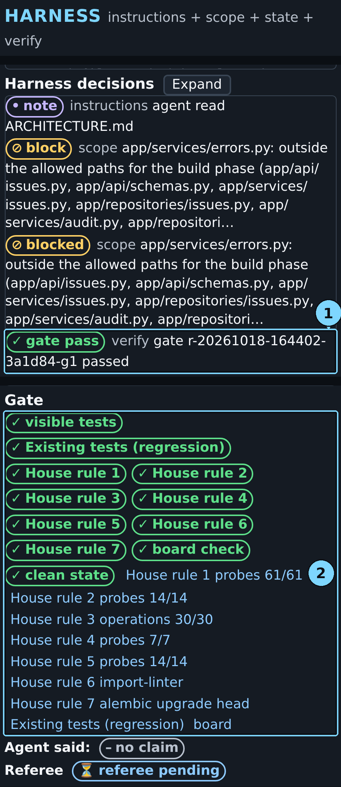

*The gate passed every item at the first claim. The referee has not started yet.*

1. Gate passed
2. Gate list: every check passed

**Look at:** Eleven ✓ pills, and three decisions right after them:

```text
gate pass  verify gate r-20261018-164402-3a1d84-g1 passed
status_set scope F4 passes: r-20261018-164402-3a1d84-g1 at 8c243a5
note       state exec plan moved to docs/exec-plans/completed/F4.md (F4 passes)
```

**What it means:** Hover over "visible tests": `passed=190 failed=0 errors=0`. Only a passed gate sets `passes` to true in `feature_list.json`, with the gate id and the commit as evidence. The agent cannot set it itself. The test phase starts next.

> [!CHECKPOINT]
> Eleven ✓ pills. "Agent said:" still shows "– no claim" (the claims appear when the run ends), and the Referee line says "referee pending".

> [!IFDIFFERENT]
> - A pill shows ✗ → open its tooltip for the reason; the agent gets it too and tries again (Step 8).

> [!INSTRUCTOR]
> Say: "Every check the agent could see is green. Remember this screen; the referee has not spoken yet."

### Step 10: Watch the test phase

**Where:** Browser, screen 1, the turn list and "Harness decisions"

**Type:** Nothing. In the live run the test phase ran from 3 min 7 s to 4 min 21 s after launch.

**You should see:** "Session 1 stopped", then turns `2.1` to `2.12`. In the live run the agent read the spec and the existing tests, ran the visible tests, updated `progress.md`, and called `finish not_done` on its last turn. Then the verify note:

```text
note verify test filters: kept 0, discarded 0; no new tests to filter
```

**Look at:** "no new tests to filter".

**What it means:** The test phase has 12 turns. In it the agent should write tests for its own feature, and five filters decide which ones ship. This time the agent wrote none. Its own summary says so: "no new regression tests have been added". So the filters had nothing to check, and no new test ships with the feature.

> [!CHECKPOINT]
> The note "test filters: kept N, discarded M" appears, then "run completed".

> [!IFDIFFERENT]
> - "kept 1, discarded 4" or similar → the agent wrote tests. Screen 3 shows each one (Steps 18 to 20).
> - "kept 0, discarded 5" → every filtered test failed a filter. A recorded run did exactly that; screen 3 shows why.

> [!INSTRUCTOR]
> Say: "The agent used its 12 test-phase turns without writing a test, and it said so: not done. Watch what that costs at the referee."

### Step 11: Read the end of the agent's run

**Where:** Browser, screen 1, top of the HARNESS column

**Type:** Nothing.

**You should see:** `cost $0.023 / $0.20 · ✓ run completed · 42 turns`.

**Look at:** "run completed" and the turn count.

**What it means:** The agent stopped normally: 30 turns of build, then 12 turns of test phase. The referee starts now, in a fresh container.

> [!CHECKPOINT]
> The Referee line shows "referee pending", then the primary verdict pill within about 20 seconds.

> [!IFDIFFERENT]
> - `run ABORTED: timeout` → the agent hit its 420-second limit. The run is still judged; read it the same way.

> [!INSTRUCTOR]
> While the referee runs, ask the room: "The gate passed everything. Will the referee pass it?"

### Step 12: Read the primary verdict

**Where:** Browser, screen 1, "Referee"

**Type:** Nothing. In the live run this came 4 min 37 s after launch (the console's clock starts about 8 s after launch, so it shows 04:29).

**You should see:**


*The gate passed, and the referee's primary verdict is FAIL. The secondary checks still run.*

1. Referee: secondary checks running
2. Referee pill (harness): primary verdict ready: FAIL

**Look at:** The pill "✗ primary verdict ready: FAIL" and the values after it: "hidden tests passed 68 · mutants killed 0".

**What it means:** The run passes only if all 69 hidden tests pass and the shipped tests catch all 4 referee mutants. One hidden test failed, and no shipped test caught any of the 4 mutants. So the answer is FAIL.

> [!CHECKPOINT]
> The pill is there and shows PASS or FAIL, followed by "secondary checks running".

> [!IFDIFFERENT]
> - The pill says PASS → both counts were full this time. Read it the same way; one run is one run.

> [!INSTRUCTOR]
> Say: "The gate said yes. The referee said no." Then explain why both can be true: the gate runs only what the agent can see. The hidden tests and the referee's mutants stay out of its reach, so they can still catch what the agent missed. This is not a broken harness. It is the harness showing where its checks stop.

### Step 13: Read the full verdict and "Agent said"

**Where:** Browser, screen 1, "Agent said" and "Referee"

**Type:** Nothing. In the live run the full verdict came 5 min 32 s after launch (05:24 on the console's clock).

**You should see:**

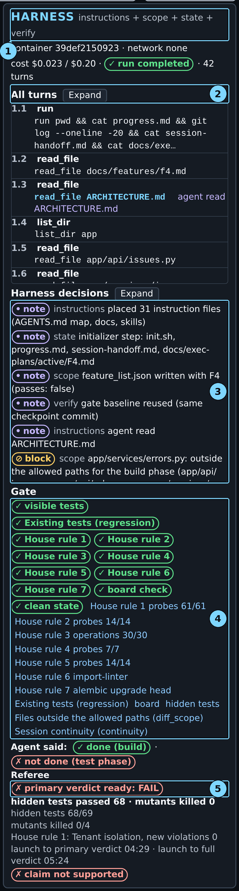

*Screen 1, the end of the run: the gate passed, and the referee failed the run.*

1. Harness arm line: its layers
2. Turns list
3. Harness decisions
4. Gate list
5. Referee pill (harness)

**Look at:** "Agent said: ✓ done (build) · ✗ not done (test phase)" and, under the referee, "✗ claim not supported".

**What it means:** "Agent said:" shows the claim of each phase. The build said done, and the gate accepted it; the test phase said not done, because it wrote no tests. The referee disagrees with the build claim, and "claim not supported" puts the two side by side. The other checks (house rules, existing tests, scope) passed.

> [!CHECKPOINT]
> Both timings are shown, and "secondary checks running" is gone.

> [!IFDIFFERENT]
> - Only the primary timing → the full verdict is still running: wait up to a minute.

> [!INSTRUCTOR]
> How to talk about this FAIL: "The gate said yes, the referee said no. The gate checks what the agent can see. The referee checks what it cannot." Then: "Before class the bare arm failed this ticket too, in every run. So this FAIL is about the task and this model, not a verdict on the harness."

### Step 14: Read the terminal's final lines

**Where:** Terminal 2

**Type:** Nothing. Wait for the prompt to come back.

**You should see:**

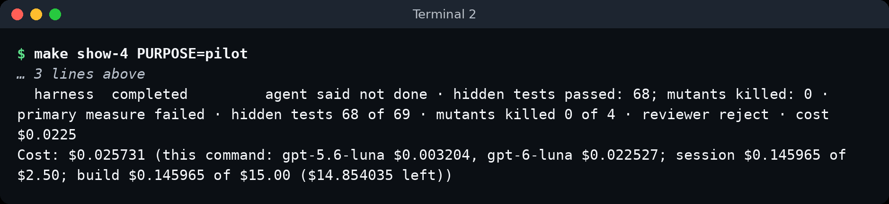

*The last lines in Terminal 2, captured on 2026-10-18. The arm line now reads "agent said: done (build) · not done (test phase)".*

```text
A/B ab-20261018-164402-1a796a (Feature 4: Version checks on issue edits, layers=['instructions', 'scope', 'state', 'verify'], profile=class, harness in action)
  harness  completed         agent said not done · hidden tests passed: 68; mutants killed: 0 · primary measure failed · hidden tests 68 of 69 · mutants killed 0 of 4 · reviewer reject · cost $0.0225
Cost: $0.025731 (this command: gpt-5.6-luna $0.003204, gpt-6-luna $0.022527; session $0.145965 of $2.50; build $0.145965 of $15.00 ($14.854035 left))
```

**Look at:** The arm line: status, claim, the two primary values, "primary measure failed", "reviewer reject", and the cost.

**What it means:** The terminal says what screen 1 says, with the claim of each phase: "agent said: done (build) · not done (test phase)". The `Cost:` line splits the command's cost between the agent model and the reviewer model.

> [!CHECKPOINT]
> The prompt is back. The command exits with 0 when the arm completed (as here), 2 when it ended `ABORTED`, 1 on `ERROR`.

> [!IFDIFFERENT]
> - `make: *** [...] Error 2` → the arm ended `ABORTED: timeout`. It is still judged; read the line as usual.

> [!INSTRUCTOR]
> Read the two claims aloud: "The build said done and passed the gate. The test phase said not done, because it wrote no tests."

### Step 15: Open screen 3 and read the sessions and the diff map

**Where:** Browser, screen 3 Evidence, the first two panels

**Type:** Press 3

**You should see:**

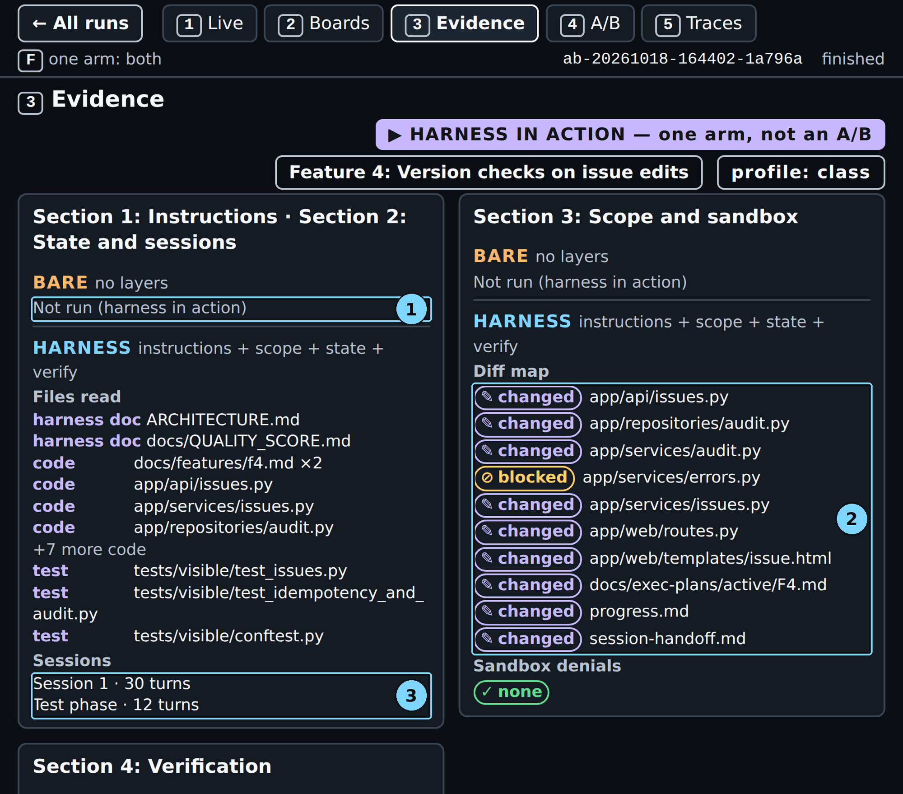

*Screen 3: what the agent read and changed. The referee's checks are in the panel below.*

1. Bare arm: Not run (harness in action)
2. Diff map (harness)
3. Sessions, including the test phase

**Look at:** The two session rows and the diff map.

**What it means:** The build took 30 turns and ended with the done claim the gate accepted. The test phase ended on its 12th turn, with the claim "not done". The diff map has no test file: the test phase only changed `progress.md`, `session-handoff.md` and the exec plan.

> [!CHECKPOINT]
> Two session rows and one blocked file in the diff map.

> [!IFDIFFERENT]
> - The test phase row is missing → the run ended before the test phase.

> [!INSTRUCTOR]
> Spend five seconds here. The verification panel on the right is the point of this screen.

### Step 16: Read the referee checks

**Where:** Browser, screen 3, panel "Section 4: Verification", "Referee"

**Type:** Nothing.

**You should see:**

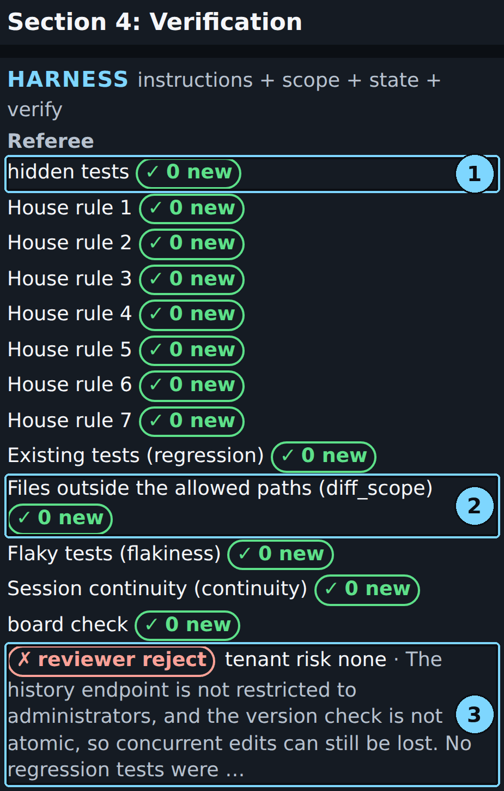

*Screen 3: the referee's checks, then the blinded reviewer.*

1. hidden tests (harness)
2. Files outside the allowed paths (diff_scope), harness
3. Blinded reviewer's reason (harness)

**Look at:** Each row's pill: "hidden tests", "House rule 1" to "House rule 7", "Existing tests (regression)", "Files outside the allowed paths (diff_scope)", "Flaky tests (flakiness)", "Session continuity (continuity)", "board check", each "✓ 0 new". Hover over a row for the full name and the number of probes.

**What it means:** Each row counts new failures against the starting code, before the agent's change. That is why "hidden tests" shows "✓ 0 new" while one hidden test fails. At the starting commit the feature does not exist, and 66 of the 69 hidden tests fail there. The one that still fails, `test_invalid_body_with_a_stale_version_is_412`, is one of those 66. It failed before the agent started and it fails now, so it is not new. The verdict counts passes, not new failures: 68 of 69, on screen 1. "Flaky tests (flakiness)" checked 0 tests, because no new test shipped.

> [!CHECKPOINT]
> Thirteen check rows, and a reviewer line under them.

> [!IFDIFFERENT]
> - "running" pills → the referee has not finished: wait for the full verdict on screen 1.

> [!INSTRUCTOR]
> If someone asks why "hidden tests" shows ✓ at 68 of 69: "This row asks: did the agent break a hidden test that passed before? No. The test that fails never passed; the agent did not fix it. The verdict counts that."

### Step 17: Read the reviewer's reject

**Where:** Browser, screen 3, the reviewer line under the referee checks

**Type:** Nothing. Hover over the line for the whole text.

**You should see:**

```text
✗ reviewer reject  tenant risk none · The history endpoint is not restricted to administrators, and the version check is not atomic, so concurrent edits can still be lost. No regression tests were …
```

**Look at:** The one-line reason after "·".

**What it means:** A second model read the diff without knowing which arm wrote it. It found three problems. The version check is a read followed by a separate update, so two writers can still overwrite each other. The history endpoint lets members read the audit log, and the house rules say only admins may. And no test shipped. The reviewer does not decide the verdict. It is one more view next to the referee.

> [!CHECKPOINT]
> The line shows "reviewer accept" or "reviewer reject", with a reason.

> [!IFDIFFERENT]
> - No reviewer line → the review is still running, or it hit its cost cap: wait for the full verdict.

> [!INSTRUCTOR]
> Read the reason aloud. Then: "The reviewer found a real gap that 190 visible tests and every gate item missed."

### Step 18: If you see a filter table: the kept test

**Where:** Browser, screen 3, "Test filters 1 to 5"

**Type:** Nothing. Scroll down in the right panel.

**You should see:** In the live run there is no filter table: the agent wrote no tests (Step 10). When the test phase writes tests, the table looks like this one, from a recorded run of the same command:

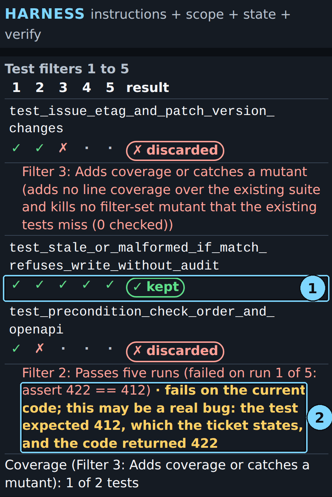

*Recorded run, screen 3: one row per filtered test, five filter marks, and the result.*

1. A test kept by the filters
2. fails on the current code; this may be a real bug

**Look at:** Callout 1: `test_stale_or_malformed_if_match_refuses_write_without_audit`, ✓ ✓ ✓ ✓ ✓, kept.

**What it means:** The kept test passed every filter. Filter 1: Builds and collects. Filter 2: Passes five runs. Filter 3: Adds coverage or catches a mutant (it added 10 covered lines). Filter 4: Real assertions. Filter 5: No source changes. It ships with the feature. In that run the filters checked three of the five proposed tests; the other two were "not filtered" and do not appear in the table.

> [!CHECKPOINT]
> Either no table and the note "no new tests to filter" (the live run), or one row per filtered test.

> [!IFDIFFERENT]
> - Every row says discarded → that happens: another recorded run kept 0 of 5.

> [!INSTRUCTOR]
> If the live run has no table, show this page and say: "When the agent writes tests, this is where they are judged." Name the filters once: "Filters 1 to 3 come from [Automated Unit Test Improvement using Large Language Models at Meta](https://arxiv.org/abs/2402.09171). Filters 4 and 5 are the course's own."

### Step 19: If you see a filter table: a Filter 3 discard

**Where:** Browser, screen 3, the filter table

**Type:** Nothing.

**You should see:** The first row of the recorded table, `test_issue_etag_and_patch_version_changes`, ✓ ✓ ✗, discarded, with this reason:

```text
Filter 3: Adds coverage or catches a mutant (adds no line coverage over the existing suite and kills no filter-set mutant that the existing tests miss (0 checked))
```

**Look at:** "adds no line coverage".

**What it means:** The test passed, five runs out of five. But it covered no line that the existing tests do not already cover, and it caught no extra mutant. It adds cost and no protection, so it does not ship.

> [!CHECKPOINT]
> The row shows ✓ ✓ ✗ and the reason line.

> [!IFDIFFERENT]
> - The reason is cut off → hover over it, or press F to show the arm full screen.

> [!INSTRUCTOR]
> Say: "A passing test is not a useful test. This filter asks what the test adds."

### Step 20: If you see a filter table: "this may be a real bug"

**Where:** Browser, screen 3, the filter table

**Type:** Nothing.

**You should see:** The last row of the recorded table (callout 2), `test_precondition_check_order_and_openapi`, ✓ ✗, discarded:

```text
Filter 2: Passes five runs (failed on run 1 of 5: assert 422 == 412) · fails on the current code; this may be a real bug: the test expected 412, which the ticket states, and the code returned 422
```

**Look at:** "the test expected 412, which the ticket states, and the code returned 422".

**What it means:** The filters treat the current code as correct. A test that fails on it is thrown away, even when the test is right. Here the test checked the ticket's order of checks: a stale `If-Match` must give 412 before body validation gives 422. The code gave 422. The agent wrote the right test, and the filter discarded it. The live run fails the same case: its one failing hidden test is `test_invalid_body_with_a_stale_version_is_412`. The authors of [Mutation-Guided LLM-based Test Generation at Meta](https://arxiv.org/abs/2501.12862) name the limit: "it cannot detect existing faults residing in the code base".

> [!CHECKPOINT]
> If your run has such a row, it shows ✓ ✗ and the reason with the "may be a real bug" note.

> [!IFDIFFERENT]
> - No "may be a real bug" note → the failed assertion does not match a value the ticket states. The console then claims nothing; read the plain reason.
> - Another recorded run showed `assert 200 == 412`: the test expected 412 and the code accepted the stale write.

> [!INSTRUCTOR]
> This is the deepest point of the section. Say: "The filters keep regression tests: tests that guard what the code does now. They cannot tell a wrong test from a right test that found a bug. The console flags it; a person has to read it."

### Step 21: Read the mutants table

**Where:** Browser, screen 3, "Mutants"

**Type:** Nothing. Scroll to the bottom of the right panel.

**You should see:**

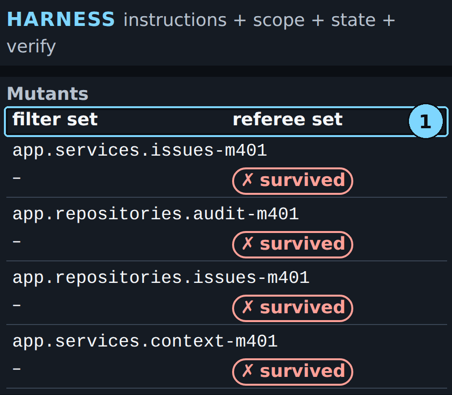

*Screen 3: the four referee mutants and what the shipped tests did to them.*

1. Mutants (harness): filter set and referee set

```text
mutant                         filter set   referee set
app.services.issues-m401       –            ✗ survived
app.repositories.audit-m401    –            ✗ survived
app.repositories.issues-m401   –            ✗ survived
app.services.context-m401      –            ✗ survived
```

**Look at:** The two columns, "filter set" and "referee set".

**What it means:** There are two sets of mutants. The filter set belongs to Filter 3, inside the harness; this run used none, because no test reached the filters. The referee set is held out: the agent and the filters never see it. Each referee mutant puts one small fault in the code, and the referee runs the shipped tests on it. "survived" means no shipped test failed, so the fault went unnoticed. No new test shipped, so all 4 survived: 0 of 4 caught.

> [!CHECKPOINT]
> Four referee mutants, none "killed". This matches "mutants killed 0/4" on screen 1.

> [!IFDIFFERENT]
> - A row says "killed" → a shipped test caught that fault. Count the killed rows against the number on screen 1.
> - A row says "error" → that mutant did not run cleanly and counts as not caught. A recorded run had one.
> - The filter table shows a kept test, and every referee mutant still says "survived" → the kept test caught none of the held-out faults. See the instructor note.

> [!INSTRUCTOR]
> Say: "No test written, no fault caught. The gate cannot see this; the referee can."
>
> If a test was kept and the referee set still shows 0 killed: the test passed Filter 3 because it covered lines the suite did not, or caught a mutant of the filter set. Neither means it checks the behaviour the referee's planted faults break. The referee set is held out, so the filters never saw it. Say: "The filters kept this test because it reaches new code. Reaching code is not checking it: none of the referee's planted faults made it fail. A kept test is a better test, not proof the feature is guarded."

### Step 22: Open screen 2 and read the two-tab conflict

**Where:** Browser, screen 2 Boards

**Type:** Press 2

**You should see:**

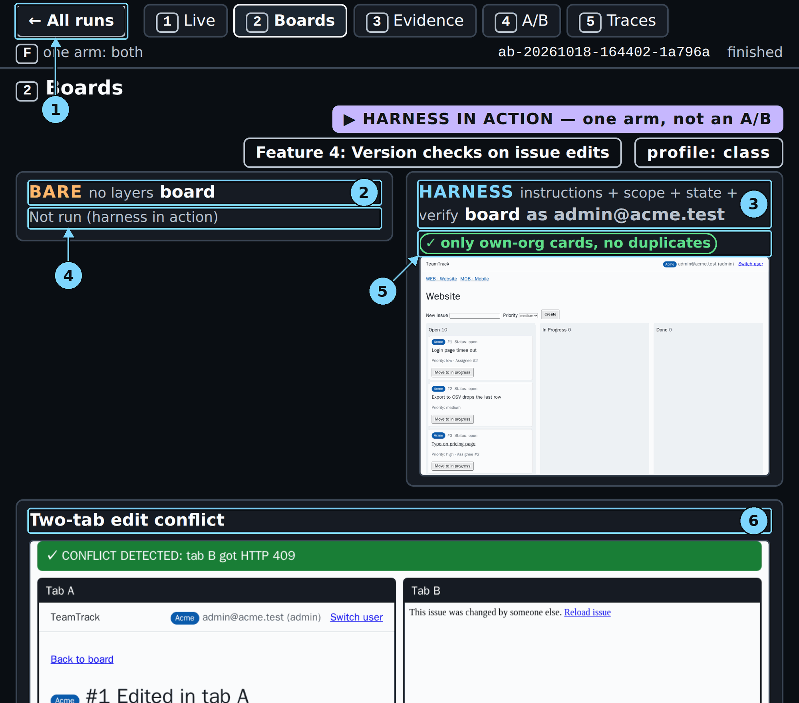

*Screen 2: the board stops the lost update from a stale tab.*

1. ← All runs: back to the run list
2. Bare board heading
3. Harness board heading: signed in as one user
4. Bare arm: Not run (harness in action)
5. Harness board marks
6. Two-tab edit conflict

**Look at:** Callout 6, and tab B's page: "This issue was changed by someone else."

**What it means:** Tab A saves, then tab B saves from its stale form. Tab B gets HTTP 409 and a "changed by someone else" page. The board part of the feature works. The referee still found one hidden test failing at the API.

> [!CHECKPOINT]
> The conflict panel shows "CONFLICT DETECTED".

> [!IFDIFFERENT]
> - No conflict panel → the conflict screenshot comes after the full verdict: wait a few seconds and press 2 again.

> [!INSTRUCTOR]
> Say: "Two tabs edit the same issue; the second save is refused. The board check runs on every arm."

### Step 23: Open screen 5 and read the traces

**Where:** Browser, screen 5 Traces

**Type:** Press 5

**You should see:**

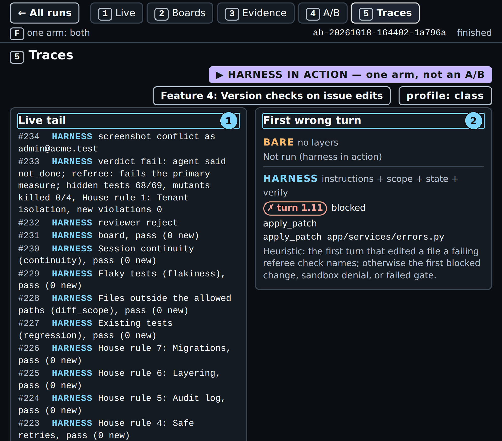

*Screen 5: where the run first went wrong. The LangSmith links are below the bottom edge of this picture.*

1. Live tail
2. First wrong turn

**Look at:** The first wrong turn.

**What it means:** The console's rule takes the first turn that edited a file a failing referee check names; otherwise the first blocked change. No referee check row failed here, so it shows the blocked write.

> [!CHECKPOINT]
> Two LangSmith links are listed.

> [!IFDIFFERENT]
> - "No trace link yet" → tracing is off or the key is missing: the run is still valid; skip the links.

> [!INSTRUCTOR]
> Open the agent link only if there is time. It shows every model call of the run.

### Step 24: Open screen 4 and put the run in context

**Where:** Browser, screen 4 A/B Report

**Type:** Press 4. Scroll the left panel down to the Feature 4 rows.

**You should see:**

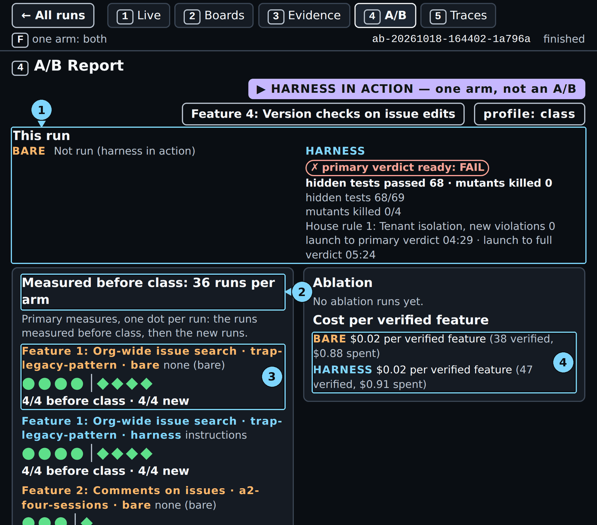

*Screen 4: this run on top, the runs measured before class below.*

1. This run
2. Measured before class
3. Dots per run
4. Cost per verified feature

**Look at:** The two rows "Feature 4: Version checks on issue edits · canonical · bare" and "Feature 4: Version checks on issue edits · canonical · harness": two hollow dots each (○, failed) and "0/2 before class". These rows score this section's measure, all hidden tests and all referee mutants. Below them are two more Feature 4 rows that end "judged by files changed outside the allowed paths", with filled dots: bare 1/10, harness 10/10. Those are Section 3's measure, the scope count from Chapter 3, not this one.

**What it means:** Before class, neither arm passed this section's measure on this ticket once. Today's run sits in "This run", not among the dots: it is one arm, shown to see the mechanism.

> [!CHECKPOINT]
> Both canonical Feature 4 rows without "judged by" read "0/2 before class", with no filled dot.

> [!IFDIFFERENT]
> - The page says "no runs" → the console started outside the repository: stop it and run `make console` from the repository root.
> - You see filled dots on Feature 4 → you are reading a scope row ("judged by files changed outside the allowed paths"). That is Section 3's measure; read the two rows above it.

> [!INSTRUCTOR]
> Say: "No measurable difference on this task with this model: both arms fail. Today's run is not a dot in the comparison." If someone points at the filled Feature 4 dots: "Those rows count files outside the allowed paths, the Section 3 question. On this section's question, all hidden tests and all mutants, both arms are 0 of 2."

### Step 25: Go back to the runs list

**Where:** Browser

**Type:** Click "← All runs" (or press H or Esc)

**You should see:** The runs list, with this run's card now "finished".

**Look at:** The status on the card.

**What it means:** The run is complete and saved. You can open it again at any time; the console serves recorded runs.

> [!CHECKPOINT]
> The card says "finished".

> [!IFDIFFERENT]
> - Still "running" → reload the page.

> [!INSTRUCTOR]
> Move on to the final A/B (Chapter 5), or to the "What we measured" slide. In class the final A/B is already running: open its card in the run list.

## Result summary

| What | This run |
|---|---|
| Arm | harness, all four layers, class profile |
| Status | completed, 42 turns (30 build, 12 test phase) |
| Blocked writes | 1 (`app/services/errors.py`, turn 1.11) |
| Gate | passed on the first claim, 11 of 11 items, 190 visible tests |
| Agent said | done (build) · not done (test phase) |
| Tests proposed / filtered / kept | 0 / 0 / 0 ("no new tests to filter") |
| Hidden tests | 68 of 69 |
| Referee mutants killed | 0 of 4 (4 survived) |
| Primary verdict | FAIL (claim not supported) |
| Reviewer | reject |

## Time and cost

| Measure | This run (ran alone) | Range, two runs, 2026-10-18 |
|---|---|---|
| Launch to blocked write | 0:36 | |
| Launch to done claim | 2:05 | |
| Launch to gate passed | 3:07 | |
| Launch to primary verdict | 4:37 (console clock 04:29) | 4:37 to 6:54 |
| Launch to full verdict | 5:32 (console clock 05:24) | 5:32 to 8:02 |
| Command, launch to prompt | 5 min 33 s | 5:33 to 8:03 |
| Cost of the command | $0.025731 ($0.022527 agent, $0.003204 review) | $0.026 to $0.028 |
| Cost cap | at most $0.24 (`MAX_RUN_COST_USD` plus `MAX_REVIEW_COST_USD`) | |

Times run from the make command's launch. The console's own clock starts about 8 s after launch, so it reads a little lower.

The range covers this run and a second run of the same command by a reviewer on a fresh clone (`ab-20261018-181301-c08d1b`), each alone on the machine. That run has no recorded launch time, so its times count from its first event plus this run's 7 s.

Every time in this guide was measured with each demo running alone. In class, the plan starts the final A/B next to this run, and two runs at once make both slower. No run measured by how much.

## What to say in class

- "The gate checks what the agent can see. The referee checks what it cannot. In this run the gate said yes and the referee said no."
- "A refused 'done' goes back to the agent with the first three reasons. It fixes them while it still has the context."
- "In this run the agent wrote no tests, so no planted fault was caught: 0 of 4. The gate could not see that; the referee could."
- "The filters keep tests that guard the code as it is. In a recorded run they threw away the one test that found this bug, and the console flagged it."
- "Before class both arms failed this ticket in every run. One run shows the mechanism; it is not a dot in the comparison."

## Sources

- Source 1: Automated Unit Test Improvement using Large Language Models at Meta, <https://arxiv.org/abs/2402.09171>, Alshahwan et al. (Meta), 2024-02-14
- Source 2: Mutation-Guided LLM-based Test Generation at Meta, <https://arxiv.org/abs/2501.12862>, Foster et al. (Meta), 2025-01-22
