# Chapter 5: Final project: the whole harness, live A/B

You have a real feature to ship with an agent, and four harness layers you could switch on. The
easy path is to run the feature once with every layer on, then keep whatever looked better. One run
cannot tell you that. Model output changes from run to run, and a second run might split the other
way. In this chapter you run one live A/B on Feature 5: Bulk close. The bare arm gets the ticket and
the repository. The harness arm also gets all four layers: instructions, state, scope and verify. One
referee scores both arms, and you read the result as one dot next to the runs measured before class.

Feature 5 has no primary measure. The referee judges each arm on all its checks, so the pill on
screen 1 reads "verdict ready: PASS" with "judged on all checks" under it. The comparison is in the
counts: hidden tests, mutants killed, files outside the allowed paths, the gate, and the blinded
reviewer. Every number, time and image below comes from one live run on 2026-10-18 (A/B
`ab-20261018-164951-bd677b`), which ran alone on the class machine.

> Your output will differ: run times, ids, and the agent's wording change on every run.

### Step 1: Check that the console is running

**Where:** Terminal 1 and the browser

**Type:** Click the browser tab with the console at `http://127.0.0.1:8765`. If Terminal 1 runs no console, start it there:

```bash
make console
```

**You should see:** The console's run list: "Runs, newest first", one entry per run with its
section, feature, type ("harness in action" or "A/B"), status and start time.

**Look at:** The top entry. It is the last run you started.

**What it means:** The console reads every run from disk. It shows a live run as it happens and a
finished run in full.

> [!CHECKPOINT]
> The run list loads, and Terminal 1 shows no error (the console is quiet by default).

> [!IFDIFFERENT]
> - The page does not load → the console is not running: `make console` in Terminal 1.
> - The text is too small or too large → press Ctrl+0 to reset the browser zoom.

> [!INSTRUCTOR]
> Say: "This is the last run of the day. Both arms run, and the harness arm has all four layers."

### Step 2: Start the final A/B

**Where:** Terminal 2

**Type:**

```bash
make final FEATURES=bulk-close PURPOSE=pilot
```

**You should see:** The command and one line, right away. No shell loop is printed.

```text
Final A/B: Feature 5: Bulk close
```

The `A/B ab-…` line and the arm lines come only at the end (Step 18).

**Look at:** The line "Final A/B: Feature 5: Bulk close". The next lines come only when both arms
are judged, about 9 minutes later in this run.

**What it means:** `make final` runs one A/B per feature you name, and prints one "Final A/B: …"
line per feature. `FEATURES=bulk-close` picks Feature 5. `PURPOSE=pilot` keeps a practice run off
the class day's cost cap. In class, with `SHIPHARNESS_CLASS_DATE` set in `.env`, leave it out.

> [!CHECKPOINT]
> Terminal 2 shows "Final A/B: Feature 5: Bulk close" and waits.

> [!IFDIFFERENT]
> - `x SHIPHARNESS_CLASS_DATE is not set` → add `PURPOSE=pilot`, or set the class date in `.env`.
> - `x Docker is not running` → `sudo systemctl start docker`, then `make warm`, then start again.
> - `x feature 'version-checks': the final project runs bulk-close, watchers, or labels` → name one of those three.

> [!INSTRUCTOR]
> In class this starts at the Section 4: Verification launch, next to `make show-4`, with the poll's
> winner first: `make final FEATURES=<winner>,<runner-up>`. Each feature is its own A/B. Every time
> in this guide was measured with each demo running alone. Running the final A/B and `make show-4`
> at once makes both slower; no run measured by how much.

### Step 3: Refresh the run list and open the new run

**Where:** Browser, run list

**Type:** Click "← All runs" (or press H), refresh the page, then click the top run id.

**You should see:**

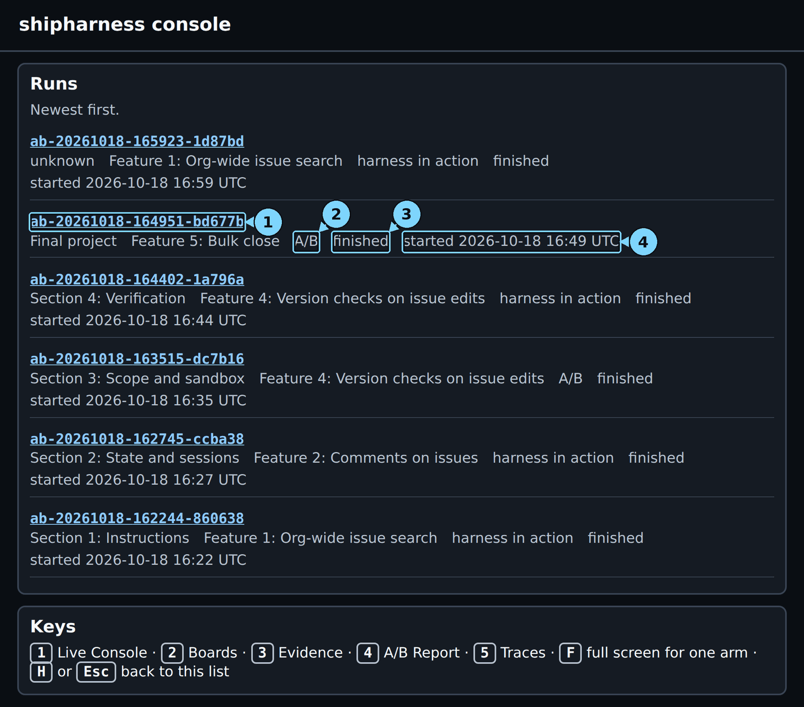

*The run list, newest first. The image was taken after the run finished.*

1. Run id: open the run
2. Type: harness in action or A/B
3. Status
4. Start time

**Look at:** The top entry: "Final project · Feature 5: Bulk close · A/B".

**What it means:** The type "A/B" means both arms run. The console opens the run on screen 1, Live.

> [!CHECKPOINT]
> Screen 1 shows two panels, BARE on the left and HARNESS on the right.

> [!IFDIFFERENT]
> - No new entry → wait 10 to 20 seconds and refresh. The run appears at its first event.
> - The entry says "harness in action" → that is a section run; go back and pick the "A/B" entry.

> [!INSTRUCTOR]
> Say: "Same ticket, model, tools, sandbox, turn budget and cost cap. Only the harness differs."

### Step 4: Read screen 1 at minute 1

**Where:** Browser, screen 1

**Type:** Press 1

**You should see:**

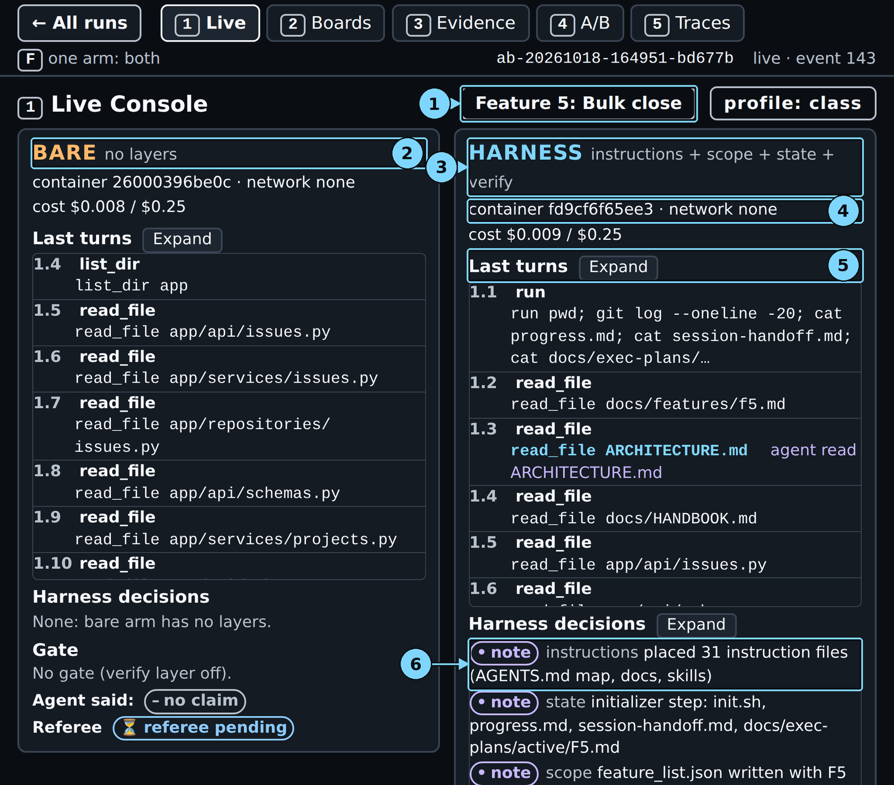

*About one minute in. Both arms are reading code; only the harness arm has harness decisions.*

1. Feature badge: Feature 5: Bulk close
2. Bare arm line: no layers
3. Harness arm line: its layers
4. Container line
5. Last turns
6. Harness decisions: the layer notes

**Look at:** The harness arm's "Harness decisions":

- instructions: "placed 31 instruction files (AGENTS.md map, docs, skills)";
- state: `initializer step: init.sh, progress.md, session-handoff.md, docs/exec-plans/active/F5.md`;
- scope: `feature_list.json written with F5 (passes: false)`;
- verify: "gate baseline reused (same checkpoint commit)";
- instructions: "agent read ARCHITECTURE.md".

**What it means:** Each layer reports what it placed before turn 1. The feature list starts at
`passes: false`, and only a passed gate may flip it. "Gate baseline reused" means `make warm` cached
the baseline, so the verify layer spends no time on it now. The bare arm shows "None: bare arm has no
layers", "No gate (verify layer off)", "Agent said: no claim" and "referee pending".

> [!CHECKPOINT]
> Both arms list turns under "Last turns", and the harness arm shows the four layer notes.

> [!IFDIFFERENT]
> - The harness arm says "gate baseline unavailable" and stops with 0 turns → the baseline was not cached: Ctrl+C, `make warm`, start again.
> - No turns after 2 minutes → look at Terminal 2 for an `ERROR` line (Docker or the network).

> [!INSTRUCTOR]
> Read the four notes aloud, one per layer. Say: "This is the whole harness from Sections 1 to 4, on
> one arm. The bare arm gets none of it."

### Step 5: Wait, and what to do meanwhile

**Where:** Browser, screen 1; Terminal 2

**Type:** No command.

**You should see:** The bare arm finishes first. The harness arm takes longer, because its gate,
its test phase and its test filters run before it is judged. Measured before class, its full
verdict came 8:41 to 15:22 after launch; in this run, 9:10.

| Console clock | Screen | What appears |
|---|---|---|
| 0:02 | 1 | Harness: the four layer notes |
| 2:04 | 1 | Harness: said done; the gate pills appear, pending |
| 2:06 | 1 | Bare: "Agent said: done" |
| 3:17 to 3:20 | 1 | Bare: run completed (38 turns), "verdict ready: PASS" |
| 3:37 | 1 | Harness: gate passed; session 1 handoff; test phase starts |
| 5:54 | 1 | Bare: full verdict |
| 6:18 to 7:14 | 1, 3 | Harness: 2 tests proposed and filtered |
| 7:14 to 7:15 | 1 | Harness: run completed (35 turns), "verdict ready: PASS" |
| 9:03 | 1 | Harness: full verdict |

**Look at:** The event count at the top right ("live · event N"). It rises while the run is live.

**What it means:** The harness arm does more work, on purpose. The gate re-runs the house-rule
checks in the arm's container before it accepts "done", and the test phase filters each proposed
test. That is the cost of the harness, in minutes. The console clock starts at the run's first
event, a few seconds after the make command.

> [!CHECKPOINT]
> The event count keeps rising until the header says "finished".

> [!IFDIFFERENT]
> - The count stops for more than 3 minutes → look at Terminal 2. An `ERROR` line means Docker or the network failed; use the replay fallback in the appendix.

> [!INSTRUCTOR]
> In class you teach Section 4 meanwhile and come back at the final block. Practising alone, press F
> to show one arm full screen (both, bare, harness), or click Expand next to "Last turns".

### Step 6: Read the bare arm's verdict pill

**Where:** Browser, screen 1, BARE panel

**Type:** Press 1

**You should see:**

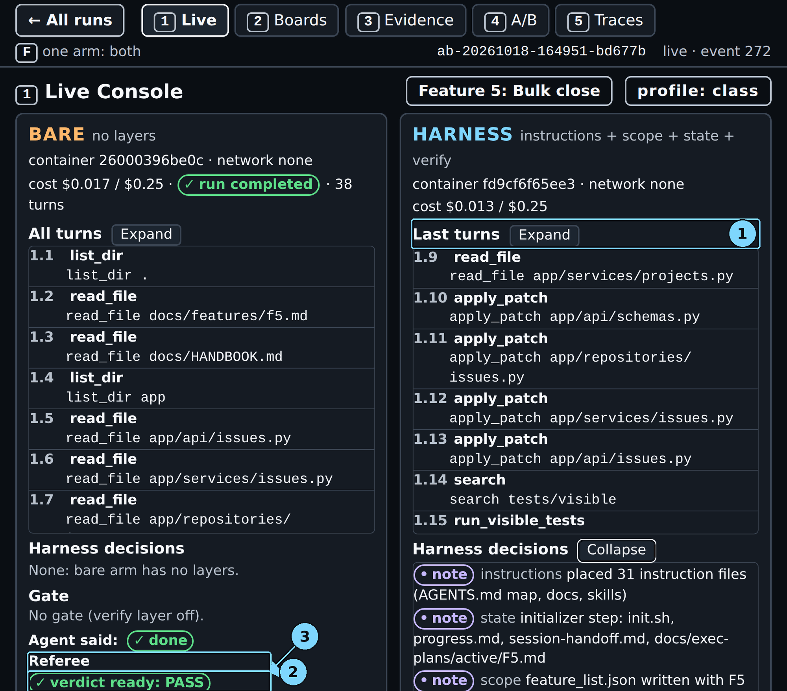

*The bare arm is judged first, while the harness arm still works.*

1. Harness still working
2. Bare referee pill: verdict ready: PASS
3. Referee heading (bare)

**Look at:** The Referee block: "verdict ready: PASS", "judged on all checks", "secondary checks
running", "launch to primary verdict 03:18". Next to it: "Agent said: done" and "claim supported".

**What it means:** Feature 5 has no primary measure, so there is no single question to answer
early. "verdict ready: PASS" says only that the run was judged and nothing failed so far. It says
nothing yet about the feature. The counts come with the full verdict.

> [!CHECKPOINT]
> The bare pill reads "verdict ready: PASS" with "judged on all checks" under it.

> [!IFDIFFERENT]
> - The pill says "primary verdict ready" → you opened a section run; check the feature badge.
> - The bare status reads "ABORTED: timeout" → the arm hit its 420 s agent time limit. It is still judged; read its counts as usual.

> [!INSTRUCTOR]
> Say: "No primary measure, so this PASS is not news. Wait for hidden tests and mutants."

### Step 7: Watch the harness gate and the handoff

**Where:** Browser, screen 1, HARNESS panel

**Type:** Press 1, then click Expand next to "Harness decisions".

**You should see:**

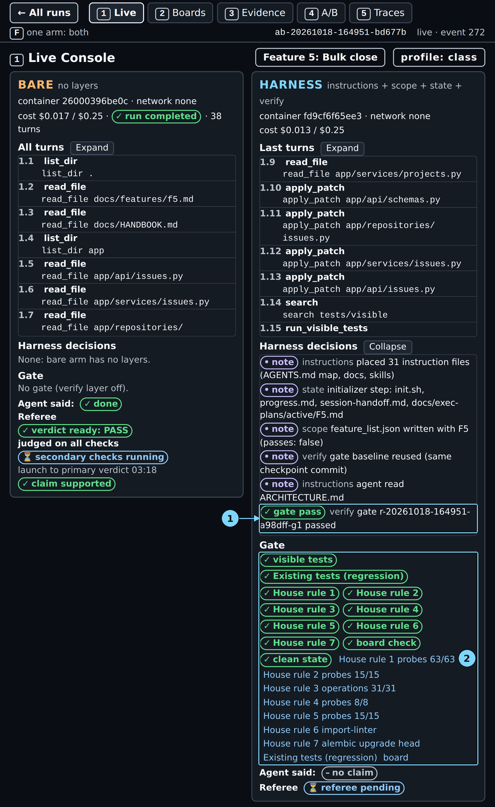

*The gate passed every item at the first attempt, so the agent's "done" can count. The claim line still reads "no claim" until the run ends.*

1. Gate passed
2. Gate list: every check passed

**Look at:** The decisions in order: "gate pass", "session stop: session 1 handoff written to
session-handoff.md", `status set: F5 passes: … at 49704cd`,
`exec plan moved to docs/exec-plans/completed/F5.md (F5 passes)`. Then the gate pills: visible tests, existing tests,
one pill per house rule, board, clean state.

**What it means:** When the agent says done, the verify layer runs the gate in the arm's own
container. It checks the visible tests (217 passed), the existing tests, and every house rule:
House rule 1: Tenant isolation, House rule 2: Roles, House rule 3: API conventions, House rule 4:
Safe retries, House rule 5: Audit log, House rule 6: Layering, House rule 7: Migrations. Only a
passed gate flips `passes` to true. Then the state layer writes the handoff, and session 2, the test
phase, starts.

> [!CHECKPOINT]
> Every gate pill is green. The harness panel still shows "Agent said: no claim"; after the run it shows "done".

> [!IFDIFFERENT]
> - A line "Gate refused 'done' (attempt 1) …" → the gate failed an item and the agent keeps working; look for "passed on attempt 2".
> - A gate pill fails on a timeout → the machine is busy; the arm may end "ABORTED: timeout". It is still judged.

> [!INSTRUCTOR]
> If the gate refuses, say: "The agent said done; the gate said not yet. That is the verify layer
> doing its job." In this run the gate passed at the first attempt.

### Step 8: Watch the harness test phase and its filters

**Where:** Browser, screen 1, HARNESS panel

**Type:** Press 1. Scroll the harness decisions to the end.

**You should see:**

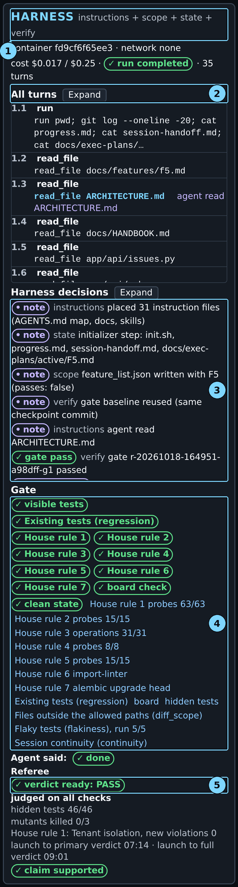

*The harness arm after the run: its turns, decisions, gate list and referee pill. Expand the decisions to see the test filter result.*

1. Harness arm line: its layers
2. Turns list
3. Harness decisions
4. Gate list
5. Referee pill (harness)

**Look at:** The last decisions: "session 2 handoff written to session-handoff.md", then "test
filters: kept 1, discarded 1".

**What it means:** In the test phase the agent proposes tests. Each must pass Filter 1: Builds and
collects, Filter 2: Passes five runs, Filter 3: Adds coverage or catches a mutant, Filter 4: Real
assertions, and Filter 5: No source changes. This run proposed 2 tests. One failed Filter 3: it added
no coverage over the existing suite. The other, `test_bulk_close_rejects_duplicate_ids`, passed all
five and was kept.

> [!CHECKPOINT]
> "test filters: kept N, discarded M" appears, then "run completed".

> [!IFDIFFERENT]
> - "kept 0" → every proposed test failed a filter. That is a result, not a failure; screen 3 gives the reason per test.

> [!INSTRUCTOR]
> Say: "Many tests an agent writes add nothing the suite did not already check. The filters throw
> those away before they ship."

### Step 9: Read both full verdicts side by side

**Where:** Browser, screen 1

**Type:** Press 1. Press F to cycle one arm full screen if the text is small.

**You should see:**

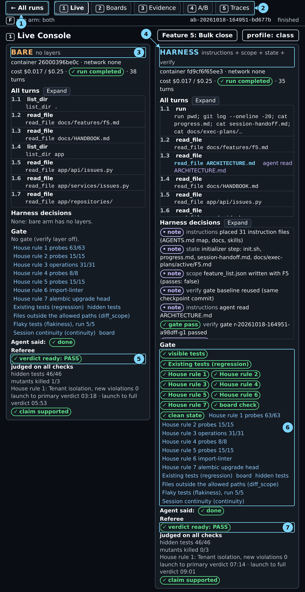

*Both arms judged. The pills are the same; the counts are where the arms differ.*

1. ← All runs: back to the run list
2. Screen tabs 1 to 5
3. Bare arm line: no layers
4. Harness arm line: its layers
5. Referee pill (bare)
6. Gate list
7. Referee pill (harness)

**Look at:** Each Referee block, then read this table aloud:

| | Bare arm | Harness arm |
|---|---|---|
| Status | run completed, 38 turns | run completed, 35 turns |
| Agent said | done | done |
| Gate | none (verify layer off) | every item passed, attempt 1 |
| Verdict pill | verdict ready: PASS | verdict ready: PASS |
| Hidden tests | 46/46 | 46/46 |
| Mutants killed | 1/3 | 0/3 |
| House rule 1: Tenant isolation, new violations | 0 | 0 |
| Launch to primary verdict (console) | 03:18 | 07:14 |
| Launch to full verdict (console) | 05:53 | 09:01 |
| Cost | $0.017 of $0.25 | $0.017 of $0.25 |

**What it means:** Both arms built a working feature: 46 of 46 hidden tests, which the agent never
saw. They differ in how. The bare arm's own tests caught one of three planted bugs; the harness
arm's tests caught none. The harness arm passed a gate the bare arm never faced. "claim supported"
on both arms means the agent said done and the referee agrees.

> [!CHECKPOINT]
> Both Referee blocks show hidden tests, mutants killed and both launch-to times.

> [!IFDIFFERENT]
> - "secondary checks running" stays → the reviewer or the mutants still run; wait a minute.
> - "claim unsupported" → the agent said done and the referee disagrees; screen 3 shows which check failed.

> [!INSTRUCTOR]
> Both pass, as here: "The difference is in how, not whether: mutants killed, scope, gate." One
> fails: name the failed count, then ask whether the cause is the layers or the machine; a timeout is
> about time. "Agent said: no claim": the arm ran out of turns before it claimed done, and the referee still
> judges what it shipped.

### Step 10: Read the boards

**Where:** Browser, screen 2

**Type:** Press 2

**You should see:**

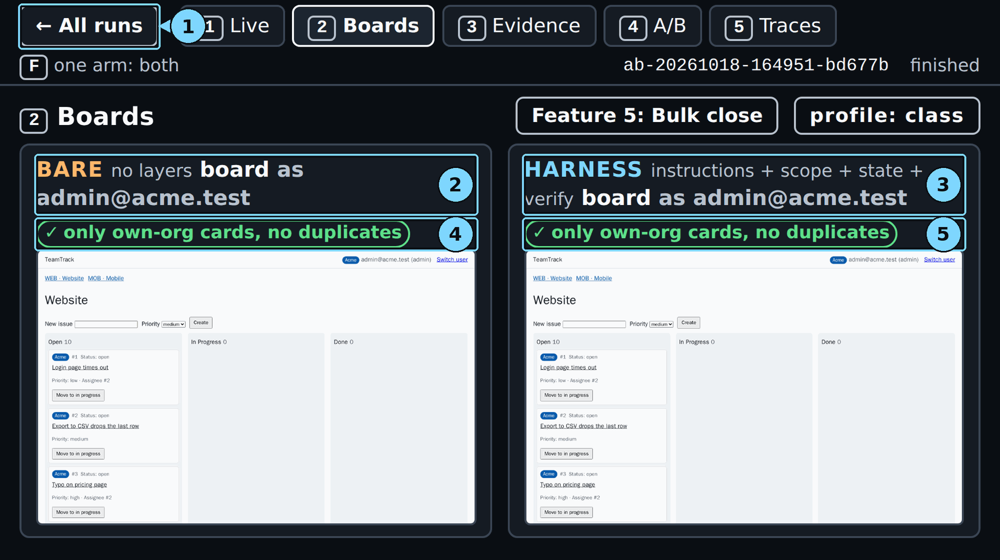

*Feature 5 adds an endpoint, not a board view, so both boards look the same as before.*

1. ← All runs: back to the run list
2. Bare board heading
3. Harness board heading: signed in as one user
4. Bare board marks
5. Harness board marks

**Look at:** The pill above each board and the org badge on each card.

**What it means:** The console takes a board screenshot per arm as an Acme user. A card from
another org would carry a ⚠ mark, a duplicate a ⧉ mark. Neither arm leaked.

> [!CHECKPOINT]
> Both boards show "only own-org cards, no duplicates".

> [!IFDIFFERENT]
> - A board is blank → the arm's app did not start; screen 3's "board check" row says why.

> [!INSTRUCTOR]
> Keep it short: "No leak on either board. Bulk close changes the API, not the board."

### Step 11: Screen 3, instructions and state: files read and sessions

**Where:** Browser, screen 3, left column

**Type:** Press 3

**You should see:**

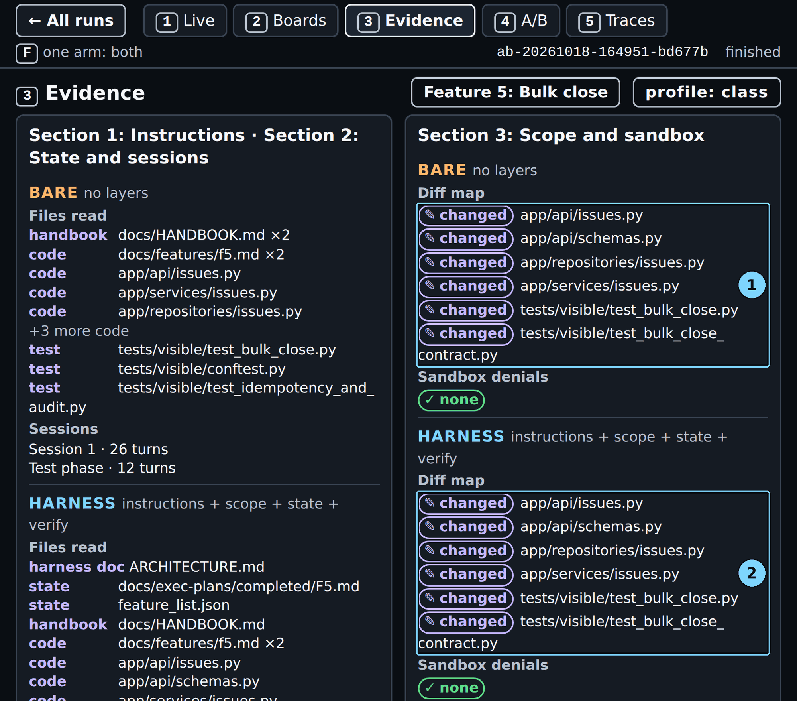

*Evidence for instructions, state and scope. The referee rows are not in this view; step 13 shows them.*

1. Diff map (bare)
2. Diff map (harness)

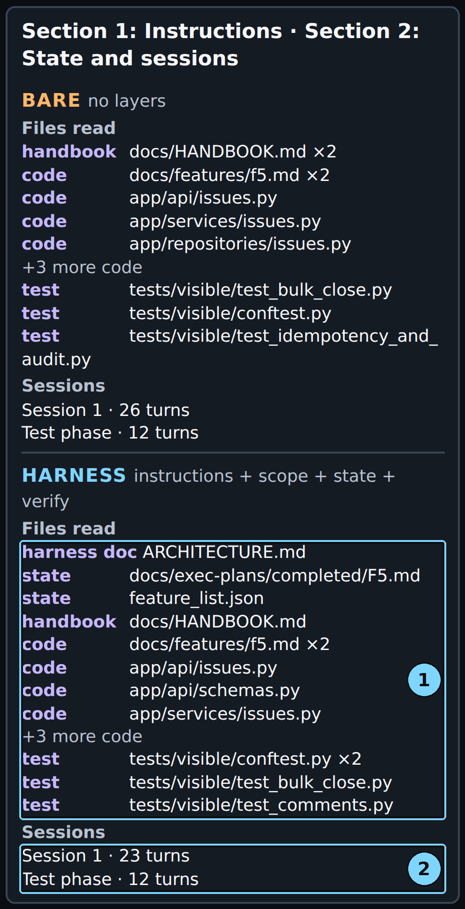

*Files read and sessions.*

1. Files read (harness)
2. Sessions (harness)

**Look at:** "Section 1: Instructions · Section 2: State and sessions". The harness arm read
`ARCHITECTURE.md` (harness doc), `docs/exec-plans/completed/F5.md` and `feature_list.json` (state),
then the handbook and the code. The bare arm read `docs/HANDBOOK.md`, the feature spec and the code.
Sessions: bare "Session 1 · 26 turns", "Test phase · 12 turns"; harness "Session 1 · 23 turns",
"Test phase · 12 turns".

**What it means:** The instructions layer put a map in front of the agent, and the agent opened the
architecture document it points to. The state layer's exec plan and feature list carried the work
from the build session into the test phase.

> [!CHECKPOINT]
> The harness arm lists a "harness doc" row and "state" rows under "Files read".

> [!IFDIFFERENT]
> - No harness doc row → the agent opened no harness document this time. That is a result; say so.

> [!INSTRUCTOR]
> Say: "Instructions and state: the agent used the map and the plan the harness left for it."

### Step 12: Screen 3, scope: diff maps and sandbox denials

**Where:** Browser, screen 3, middle column

**Type:** Press 3

**You should see:**

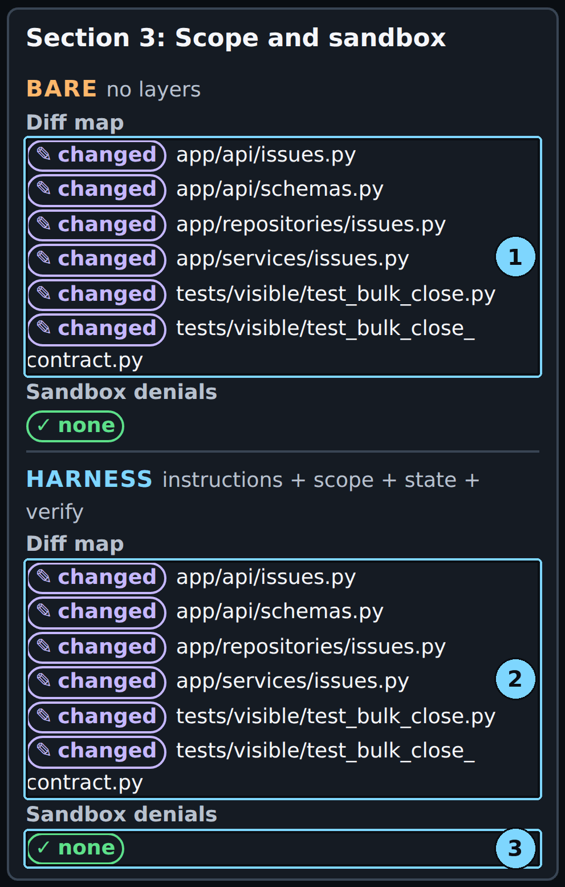

*Both arms changed the same six files, all inside the allowed paths.*

1. Diff map (bare)
2. Diff map (harness)
3. Sandbox denials (harness)

**Look at:** "Section 3: Scope and sandbox". Both arms show "✎ changed" for `app/api/issues.py`,
`app/api/schemas.py`, `app/repositories/issues.py`, `app/services/issues.py`,
`tests/visible/test_bulk_close.py` and `tests/visible/test_bulk_close_contract.py`. "Sandbox denials:
none" for both.

**What it means:** No file outside the allowed paths in either arm, so the scope layer had nothing
to block. A "⊘ blocked" row would show an edit the scope layer refused.

> [!CHECKPOINT]
> Both diff maps show only "✎ changed" rows, and both arms say "none" under sandbox denials.

> [!IFDIFFERENT]
> - A "⊘ blocked" row in the harness arm → the scope layer refused an edit outside the allowed paths; screen 1 shows the reason.

> [!INSTRUCTOR]
> Say: "Scope: on this ticket both arms stayed inside the allowed paths."

### Step 13: Screen 3, verify: referee checks, mutants, filter table

**Where:** Browser, screen 3, right column; scroll down for the mutants and the filter table

**Type:** Press 3, then scroll the right column.

**You should see:**

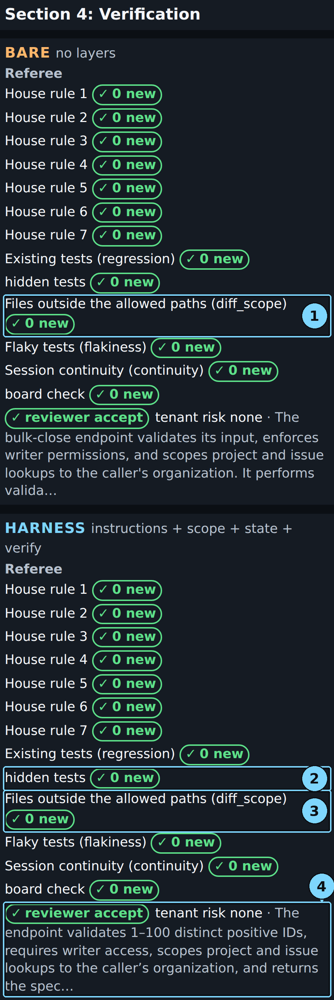

*The referee rows: every check "0 new" in both arms.*

1. Files outside the allowed paths (diff_scope), bare
2. hidden tests (harness)
3. Files outside the allowed paths (diff_scope), harness
4. Blinded reviewer's reason (harness)

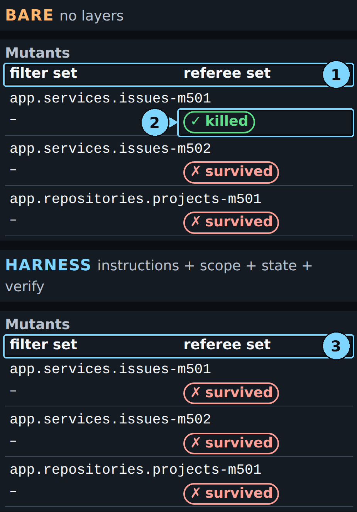

*The mutant table: which planted bugs each arm's tests caught.*

1. Mutants (bare): filter set and referee set
2. Bare: a mutant the referee set killed
3. Mutants (harness): filter set and referee set

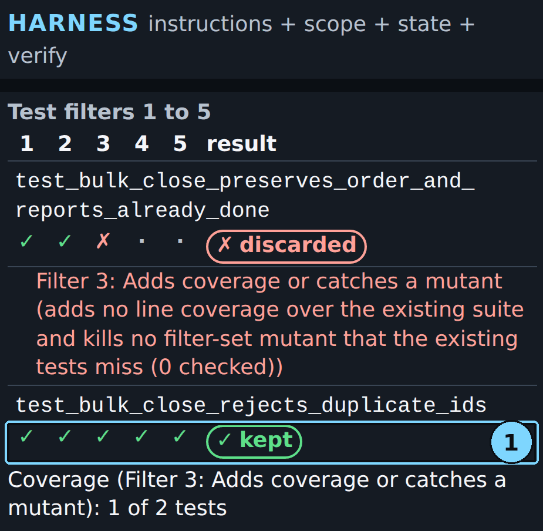

*The harness arm's filter table: one row per test, one column per filter.*

1. A test kept by the filters

**Look at:** The referee rows per arm: House rule 1 to House rule 7, "Existing tests (regression)",
"hidden tests", "Files outside the allowed paths (diff_scope)", "Flaky tests (flakiness)", "Session
continuity (continuity)", "board check", each "0 new". Then "reviewer accept · tenant risk none" with
the reviewer's one-line reason. Then the mutants: the bare arm killed `app.services.issues-m501`;
`app.services.issues-m502` and `app.repositories.projects-m501` survived. In the harness arm all three
survived. Last, the filter table: `test_bulk_close_preserves_order_and_reports_already_done` "✗
discarded" at Filter 3, `test_bulk_close_rejects_duplicate_ids` "✓ kept".

**What it means:** No check found a new violation in either arm, and the reviewer accepted both. The
mutants are the one count that separates the arms in this run, by one planted bug.

> [!CHECKPOINT]
> Both arms show "reviewer accept"; the mutant table shows one "killed" for bare and none for harness.

> [!IFDIFFERENT]
> - A filter row says "fails on the current code; this may be a real bug" → a Filter 2 discard that matched the ticket's value; read it, it may point to a real bug.

> [!INSTRUCTOR]
> On a reviewer reject: "A separate model read the diff without knowing which arm wrote it, and
> objected. Read its one-line reason before you judge the arm."

### Step 14: Screen 4, this run

**Where:** Browser, screen 4, top

**Type:** Press 4

**You should see:**

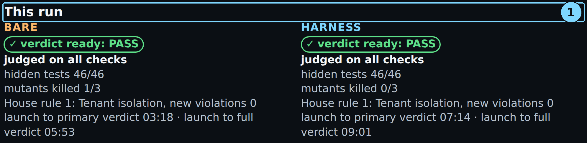

*This run, both arms, at the top of the A/B Report.*

1. This run

**Look at:** "This run": BARE "verdict ready: PASS · judged on all checks", hidden tests 46/46,
mutants killed 1/3; HARNESS the same pill, hidden tests 46/46, mutants killed 0/3. Both: House rule
1, new violations 0.

**What it means:** Screen 4 repeats this run's verdicts so you can hold them next to the earlier
runs below.

> [!CHECKPOINT]
> "This run" shows both arms with their counts.

> [!IFDIFFERENT]
> - "No results to compare yet" → the run is not finished; come back after both full verdicts.

> [!INSTRUCTOR]
> Say: "Here is today's result. Now look at what came before it."

### Step 15: Screen 4, the runs measured before class

**Where:** Browser, screen 4, left panel; scroll to the Feature 5 rows

**Type:** Press 4, then scroll the left panel to the end.

**You should see:**

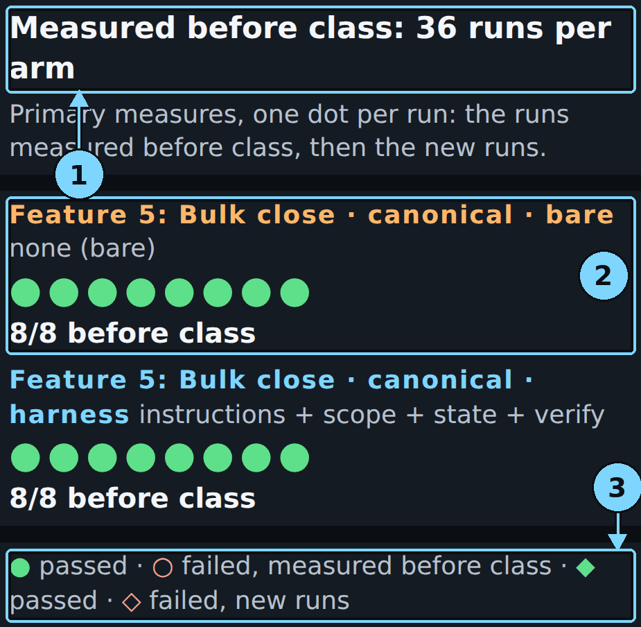

*One dot per run: filled passed, hollow failed; diamonds are new runs.*

1. Measured before class
2. Dots per run, Feature 5: Bulk close
3. Legend

**Look at:** The two Feature 5 rows. "Feature 5: Bulk close · canonical · bare": "8/8 before class ·
1/1 new". "Feature 5: Bulk close · canonical · harness": "8/8 before class · 1/1 new". Today's run is
the diamond after the bar.

**What it means:** One A/B is one dot. With no primary measure, every Feature 5 run before class
passed in both arms, and today's did too. The dots alone cannot separate the arms on this feature;
the counts in steps 9 and 13 do, run by run.

> [!CHECKPOINT]
> Each Feature 5 row ends with one new diamond.

> [!IFDIFFERENT]
> - No diamond → the score record is not in `exports/` yet; reload after the terminal prints its `Cost:` line.

> [!INSTRUCTOR]
> Say: "One A/B is one dot. Read it next to the dots from before class." Point at the rows of Feature 4: Version checks on issue edits
> for contrast: there the dots do separate the arms on files outside the allowed paths.

### Step 16: Screen 4, cost per verified feature and reviewer agreement

**Where:** Browser, screen 4, middle and right panels

**Type:** Press 4

**You should see:**

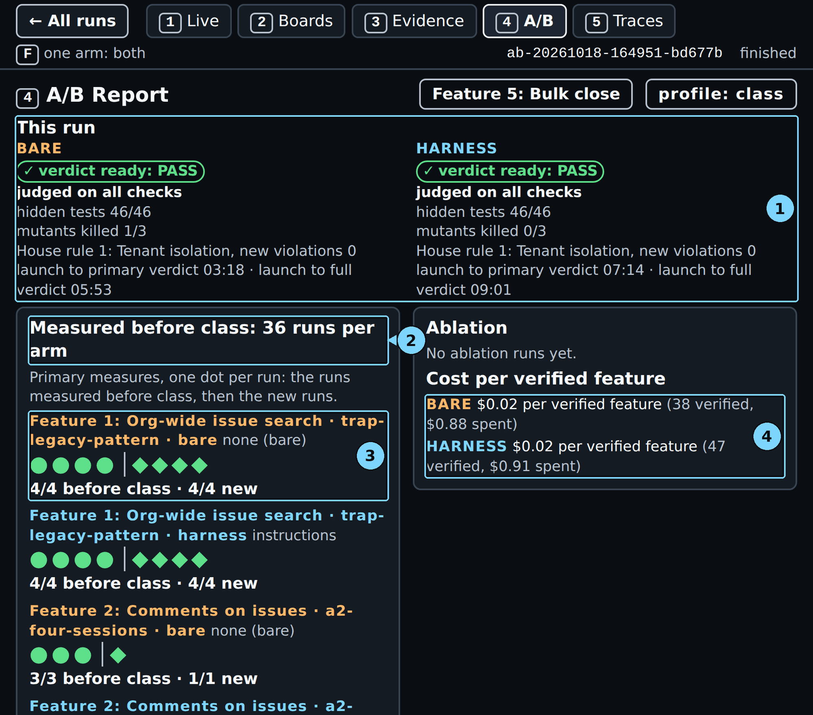

*The top of the A/B Report.*

1. This run
2. Measured before class
3. Dots per run
4. Cost per verified feature

**Look at:** "Cost per verified feature": BARE "$0.03 per verified feature (27 verified, $0.68
spent)", HARNESS "$0.02 per verified feature (36 verified, $0.76 spent)". "Reviewer agreement": BARE
"reviewer agrees with the referee in 27/35 runs", HARNESS "29/35 runs".

**What it means:** Cost per verified feature divides what an arm spent across all scored runs by the
features the referee verified. Reviewer agreement counts how often the blinded reviewer and the
referee agreed. Both pool every run in `exports/`, not only today's.

> [!CHECKPOINT]
> Both panels show one line per arm.

> [!IFDIFFERENT]
> - "No costs yet" → no scored record is in `exports/` yet; wait for the full verdicts.

> [!INSTRUCTOR]
> Say: "Across all runs, the harness arm verified more features for a little more money in total.
> In this run it cost $0.0166 against the bare arm's $0.0173."

### Step 17: Screen 5, traces

**Where:** Browser, screen 5

**Type:** Press 5

**You should see:**

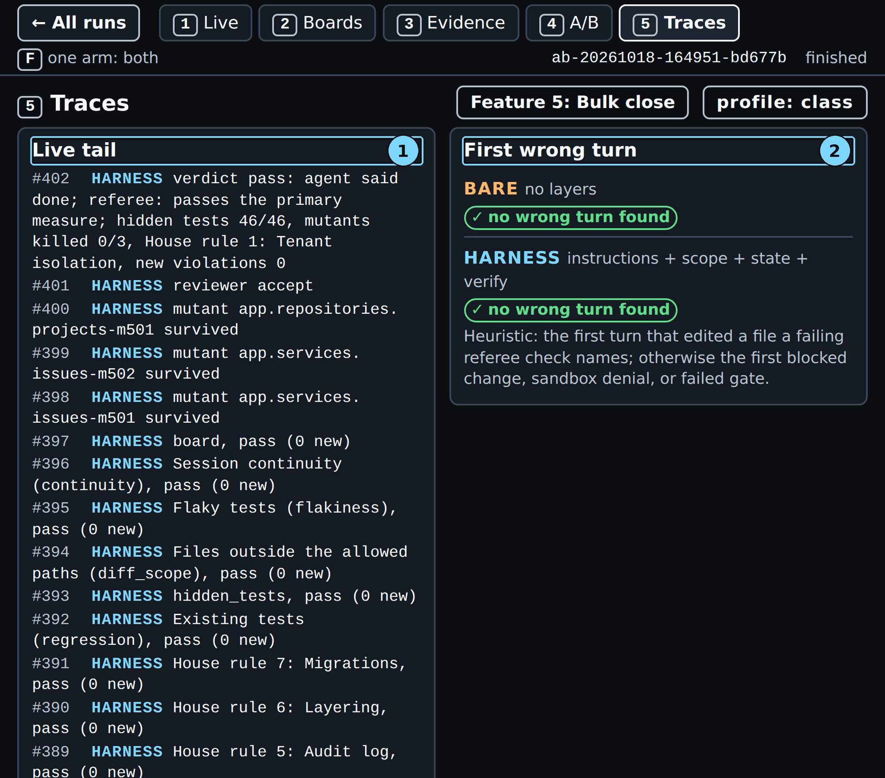

*Traces: the event tail and the first wrong turn per arm.*

1. Live tail
2. First wrong turn

**Look at:** "First wrong turn": "no wrong turn found" for both arms. The tail ends with the harness
arm's mutants "survived", "reviewer accept" and its verdict line.

**What it means:** The console looks for the first turn that edited a file a failing referee check
names, else the first blocked change, sandbox denial or failed gate. With every check passing, it
finds none. Surviving mutants do not count as a wrong turn: they show weak tests, not a wrong edit.

> [!CHECKPOINT]
> Each arm shows a "First wrong turn" result and LangSmith links.

> [!IFDIFFERENT]
> - No LangSmith links → tracing is off; the run is still valid.

> [!INSTRUCTOR]
> Open one LangSmith link only if a question needs it.

### Step 18: Read the terminal's final lines

**Where:** Terminal 2

**Type:** No command.

**You should see:**

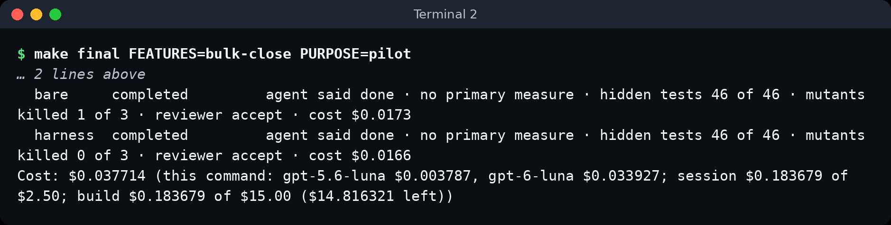

*Terminal 2 when the command ends.*

<!-- check-style: allow SC08 quoted terminal output -->
```text
Final A/B: Feature 5: Bulk close
A/B ab-20261018-164951-bd677b (Feature 5: Bulk close, layers=['instructions', 'scope', 'state', 'verify'], profile=class)
  bare     completed         agent said done · no primary measure · hidden tests 46 of 46 · mutants killed 1 of 3 · reviewer accept · cost $0.0173
  harness  completed         agent said done · no primary measure · hidden tests 46 of 46 · mutants killed 0 of 3 · reviewer accept · cost $0.0166
Cost: $0.037714 (this command: gpt-5.6-luna $0.003787, gpt-6-luna $0.033927; session $0.183679 of $2.50; build $0.183679 of $15.00 ($14.816321 left))
```

**Look at:** Per arm: status, "agent said: done", "no primary measure", hidden tests, mutants killed,
reviewer, cost. Then the `Cost:` line.

**What it means:** The arm lines repeat screen 1, one line each. The `Cost:` line gives this
command's spend, split into reviews (gpt-5.6-luna) and agents (gpt-6-luna), then the session and
build totals against their caps. The session figure here includes the four section runs before it.

> [!CHECKPOINT]
> Both arm lines and the `Cost:` line are printed, and the prompt returns (exit code 0).

> [!IFDIFFERENT]
> - `make: *** … Error 2` after the lines → an arm was aborted on time or cost. Both arms are still judged: a result, not a failure.

> [!INSTRUCTOR]
> Read the session figure on the `Cost:` line aloud. In class it shows what the whole session has
> spent against $2.50.

### Step 19: Say what the result means

**Where:** Browser, screen 1 or screen 4

**Type:** No command.

**You should see:** The table in step 9 and the Feature 5 dots in step 15.

**Look at:** Mutants killed, the gate, and files outside the allowed paths, per arm.

**What it means:** Read the outcome as one of three:

- Harness ahead: better counts, and the runs before class show the same gap.
- No measurable difference: equal counts, or a difference one run can produce.
- Bare ahead: the same as harness ahead, the other way round.

In this run both arms passed every check. The bare arm killed one more mutant (1 of 3 against 0 of 3).
As one dot that is a difference one run can produce. Earlier Feature 5 runs split 2 of 3 against 3
of 3 and 3 of 3 against 1 of 3, so no arm leads on mutants across runs.

> [!CHECKPOINT]
> You can say the result in one sentence, with its counts.

> [!IFDIFFERENT]
> - One arm failed → name the failed count and its cause (the layers, or machine time).

> [!INSTRUCTOR]
> Both pass: "The difference is in how, not whether: mutants killed, scope, gate." One fails: "This
> is one dot. Here is why it failed, and here is what the earlier dots say."

## Result summary

| | Bare arm | Harness arm |
|---|---|---|
| Status | completed, 38 turns | completed, 35 turns |
| Sessions | build 26, test phase 12 | build 23, test phase 12 |
| Agent said | done | done |
| Gate | none (verify layer off) | passed at attempt 1 |
| Hidden tests | 46 of 46 | 46 of 46 |
| Mutants killed | 1 of 3 | 0 of 3 |
| Files outside the allowed paths | 0 | 0 |
| Sandbox denials | none | none |
| Test filters | none | kept 1, discarded 1 |
| Blinded reviewer | accept | accept |
| Launch to primary verdict (from make) | 3:27 | 7:23 |
| Launch to full verdict (from make) | 6:02 | 9:10 |
| Arm cost | $0.0173 | $0.0166 |

## Time and cost

The run ran alone on the class machine. From the make command to the `Cost:` line: 9 min 11 s, exit
code 0. The console's own "launch to" times are about 9 seconds shorter, because its clock starts at
the run's first event. The command cost $0.037714: $0.033927 for the two agents on gpt-6-luna and
$0.003787 for the two blinded reviews on gpt-5.6-luna. The cap is $0.58 per feature: two arms at
$0.25 and two reviews at $0.04. Before class, three runs of the same command, two at a time, took
up to 15 min 22 s and cost $0.044 to $0.048 each.

| Moment | Range, two runs, 2026-10-18 |
|---|---|
| Launch to primary verdict | bare 2:48 to 3:27, harness 5:31 to 7:23 |
| Launch to full verdict | bare 5:07 to 6:02, harness 7:25 to 9:10 |
| Cost of the command | $0.038 to $0.042 |

The ranges cover this run and a second run of the same command by a reviewer on a fresh clone
(`ab-20261018-182151-a4bd6f`), each alone on the machine. That run has no recorded launch time, so
its times count from its first event plus this run's 7 s. Running two demos at once makes both
slower.

## What to say in class

- "One A/B is one dot. Read it next to the dots from before class, not on its own."
- "Feature 5 has no primary measure, so 'verdict ready: PASS' is not news. The counts are."
- "Both arms passed 46 of 46 hidden tests. The difference is in how, not whether: mutants killed, scope, gate."
- "Today the bare arm's tests caught one more planted bug. Earlier runs split the other way, so this is no gap yet."
- "To learn which layers earn their place, remove one layer at a time and compare many runs, not one."
