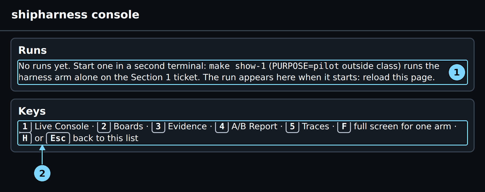

# Part 0: Before you start

Every demo in this guide uses the same set-up: two Ubuntu terminals in your copy of the course
repository, and the console open in a browser. This part gets you there and checks that the
machine is ready, with no model calls and no cost. Do it once before class, and again on the
morning of the class (Steps 3 to 7 take a few minutes once everything is installed).

> **Terms on this page**
>
> - **Console**: the browser page that shows a run live, on five screens.
> - **Referee**: the program that scores each run after the agent stops.
> - **Class date**: the class day in `.env`, which names the LangSmith project and keys the session cap.
> - **Purpose**: the make variable that picks the LangSmith project and the cost session.

## What you need

| Item | What it is for | Where to set it up |
|---|---|---|
| Windows 11 with WSL2 and Ubuntu | Every course command runs in the Ubuntu terminal | `setup/windows.md` |
| Docker Engine inside Ubuntu | The agent and the referee run in containers | `setup/windows.md`, step 5 |
| git, uv and make | Clone, Python packages, the `make` commands | `setup/windows.md`, steps 6 to 8 |
| A clone of the course repository | The code, the app, and the checkpoint tags | `setup/windows.md`, step 9 |
| Two keys in `.env` | OpenAI for the agent, LangSmith for the traces | `setup/windows.md`, step 10 |

On macOS or Linux, follow `setup/macos.md` or `setup/linux.md` instead; every command in this guide
is the same, and "Ubuntu terminal" means your normal terminal.

> [!WARNING]
> Your two keys live only in `.env` at the repository root. Never paste them into a chat, a
> ticket, a slide, or a command line, and never share a screenshot of `.env`. The tools read the
> file themselves and never print a key. If a key leaks, delete it on its provider's page and
> create a new one.

### Step 1: Open Terminal 1

**Where:** Windows, the Start menu

**Type:** Click Start, type `Ubuntu`, and open the Ubuntu app. From PowerShell you can type this
instead:

```bash
wsl -d Ubuntu
```

Then go to your copy of the repository:

```bash
cd ~/shipharness
```

**You should see:** an Ubuntu prompt that ends in `~/shipharness$`.

**Look at:** the folder in the prompt. It starts with `~`, not `/mnt/c`.

**What it means:** this is Terminal 1. In this guide it runs the console and nothing else, so it
stays open for the whole class.

> [!CHECKPOINT]
> `pwd` prints a path in your Linux home folder that ends in `/shipharness`.

> [!IFDIFFERENT]
> `No such file or directory` → your copy has another name or place; `cd` into the folder you cloned.
> The path starts with `/mnt/c` → the copy is on the Windows drive and runs slowly; clone it again under `~` (`setup/windows.md`, step 9).
> `wsl` is not found in PowerShell → WSL is not installed (`setup/windows.md`, step 4).

> [!INSTRUCTOR]
> Put Terminal 1 on the left half of the shared screen and the browser on the right. Say: "This
> terminal only serves the console. The runs start in the other one."

### Step 2: Open Terminal 2

**Where:** Windows, a second Ubuntu window

**Type:** Open the Ubuntu app a second time (or a second tab in Windows Terminal), then:

```bash
cd ~/shipharness
```

**You should see:** a second prompt that ends in `~/shipharness$`.

**Look at:** the window title or tab, so you can tell the two terminals apart.

**What it means:** this is Terminal 2. Every check and every demo run starts here.

> [!CHECKPOINT]
> Two Ubuntu windows are open, both in the repository folder.

> [!IFDIFFERENT]
> The prompt shows another folder → run the `cd` command again in this window.

> [!INSTRUCTOR]
> Name the two terminals out loud once: "Terminal 1 serves the console, Terminal 2 starts the
> runs." The chapters use these names in every step. The class plan in `docs/instructor-guide.md`
> also starts the final A/B in a third Ubuntu window, opened the same way, right after `make show-4`.
> Every step and every time in this guide uses Terminal 2 alone, with one demo running at a time.

### Step 3: Check that your copy matches the class release

**Where:** Terminal 2

**Type:**

```bash
uv run shipharness verify --tag class-v1
```

**You should see:** one line that starts with `your copy matches class-v1:`, followed by the number
of paths and checkpoint trees it compared. On the course machine, for a fresh clone of the release:

> Your output will differ: run times, ids, and the agent's wording change on every run.

```text
your copy matches class-v1: 27 paths, 8 checkpoint trees
```

**Look at:** the first words: `your copy matches`.

**What it means:** the command compares every course file and every checkpoint tag in your copy
with the record stored in the `class-v1` tag. It makes no model calls. A match means your demos
start from the same code as the course's runs.

> [!CHECKPOINT]
> The line starts with `your copy matches class-v1`, and the command exits without an error.

> [!IFDIFFERENT]
> `x tag class-v1 not found` → run `git fetch --tags`, then run the command again.
> One line per changed file → you edited a course file; `git status` names it, and `git restore` with the file name puts it back.
> `is not a git clone` → you are not in the repository folder; `cd ~/shipharness`.

> [!INSTRUCTOR]
> Run this on the class machine the morning of the class. A copy that does not match can give a
> different result from the one this guide shows.

### Step 4: Run make doctor

**Where:** Terminal 2

**Type:**

```bash
make doctor PURPOSE=pilot
```

**You should see:** one line per check, each starting with `+ ok`: python, git, uv, the container
runtime, both keys, the two models, the prices, and `.env not in git`. It took 6 s on the course
machine. The last lines there:

```text
  + ok          OPENAI_API_KEY         accepted by OpenAI
  + ok          agent model            gpt-6-luna accepted
  + ok          reviewer model         gpt-5.6-luna accepted
  + ok          LANGSMITH_API_KEY      accepted by LangSmith
  + ok          prices                 gpt-6-luna, gpt-5.6-luna
  + ok          .env not in git        not tracked
  + ok          SHIPHARNESS_CLASS_DATE not needed for PURPOSE=pilot
  result: + ready
Cost: $0.000000 (no model calls)
```

**Look at:** the key lines. They end in `accepted by OpenAI` and `accepted by LangSmith`, and no
part of a key is ever shown.

**What it means:** one command checks the whole machine. The OpenAI checks ask whether the key
works and whether it can use both course models; they use no tokens. `PURPOSE=pilot` skips the
class date check (see "What PURPOSE=pilot means" below).

> [!CHECKPOINT]
> The last line reads `result: + ready`, and there is no `make: ***` line after it.

> [!IFDIFFERENT]
> `x missing OPENAI_API_KEY` (or `LANGSMITH_API_KEY`) → put the key in `.env` next to the `Makefile`.
> `x missing agent model` (or `reviewer model`) → use the key from the program's email, or your own key on the Build tier.
> `! warn container runtime` → start Docker with `sudo systemctl start docker`.

> [!INSTRUCTOR]
> Every `x` line has a `next step` line under it. Read that line out loud if a learner's check
> fails: the fix is printed there.

### Step 5: Run make warm

**Where:** Terminal 2

**Type:**

```bash
make warm PURPOSE=pilot
```

**You should see:** one line per step with its time, then `warm: done` and a cost line. A first
warm-up on a fresh clone builds both images and computes 10 baselines; on the course machine it
took 431 s. Its first and last lines:

```text
images: built (shipharness-agent:1: no record of its source; shipharness-referee:1: no record of its source) (236.8 s)
page-in shipharness-agent:1 (0.6 s)
page-in shipharness-referee:1 (0.4 s)
plan: 10 baselines to compute (0.5 s)
referee baseline demo-1 (Feature 1: Org-wide issue search): computed (67.4 s)
gate baseline final (Feature 7: Labels): computed (43.0 s)
warm: done (429.0 s)
Cost: $0.000000 (this command: no calls; session $0.000000 of $2.50; build $0.000000 of $15.00 ($15.000000 left))
```

The excerpt skips the build log and the middle lines: one `referee baseline` line per class task
and one `gate baseline` line per gated task. A second `make warm` builds nothing, every baseline
line ends in `cached`, and it takes about 2 s.

**Look at:** the last line before the cost line: `warm: done`.

**What it means:** `make warm` rebuilds an image only if its source changed, starts each image once,
and saves the referee's and the gate's results on the unchanged app (the baselines), so the first
demo starts at once. It makes no model calls and is safe to run again.

> [!CHECKPOINT]
> The last line before the cost line is `warm: done`.

> [!IFDIFFERENT]
> `x images: build failed` → start Docker, then run `make images` to see the build error.
> The last line is `warm: incomplete` → fix the step marked `x` and run `make warm PURPOSE=pilot` again; finished baselines stay cached.

> [!INSTRUCTOR]
> Run `make warm` on the class machine at least 30 minutes before class, so a first warm-up never
> runs during the session.

### Step 6: Start the console

**Where:** Terminal 1

**Type:**

```bash
make console
```

**You should see:** three lines, then nothing more: the `uv run shipharness console --port 8765`
command, the address line `Console: http://127.0.0.1:8765/`, and the line
`Only warnings and errors print here; make console VERBOSE=1 (--verbose) logs each request.`

**Look at:** the address on the `Console:` line: `http://127.0.0.1:8765/`.

**What it means:** the console is a small web server that reads the run folders on disk. It is
quiet by default: only the address, warnings and errors print here. Leave it running for the
whole class. `make console VERBOSE=1` also prints one line per browser request.

> [!CHECKPOINT]
> The `Console:` line shows `http://127.0.0.1:8765/`, and the prompt does not come back.

> [!IFDIFFERENT]
> `address already in use` → another program holds port 8765: run `make console CONSOLE_PORT=8766` and use port 8766 in the next step.
> The prompt comes back with an error → read the last line; if it names a missing package, run `make setup` once.

> [!INSTRUCTOR]
> Never close Terminal 1 during class. If the console header shows `reconnecting`, the server
> stopped: run `make console` again and reload the browser.

### Step 7: Open the console in the browser

**Where:** your Windows browser

**Type:** Open a new tab and go to `http://127.0.0.1:8765/`.

**You should see:** the "Runs" panel and the "Keys" panel. Before the first run, the list is
empty:



*A fresh console: no runs yet, and the keys every chapter uses.*

1. No runs yet: start one in Terminal 2
2. Console keys

Once runs exist, each one is a card with its run id, section, feature, type ("harness in action"
for a single-arm run, "A/B" for two arms), status ("finished" once the referee is done), and start
time, newest first.

**Look at:** the "Keys" panel under the run list: it lists the keys 1 to 5 and the screen each one
opens, then `F`, and `H` or `Esc`.

**What it means:** the console shows every run under `.shipharness/runs/` in your copy. A new run
appears when you reload the page; the list does not refresh by itself.

> [!CHECKPOINT]
> The page loads and shows the "Runs" panel; on a fresh copy it starts with "No runs yet".

> [!IFDIFFERENT]
> The page does not load → check that Terminal 1 still runs `make console`, then try `http://localhost:8765/`.
> Text or panels look cut off → press `Ctrl+0` to reset the browser zoom, then `Ctrl+F5` to reload.
> The page looks like an older design → press `Ctrl+F5` for a hard reload.

> [!INSTRUCTOR]
> Zoom the browser so the back row can read the pills; the console is fluid and reflows at any
> zoom or Windows display scaling. `Ctrl+0` returns to the normal size.

### Step 8: Learn the console keys

**Where:** browser, the console

**Type:** Nothing yet: a fresh copy has no runs, so there is no run card to open. Read the table
now. After your first run (Chapter 1, Step 5), click the run id on its card, press `1`, `2`, `3`,
`4` and `5` in turn, press `F`, then press `H` to go back to the run list.

**You should see:** once a run is open, a different screen for each number key:

| Key | Screen | What it shows |
|---|---|---|
| `1` | Live | Each arm's turns, cost, harness decisions, the gate, and the verdict |
| `2` | Boards | Each arm's running app as a user sees it, every 5 s |
| `3` | Evidence | Files read, the diff, the referee's checks, the test filters |
| `4` | A/B report | The runs measured before class, one dot per run, and this run |
| `5` | Traces | A live tail of events and the LangSmith trace links |

**Look at:** the tabs at the top: the current screen's tab is outlined. `F` cycles one arm to the
full width (both, bare, harness). "← All runs", `H` or Esc returns to the run list.

**What it means:** every chapter of this guide names the screen by its key, such as "Press 3".

> [!CHECKPOINT]
> You know which key opens which screen. After Chapter 1, each number key changes the screen, and
> `H` brings back the run list.

> [!IFDIFFERENT]
> The keys do nothing → click once on the page so it has the keyboard focus, then press the key again.
> The run list still says "No runs yet" → expected before Chapter 1; come back to this step after your first run.

> [!INSTRUCTOR]
> Practise the keys before class with the run from your practice of Chapter 1. On screen 4, a run of type "harness in
> action" has one arm, so the screen has no two arms to compare.

## What PURPOSE=pilot means

Every live command and every check takes a `PURPOSE`. It picks two things: the LangSmith project
the traces go to, and the cost session that the session cap counts against. The run itself is the
same: the same agent, the same harness, the same referee, and the same caps per run.

| `PURPOSE` | LangSmith project | Cost session |
|---|---|---|
| `class` (the default) | `shipharness-class-` plus the class date | One per class date |
| `pilot` | `shipharness-pilot` | One, named `pilot` |
| `assignment` | `shipharness-assignments` | One, named `assignment` |

This guide adds `PURPOSE=pilot` so that practice runs never use the class project or the class
day's $2.50 session cap. On class day, set `SHIPHARNESS_CLASS_DATE` in `.env` to the class day and
run the same commands without `PURPOSE=pilot`: the traces then go to the class project.
