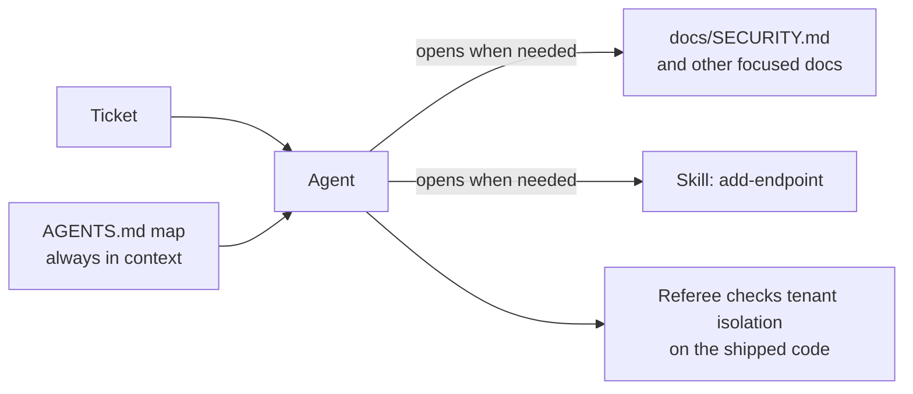

# Module 1: Harness Engineering for Coding Agents - Section 1: Instructions

What the agent knows: a short map in its context, and the details on disk.

## The problem

**Illustrative scenario.** You ask a coding agent to add an org-wide issue search to a multi-tenant
tracker. The tenant rule is written down, deep in a long handbook. The agent finds a legacy list
handler that predates the rule. It has no org filter, and the agent copies its query. The tests create
one org, so they pass. The diff looks like the code around it, so review approves it. After release,
one customer's search returns another customer's issues.

The cost is a cross-tenant data exposure, an incident, a disclosure, and a hunt for every other copy
of the pattern.

> **Terms on this page**
>
> - **Harness**: The files and code around the agent that decide what it sees and may do.
> - **Harness layer**: One part of the harness: instructions, state, scope, or verification.
> - **Bare arm**: An agent run with the ticket and the repository, and no harness.
> - **Harness arm**: The same run with the harness turned on.
> - **Referee**: The program that scores each run after the agent stops.
> - **Map**: A short `AGENTS.md` that says where each rule lives, instead of holding every rule.
> - **Agent Skill**: A folder with a `SKILL.md` recipe that the agent loads only when a task needs it.
> - **House rule 1: Tenant isolation**: another org's resource answers 404, never 403.
>
> All terms: [glossary](../docs/glossary.md).

## Why it happens

- A rule the agent never reads does not exist for it. OpenAI's harness team puts it this way: "From
  the agent’s point of view, anything it can’t access in-context while running effectively doesn’t
  exist." ([OpenAI, Harness engineering](https://openai.com/index/harness-engineering/))
- Agents copy what they find: "Codex replicates patterns that already exist in the repository—even
  uneven or suboptimal ones." ([OpenAI, Harness engineering](https://openai.com/index/harness-engineering/))
- A longer instruction file does not fix it: "Too much guidance becomes non-guidance."
  ([OpenAI, Harness engineering](https://openai.com/index/harness-engineering/))

## How this section fixes it

The instructions layer gives the agent a short `AGENTS.md` that "serves primarily as a map". The map
points into a `docs/` folder with one focused document per topic. Agent Skills hold step-by-step
recipes. The agent sees only their names and descriptions until a task needs one
([Agent Skills Specification](https://agentskills.io/specification)).

The course also measures whether the map helps. On this ticket, with this model, it made no
measurable difference: neither arm leaked data in any test run before class
([evidence](../docs/evidence/s1.md#section-1)). The concepts page explains why, and when a map still
earns its place.

## How to work through this section

In class the section takes 50 minutes. The live demo starts at minute 1, on the section's start slide, and runs while
the concepts are taught.

| Part | What it gives you | In class |
|---|---|---|
| [concepts.md](concepts.md) | The idea, how it works, what the course measured | Minutes 2-20 |
| [demo/](demo/README.md) | The live run of the harness arm, and how to read it | Launch at minute 1; review at 30-46 |
| [demo/walkthrough.md](demo/walkthrough.md) | The code behind the layer, about 40 lines | Minutes 20-30, on the DEMO slide |
| [assignment/](assignment/README.md) | Turn an 899-line instruction file into a map, docs, and a skill | After class |
| [post-class-reading/](post-class-reading/README.md) | Three short readings on maps and skills | After class |
| [session-notes.md](session-notes.md) | What class showed, questions, what to try next | After class |

## Where next

- First time here? Install everything with [setup/](../setup/README.md), then run the
  [demo](demo/README.md).
- Already set up? Start with [concepts.md](concepts.md).
- Want to use the map in your own repository? See [use-in-your-repo/](../use-in-your-repo/README.md).

## Sources

- Source 1: Harness engineering: leveraging Codex in an agent-first world, <https://openai.com/index/harness-engineering/>, Ryan Lopopolo (OpenAI), 2026-02-11
- Source 2: Agent Skills Specification, <https://agentskills.io/specification>, Agent Skills project, n.d.
