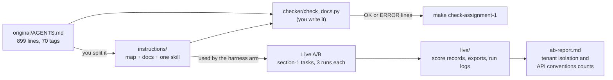

# Module 1: Harness Engineering for Coding Agents - Assignment 1: Instructions, from one long instruction file to a map

Try it yourself first. The full solution is in [./solution/](solution/) with a step-by-step walkthrough.

## The problem

**Illustrative scenario.** A team keeps every rule for its multi-tenant service in one long
`AGENTS.md`. The tenant rule sits between incident notes, a review checklist, and rules retired long
ago. An agent asked for a new list endpoint skims the file, misses the tenant rule, and copies an old
handler with no org filter. The tests use one org, so they pass. Someone proposes splitting the file,
and nobody can say whether a rule would be lost on the way.

Your starting point is that kind of file: `starter/original/AGENTS.md`, 899 lines, 70 tagged rules.
OpenAI's harness team names the cost of such a file: "A giant instruction file crowds out the task,
the code, and the relevant docs." Their fix is a short map, focused documents, and checks that run by
machine ([Harness engineering](https://openai.com/index/harness-engineering/)).

> **Terms on this page**
>
> - **Map**: A short `AGENTS.md` that says where each rule lives, instead of holding every rule.
> - **Rule tag**: An id such as `R1.2` or `CV-07` that marks one rule in the original file.
> - **Retired rule**: A tagged rule marked "(retired ...)" that must not come back.
> - **Agent Skill**: A folder with a `SKILL.md` recipe that the agent loads only when a task needs it.
> - **Bare arm**: An agent run with the ticket and the repository, and no harness.
> - **Harness arm**: The same run with the harness turned on.
> - **A/B**: Bare arm and harness arm on the same ticket, scored the same way.
> - **Tenant isolation rule**: House rule 1: Tenant isolation. Another org's resource answers 404, never 403.
> - **API conventions rule**: House rule 3: API conventions. List and error envelopes, status codes.
> - **Live evidence**: The files your real A/B run wrote, collected into `live/`.
> - **Score record**: The file the referee writes for each run, with every measured result.
> - **Experiment export**: The JSON file the run writes for each arm, listing that arm's runs.

## What you'll build



You split the file into an `instructions/` tree: a short map, `ARCHITECTURE.md`, a `docs/` folder
where each active rule lives in exactly one document, and one Agent Skill. You write
`checker/check_docs.py`, a script that fails when a link breaks or a rule from the original goes
missing. Then you run one live A/B of your tree against the bare arm, keep its evidence in `live/`,
and report the tenant isolation and API conventions results as counts in `ab-report.md`. Everything
lives in your work folder, `starter/` by default. The exact requirements are in [SPEC.md](SPEC.md).

## Step by step

All commands run from the repository root. Steps 1 to 5 need no keys and no Docker.

1. **See where you start.** Run the self-check and the visible tests:

   ```bash
   make check-assignment-1
   uv run python -m pytest -q -p no:cacheprovider section-1-instructions/assignment/starter/checker
   ```

   Check: the self-check prints one FAIL line per open requirement, each saying what to fix. On the
   unchanged starter it fails by design.

2. **Read the original.** List its sections and its 70 tags: 66 active, 4 retired. Decide a home for
   each: the tenant isolation and roles rules (`R1`, `R2`) in `docs/SECURITY.md`, the API conventions
   rule (`R3`) in an API conventions design doc, the safe retries, audit log, and migrations
   rules (`R4`, `R5`, `R7`) in `docs/RELIABILITY.md`, and the layering rule (`R6`) in
   `ARCHITECTURE.md`. History and review notes are background, not rules.
   Check: every active tag has exactly one planned home.

3. **Write the checker first.** Fill the two stubs marked `TODO(A1-3)` and `TODO(A1-4)` (the
   markers for steps 3 and 4) in `starter/checker/check_docs.py`, then add your own tests. Check: the visible tests pass, and the
   checker reports 69 problems on the starter tree (66 missing rules, 3 broken paths).

4. **Split the file.** Create the documents and move each active tag into exactly one of them. Leave
   the retired rules out. Run your checker after every document:

   ```bash
   uv run python section-1-instructions/assignment/starter/checker/check_docs.py \
     --original section-1-instructions/assignment/starter/original/AGENTS.md \
     --tree section-1-instructions/assignment/starter/instructions
   ```

   Check: the last line reads `OK: ... 66 rules covered`.

5. **Write the map and the skill.** The map is about 100 lines: a "where to look" table, the house
   rules as pointers, a "do not copy" warning, commands, and a short "before you finish" list. Copy
   `use-in-your-repo/skills/skill-template` into `instructions/.agents/skills/` under a new name, then
   validate it:

   ```bash
   uv run shipharness skills validate section-1-instructions/assignment/starter/instructions/.agents/skills
   ```

   Check: the validator reports 0 errors and 0 warnings.

6. **Run the A/B live, once.** It needs your keys and Docker, and the command stops at $2.50. Finish
   the tree first, because the evidence must match the tree you submit. Follow
   [SPEC.md, "Run the A/B"](SPEC.md#run-the-ab): it copies your tree into the layer's folder on a
   throwaway branch, runs 8 tasks with 3 runs per arm, and collects the evidence into `live/`.
   Check: `live/` holds the output, two exports, 48 score records, and 24 run logs.

7. **Write the report.** Copy the numbers from the `ab_summary.py` output into `ab-report.md`, then
   write what they mean and what they cannot tell you. Never re-run to get a nicer result; every run
   counts. Check: the self-check's `report-*` and `live-*` lines pass.

8. **Submit.** Run `make check-assignment-1` until every line says PASS, then commit your work folder,
   `live/` included, on your own branch.

## Grading criteria (100 points)

| Criterion | What earns the points | Points | Checked by |
|---|---|---|---|
| A. Map and layout | Files present, map of 30 to 120 lines, docs reachable, nothing overwritten | 15 | Self-check |
| B. Rule coverage | Each active rule once, at least half its words kept, no extra rules or facts | 25 | Mostly grader |
| C. Skill | Valid, named for its folder, "Use when", linked from the map, cites tags | 12 | Self-check |
| D. Docs checker | Your tests pass, clean on your tree, finds faults, passes hidden cases | 26 | Both |
| E. A/B report | Exact command, `R1` and `R3` rows as counts, links, budget, reading and limits | 10 | Self-check |
| F. Live run evidence | Complete, matches the command, class model and caps, your tree used | 12 | Self-check |
| **Total** | | **100** | |

`make check-assignment-1` runs the visible checks. The instructor's grader adds hidden checks; it is
not in this repository. The points per item are in
[SPEC.md](SPEC.md#grading-criteria-item-by-item).

## Solution walkthrough

The reference solution is a finished work folder in [solution/](solution/). Its
[SOLUTION.md](solution/SOLUTION.md) explains:

- how the 66 active rules were split into seven documents, each answering one question;
- why the checker came first, and how it resolves links across the tree and TeamTrack;
- why the skill targets list endpoints, the task the A/B measures;
- what the live A/B measured, and the grade it earned.

Read it after your own attempt, and compare your choices with its alternatives.

## Sources

- Source 1: Harness engineering: leveraging Codex in an agent-first world, <https://openai.com/index/harness-engineering/>, Ryan Lopopolo (OpenAI), 2026-02-11
