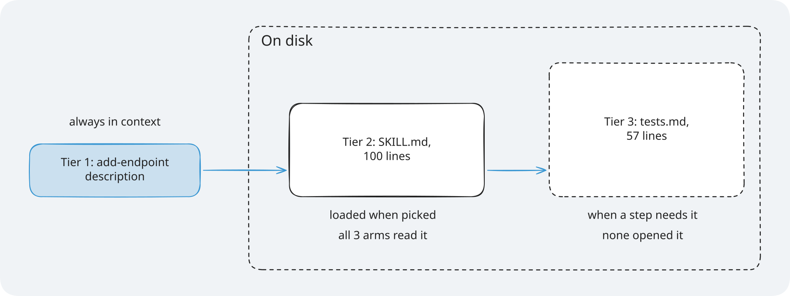
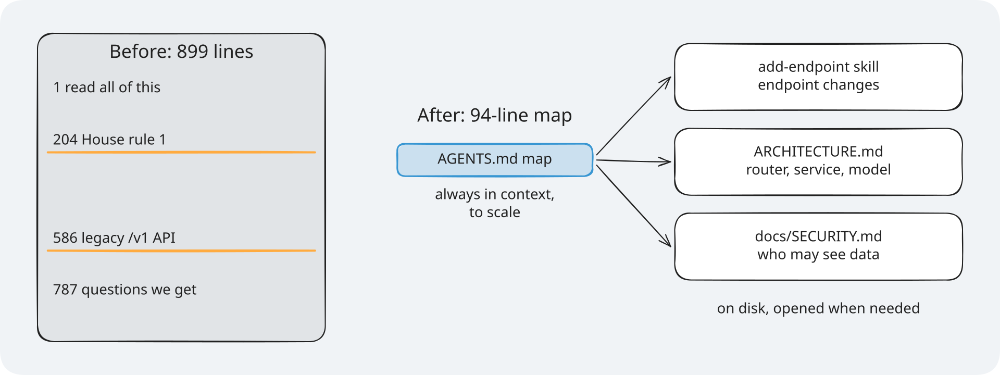
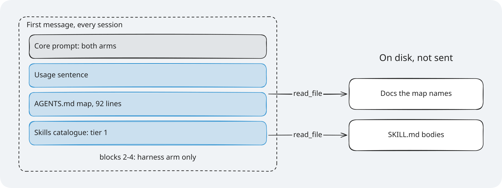

# Section 1: Instructions. Concepts: what the agent knows

Reading time: about 15 minutes.

## The problem

**Illustrative scenario.** Priya's team runs TeamTrack, a multi-tenant issue tracker where each
customer is an org. She asks a coding agent for `GET /issues`, an org-wide issue search. The tenant
rule exists, in the team handbook, which the ticket does not mention.

The agent lists the repository and opens the issues code. Next to the right query it finds
`list_all_legacy`, a query from an old endpoint that lists every issue of every org. It is short and
already paginates, so the agent copies it. The tests create one org, so they pass. The reviewer sees
code that looks like the rest of the file and approves it. After release, a customer finds another
customer's issues in their search.

Nobody broke a rule on purpose. The rule was on disk, but not in front of the agent when it wrote the
query.

> **Terms on this page**
>
> - **Harness**: The files and code around the agent that decide what it sees and may do.
> - **Harness layer**: One part of the harness: instructions, state, scope, or verification.
> - **Bare arm**: An agent run with the ticket and the repository, and no harness.
> - **Harness arm**: The same run with the harness turned on.
> - **Referee**: The program that scores each run after the agent stops.
> - **Map**: A short `AGENTS.md` that says where each rule lives, instead of holding every rule.
> - **Progressive disclosure**: A small entry point first; the details only when the task needs them.
> - **Agent Skill**: A folder with a `SKILL.md` recipe that the agent loads only when a task needs it.
> - **Context prefix**: The fixed text block sent at the start of every agent session.
> - **House rules**: TeamTrack's seven rules for every endpoint, such as House rule 1: Tenant isolation.
> - **Tenant isolation rule**: House rule 1. Another org's resource answers 404, never 403.
> - **Primary measure**: The one result, chosen before any run, that decides the comparison.
>
> All terms: [glossary](../docs/glossary.md).

## The idea in one sentence

Give the agent a short map that is always in its context and points to focused documents and skills,
which it opens only when the task needs them.

## How it works

OpenAI's harness team states the problem: "From the agent’s point of view, anything it can’t access
in-context while running effectively doesn’t exist." Then the fix: "give Codex a map, not a 1,000-page
instruction manual." The map is "a short AGENTS.md (roughly 100 lines)" that "is injected into context
and serves primarily as a map, with pointers to deeper sources of truth elsewhere."
([Harness engineering](https://openai.com/index/harness-engineering/))

Why not paste every rule into the prompt? The same source answers: "Context is a scarce resource. A
giant instruction file crowds out the task, the code, and the relevant docs." And: "Too much guidance
becomes non-guidance."

The details live in a `docs/` folder "treated as the system of record". The result is progressive
disclosure: "agents start with a small, stable entry point and are taught where to look next, rather
than being overwhelmed up front."

Skills follow the same pattern, in three tiers
([Agent Skills Specification](https://agentskills.io/specification)):

| Tier | What loads | When |
|---|---|---|
| 1 | Each skill's `name` and `description` | At the start, for every skill |
| 2 | The full `SKILL.md` | When the agent decides to use the skill |
| 3 | Files in `references/`, `scripts/`, `assets/` | Only when a step needs them |



*Only the catalogue line is always in the context; the body and its files load when a task needs them.*



*The map is drawn to scale: 94 lines in the context, each row naming the document that holds the rule.*

### Before and after

**Before: one instruction dump.** [Assignment 1: Instructions](assignment/) starts from a real example: an 899-line `AGENTS.md`
for a TeamTrack variant. These are some of its headings, with the line where each starts:

| Line | Heading |
|---|---|
| 1 | `AGENTS.md: TeamTrack (read all of this before you change anything)` |
| 196 | `5. House rules (R1 to R7)` |
| 204 | `R1 Tenant isolation` |
| 586 | `14. The legacy /v1 API` |
| 669 | `17. Team notes and history` |
| 787 | `18. Questions we keep getting` |

The file numbers its seven house rules `R1` to `R7`. The tenant isolation rule (`R1`) starts at line 204, and the warning about the legacy endpoint at line 586. Four
retired rules are still in the file. An agent that reads it all pays for 899 lines on every task.

**After: a map with progressive disclosure.** TeamTrack's harness map is a 94-line file. It is keyed
by what the agent is about to do, and each row names one file:

```markdown
<!-- platform/teamtrack/harness/instructions/AGENTS.md (lines 12-16 and 31) -->
| When you are about to | Read first |
|---|---|
| add or change an endpoint | `.agents/skills/add-endpoint/SKILL.md` (step by step) |
| touch a router, service, repository, or model | `ARCHITECTURE.md` (layers, House rule 6: Layering) |
| decide who may see or change data | `docs/SECURITY.md` (House rule 1: Tenant isolation, House rule 2: Roles) |

- House rule 1: Tenant isolation. Another org's resource is 404, never 403. See `docs/SECURITY.md`.
```

A section near the end, "Do not copy", names the legacy endpoint and its query. The full text of the tenant
isolation rule lives once, in the security document.

## How shipharness does it

The instructions layer does three things. Before the run, it copies the map, the docs, and the skill
into the harness arm's workspace. At the start of every session, it sends the context prefix. After
each tool call, it notes which harness files the agent opened, for the console.

This is the code that builds the prefix:

```python
# platform/src/shipharness/harness/instructions/router.py (lines 37-47)
    source = Path(source)
    agents_md = strip_markers((source / MAP_FILE).read_text(encoding="utf-8")).strip()
    blocks = [
        "Repository map (AGENTS.md at the workspace root). It points to the documents to read "
        "before you change code; open them with read_file when your task needs them.",
        agents_md,
    ]
    catalogue = SkillsLoader(source / SKILLS_DIR, workspace_prefix=SKILLS_DIR).catalogue_block()
    if catalogue:
        blocks.append(catalogue)
    return "\n\n".join(blocks)
```

Two details matter. Only the map and the skills catalogue go into the prefix; documents and skill
bodies stay on disk. And `source` is the course's copy, never the arm's workspace, so an agent that
edits its own `AGENTS.md` cannot change what it is told. The [walkthrough](demo/walkthrough.md) reads
the rest of the layer.



*The bare arm gets only block 1; the harness adds one block per layer, always in this order.*

One fairness rule applies: the harness may reorganise knowledge, never add facts. Every rule in the
harness docs is also in the handbook that both arms have, and a unit test checks that.

## What we measured

Before class, the course ran both arms on the same ticket: `GET /issues`, with the legacy query in the
repository and a ticket that points at the legacy code. The primary measure: a run fails if it adds at
least one new violation of the tenant isolation rule. Effort is the model's reasoning effort (how
long it thinks before it answers); the fast tier is OpenAI's quicker, higher-priced service tier.

| Setting | Bare arm: runs failing | Harness arm: runs failing |
|---|---|---|
| Medium effort | 0 of 3 | 0 of 3 |
| Low effort | 0 of 3 | 0 of 3 |
| Low effort, fast tier (class settings) | 0 of 1 | 0 of 1 |

No measurable difference on this task with this model
([evidence](../docs/evidence/s1.md#section-1)). Neither arm copied the legacy query, so the map had
nothing to fix here. In the run with class settings, the bare arm did not open the handbook in its
first nine tool calls and still wrote an org-scoped query.


*One dot per run: all 7 runs of each arm passed, so there is no measurable difference.*

## When it helps, and when it does not

It helps when:

- The rules are many, long, or far from the code that breaks them.
- A rule is about something the code cannot show, such as "404, never 403".
- Several people maintain the rules. Small focused files have owners and can be checked by a script,
  while one big file "rots instantly" ([Harness engineering](https://openai.com/index/harness-engineering/)).
- The same task comes up again and again. A skill turns it into steps the agent loads only then.

It does not help, or helps less, when:

- The model already does the right thing. The test runs above are an example.
- The ticket already points to the rules. Then the bare arm gets them too.
- The map is stale. A map that points to a renamed file sends the agent nowhere.
- You need a guarantee. The layer only informs; it never blocks a tool call. Sections 3 and 4 add
  limits and checks that do block.

Anthropic's harness team gives the test to apply: "every component in a harness encodes an assumption
about what the model can't do on its own, and those assumptions are worth stress testing."
([Harness design for long-running application development](https://www.anthropic.com/engineering/harness-design-long-running-apps))
The map assumes the
model will not apply a rule it has not been pointed to. Measure that on your model.

## Key takeaways

- A rule the agent does not read during the run does not exist for it. Put a short map in its context
  and the details on disk.
- Progressive disclosure keeps context small: the map and the skill descriptions are always there;
  documents and skill bodies load on demand.
- A map is a bet on what the model will miss. Check it with a measure, such as the referee's tenant isolation check,
  and keep it where it pays off.

## Check your understanding

1. The bare arm has the handbook with every rule. Why can the rule still be missing when the agent
   writes the query?

   <details>
   <summary>Answer</summary>

   Being on disk is not being in context. The agent sees the handbook only if it opens it, and only
   the part it reads. If it reaches the legacy query first, the copied pattern wins.

   </details>

2. Why does the layer build the prefix from the course's copy and not from the arm's workspace?

   <details>
   <summary>Answer</summary>

   So the agent cannot change what it is told. An agent that edits its own `AGENTS.md` changes a file
   in its workspace, not the prefix.

   </details>

3. A skill's description says only "Endpoint helper." Which tier fails, and what does the agent miss?

   <details>
   <summary>Answer</summary>

   Tier 1. The description is all the agent sees before it decides to open the skill. If it does not
   say what the skill does and when to use it, the agent never opens the body, so tiers 2 and 3 never
   load.

   </details>

4. The test runs found no difference. Name one reason the map could still be worth keeping.

   <details>
   <summary>Answer</summary>

   Maintenance: focused files can be owned and checked by a script, and one big file goes stale. Also,
   another model or another ticket may need the map even if this one did not.

   </details>

## Further reading

- [A map, not a manual](post-class-reading/01-map-not-manual.md): OpenAI's case for a short map and a
  checked `docs/` folder.
- [Progressive disclosure in Agent Skills](post-class-reading/02-progressive-disclosure-in-agent-skills.md):
  the specification, tier by tier.
- [Skills in other agents](post-class-reading/03-instructions-in-other-agents.md): where Claude Code,
  Codex, and Cursor look.
- [Harness engineering: leveraging Codex in an agent-first world](https://openai.com/index/harness-engineering/) (OpenAI, Ryan Lopopolo,
  2026-02-11)
- [Agent Skills Specification](https://agentskills.io/specification) (Agent Skills project)
- [Harness design for long-running application development](https://www.anthropic.com/engineering/harness-design-long-running-apps)
  (Anthropic, Prithvi Rajasekaran, 2026-03-24)

## Sources

- Source 1: Harness engineering: leveraging Codex in an agent-first world, <https://openai.com/index/harness-engineering/>, Ryan Lopopolo (OpenAI), 2026-02-11
- Source 2: Agent Skills Specification, <https://agentskills.io/specification>, Agent Skills project, n.d.
- Source 3: Harness design for long-running application development, <https://www.anthropic.com/engineering/harness-design-long-running-apps>, Prithvi Rajasekaran (Anthropic), 2026-03-24
