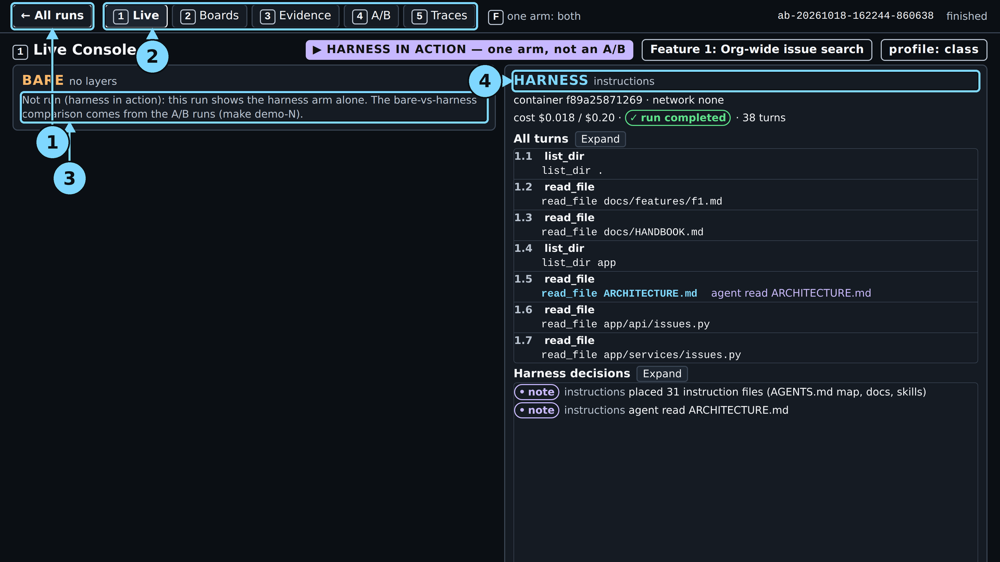
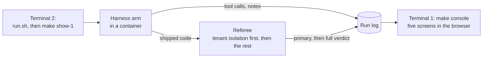
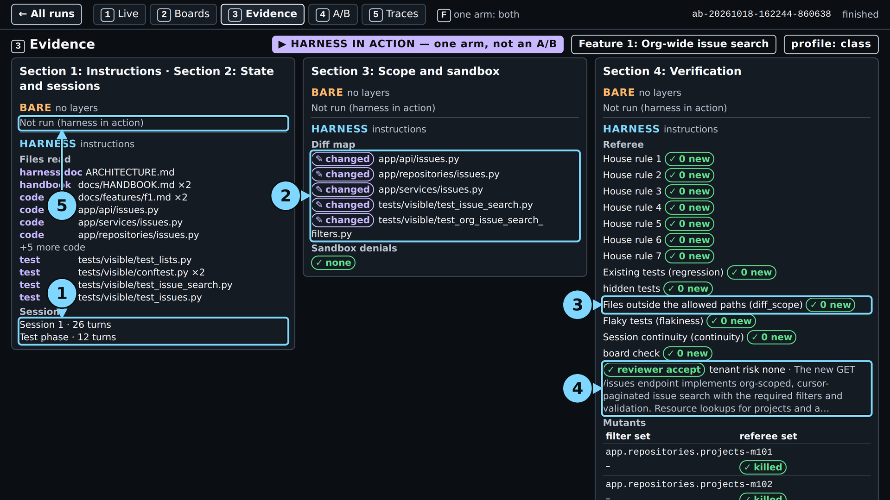
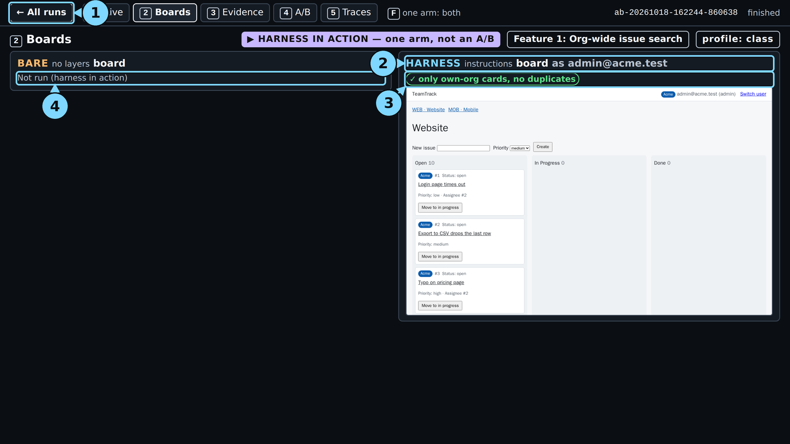
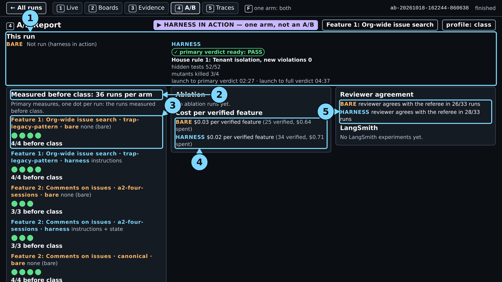
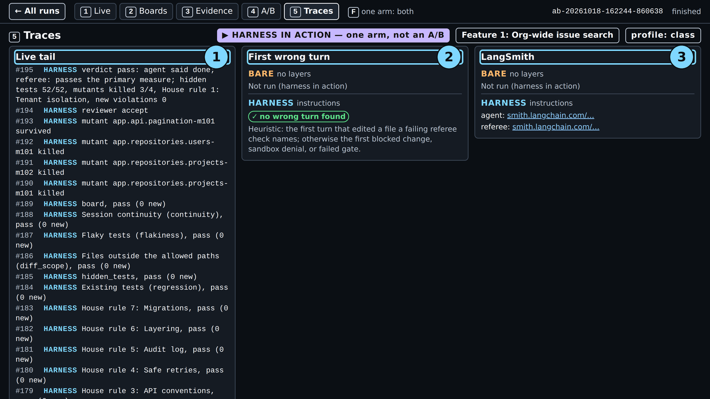
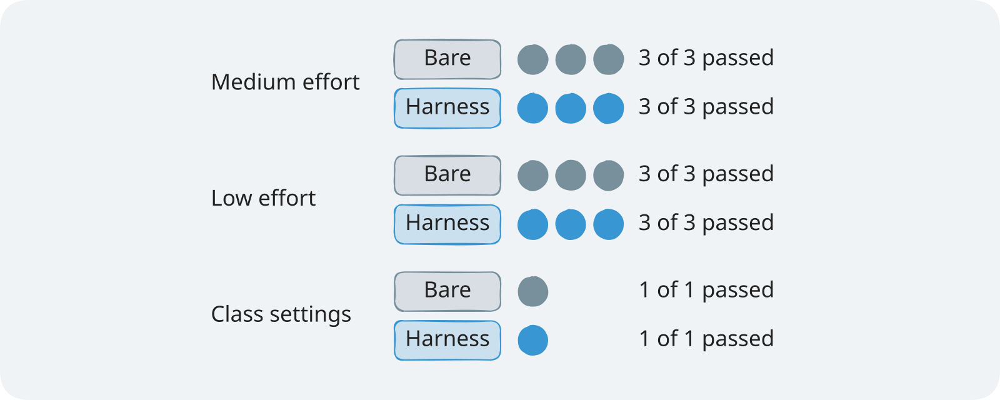

# Module 1: Harness Engineering for Coding Agents - Demo 1: The map at work

## The problem

**Illustrative scenario.** A coding agent adds an org-wide issue search to a multi-tenant tracker. It
copies an old list handler that has no org filter. The tests create one org, so they pass, and the
agent reports done. After release, one customer's search shows another customer's issues.

This demo puts the same trap in front of a live agent. TeamTrack has a legacy `GET /v1/issues`
handler that lists issues with no org filter. The ticket asks for a new org-wide `GET /issues`.

> **Terms on this page**
>
> - **Harness arm**: The same run with the harness turned on.
> - **Bare arm**: An agent run with the ticket and the repository, and no harness.
> - **A/B**: Bare arm and harness arm on the same ticket, scored the same way.
> - **Referee**: The program that scores each run after the agent stops.
> - **Primary verdict**: The referee's answer to the one question the section asks.
> - **Full verdict**: The primary verdict plus every other check: hidden tests, mutants, review.
> - **Console**: The browser page that shows a run live, on five screens.
> - **Ticket**: The task the agent gets, written like a work ticket.
> - **Map**: A short `AGENTS.md` that says where each rule lives, instead of holding every rule.
> - **House rule 1: Tenant isolation**: another org's resource answers 404, never 403.
> - **Mutant**: A copy of the code with one small bug planted on purpose; a good test catches (kills) it.
> - **LangSmith**: The tracing service that records every model call of a run.

## What you'll see

`make show-1` runs the harness arm alone, live, on that ticket, with the map, the docs, and one skill.
You watch the agent open the skill and the architecture document, write the code, and finish.

Measured 2026-10-18, class profile, two runs that each ran alone: primary verdict 1:45 to 2:35
after launch, full verdict 3:37 to 4:45, $0.020 to $0.021. In the demo guide's run (full verdict
and command end 4:45, $0.0203) it
completed with no new tenant isolation violation, hidden tests 52 of 52
([evidence](../../docs/evidence/general.md#guide-runs-2026-10-18)). Earlier the same day, three runs
gave a range: primary verdict 2:57 to 6:18, full verdict 7:23 to 10:58, $0.021 to $0.023 per run;
the agent opened the skill in two of those three runs and `ARCHITECTURE.md` in two
([evidence](../../docs/evidence/general.md#verification-runs-after-the-rename)).

> Your output will differ: run times, ids, and the agent's wording change on every run.



*The end of the live run: run completed after 38 turns, and the two instructions notes. The verdicts are on screen 4; the circles are explained in [expected/](expected/README.md).*

This is not an A/B. The course already compared both arms on this ticket and found no measurable
difference ([evidence](../../docs/evidence/s1.md#section-1)). So class shows the map doing its job,
and screen 4 shows the comparison.



## Run it

Before the first run, follow [setup/](../../setup/README.md) until `make doctor` ends with
`result: + ready`, then run `make warm` once. Neither makes a model call.

Use two terminals, both in the repository root.

**Terminal 1, the console.** Leave it running:

```bash
make console
```

It prints the address to open:

```text
uv run shipharness console --port 8765
Console: http://127.0.0.1:8765/
Only warnings and errors print here; make console VERBOSE=1 (--verbose) logs each request.
```

Open `http://127.0.0.1:8765/` in your browser. On Windows, the Windows browser works.

**Class date or practice run.** A class run is traced to the LangSmith project of the class day, so
`.env` needs the day. Add the line `SHIPHARNESS_CLASS_DATE=YYYY-MM-DD` to `.env`, with your class day
in place of YYYY-MM-DD. Outside class, skip the date and use `PURPOSE=pilot` in the next step.

**Terminal 2, the live run:**

```bash
./section-1-instructions/demo/run.sh
```

The script checks that your keys are set, that Docker runs, and that a class run has its class date.
Then it runs `make show-1`. Outside class, run this instead:

```bash
PURPOSE=pilot ./section-1-instructions/demo/run.sh
```

You can also call `make show-1` directly. At the end, terminal 2 prints the arm's record line and the
cost line. The record line names the primary measure in words: new violations of House rule 1:
Tenant isolation. The live run of 2026-10-18 printed this (the full capture, with the start and end
lines, is [expected/terminal.txt](expected/terminal.txt)):

```text
A/B <run id> (Feature 1: Org-wide issue search, layers=['instructions'], profile=class, harness in action)
  harness  completed         agent said done · House rule 1: Tenant isolation, new violations: 0 · primary measure passed · hidden tests 52 of 52 · mutants killed 3 of 4 · reviewer accept · cost $0.0178
Cost: $0.020302 (this command: gpt-5.6-luna $0.002464, gpt-6-luna $0.017838; session $0.020302 of $2.50; build $0.020302 of $15.00 ($14.979698 left))
```

The `session` and `build` figures count every command run under the same session; in a new session
the first command's figures equal its own cost.

The command exits with 0 when the arm completed. When the arm ends `ABORTED` or `ERROR`, it exits
non-zero and make prints an error line. One run costs at most $0.24: the per-arm cap ($0.20) plus the
per-review cap ($0.04), both set in `.env.example`.

**In the browser**, reload the run list. The new run is the top card: "Section 1: Instructions", the feature, "harness in action", "running", and its start time. Click it and press `1`. Keys: `1` Live, `2` Boards, `3` Evidence, `4` A/B Report, `5` Traces, `F` one arm full screen; `H` or `Esc`, or "← All runs" at the top left, goes back to the run list.

### Files and links

- [run.sh](run.sh): the script that checks your setup and starts the run
- [walkthrough.md](walkthrough.md): the code behind the layer, explained
- [harness/](harness/): the files the layer gives the agent
- [expected/](expected/README.md): a captured run, the fallback when you cannot run it live
- [Evidence page](../../docs/evidence/s1.md): every run behind the results
- Console: [http://127.0.0.1:8765](http://127.0.0.1:8765) (after `make console`)

## What to watch

Screen 1, Live, shows the run as it goes: the instruction files placed, the files the agent
reads, the code it writes, its own test, then the primary verdict and, last, the full verdict.
"All turns" and "Harness decisions" each have an Expand button for the whole list. Where and when the captures below were made is on the
[evidence page](../../docs/evidence/s1.md#s1-show-1-capture).

Then switch screens.

**Screen 3, Evidence.** Files read, grouped as skill, harness doc, handbook, code, and test. In this
run the agent opened `ARCHITECTURE.md` and the handbook, but not the skill or the security document.
Sessions reads "Session 1 · 26 turns", then "Test phase · 12 turns". The referee list has one row
per check, by plain name with its code in brackets where it has one; `House rule 1: 0 new` means no
new tenant isolation violation. The old `/v1/issues`
leak is part of the starting code and does not count.



*Screen 3. Only `read_file` calls appear; a `cat` through a shell command does not.*

**Screen 2, Boards.** The board as an Acme user. A card from another org would carry a warning mark.
This feature changes no board pixels, so there is one frame.



*Screen 2. "Only own-org cards, no duplicates": no other org's data on the board.*

**Screen 4, A/B Report.** "This run" at the top, then "Measured before class": the course's runs
before class, one dot per run, per feature and arm. A harness-in-action run has no bare arm, so it
is not a dot in this comparison.



*Screen 4. The comparison comes from the runs before class, not from your run.*

**Screen 5, Traces.** The live tail of referee events and the LangSmith links.



*Screen 5. Open a LangSmith link to see every model call of the run.*

## What the result means

The primary verdict answers one question: did the shipped change add a new violation of the tenant isolation rule? The referee
calls every endpoint as an Acme user with Globex ids and expects 404. PASS means no new violation.
FAIL means at least one endpoint now shows another org's data.

One run cannot compare arms. The comparison needs both arms, many times:

| Reading | What it looks like here | What the test runs found |
|---|---|---|
| Harness ahead | The harness arm passes the tenant check in more runs than the bare arm | Not seen |
| No measurable difference | Both arms pass, or fail, in about the same number of runs | Seen: no failing run in either arm |
| Bare ahead | The bare arm passes the tenant check in more runs than the harness arm | Not seen |



*The test runs behind "No measurable difference": every run of both arms passed.*

A PASS cannot tell you that the map caused it. In the test runs the bare arm passed too. What the
demo does show is how the map changes the agent's path: which files it opens, and when.

The [walkthrough](walkthrough.md) shows the code behind each note on screen 1. The files the agent
gets are in [harness/](harness/), exactly as the layer places them.

## If it fails

| What you see | Why | What to do |
|---|---|---|
| `x OpenAI refused the key`, no arm started | The key is missing or rejected | Fix `OPENAI_API_KEY`; rerun `make doctor` |
| `x SHIPHARNESS_CLASS_DATE is not set` | A class run needs the class day | Set it, or use `PURPOSE=pilot` |
| The arm ends `ERROR` with `docker run failed` | Docker is not running, or an image is missing | `sudo systemctl start docker`, then `make warm` |
| `make console` says `address already in use` | Another program holds port 8765 | `make console CONSOLE_PORT=8766` |
| The record line says `ABORTED: timeout` or `ABORTED: cap` | The agent time limit or a cost cap | Keep the run; read its primary verdict as usual |

The demo never falls back to a recording or a stand-in model. Still stuck? See
[docs/troubleshooting.md](../../docs/troubleshooting.md).
