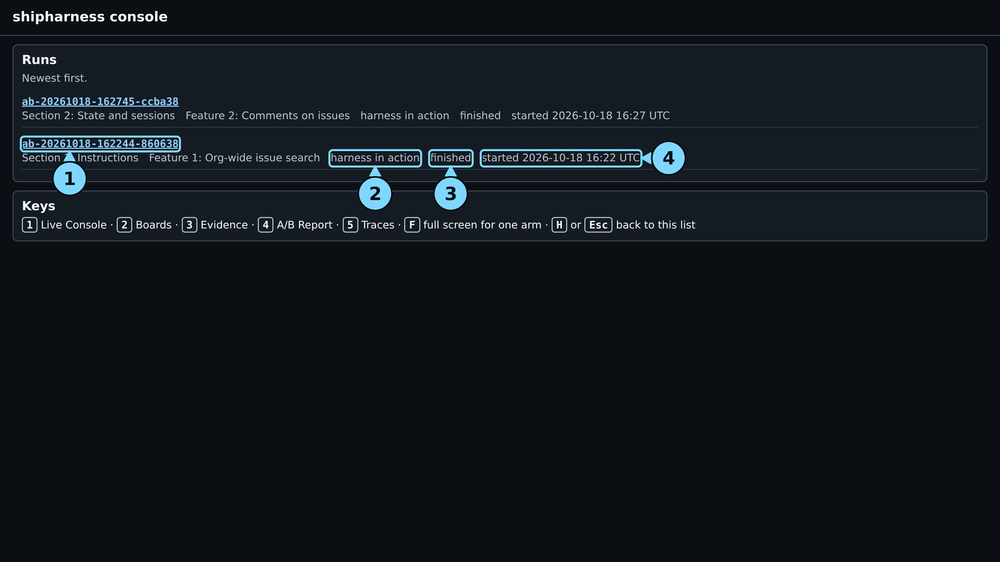
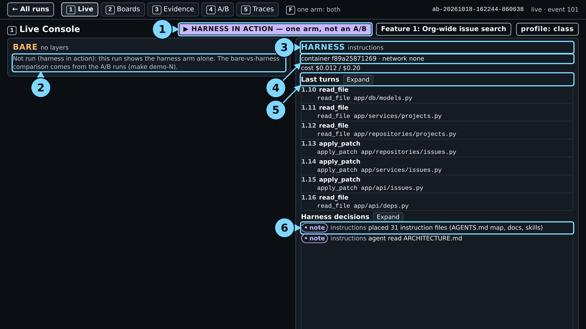
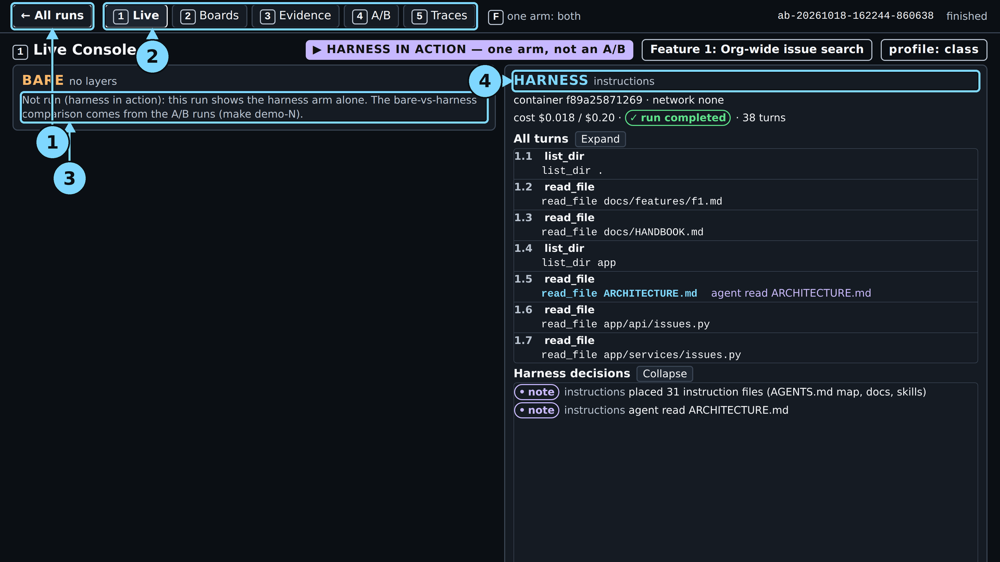

# Module 1: Harness Engineering for Coding Agents - Demo 1: What one real run looked like

This folder holds the output and the screenshots of one real `make show-1` run, the live run of
2026-10-18 for the demo guide, with the class settings (run id on the
[evidence page](../../../docs/evidence/s1.md#s1-show-1-capture)). Nothing here is
staged or edited, except where a line says it was cut. Use it to check that your run looks roughly
like this one, or to follow the demo without running it. When and how it was captured is on the
[evidence page](../../../docs/evidence/s1.md#s1-show-1-capture).

> **Terms on this page**
>
> - **Primary verdict**: The referee's answer to the one question the section asks.
> - **Full verdict**: The primary verdict plus every other check: hidden tests, mutants, review.
> - **Harness note**: A line the instructions layer adds to screen 1, such as "agent read ARCHITECTURE.md".
> - **Tenant isolation rule**: House rule 1: Tenant isolation, another org's resource answers 404,
>   never 403.
> - **Mutant**: A copy of the code with one small bug planted on purpose; a good test catches (kills) it.
> - **LangSmith**: The tracing service that records every model call of a run.

## Terminal output

| File | What it holds |
|---|---|
| `terminal.txt` | The command, the record line, the cost line, the start and end lines |

The start and end lines (with the wall time) are the capture script's; nothing is cut. This was the
first command of its session, so the `session` figure equals its own cost.

## Screenshots

The screenshots were taken from `make console` after the run ended (the minute 1 screen from the
console fed with the run's log up to that point). The numbered circles are the demo guide's
callouts; each caption names them. Times count from the make command's launch.

> Your output will differ: run times, ids, and the agent's wording change on every run.

*The run list. Circles: 1 the run id (click to open), 2 the type, "harness in action", 3 the status, 4 the start time.*

*About one minute in: 31 instruction files placed and `ARCHITECTURE.md` read.*

Circles: 1 the HARNESS IN ACTION badge, 2 the bare arm, "Not run (harness in action)", 3 the harness arm's layers, 4 the container line, 5 the last turns, 6 the harness decisions.

*The end: run completed after 38 turns, cost $0.018 of the $0.20 cap. The verdicts are on screen 4 and in `terminal.txt`.*

Circles: 1 "← All runs" (or H, Esc), 2 the screen tabs, 3 the bare arm, 4 the harness arm's layers.

*"Harness decisions" expanded: "placed 31 instruction files" and "agent read ARCHITECTURE.md".*

Circles: 1 "← All runs", 2 the screen tabs, 3 the bare arm, 4 the harness arm's layers.

*Screen 2: only own-org cards, no duplicates. Circles: 1 "← All runs", 2 the harness board, 3 the board marks, 4 the bare arm, not run.*

*Screen 3: `ARCHITECTURE.md` and the handbook read; "Session 1 · 26 turns", "Test phase · 12 turns"; five files changed; every check 0 new; the reviewer accepts.*

Circles: 1 the sessions, 2 the diff map, 3 Files outside the allowed paths (`diff_scope`), 4 the blinded reviewer's reason, 5 the bare arm, not run.

*Screen 4: this run at the top; below it, "Measured before class", one dot per run. A harness-in-action run is not a dot in the comparison.*

Circles: 1 this run, 2 Measured before class, 3 the dots, 4 cost per verified feature, 5 reviewer agreement.

*Screen 5: "no wrong turn found". Circles: 1 the live tail of events, 2 the first wrong turn, 3 the LangSmith links for the agent and the referee.*
