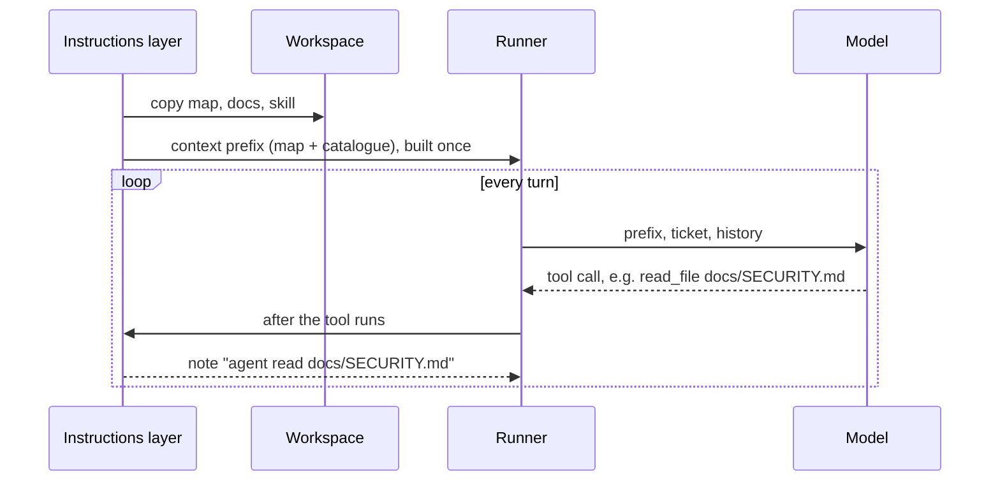

# Demo 1 walkthrough: the instructions layer

> **Terms on this page**
>
> - **Harness layer**: One part of the harness: instructions, state, scope, or verification.
> - **Workspace**: The harness arm's copy of TeamTrack, inside its container.
> - **Map**: A short `AGENTS.md` that says where each rule lives, instead of holding every rule.
> - **Skills catalogue**: One line per skill (name, description, path), given to the agent at the start.
> - **Context prefix**: The fixed text block sent at the start of every agent session.
> - **Note**: A harness decision that only reports; it never blocks the agent.
> - **Tier**: One of the three loading stages of a skill: metadata, instructions, resources.
> - **Frontmatter**: The block between `---` lines at the top of `SKILL.md`.

## What this code does

The instructions layer talks to the runner through three hooks. Before the run, it copies the map, the
docs, and the skill into the workspace. At the start of each session, it hands over the context
prefix: the map and the skills catalogue. After each tool call, it reports which of its files the
agent opened. Four short excerpts, 40 lines in all, show each step in the order it runs.



### The files the layer places

The layer reads `platform/teamtrack/harness/instructions/`. Its tree mirrors the workspace, following
the layout OpenAI's harness team describes: `AGENTS.md` and `ARCHITECTURE.md` at the root, the rest in
`docs/` ([Harness engineering](https://openai.com/index/harness-engineering/)). The
[harness/](harness/) folder next to this page holds the same 31 files, exactly as the agent gets them.

| Path | What it holds | How the agent gets it |
|---|---|---|
| `AGENTS.md` | The map: where to look, the house rules, "Do not copy", commands | In its context, every session |
| `ARCHITECTURE.md` | Layers `api → services → repositories → db` (House rule 6: Layering) | Opens it when the map points there |
| `docs/SECURITY.md` | House rule 1: Tenant isolation and House rule 2: Roles | Opens it when needed |
| `docs/design-docs/api-conventions.md` | House rule 3: API conventions: list and error envelopes, status codes | Opens it when needed |
| `docs/RELIABILITY.md` | House rules 4, 5, and 7: safe retries, audit log, migrations | Opens it when needed |
| `docs/QUALITY_SCORE.md` | Testing, known gaps, the legacy endpoint | Opens it when needed |
| `docs/PLANS.md` | Roadmap and scope | Opens it when needed |
| `docs/design-docs/` | Index, core beliefs, cursor pagination | Opens it when needed |
| `docs/product-specs/` | Feature and control specs, base product behaviour | Opens it when needed |
| `docs/references/` | Notes on Alembic (database migrations) and import-linter (import checks) | Opens it when needed |
| `.agents/skills/add-endpoint/SKILL.md` | Steps to add or change an endpoint | Name and description first; the body when it opens it |
| `.agents/skills/add-endpoint/references/tests.md` | How to test a new endpoint | Only when a step sends it there |

Two things are not in the tree. `docs/HANDBOOK.md` is in both arms' workspaces, with the same rules in
one long file; the harness only reorganises what it says, and a unit test checks that. The core system
prompt is the same for both arms and is not part of this layer.

## The code, explained

### layer.py, lines 85-98

This loop is the body of `prepare_workspace`. It puts each file where the agent works.

```python
# platform/src/shipharness/harness/instructions/layer.py (lines 85-98)
        for rel in source_files(self.source):
            try:
                if _crosses_link(ctx.workspace, rel):
                    raise PathOutsideWorkspace(rel)
                target = resolve_in_workspace(ctx.workspace, rel)
            except PathOutsideWorkspace:
                skipped.append(rel)
                continue
            text = (self.source / rel).read_text(encoding="utf-8")
            if rel.endswith(".md"):
                text = strip_markers(text)
            target.parent.mkdir(parents=True, exist_ok=True)
            target.write_bytes(text.encode("utf-8"))
            placed.append(rel)
```

- `self.source` is `platform/teamtrack/harness/instructions/`, the tree in the table above.
- A path that would cross a symbolic link is skipped, not followed, so the copy cannot land outside
  the workspace.
- `strip_markers` drops the class's walkthrough comment lines, so the agent gets clean Markdown.
- The handbook is not in this tree, so the copy never touches it. Both arms read it.

Right after the loop, line 100 builds the first note on screen 1:
`placed {len(placed)} instruction files (AGENTS.md map, docs, skills)`. In the captured run, that was
31 files.

### router.py, lines 37-47

The body of `build_prefix` puts the map and the catalogue into one block.

```python
# platform/src/shipharness/harness/instructions/router.py (lines 37-47)
    source = Path(source)
    agents_md = strip_markers((source / MAP_FILE).read_text(encoding="utf-8")).strip()
    blocks = [
        "Repository map (AGENTS.md at the workspace root). It points to the documents to read "
        "before you change code; open them with read_file when your task needs them.",
        agents_md,
    ]
    catalogue = SkillsLoader(source / SKILLS_DIR, workspace_prefix=SKILLS_DIR).catalogue_block()
    if catalogue:
        blocks.append(catalogue)
    return "\n\n".join(blocks)
```

- The prefix has three parts: one sentence on how to use the map, the whole map, and the skills
  catalogue. The map file has 94 lines; the agent gets 92, without the two walkthrough comment lines.
- The documents the map points to are not in the prefix. The agent opens them with `read_file` when
  its task needs them. That is progressive disclosure.
- `catalogue_block` reads only each skill's frontmatter and writes one line per skill. The skill body
  stays on disk until the agent opens it.
- `source` is the course's copy, never the workspace. If the agent edits its own `AGENTS.md`, the
  prefix stays the same.

### layer.py, lines 113-116

The `context_prefix` hook builds the prefix once and reuses it.

```python
# platform/src/shipharness/harness/instructions/layer.py (lines 113-116)
    def context_prefix(self, ctx: LayerContext) -> list[str]:
        if self._prefix is None:
            self._prefix = build_prefix(self.source)
        return [self._prefix]
```

- Every session of the run gets the same text: the "small, stable entry point" that OpenAI's harness
  team describes ([Harness engineering](https://openai.com/index/harness-engineering/)).
- The runner joins the core system prompt and this prefix into the first message of every session
  (`platform/src/shipharness/runner/loop.py`, line 364). The bare arm gets the core prompt alone.

### layer.py, lines 126-136

The second half of `after_tool` reports what the agent opened.

```python
# platform/src/shipharness/harness/instructions/layer.py (lines 126-136)
        files_read: list[str] = ctx.state.setdefault(FILES_READ_KEY, [])
        if rel in files_read:
            return []
        files_read.append(rel)
        data: dict[str, Any] = {"file": rel, "kind": "doc"}
        message = f"agent read {rel}"
        hit = self._skills.skill_for_path(rel)
        if hit is not None:
            skill, tier = hit
            data = {"file": rel, "kind": "skill", "skill": skill, "tier": tier}
            message = f"agent read skill {skill} (tier {tier}): {rel}"
```

- Just above, lines 121-125 return early unless the call was a successful `read_file` of a file the
  layer placed.
- Each file is reported once, the first time the agent reads it.
- `skill_for_path` says which tier a read touched: `SKILL.md` is tier 2; any other file in the skill
  folder is tier 3.
- The hook returns a note. It never blocks a tool call. This layer informs; Sections 3 and 4 enforce.

These notes feed the "Harness decisions" list on screen 1 and the files-read list on screen 3. A read
through a shell command, such as `cat`, is not a `read_file` call, so it does not appear.

## If you copy this into your repo

- Most coding agents load `AGENTS.md` and skills themselves. Then you need only the files: a map of
  about 100 lines, focused documents, and skills in a folder your agent scans.
- If you run your own harness, build the first message from a copy the agent cannot edit, and keep it
  the same for the whole run.
- Log which documents the agent opens. It is the cheapest way to see whether your map is used.
- Keep one copy of each rule. Compare the map with `platform/teamtrack/docs/HANDBOOK.md`: how far
  down is the legacy warning in each?

## Sources

- Source 1: Harness engineering: leveraging Codex in an agent-first world, <https://openai.com/index/harness-engineering/>, Ryan Lopopolo (OpenAI), 2026-02-11
