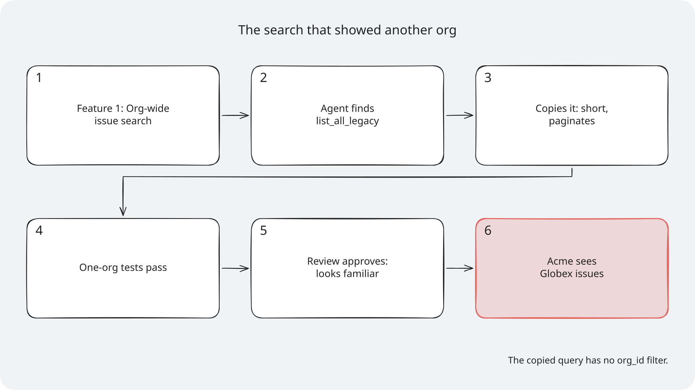
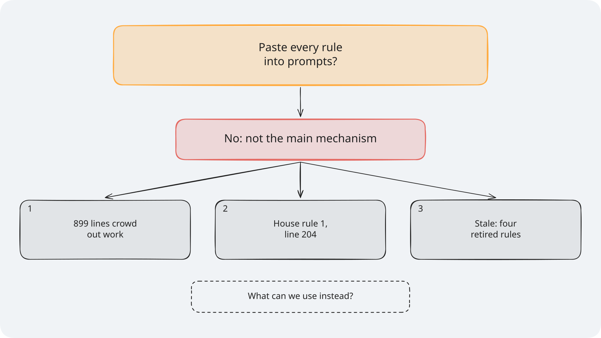
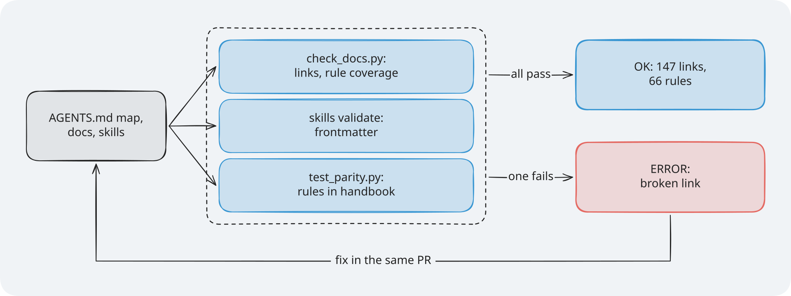
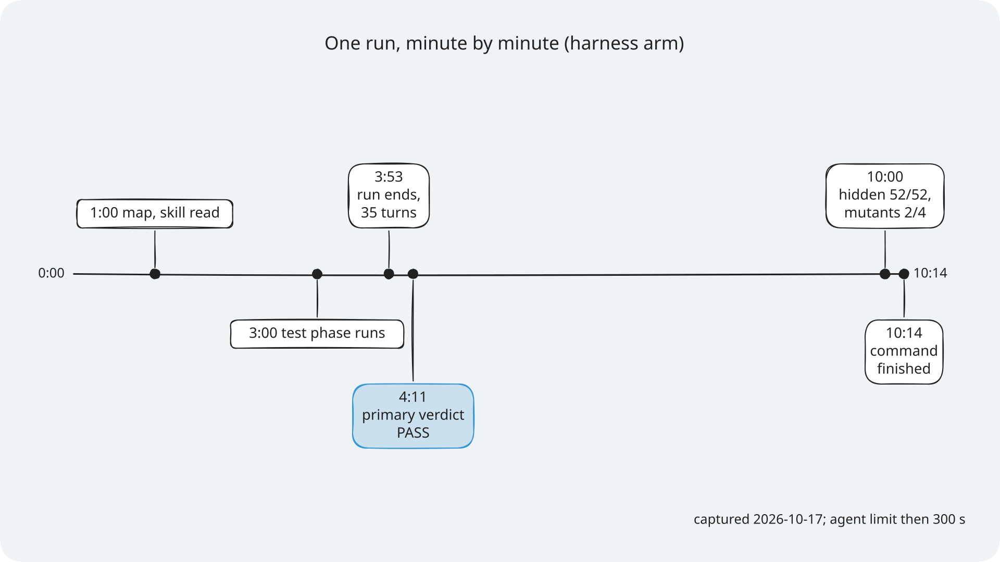
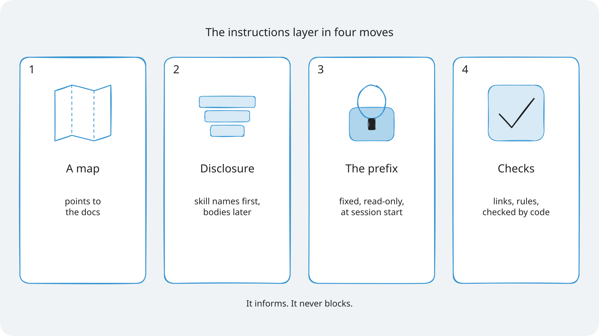

# Module 1: Harness Engineering for Coding Agents - Diagrams for Section 1: Instructions

The diagrams for Section 1, the instructions layer. Each one has an `.excalidraw` source, a `.png`
at 2x for slides, and an `.svg` with the font embedded for pages. Colours, step frames, editing,
and licences are explained once, in [the course diagrams guide](../../docs/diagrams/README.md).

> **Terms on this page**
>
> - **Bare arm**: An agent run with the ticket and the repository, and no harness.
> - **Harness arm**: The same run with the harness turned on.
> - **Map**: A short `AGENTS.md` that says where each rule lives, instead of holding every rule.
> - **Context prefix**: The fixed text block sent at the start of every agent session.
> - **Tenant isolation rule**: House rule 1: Tenant isolation. Another org's resource answers 404, never 403.

## The diagrams

### Manual or map

*The tenant rule sits at line 204 of the manual; the map is drawn to scale and names the file that holds it.*

- **What it teaches**: why a short map in the context beats one long instruction file.
- **Slide topic**: a map, not a manual.
- **Files**: `manual-vs-map`.
- **Source**: `section-1-instructions/assignment/starter/original/AGENTS.md` (899 lines) and
  `platform/teamtrack/harness/instructions/AGENTS.md` (94 lines).

### Skills in three tiers

*Only the one catalogue line is always in the context; the body and its files load when needed.*

- **What it teaches**: progressive disclosure in Agent Skills, with TeamTrack's `add-endpoint` skill.
- **Slide topic**: skills load in three tiers.
- **Files**: `skills-three-tiers`.
- **Source**: `platform/teamtrack/harness/instructions/.agents/skills/add-endpoint/`, the catalogue
  line format in `platform/src/shipharness/runner/skills_loader.py`, and what each arm read in
  [the Section 1 evidence](../../docs/evidence/s1.md).

### The context prefix

*The bare arm gets only the core prompt; the harness arm also gets the prefix, and reads the rest with read_file.*

- **What it teaches**: what the agent sees first in every session, and in what order.
- **Slide topic**: what the agent sees first.
- **Files**: `context-prefix`.
- **Source**: `build_prefix` in `platform/src/shipharness/harness/instructions/router.py` and
  `base_items` in `platform/src/shipharness/runner/loop.py`.

### Section 1 results

*All 7 runs of each arm passed: no measurable difference on this task with this model.*

- **What it teaches**: how to read a result as dots, one per run.
- **Slide topic**: what we measured in Section 1.
- **Files**: `results-s1`.
- **Source**: [the Section 1 evidence](../../docs/evidence/s1.md).

### Failure story: the search that showed another org

*Every step looks reasonable; the last one is the leak.*

- **What it teaches**: how a copied legacy query leaks another org's issues, one step at a time.
- **Slide**: "Failure story: The search that showed another org".
- **Files**: `failure-story-s1`.
- **Source**: the slide's notes; `list_all_legacy` in `platform/teamtrack/app/repositories/issues.py`.
- **How to edit**: open `failure-story-s1.excalidraw`, edit it, then export the PNG and the SVG (see [How to edit a diagram](../../docs/diagrams/README.md#how-to-edit-a-diagram)).

### Socratic build-up: why not paste every rule?

*Frame 1 asks, frame 2 answers, frame 3 gives the reasons.*

- **What it teaches**: why pasting every rule into the prompt is not the main mechanism.
- **Slide**: "Instructions: Why not paste every rule?", frame N on build N.
- **Files**: `socratic-s1`, with step frames `socratic-s1-step-1` to `socratic-s1-step-3`.
- **Source**: `section-1-instructions/assignment/starter/original/AGENTS.md` (899 lines, the tenant rule at line 204).
- **How to edit**: open `socratic-s1.excalidraw`, edit it, then export the PNG and the SVG (see [How to edit a diagram](../../docs/diagrams/README.md#how-to-edit-a-diagram)).

### Mechanical checks keep the map true

*The checks inform; they never block the agent.*

- **What it teaches**: the three checks that keep the map, the docs, and the skills honest.
- **Slide**: "4) Mechanical checks keep the map true".
- **Files**: `checker-flow`.
- **Source**: Assignment 1: Instructions (`check_docs.py`), `platform/tests/unit/harness_instructions/test_parity.py`, and the reference checker's OK line in [the Section 1 evidence](../../docs/evidence/s1.md).
- **How to edit**: open `checker-flow.excalidraw`, edit it, then export the PNG and the SVG (see [How to edit a diagram](../../docs/diagrams/README.md#how-to-edit-a-diagram)).

### Timeline of the captured show-1 run

*Captured 2026-10-17 with the agent limit then at 300 s.*

- **What it teaches**: what happened in the run, minute by minute, and when each verdict arrived.
- **Slide**: "What just happened: The run, minute by minute".
- **Files**: `timeline-s1`.
- **Source**: the show-1 capture in [the Section 1 evidence](../../docs/evidence/s1.md) and `demo/expected/terminal.txt`.
- **How to edit**: open `timeline-s1.excalidraw`, edit it, then export the PNG and the SVG (see [How to edit a diagram](../../docs/diagrams/README.md#how-to-edit-a-diagram)).

### Cheat sheet: the instructions layer

*One box per idea, in the order the section teaches them.*

- **What it teaches**: the four ideas of Section 1 on one page.
- **Slide**: "Cheat Sheet: The instructions layer in four moves".
- **Files**: `cheat-sheet-s1`.
- **Source**: `section-1-instructions/concepts.md`.
- **How to edit**: open `cheat-sheet-s1.excalidraw`, edit it, then export the PNG and the SVG (see [How to edit a diagram](../../docs/diagrams/README.md#how-to-edit-a-diagram)).
