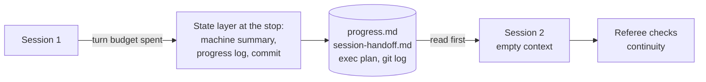

# Module 1: Harness Engineering for Coding Agents - Section 2: State and sessions

What the agent remembers: the state that survives a session stop, in files and git.

## The problem

**Illustrative scenario.** You ask a coding agent to add comments to issues. Its first session
writes the migration for a `comments` table and half of the endpoint, then reaches its turn limit
without leaving a note. The next session starts with an empty context and sees no working endpoint.
It writes a second migration for the same table from the old head, and rewrites the half-done code.

The cost is a deploy that stops on two migration heads, a reviewer who untangles two versions of one
change, and a bill for the same work twice.

> **Terms on this page**
>
> - **Harness**: The files and code around the agent that decide what it sees and may do.
> - **Harness layer**: One part of the harness: instructions, state, scope, or verification.
> - **Bare arm**: An agent run with the ticket and the repository, and no harness.
> - **Harness arm**: The same run with the harness turned on.
> - **Referee**: The program that scores each run after the agent stops.
> - **Session turn budget**: The fixed number of turns a session gets before the runner stops it.
> - **Structured handoff**: A file that carries the last session's state and the next steps to the next session.
> - **Continuity failure**: Two migration heads, a table created twice, or 30% or more of session 1's lines redone in session 2.
> - **Migration head**: The newest migration in the chain; two heads means two migrations each claim to be the newest.
> - **Exec plan**: A plan file the agent keeps up to date as it works, with steps, decisions, and progress.
> - **Compaction**: Squeezing an old context into a short summary for the next session.
>
> All terms: [glossary](../docs/glossary.md).

## Why it happens

- Every session starts from zero: "each new session begins with no memory of what came before."
  ([Anthropic, Effective harnesses](https://www.anthropic.com/engineering/effective-harnesses-for-long-running-agents))
- Without a record, the next session has to guess. Anthropic's agents were left "to guess at what
  had happened" ([Anthropic, Effective harnesses](https://www.anthropic.com/engineering/effective-harnesses-for-long-running-agents)).
- Squeezing the old context into the new session does not fix it: "However, compaction isn’t
  sufficient." ([Anthropic, Effective harnesses](https://www.anthropic.com/engineering/effective-harnesses-for-long-running-agents))

## How this section fixes it

The state layer keeps the work in the repository. Before session 1 it writes `init.sh`,
`progress.md`, a structured handoff, and an exec plan. At every stop it writes the facts from git
and the files on disk, keeps the agent's notes, and commits. Every session starts by reading them
([Anthropic, Harness design](https://www.anthropic.com/engineering/harness-design-long-running-apps)).

The course also measures whether it helps. On this ticket, with this model, it made no measurable
difference: neither arm had a continuity failure in any test run before class
([evidence](../docs/evidence/s2.md#section-2)). The concepts page explains why, and what the state
files cost.

## How to work through this section

In class the section takes 50 minutes. The live demo starts at minute 1, on the section's start slide, and runs while
the concepts are taught.

| Part | What it gives you | In class |
|---|---|---|
| [concepts.md](concepts.md) | The idea, how it works, what the course measured | Minutes 2-20 |
| [demo/](demo/README.md) | The live run across a 12-turn stop, and how to read it | Launch at minute 1; review at 30-46 |
| [demo/walkthrough.md](demo/walkthrough.md) | The 40 lines of code behind the layer | Minutes 20-30, on the DEMO slide |
| [assignment/](assignment/README.md) | Assignment 2: State and sessions. A state layer that survives three stops | After class |
| [post-class-reading/](post-class-reading/README.md) | Three short readings on sessions, resets, and plans | After class |
| [session-notes.md](session-notes.md) | What class showed, questions, what to try next | After class |

## Where next

- First time here? Install everything with [setup/](../setup/README.md), then run the
  [demo](demo/README.md).
- Already set up? Start with [concepts.md](concepts.md).
- Want state files in your own repository? See [use-in-your-repo/](../use-in-your-repo/README.md).

## Sources

- Source 1: Effective harnesses for long-running agents, <https://www.anthropic.com/engineering/effective-harnesses-for-long-running-agents>, Justin Young (Anthropic), 2025-11-26
- Source 2: Harness design for long-running application development, <https://www.anthropic.com/engineering/harness-design-long-running-apps>, Prithvi Rajasekaran (Anthropic), 2026-03-24
