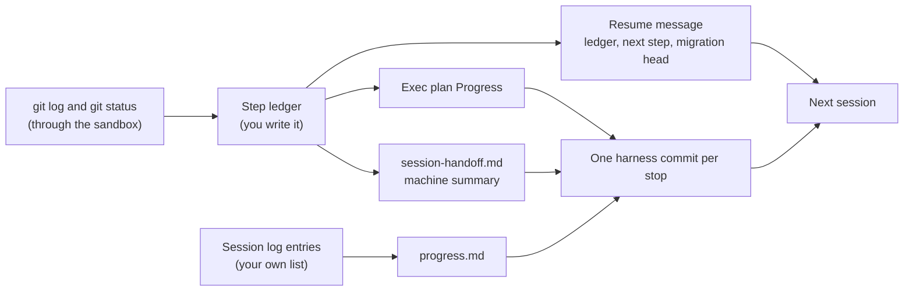

# Module 1: Harness Engineering for Coding Agents - Assignment 2: State and sessions, three forced stops, one consistent history

Try it yourself first. The full solution is in [./solution/](solution/) with a step-by-step walkthrough.

## The problem

**Illustrative scenario.** A change in several steps, a table, a service, and an index with tests, is too
big for a single agent session. Each session ends at its turn limit. The progress note says only
"comments in progress", which does not say which steps are finished or which files exist. Each new
session cannot tell what is done, so it starts the first step again: a second migration for a table that
already exists, files rewritten, and the last step never reached.

The cost is a migration history that no longer applies, a progress log that disagrees with git, and
a feature that never finishes while every session bills for work already done.

A handoff helps only if it carries the right facts. Anthropic's harness team describes one that
"carries the previous agent's state and the next steps"
([Harness design for long-running application development](https://www.anthropic.com/engineering/harness-design-long-running-apps)).
The class's state
layer carries notes and a machine summary, but it never says which steps are done. That is the gap
you close.

> **Terms on this page**
>
> - **Harness layer**: One part of the harness: instructions, state, scope, or verification.
> - **Forced stop**: The end of a session before the work is done: by its turn budget, or by the agent's `finish(claim="not_done")` once the harness stop step has run.
> - **Step ledger**: One line per ticket step, done or not, derived from git at every stop.
> - **Test stand-in agent**: A deterministic program, not a model, that plays the agent in the graded scenarios.
> - **Scenario**: One run of the real runner with your layer, the stand-in agent, and four sessions.
> - **Structured handoff**: A file that carries the last session's state and the next steps to the next session.
> - **Exec plan**: A plan checked into the repository, with its progress and its decisions.
> - **Migrations rule**: House rule 7: Migrations. Exactly one Alembic head, and a fresh upgrade works.
> - **Alembic head**: The newest migration in the chain; Alembic is the migration tool TeamTrack uses.
> - **Live evidence**: The files your real live run wrote, collected into `live/`.

## What you'll build



You complete `ResumableStateLayer`, a state layer that writes, at every session stop, what the next
session needs. It takes the facts from the repository, git and the files on disk, never from what
the agent says it did. A test stand-in agent drives the real runner offline across three forced
stops, so the self-check needs no key, no network, and no Docker. Then you run your layer once,
live, with the course model, and keep that run's records in `live/`. The exact requirements are in
[SPEC.md](SPEC.md).

## Step by step

All commands run from the repository root. Steps 1 to 6 need no keys and no Docker. To keep the
starter untouched, copy it first (`cp -r section-2-state-lifecycle/assignment/starter my-a2`) and add
`A2_IMPL=my-a2` to each `make` command.

1. **See where you start.** Run the self-check:

   ```bash
   make check-assignment-2
   ```

   Check: it ends with `Self-check: 2 of 28 checks pass.` Read the session lines of scenario V1 and
   find the first `[REDO`: session 2 writes step 1 again, because nothing told it step 1 was done.

2. **Read the stand-in agent's rules.** They are the contract between your layer and the next
   session ([SPEC.md, "Inputs"](SPEC.md#inputs)). The agent believes only `[x]` lines with a step
   id, `written` lines, and a `Migration heads: 1 (<rev>)` line.
   Check: you can say which line stops it from writing step 1 twice.

3. **Write the ledger.** Fill TODO 1a to 1c in `a2_state/ledger.py`: `parse_steps`,
   `derive_ledger`, `render_ledger`. Add unit tests next to your code.
   Check: your tests pass. A step is done only when a commit subject starts with its id and a colon.

4. **Compute the evidence at each stop.** In `a2_state/layer.py`, TODO 1 and 5: read `git log` and
   `git status` through `ctx.sandbox.exec`, build the ledger, read the migration heads, and commit
   what you write.
   Check: run `uv run python section-2-state-lifecycle/assignment/check.py --impl my-a2 --keep`; it prints
   the scenario repositories' paths, and `git log` in one shows one harness commit per stop.

5. **Tell the next session.** TODO 6, `on_session_start`: the ledger lines, the next step, and
   `Migration heads: <head>`.
   Check: the self-check's V1 session lines get past step 1 with no `[REDO`.

6. **Write the files.** TODO 2, the exec plan's Progress section, rebuilt from the ledger every time.
   TODO 3, the handoff: machine summary plus the ledger, agent notes kept. TODO 4, `progress.md`:
   every section, and one session-log entry per session from your own list. TODO 7: move the plan
   to `completed/` when the claim is done and git shows every step committed.
   Check: `Self-check: 28 of 28 checks pass.`

7. **Run the live step, once.** It needs your keys and Docker, and it costs at most $0.40 at the
   caps. Your layer must be final, because the evidence records a hash of its files:

   ```bash
   uv run python section-2-state-lifecycle/assignment/live/run_live.py --impl my-a2 --forced-stops
   ```

   Check: it ends with `+ live evidence written`, and the self-check's last lines report valid live
   evidence. Sessions 1 to 3 must end by their turn budget. A session the agent ends itself with
   `finish(claim="not_done")` also counts, but only if your layer's stop step wrote and committed
   the handoff and `progress.md` for it. If a session ended any other way, move `live/` away and run
   again ([SPEC.md, "Evidence to hand in"](SPEC.md#evidence-to-hand-in)).

8. **Submit.** Commit your folder, `a2_state/` and `live/`, on your own branch, or hand in the
   folder. Do not change `a2_state/` after the live step.

## Grading criteria (100 points)

Each scenario criterion is checked in 2 visible and 4 hidden scenarios. Its points are multiplied by
the share of scenarios that pass it.

| Criterion | What earns the points | Points | Checked by |
|---|---|---|---|
| A. Finished | Three forced stops, then `finish(done)` in session 4, tests pass, every file there | 13 | Both |
| B. Migrations | One Alembic head, a fresh upgrade works, no table created twice | 23 | Both |
| C. No redone work | No session removes earlier lines; each step committed once | 18 | Both |
| D. progress.md | Six sections in order, one log entry per session, entries match the run | 15 | Both |
| E. Exec plan | Every step ticked with its commit, every session listed, moved with an outcome | 15 | Both |
| F. Handoff and tree | Last summary, `Migration heads: 1 (`, notes kept; clean working tree | 6 | Both |
| G. Live run | `live/` holds valid evidence of the live step | 10 | Both |
| **Total** | | **100** | |

`make check-assignment-2` runs the visible scenarios and checks `live/`. The instructor's grader
adds the hidden scenarios; it is not in this repository. The points per item are in
[SPEC.md](SPEC.md#grading-criteria-item-by-item).

## Solution walkthrough

The reference solution is a finished layer in [solution/](solution/). Its
[SOLUTION.md](solution/SOLUTION.md) explains:

- why the ledger comes from git and never from the files the agent edits;
- how a stop between "files written" and "commit" is handed over without redoing the files;
- why the layer keeps its own list of session-log entries;
- what the captured self-check shows, and where the live run's evidence is.

Read it after your own attempt, and compare your choices with its alternatives.

## Sources

- Source 1: Harness design for long-running application development, <https://www.anthropic.com/engineering/harness-design-long-running-apps>, Prithvi Rajasekaran (Anthropic), 2026-03-24
