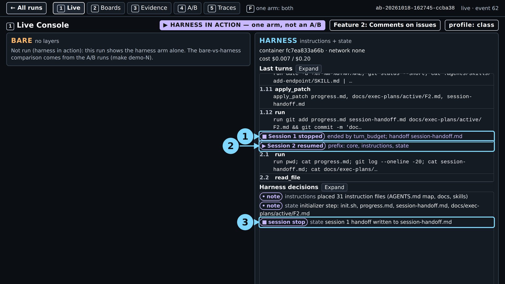
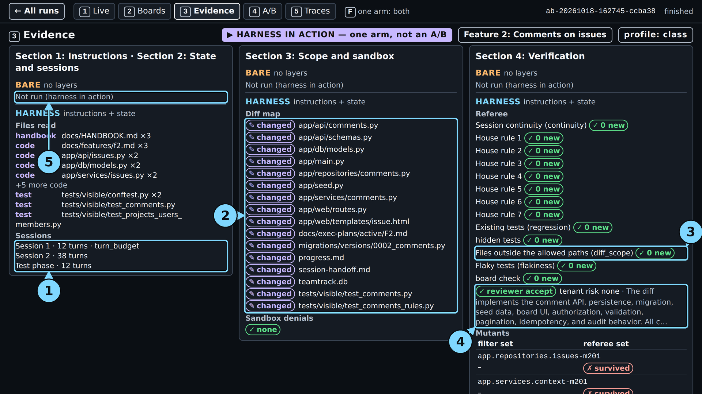
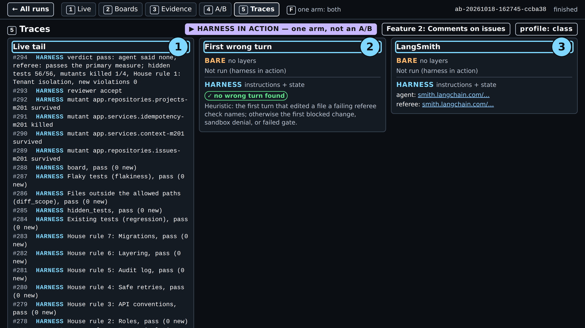
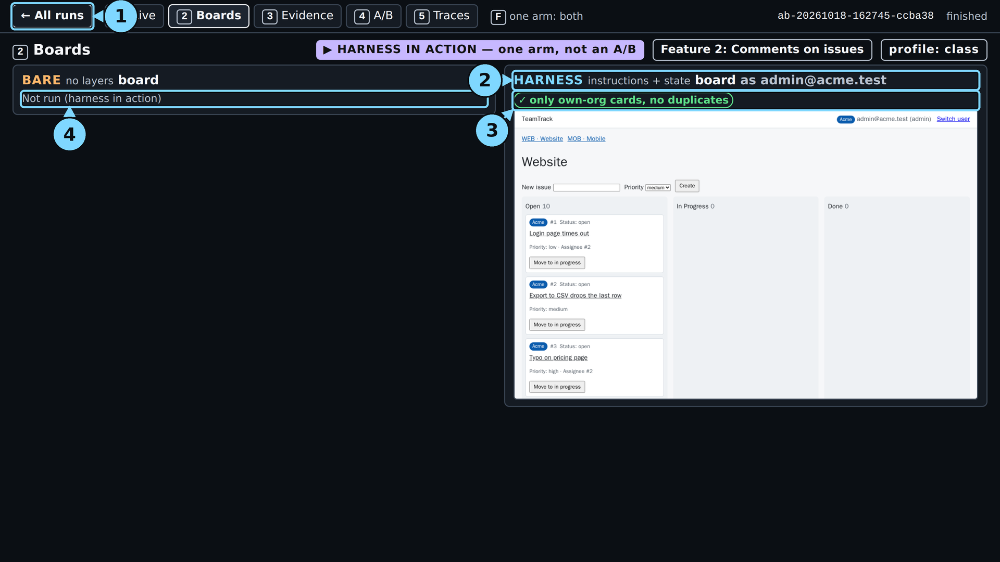
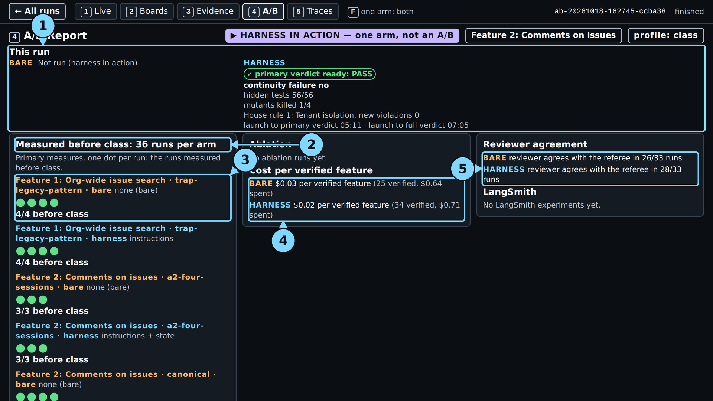

# Module 1: Harness Engineering for Coding Agents - Demo 2: A session stop and a clean resume

## The problem

**Illustrative scenario.** A coding agent adds comments to issues. Its first session writes the
migration for a `comments` table and part of the endpoint, then hits its turn limit without a note.
The second session starts with an empty context. It cannot see what the first one did, so it writes
a second migration for the same table from the old head. The deploy stops on two migration heads.

Anthropic's harness team names the cause: "each new session begins with no memory of what came
before." ([Anthropic, Effective harnesses](https://www.anthropic.com/engineering/effective-harnesses-for-long-running-agents)) This
demo stops a live agent at that point: TeamTrack's comments ticket (comments on issues), with the first
session cut off after 12 turns.

> **Terms on this page**
>
> - **Harness arm**: The same run with the harness turned on.
> - **Bare arm**: An agent run with the ticket and the repository, and no harness.
> - **A/B**: Bare arm and harness arm on the same ticket, scored the same way.
> - **Referee**: The program that scores each run after the agent stops.
> - **Primary verdict**: The referee's answer to the one question the section asks.
> - **Full verdict**: The primary verdict plus every other check: hidden tests, mutants, review.
> - **Console**: The browser page that shows a run live, on five screens.
> - **Session turn budget**: The fixed number of turns a session gets before the runner stops it.
> - **Structured handoff**: A file that carries the last session's state and the next steps to the next session.
> - **Continuity failure**: Two migration heads, a table created twice, or 30% or more of session 1's lines redone in session 2.
> - **House rule 7: Migrations**: exactly one Alembic head, and a fresh upgrade works.
> - **Alembic head**: The newest migration in the chain; Alembic is the migration tool TeamTrack uses.
> - **Mutant**: A copy of the code with one small bug planted on purpose; good tests catch (kill) it.

## What you'll see

`make show-2 SESSION_BUDGET=12,38` runs the harness arm alone, live, with the instructions and state
layers. Session 1 gets 12 turns. At the stop, the state layer writes the handoff and commits it. A
fresh 38-turn session reads it and carries on. The referee then checks whether session 2 broke or
redid session 1's work.

> Your output will differ: run times, ids, and the agent's wording change on every run.



*The moment that matters: session 1 stops, and session 2's first call reads the state files.*

This is not an A/B. The course already compared both arms on this ticket and found no measurable
difference ([evidence](../../docs/evidence/s2.md#section-2)). So class shows the state layer doing its
job, and screen 4 shows the comparison.


*About a minute in you see this stop: the handoff is written, and session 2 reads it first.*

Measured 2026-10-18, class profile, two runs that each ran alone: primary verdict 4:11 to 5:18
after launch, full verdict 5:52 to 7:11, $0.036 to $0.044. In the demo guide's run, session 1
stopped at its 12-turn budget 1:16 after launch, the command finished 7:12, and it completed with no continuity failure and hidden tests 56 of 56;
session 2's first call read `progress.md`, the git log, `session-handoff.md`, and the exec plan
([evidence](../../docs/evidence/general.md#guide-runs-2026-10-18)). Earlier the same day, after the
harness speed-up ([what changed](../../docs/evidence/general.md#demo-speed-2026-10-18)), three runs
gave a range: session 1 stopped 0:44 to 1:01, primary verdict 3:21 to 5:20, full verdict 5:10 to
6:59, $0.036 to $0.038 per run ([evidence](../../docs/evidence/general.md#demo-runs-after-the-speed-up)).
No show-2 setting changed.

## Run it

Before the first run, follow [setup/](../../setup/README.md) until `make doctor` ends with
`result: + ready`, then run `make warm` once. Neither makes a model call.

Use two terminals, both in the repository root.

**Terminal 1, the console.** Leave it running:

```bash
make console
```

It prints the address to open:

```text
uv run shipharness console --port 8765
Console: http://127.0.0.1:8765/
Only warnings and errors print here; make console VERBOSE=1 (--verbose) logs each request.
```

Open `http://127.0.0.1:8765/` in your browser. On Windows, the Windows browser works.

**Class date or practice run.** A class run is traced to the LangSmith project of the class day, so
`.env` needs the day. Add this line to `.env` and replace YYYY-MM-DD with your class day:

```bash
SHIPHARNESS_CLASS_DATE=YYYY-MM-DD
```

Outside class, skip the date and add `PURPOSE=pilot` to the command in the next step instead.

**Terminal 2, the live run:**

```bash
./section-2-state-lifecycle/demo/run.sh
```

The script checks your keys, Docker, and the class date, then runs
`make show-2 SESSION_BUDGET=12,38`. Outside class, run `PURPOSE=pilot ./section-2-state-lifecycle/demo/run.sh`.
You can also call the make target directly; without `SESSION_BUDGET=12,38` the first session runs
the ticket's 20 turns. At the end, terminal 2 prints the arm's record line and the cost line. The
live run of 2026-10-18 printed this (the full capture is [expected/terminal.txt](expected/terminal.txt)):

```text
A/B <run id> (Feature 2: Comments on issues, layers=['instructions', 'state'], profile=class, harness in action)
  harness  completed         agent made no claim · continuity failure: no · primary measure passed · hidden tests 56 of 56 · mutants killed 1 of 4 · reviewer accept · cost $0.0402
Cost: $0.043716 (this command: gpt-5.6-luna $0.003537, gpt-6-luna $0.040178; session $0.064018 of $2.50; build $0.064018 of $15.00 ($14.935982 left))
```

The `session` figure includes the `make show-1` run before it. The command exits with 0 when the
arm completed, 2 when it ended `ABORTED`, and 1 on `ERROR`; this run exited 0. "Agent made no
claim" means the agent never called `finish` with done or not done; the referee judges the run the
same way. One run costs at most $0.24: the per-arm cap plus the per-review cap.

**In the browser**, reload the run list. The new run is the top card: "Section 2: State and sessions", the feature, "harness in action", "running", and its start time. Click it and press `1`. Keys: `1` Live, `2` Boards, `3` Evidence, `4` A/B Report, `5` Traces, `F` one arm full screen; `H` or `Esc`, or "← All runs" at the top left, goes back to the run list.

### Files and links

- [run.sh](run.sh): the script that checks your setup and starts the run
- [walkthrough.md](walkthrough.md): the code behind the layer, explained
- [harness/](harness/): the files the layer gives the agent
- [expected/](expected/README.md): a captured run, the fallback when you cannot run it live
- [Evidence page](../../docs/evidence/s2.md): every run behind the results
- Console: [http://127.0.0.1:8765](http://127.0.0.1:8765) (after `make console`)

## What to watch

Screen 1, Live, shows the run as it goes: session 1 builds, writes and commits the state files,
and stops at its turn budget; session 2 reads them first and carries on; then the primary verdict
and the full verdict ([evidence](../../docs/evidence/s2.md#s2-show-2-capture)). The stop shows in
the turn list as "Session 1 stopped · ended by turn_budget; handoff session-handoff.md", then
"Session 2 resumed · prefix: core, instructions, state".

In this run session 1 used all 12 turns. If session 1 ends with `finish(claim="not_done")`
instead, session 2 still starts. That is a runner fix at work: before it, that call ended the build
phase, and the 38-turn session never ran ([evidence](../../docs/evidence/s2.md#s2-runner-fix)).

What session 2 read first is in [expected/](expected/README.md): turn 2.1 runs
`cat progress.md`, `git log`, `cat session-handoff.md`, and the exec plan in one command, and the
agent's own notes list the house rules and files that matter. Because it reads them with `cat`
inside a `run` call, they show under "All turns" on screen 1, not under "Files read" on screen 3.
`feature_list.json` is not part of this handoff: the scope layer writes it, from Section 3: Scope and
sandbox on.


*What session 2 reads: the harness's machine summary, then the agent's own notes.*

Then switch screens.

**Screen 3, Evidence.** Sessions "Session 1 · 12 turns · turn_budget", "Session 2 · 38 turns",
and "Test phase · 12 turns"; the end reason shows on the first row only. "Files read" lists the
files opened with the file tools: the handbook and the spec three times each, then code and tests.
The referee list shows `Session continuity (continuity): 0 new` (the primary measure) and `House rule 7: 0 new` (House rule 7: Migrations, one migration head). In this run `Files outside the allowed paths (diff_scope)` is also 0 new: the
agent stayed in the comments ticket's allowed paths. Nothing would have stopped it otherwise, because
the scope layer starts in Section 3.



*Screen 3. Two build sessions and the test phase, no continuity failure, and no file outside scope.*

**Screen 5, Traces.** The live tail, the LangSmith links, and the first wrong turn, which this run
does not have. Open the agent's trace and look at session 2's first calls.



*Screen 5. No first wrong turn in this run; the live tail ends with the full verdict.*

**Screen 2, Boards.** One frame of `/board` with "only own-org cards, no duplicates". The comments
panel is on the issue page, which the preview does not open; the hidden board tests judge it.



*Screen 2. No other org's data on the board.*

**Screen 4, A/B Report.** "This run" at the top, then "Measured before class", one dot per run, per
feature and arm. "Comments on issues · canonical" reads "4/4 before class" for each arm. Your own run
has no bare arm, so it is not a dot in this comparison.



*Screen 4. The comparison comes from the runs before class, not from your run.*

## What the result means

The primary verdict answers one question: did session 2 break or redo session 1's work? It fails
on two Alembic heads or a failed fresh upgrade (the migrations rule), on a table created by two migrations, or when
session 2 removes 30% or more of the lines session 1 added. PASS means none of the three happened.


*One of the three failures the verdict checks: two migration heads.*

PASS does not mean the feature was built. Read the hidden-test count next to it. The measure also
cannot fail when session 1 leaves no product code to redo, and a 12-turn session 1 often spends its
turns reading and wrapping up, as this one did.

One run cannot compare arms. The comparison needs both arms, many times:

| Reading | What it looks like here | What the test runs found |
|---|---|---|
| Harness ahead | Fewer continuity failures in the harness arm | Not seen |
| No measurable difference | About the same number in both arms | Seen: no failing run in either arm |
| Bare ahead | Fewer continuity failures in the bare arm | Not seen |


*The test runs behind "No measurable difference": every run of both arms passed.*

In one of those runs the bare arm, with no state files, found session 1's uncommitted work with
`git status` and carried on ([evidence](../../docs/evidence/s2.md#s2-bare-found-state)). What the demo does show is the state layer's path: what it writes at the stop, and what
the next session reads first. The [walkthrough](walkthrough.md) shows the code behind each step.

## If it fails

| What you see | Why | What to do |
|---|---|---|
| `x OpenAI refused the key`, exit 2, no arm started | The key is missing or rejected | Fix `OPENAI_API_KEY`; rerun `make doctor` |
| `x SHIPHARNESS_CLASS_DATE is not set`, exit 2 | A class run needs the class day | Set it, or add `PURPOSE=pilot` |
| The first session runs 20 turns, not 12 | `SESSION_BUDGET=12,38` was left out | Let it run; the stop comes at turn 20 |
| No "Session 1 stopped" marker | The agent called `finish(claim="done")` in session 1, or hit a cap | Read the run as one that never faced the stop |
| The arm ends `ERROR` with `docker run failed` | Docker is not running, or an image is missing | `sudo systemctl start docker`, then `make warm` |
| `make console` says `address already in use` | Another program holds port 8765 | `make console CONSOLE_PORT=8766` |
| The record line says `ABORTED: timeout` or `ABORTED: cap` | The agent time limit or a cost cap | Keep the run; read its primary verdict as usual |

The demo never falls back to a recording or a stand-in model. Still stuck? See
[docs/troubleshooting.md](../../docs/troubleshooting.md).

## Sources

- Source 1: Effective harnesses for long-running agents, <https://www.anthropic.com/engineering/effective-harnesses-for-long-running-agents>, Justin Young (Anthropic), 2025-11-26
