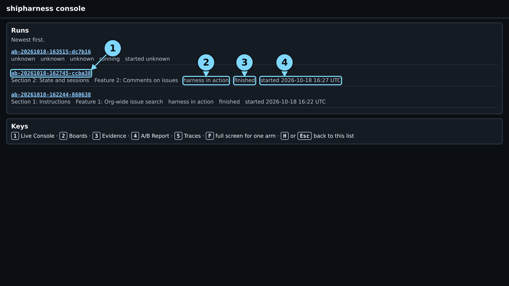
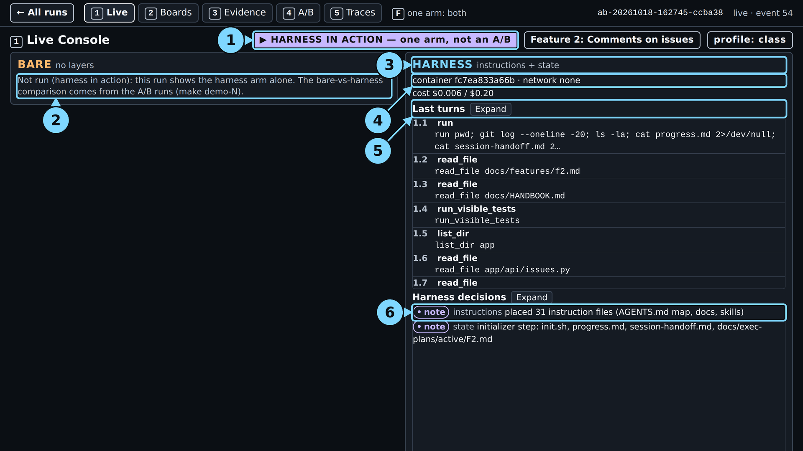
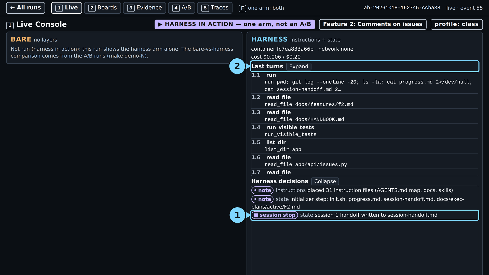
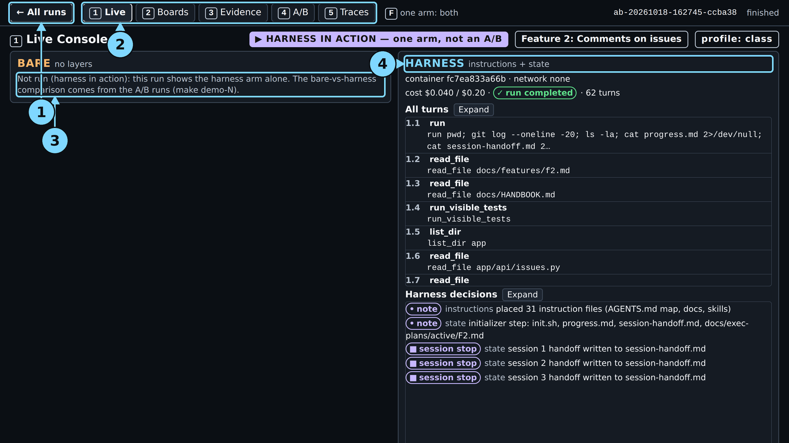

# Module 1: Harness Engineering for Coding Agents - Demo 2: What one real run looked like

This folder holds the output and the screenshots of one real `make show-2 SESSION_BUDGET=12,38`
run, the live run of 2026-10-18 for the demo guide, with the class settings (run id on the
[evidence page](../../../docs/evidence/s2.md#s2-show-2-capture)). Nothing here is
staged or edited, except where a line says it was cut. Use it to check that your run looks roughly
like this one, or to follow the demo without running it. When and how it was captured is in the
[evidence page](../../../docs/evidence/s2.md#s2-show-2-capture).

> **Terms on this page**
>
> - **Referee**: The program that scores each run after the agent stops.
> - **Primary verdict**: The referee's answer to the one question the section asks.
> - **Full verdict**: The primary verdict plus every other check: hidden tests, mutants, review.
> - **Continuity failure**: Two migration heads, a table created twice, or 30% or more of session 1's lines redone in session 2.
> - **Structured handoff**: A file that carries the last session's state and the next steps to the next session.
> - **Hidden tests**: Tests the referee runs that the agent never sees.
> - **Mutant**: A copy of the code with one small bug planted on purpose; good tests catch (kill) it.
> - **Harness note**: A line a harness layer adds to screen 1, such as "session 1 handoff written to session-handoff.md".

## Terminal output

| File | What it holds |
|---|---|
| `terminal.txt` | The command, the record line, the cost line, the start and end lines |
| `session-1-notes.txt` | The notes the agent left in the handoff before the stop |
| `session-2-first-call.txt` | Session 2's first command and the start of what it read |

The start and end lines (with the wall time) are the capture script's; nothing is cut. The
`session` figure includes the `make show-1` run before it in the same session ($0.020302).

## Screenshots

The screenshots were taken from `make console` after the run ended; the three moments of screen 1
come from the console fed with the run's log up to that event. The numbered circles are the demo
guide's callouts; each caption names them. Times count from the make command's launch.

> Your output will differ: run times, ids, and the agent's wording change on every run.

*The run list. Circles: 1 the run id (click to open), 2 the type, 3 the status, 4 the start time.*

*About one minute in: notes for the map (31 instruction files) and the initializer step.*

Circles: 1 the HARNESS IN ACTION badge, 2 the bare arm, 3 the harness arm's layers, 4 the container line, 5 the last turns, 6 the harness decisions.

*At the stop: the state layer's "session stop" decision appears under Harness decisions. Circles: 1 the harness decision "session 1 handoff written to session-handoff.md", 2 the turn list.*

*Session 2 starts with an empty context; its first call, turn 2.1, reads the state files with `cat`. Circles: 1 "Session 1 stopped · ended by turn_budget", 2 "Session 2 resumed", 3 the handoff note.*

*The end: run completed after 62 turns, cost $0.040 of the $0.20 cap. The verdicts are on screen 4 and in `terminal.txt`.*

Circles: 1 "← All runs", 2 the screen tabs, 3 the bare arm, 4 the harness arm's layers.

*Screen 2: only own-org cards, no duplicates. The comments panel is on the issue page. Circles: 1 "← All runs", 2 the harness board, 3 the board marks, 4 the bare arm, not run.*

*Screen 3: "Session 1 · 12 turns · turn_budget" (end reason on that row only), "Session 2 · 38 turns", "Test phase · 12 turns"; every referee check 0 new; reviewer accept.*

Circles: 1 the sessions, 2 the diff map, 3 Files outside the allowed paths, 4 the reviewer's reason, 5 the bare arm.

*Screen 4: this run at the top, with "primary verdict ready: PASS", hidden tests 56/56, and mutants killed 1/4; below it, "Measured before class", one dot per run. This run is not a dot.*

Circles: 1 this run, 2 Measured before class, 3 the dots, 4 cost per verified feature, 5 reviewer agreement.

*Screen 5: the live tail of referee events; "no wrong turn found". Circles: 1 the live tail, 2 the first wrong turn, 3 the LangSmith links.*
