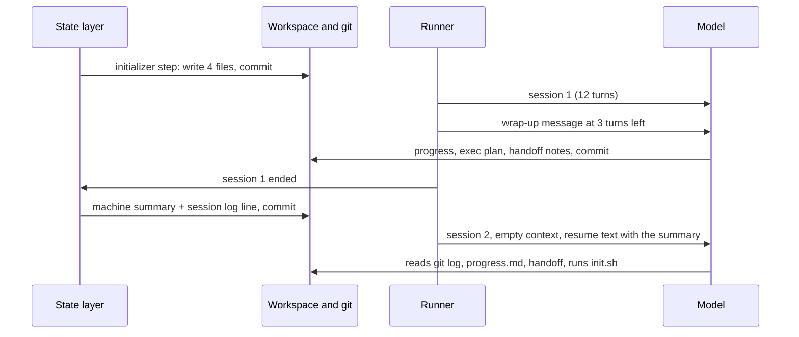

# Demo 2 walkthrough: the state layer

> **Terms on this page**
>
> - **Harness layer**: One part of the harness: instructions, state, scope, or verification.
> - **Workspace**: The harness arm's copy of TeamTrack, inside its container.
> - **Initializer step**: The harness code that writes `init.sh`, `progress.md`, `session-handoff.md`, and the exec plan before session 1.
> - **Session turn budget**: The fixed number of turns a session gets before the runner stops it.
> - **Structured handoff**: A file that carries the last session's state and the next steps to the next session.
> - **Machine summary**: The part of the handoff that the harness writes from the repository, not from the agent.
> - **House rules**: TeamTrack's seven rules for every endpoint, from tenant isolation to migrations.
> - **Exec plan**: A plan file the agent keeps up to date as it works, with steps, decisions, and progress.
> - **Migration head**: The newest migration in the chain; two heads means two migrations each claim to be the newest.

## What this code does

The state layer talks to the runner through four hooks. Before session 1, it writes four files and
commits them. Near the end of each session, it asks the agent to wrap up. When a session stops, it
writes the machine summary and a progress log line, whatever the agent did, and commits them. When
the next session starts, it hands over the summary. Five short excerpts, 40 lines in all, show each
step in the order it runs.



## The code, explained

### layer.py, lines 42-48

The start of `prepare_workspace`, the initializer step.

```python
# platform/src/shipharness/harness/state/layer.py (lines 42-48)
    def prepare_workspace(self, ctx: LayerContext) -> list[HarnessDecision]:
        files = initial_files(ctx.spec, self.feature_description, self.feature_steps)
        for rel, data in files.items():
            write_file(ctx.workspace, rel, data)
        commit_paths(
            ctx.sandbox, list(files), f"harness: initializer step for {ctx.spec.feature_id}"
        )
```

- `initial_files` renders the four templates in `assets/` with the ticket's id, title, and steps.
  The result is exactly what [harness/](harness/README.md) holds.
- Anthropic's harness uses a model session for this, an "initializer agent"
  ([Effective harnesses for long-running agents](https://www.anthropic.com/engineering/effective-harnesses-for-long-running-agents)). Here it is
  plain code, because one ticket fixes the files. It costs no model call.
- `write_file` never writes through a link, so an agent cannot redirect a harness write.
- The commit runs inside the arm's sandbox and names its paths, so nothing the agent staged slips in.
  This is the note "initializer step: init.sh, progress.md, ..." at minute 0 on screen 1.

### lifecycle.py, lines 100-111

The body of `session_stop`. The runner calls it after every session that ends.

```python
# platform/src/shipharness/harness/state/lifecycle.py (lines 100-111)
    ws: Path = ctx.workspace
    summary, tests = machine_summary(ctx, result, files_changed, timeout_s)
    template = (ASSETS / HANDOFF).read_text(encoding="utf-8")
    write_file(ws, HANDOFF, handoff.merge(read_text(ws, HANDOFF), template, summary).encode())
    log = read_text(ws, PROGRESS) or (ASSETS / PROGRESS).read_text(encoding="utf-8")
    entry = progress.session_entry(result, len(files_changed), tests, claim)
    write_file(ws, PROGRESS, progress.append_session_entry(log, entry).encode())
    commit_paths(
        ctx.sandbox,
        [HANDOFF, PROGRESS],
        f"harness: session {result.index} handoff for {ctx.spec.feature_id}",
    )
```

- `machine_summary` reads the repository: the last commits, the files changed, the visible test
  result, open TODO markers, the migration heads, and the documents the agent opened.
- It runs the full visible suite once per stop. That is harness time, on its own clock, after the
  agent's turns.
- If the agent deleted `progress.md`, the template comes back and the log line still lands.
- The commit message is the one session 2 sees first in its git log:
  `harness: session 1 handoff for F2`, where `F2` is the course's code for Feature 2: Comments on issues
  ([expected/](expected/README.md)).

### handoff.py, lines 123-129

`merge` keeps the agent's notes and replaces only the harness's part.

```python
# platform/src/shipharness/harness/state/handoff.py (lines 123-129)
def merge(existing: str | None, template: str, summary: str) -> str:
    """Header from the template, the new machine summary, and the agent's notes kept as written."""
    header = template.split(MACHINE, 1)[0]
    notes = template[template.index(NOTES) :]
    if existing and NOTES in existing:
        notes = existing[existing.index(NOTES) :]
    return f"{header}{MACHINE}\n\n{summary}\n\n{notes.rstrip()}\n"
```

- The handoff has two owners. The harness owns "Machine summary"; the agent owns "Notes from the
  agent". Neither overwrites the other.
- If the agent wrote nothing, the next session still gets the machine summary. A handoff that
  depends only on the agent is empty exactly when the agent ran out of turns.

### handoff.py, lines 116-120

The end of `migration_heads`, one line of the summary.

```python
# platform/src/shipharness/harness/state/handoff.py (lines 116-120)
    if not revisions:
        return "no migrations found"
    heads = sorted(clean(r, 60) for r in revisions if r not in parents)
    note = "" if len(heads) == 1 else "; there must be exactly one (House rule 7: Migrations)"
    return f"{len(heads)} ({', '.join(heads)}){note}"
```

- The function reads `migrations/versions/*.py` as text and never runs them. A head is a revision
  that no other migration names as its `down_revision`.
- Two heads is the failure this section is about. The line names the migrations rule, House rule 7:
  Migrations, so the next session sees the problem before it writes another migration.

### lifecycle.py, lines 123-131

`resume_text`: what the harness adds when the next session starts.

```python
# platform/src/shipharness/harness/state/lifecycle.py (lines 123-131)
def resume_text(summary: str, phase: str = "build") -> str:
    """Extra resume text for the harness arm (the neutral resume sentence comes first)."""
    text = (
        "Start with the Getting up to speed steps before you change code. The structured "
        "handoff from the last session is in session-handoff.md."
    )
    if phase == "test":
        text = f"{text} {TEST_PHASE_FIRST}"
    return f"{text} Its machine summary:\n\n{summary[:3000]}" if summary else text
```

- Both arms get the same first sentence from the runner: "A previous session worked on this ticket
  and was stopped." Only the harness arm gets this text after it.
- The summary is capped at 3,000 characters, so a long file list cannot crowd out the ticket.
- On screen 1 this is the marker "Session 2 resumed · prefix: core, instructions, state".

Two more pieces sit in the same file. `getting_up_to_speed` (lines 21-53) is the routine every
session starts with: `pwd`, `progress.md` and the git log, the handoff and the plan, then
`bash init.sh`. `wrapup_text` (lines 56-68) is the message at three turns left. The runner decides
when a session ends: `_next_session_runs` in `platform/src/shipharness/runner/loop.py` starts the next
build session after a spent turn budget or a `finish(claim="not_done")`.

## If you copy this into your repo

- Write the handoff from code, not only from the agent. Commits, changed files, test status, and
  migration heads can all be read from the repository at the stop.
- Give each part of a state file one owner. Let the agent write notes; let the harness write facts.
- Commit harness files with explicit paths, so the agent's half-staged work stays out.
- Keep the resume message short and capped. The next session also needs room for the ticket.
- Check your templates against what the agent will really find. In this demo, `progress.md` says
  to read `feature_list.json`, which only exists once the scope layer runs.

## Sources

- Source 1: Effective harnesses for long-running agents, <https://www.anthropic.com/engineering/effective-harnesses-for-long-running-agents>, Justin Young (Anthropic), 2025-11-26
