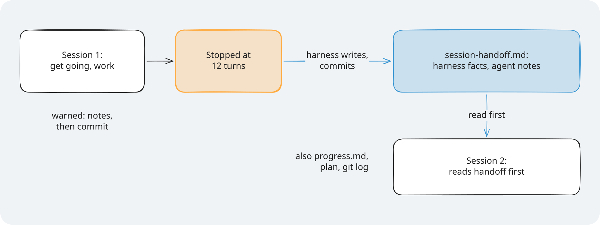
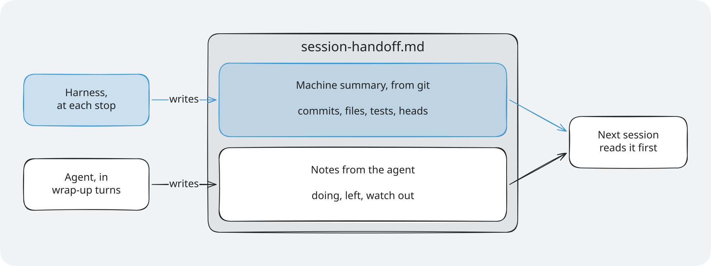
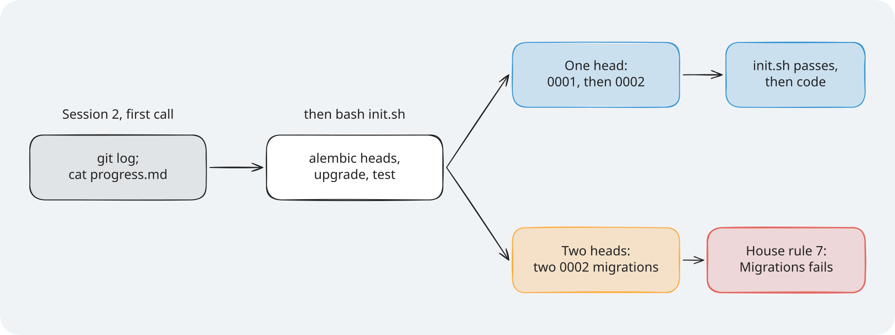
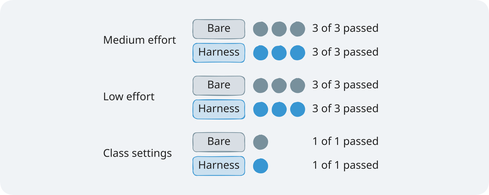
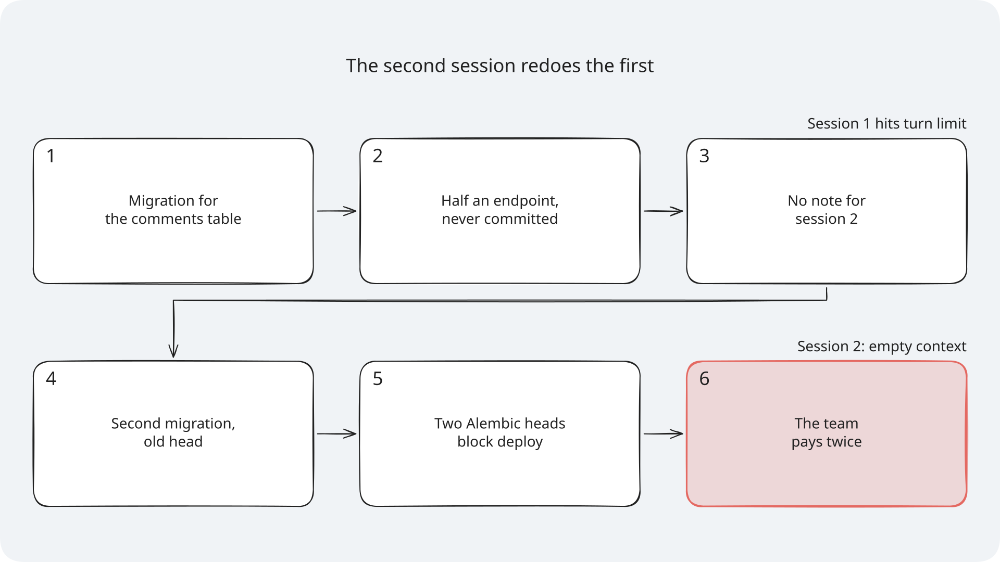
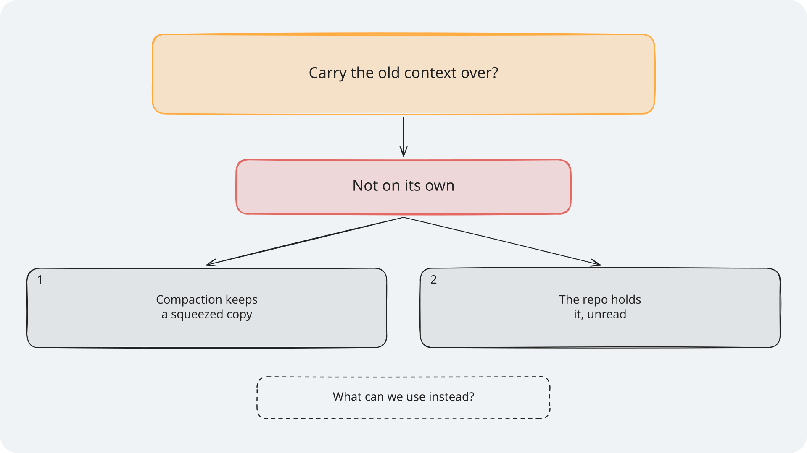
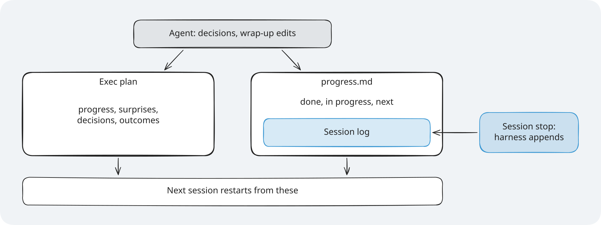
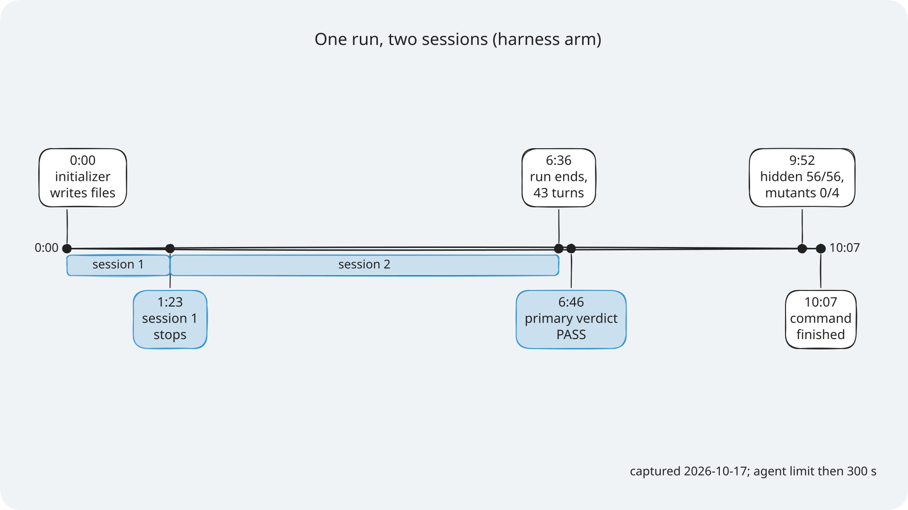
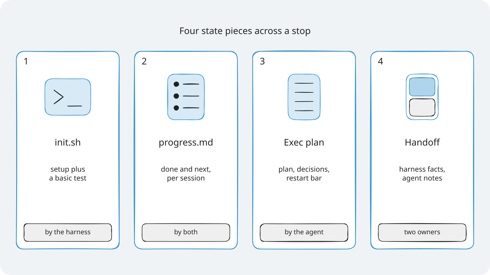

# Module 1: Harness Engineering for Coding Agents - Diagrams for Section 2: State and sessions

The diagrams for Section 2, the state and lifecycle layer. Each one has an `.excalidraw` source, a
`.png` at 2x for slides, and an `.svg` with the font embedded for pages. Colours, step frames,
editing, and licences are explained once, in [the course diagrams guide](../../docs/diagrams/README.md).

> **Terms on this page**
>
> - **Bare arm**: An agent run with the ticket and the repository, and no harness.
> - **Harness arm**: The same run with the harness turned on.
> - **Session turn budget**: The fixed number of turns a session gets before the runner stops it.
> - **Structured handoff**: A file that carries the last session's state and the next steps to the next session.
> - **Migrations rule**: House rule 7: Migrations. Exactly one Alembic head, and a fresh upgrade works.

## The diagrams

### Session lifecycle and handoff

*Session 2 starts with an empty context; what it knows comes from the handoff, progress.md, and git.*

- **What it teaches**: a context reset with a structured handoff, from one session to the next.
- **Slide topic**: one task, two sessions.
- **Files**: `session-lifecycle`, with step frames `session-lifecycle-step-1` to
  `session-lifecycle-step-4`.
- **Source**: `platform/src/shipharness/harness/state/lifecycle.py` and the 12-turn first session in
  [the Section 2 evidence](../../docs/evidence/s2.md).

### What the handoff holds

*The harness writes the facts from the repository; the agent writes its notes, which stay as written.*

- **What it teaches**: the two owners of `session-handoff.md` and what each part holds.
- **Slide topic**: the handoff file.
- **Files**: `handoff-contents`.
- **Source**: `MachineSummary` and `merge` in `platform/src/shipharness/harness/state/handoff.py`.

### One head or two heads

*Read state, then run init.sh; two migrations on the same parent make two heads, and init.sh stops there.*

- **What it teaches**: the getting-up-to-speed routine, and what a redone migration does to the Alembic history.
- **Slide topic**: the cost of a forgotten session.
- **Files**: `alembic-heads`.
- **Source**: `section-2-state-lifecycle/demo/harness/init.sh`, the Section 2 evidence, and
  `migration_heads` in `platform/src/shipharness/harness/state/handoff.py`.

### Section 2 results

*All 7 runs of each arm passed: no measurable difference on this task with this model.*

- **What it teaches**: the measured result for the state layer, one dot per run.
- **Slide topic**: what we measured in Section 2.
- **Files**: `results-s2`.
- **Source**: [the Section 2 evidence](../../docs/evidence/s2.md). One earlier round is not shown:
  the evidence page reports it as a measurement bug.

### Failure story: the second session redoes the first

*Session 2 had the whole repository and still redid the migration.*

- **What it teaches**: how a stop without a handoff leads to a second migration and two heads.
- **Slide**: "Problem statement: The second session redoes the first".
- **Files**: `failure-story-s2`.
- **Source**: the slide's notes; the migrations rule (House rule 7) in `platform/teamtrack/docs/HANDBOOK.md`.
- **How to edit**: open `failure-story-s2.excalidraw`, edit it, then export the PNG and the SVG (see [How to edit a diagram](../../docs/diagrams/README.md#how-to-edit-a-diagram)).

### Socratic build-up: why redo work already on disk?

*Frame 1 asks, frame 2 answers, frame 3 gives the reasons.*

- **What it teaches**: why carrying the old context over is not enough on its own.
- **Slide**: "Fresh session: Why redo work already on disk?", frame N on build N.
- **Files**: `socratic-s2`, with step frames `socratic-s2-step-1` to `socratic-s2-step-3`.
- **Source**: `section-2-state-lifecycle/concepts.md`.
- **How to edit**: open `socratic-s2.excalidraw`, edit it, then export the PNG and the SVG (see [How to edit a diagram](../../docs/diagrams/README.md#how-to-edit-a-diagram)).

### The exec plan and the progress ledger

*Two files, two writers; restart from these alone.*

- **What it teaches**: what the exec plan and `progress.md` hold, who writes each part, and that the next session restarts from them.
- **Slide**: "3) The exec plan and the progress ledger".
- **Files**: `exec-plan-ledger`.
- **Source**: `platform/src/shipharness/harness/state/layer.py` and `lifecycle.py`, `demo/walkthrough.md`, `demo/harness/progress.md`, and the slide's speaker notes (the four PLANS.md sections).
- **How to edit**: open `exec-plan-ledger.excalidraw`, edit it, then export the PNG and the SVG (see [How to edit a diagram](../../docs/diagrams/README.md#how-to-edit-a-diagram)).

### Timeline of the captured show-2 run

*Captured 2026-10-17 with the agent limit then at 300 s.*

- **What it teaches**: one run across a planned stop: when session 1 ended and when each verdict came.
- **Slide**: "What just happened: One run, two sessions".
- **Files**: `timeline-s2`.
- **Source**: the show-2 capture in [the Section 2 evidence](../../docs/evidence/s2.md) and `demo/expected/terminal.txt`.
- **How to edit**: open `timeline-s2.excalidraw`, edit it, then export the PNG and the SVG (see [How to edit a diagram](../../docs/diagrams/README.md#how-to-edit-a-diagram)).

### Cheat sheet: four state pieces

*Each piece names who writes it.*

- **What it teaches**: the four state files that carry work across a stop.
- **Slide**: "Cheat Sheet: Four state pieces across a stop".
- **Files**: `cheat-sheet-s2`.
- **Source**: `section-2-state-lifecycle/concepts.md`.
- **How to edit**: open `cheat-sheet-s2.excalidraw`, edit it, then export the PNG and the SVG (see [How to edit a diagram](../../docs/diagrams/README.md#how-to-edit-a-diagram)).
