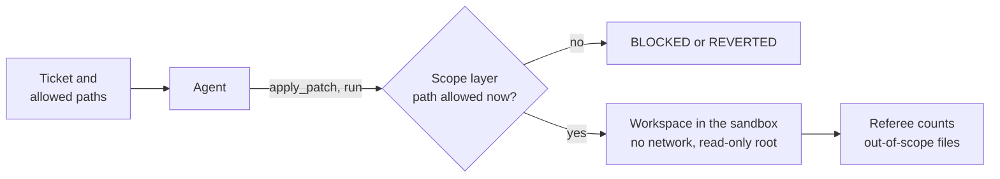

# Module 1: Harness Engineering for Coding Agents - Section 3: Scope and sandbox

What the agent may change and reach: the files of one feature, checked by code, inside a container.

## The problem

**Illustrative scenario.** You ask a coding agent to stop lost updates on issues in a multi-tenant
tracker. The ticket lists the files to change. The agent needs a new error, and the shared errors
module that every endpoint imports looks like the right home, so it adds one there. The ticket's
tests pass and review approves a small diff. Later, a change to that shared module breaks the
feature, and an older endpoint starts answering differently. Nobody connects either to a ticket that
never listed the file.

The cost is a regression in code nobody asked to change, and a review of every file outside the
ticket on every agent change.

> **Terms on this page**
>
> - **Harness**: The files and code around the agent that decide what it sees and may do.
> - **Harness layer**: One part of the harness: instructions, state, scope, or verification.
> - **Bare arm**: An agent run with the ticket and the repository, and no harness.
> - **Harness arm**: The same run with the harness turned on.
> - **Referee**: The program that scores each run after the agent stops.
> - **Allowed paths**: The globs a ticket lists for each phase; the files the agent may change then.
> - **Feature list**: `feature_list.json`, the one feature of the run and its `passes` field.
> - **Sandbox**: The container every tool command runs in, the same for both arms.
> - **Lost update**: One edit silently overwriting another made a moment earlier.
>
> All terms: [glossary](../docs/glossary.md).

## Why it happens

- Agents copy what they find: "Codex replicates patterns that already exist in the repository—even
  uneven or suboptimal ones." ([OpenAI, Harness engineering](https://openai.com/index/harness-engineering/))
  TeamTrack's handbook points to the shared errors module for every new error.
- Unattended agents do things nobody asked for. One author's advice is "(Run this in a container, not
  your actual machine)." ([Anthropic, C compiler](https://www.anthropic.com/engineering/building-c-compiler))
- A list of files in a ticket is text. Nothing checks it, so the agent's own judgement decides.

## How this section fixes it

The scope layer makes the ticket's list a boundary that code checks. The harness writes a feature
list with one feature, refuses any patch outside the phase's allowed paths, undoes a command's stray
changes, and sets `passes` itself from evidence. Every tool command of both arms runs in the same
container with no network ([Anthropic, Autonomous coding demo](https://github.com/anthropics/claude-quickstarts/tree/main/autonomous-coding)
keeps "File operations restricted to the project directory only").

The course measures whether it helps. On the class demo's ticket, Feature 4: Version checks on
issue edits, every bare arm changed a shared file outside the list in three test runs, and the scope
layer kept every harness arm inside it ([evidence](../docs/evidence/s3.md#s3-confirmation)). On
Feature 3: Safe retries for issue creation (a retried create never makes a duplicate), neither arm
ever left the list.
The concepts page explains both, and what the result does not show.

## How to work through this section

In class the section takes 50 minutes. The live A/B starts at minute 1 (2:01), on the section's start slide, and runs while
the concepts are taught.

| Part | What it gives you | In class |
|---|---|---|
| [concepts.md](concepts.md) | The idea, how it works, what the course measured | Minutes 2-20 |
| [demo/](demo/README.md) | The live A/B on the version-checks ticket, and how to read it | Launch at minute 1; review at 28-44 |
| [demo/walkthrough.md](demo/walkthrough.md) | The 34 lines of code behind the layer | Minutes 20-30, on the DEMO slide |
| [assignment/](assignment/README.md) | Assignment 3: Scope and sandbox. A diff-scope policy, a `passes` gate, a sandbox rule | After class |
| [post-class-reading/](post-class-reading/README.md) | Three short readings on feature lists and sandboxes | After class |
| [session-notes.md](session-notes.md) | What class showed, questions, what to try next | After class |

## Where next

- First time here? Install everything with [setup/](../setup/README.md), then run the
  [demo](demo/README.md).
- Already set up? Start with [concepts.md](concepts.md).
- Want allowed paths for your own agent? See [use-in-your-repo/](../use-in-your-repo/README.md).

## Sources

- Source 1: Harness engineering: leveraging Codex in an agent-first world, <https://openai.com/index/harness-engineering/>, Ryan Lopopolo (OpenAI), 2026-02-11
- Source 2: Building a C compiler with a team of parallel Claudes, <https://www.anthropic.com/engineering/building-c-compiler>, Nicholas Carlini (Anthropic), 2026-02-05
- Source 3: Autonomous Coding Agent Demo (README), <https://github.com/anthropics/claude-quickstarts/tree/main/autonomous-coding>, Anthropic, 2025-11-26
