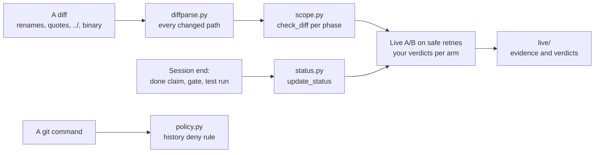

# Module 1: Harness Engineering for Coding Agents - Assignment 3: Scope and sandbox

Try it yourself first. The full solution is in [./solution/](solution/) with a step-by-step walkthrough.

## The problem

**Illustrative scenario.** A team checks every agent patch against the ticket's list of files. The
check compares each path in the patch with the list's globs. Then the agent sends a patch that renames
a shared module, and the check reads only the old name. Another patch writes to
`tests/visible/../../app/services/issues.py`, which matches the allowed `tests/visible/**` glob as a
string. Both pass. Elsewhere the feature list says "passes" because the agent said so, and a history
rewrite leaves that evidence pointing at a commit that no longer exists.

Path checks go wrong in both directions. Before its measurement was fixed, the course's own referee
counted the import linter's cache as out-of-scope files in every arm. You will build the checks so
that they decide what a diff really changes before they decide whether it is allowed. The idea
behind them is OpenAI's "enforce boundaries centrally, allow autonomy locally."
([Harness engineering](https://openai.com/index/harness-engineering/))

> **Terms on this page**
>
> - **Allowed paths**: The globs a ticket lists for each phase; the files the agent may change then.
> - **Phase**: One stage of a run: build (write the feature), then test (add tests only).
> - **Diff-scope policy**: Your function that reads a diff and refuses every path outside the list.
> - **Feature list**: `feature_list.json`, the one feature of the run and its `passes` field.
> - **Evidence**: A passing gate result or visible-test run that lets the harness set `passes`.
> - **Deny rule**: A pattern on a command's text that the sandbox refuses before the command runs.
> - **Bare arm**: An agent run with the ticket and the repository, and no harness.
> - **Harness arm**: The same run with the harness turned on.
> - **Referee**: The program that scores each run after the agent stops.
> - **Live evidence**: The files your real A/B run wrote, collected into `live/`.

## What you'll build



You build the three controls of Section 3: Scope and sandbox in a small package of your own,
`a3scope`. First, a diff
parser and a per-phase diff-scope policy that finds every changed file, including renames, quoted
names, `../` paths, and empty new files. Second, an update of `passes` that needs evidence, never the
agent's word alone. Third, a sandbox rule that refuses git history rewrites, with a test that proves
the denial. Then you run one live `demo-3` A/B on the ticket for Feature 3: Safe retries for issue
creation (retried creates never duplicate) and apply your code to what the two real arms changed. The exact requirements are in [SPEC.md](SPEC.md).

## Step by step

All commands run from the repository root. Steps 1 to 7 need no keys and no Docker.

1. **See where you start.** Run the self-check:

   ```bash
   make check-assignment-3
   ```

   Check: it prints one FAIL row per part and lists the `TODO(A3 ...)` markers left (each marks a
   place in the starter you still have to fill). On the unchanged
   starter it fails by design. Only the "history rule allows" row passes, because an empty rule
   allows everything.

2. **Parse diffs.** Implement `parse_diff` and `changed_paths` in `starter/a3scope/diffparse.py`.
   Start with the git sections in `fixtures/diffs/`, then plain unified sections, hunk counting,
   quoted names, and binary files. Check: the "diff parsing and path matching" row reaches 28/28.

3. **Match globs and check a diff.** Implement `glob_matches`, then `check_diff`, in
   `starter/a3scope/scope.py`. Apply the rules in the order the spec gives. Check: both
   "out-of-scope diffs rejected" and "legitimate diffs accepted" are `ok`.

4. **Gate `passes` on evidence.** Implement `update_status` in `starter/a3scope/status.py`: the
   cases that change nothing first, then the gate path, then the visible-test path. Check: both
   "passes" rows are `ok`.

5. **Write the history rule.** Fill `HISTORY_MESSAGE` and `HISTORY_RULES` in
   `starter/a3scope/policy.py`. Write the "must keep running" list from the spec into a scratch test
   before you write any pattern. Check: both "history rule" rows are `ok`.

6. **Prove the denial.** Write `starter/tests/test_a3_sandbox_rule.py`. Run it once with your rule,
   and once with `HISTORY_RULES = ()`:

   ```bash
   uv run python -m pytest -q -p no:cacheprovider section-3-scope-sandbox/assignment/starter/tests
   ```

   Check: it passes with the rule and fails without it. The three "your denial test" rows are `ok`.

7. **Add your own cases.** `fixtures/make_fixtures.py` shows how to turn file operations into real
   `git diff --cached` output. Check: `make check-assignment-3` shows every row `ok` except the live
   row.

8. **Run the A/B live, once.** It needs your keys and Docker. Finish steps 2 to 6 first: your
   verdicts come from your code, and the grader re-runs it on the evidence. `--feature F3` picks the
   ticket for Feature 3.

   ```bash
   uv run shipharness ab --section demo-3 --feature F3 --no-preview --purpose assignment 2>&1 | tee ab-output.txt
   ```

   Check: the output ends with a `Cost: $...` line. An arm that ends `ABORTED: timeout` still counts.

9. **Collect and verify the evidence**, right after the A/B, while the arm workspaces still exist.
   Replace `section-3-scope-sandbox/assignment/starter` if you work in a copy:

   ```bash
   uv run python section-3-scope-sandbox/assignment/live.py collect --impl section-3-scope-sandbox/assignment/starter \
       --ab-output ab-output.txt \
       --command "uv run shipharness ab --section demo-3 --feature F3 --no-preview --purpose assignment"
   uv run python section-3-scope-sandbox/assignment/live.py verify --impl section-3-scope-sandbox/assignment/starter
   ```

   Check: `verify` prints `evidence  ok` and `verdicts  ok`.

10. **Read your verdicts against the referee's.** Open `live/verdict-bare.json` and
    `live/verdict-harness.json`. Your policy reads the whole diff; the referee removes harness files
    first. Check: you can say, for each difference, which side is right for an agent patch.

11. **Submit.** Run `make check-assignment-3` until every row says `ok`, then commit your folder with
    `live/` on your own branch.

## Grading criteria (100 points)

| Criterion | What earns the points | Points | Checked by |
|---|---|---|---|
| 1. Diff parsing | Every changed path found, in order | 15 | Both |
| 2. Diff-scope policy | Out-of-scope diffs refused with path and code; legitimate diffs accepted | 40 | Both |
| 3. Evidence-gated status | `passes` set with the right evidence; unchanged otherwise | 15 | Both |
| 4. History rule | Rewrites refused; ordinary and harness commands still run | 10 | Both |
| 5. Denial test | Passes with the rule, fails without it, uses the real policy | 10 | Both |
| 6. Live evidence | One valid live `demo-3` A/B on Feature 3; your verdicts reproduced | 10 | Both |
| **Total** | | **100** | |

Criteria 2 to 4 multiply both sides, so a policy that refuses everything, or allows everything, earns
nothing there. To pass you need at least 80 points, every out-of-scope diff refused, no false
positive, and valid live evidence. `make check-assignment-3` runs the visible checks. The
instructor's grader adds hidden cases; it is not in this repository. The scoring per item is in
[SPEC.md](SPEC.md#grading-criteria-item-by-item).

## Solution walkthrough

The reference solution is a finished work folder in [solution/](solution/). Its
[SOLUTION.md](solution/SOLUTION.md) explains:

- how one parser counts hunk lines, so a content line that looks like `--- a/x` is never a header;
- why path escapes are checked first and the feature list second, before any allow list;
- why the status gate checks that a gate's items agree with its `passed` field;
- how every history pattern starts at a command position, so a quoted `git reset --hard` still runs;
- what its live A/B measured, and the grade it earned.

Read it after your own attempt, and compare your choices with its alternatives.

## Sources

- Source 1: Harness engineering: leveraging Codex in an agent-first world, <https://openai.com/index/harness-engineering/>, Ryan Lopopolo (OpenAI), 2026-02-11
