# Module 1: Harness Engineering for Coding Agents - Demo 3: what a real run looked like

This folder holds the output and the screenshots of one real `make demo-3 FEATURE=version-checks`
A/B, the live run of 2026-10-18 for the demo guide, with the class settings (run id on the
[evidence page](../../../docs/evidence/s3.md#s3-guide-run)). Nothing here is staged or edited. Use it
to check that your run looks roughly like this one, or to follow the demo without running it. When
and how each file was captured is on the
[evidence page](../../../docs/evidence/s3.md#s3-demo-capture).

In this run the bare arm stayed inside the allowed paths, so both arms passed the demo's measure.
That is the less usual result: before class the bare arm left the allowed paths in 9 of 10 runs
([evidence](../../../docs/evidence/s3.md#s3-screen-4-before-class)). The scope layer still blocked
the harness arm's patch to `app/services/errors.py`. One screenshot from a recorded run shows the
usual result.

> **Terms on this page**
>
> - **Bare arm**: An agent run with the ticket and the repository, and no harness.
> - **Harness arm**: The same run with the harness turned on.
> - **Primary verdict**: The referee's answer to the one question the section asks.
> - **Out-of-scope file**: A file in the shipped diff that matches none of the allowed paths.
> - **Block**: A patch the scope layer refuses before anything is written; the agent sees `BLOCKED`.

## Terminal output

| File | What it holds |
|---|---|
| `terminal.txt` | The command, both record lines, the cost line, the start and end lines |

The start and end lines (with the wall time) are the capture script's; nothing is cut. The
`session` figure counts the two show-N runs before it in the same session.

## Screenshots

All from `make console`; the three moment screens of screen 1 were taken while the run was live.
The numbered circles are the demo guide's callouts. Times count from the make command's launch;
the console's own "launch to" times start a few seconds later.

> Your output will differ: run times, ids, and the agent's wording change on every run.

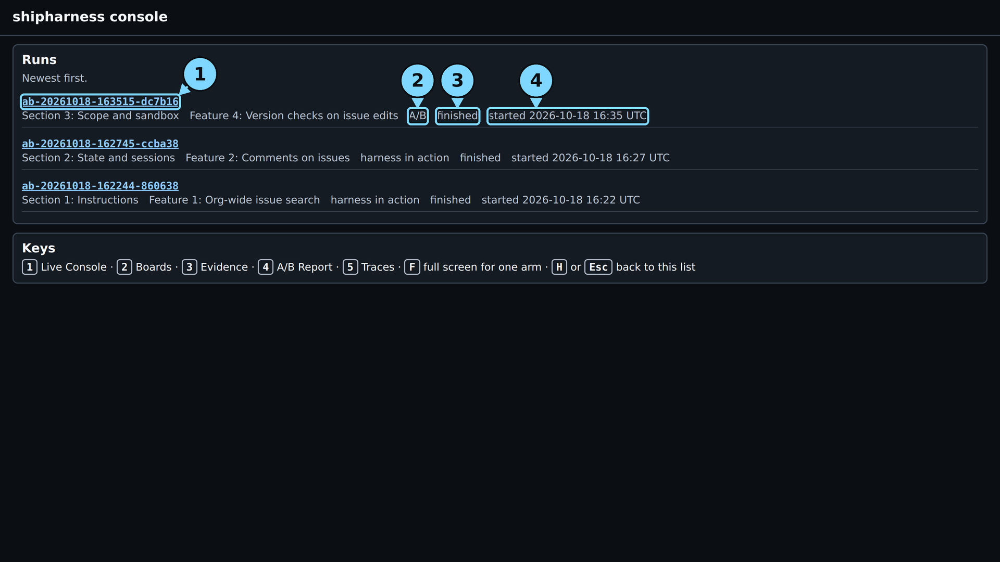

*The run list. Circles: 1 the run id, 2 the type, "A/B", 3 the status, 4 the start time.*

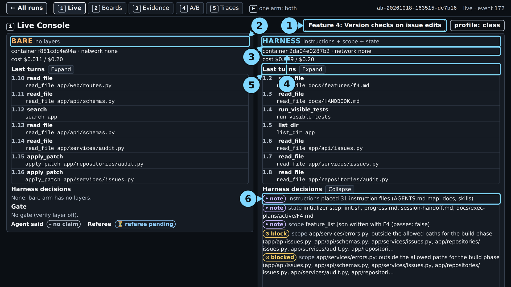

*About one minute in: both arms at work; the harness arm's notes show the instruction files, the state files, and `feature_list.json`.*

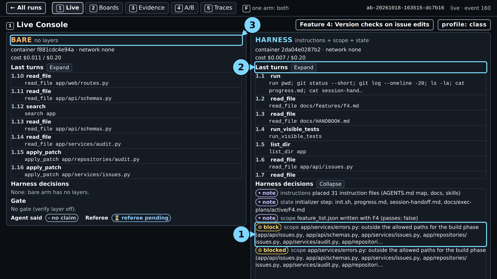

*1:03: the block. Circles: 1 the block row, 2 the turn list, 3 the bare arm.*

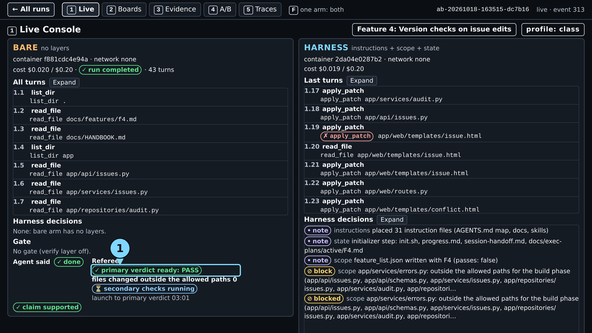

*3:10: the bare arm's pill, "primary verdict ready: PASS", with 0 files outside the allowed paths. Circle 1: the pill.*

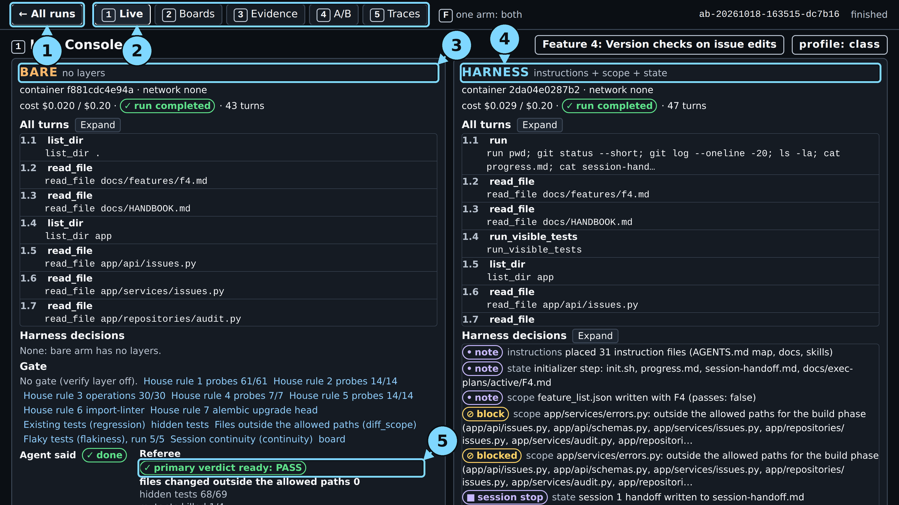

*The end: bare 43 turns, harness 47; the bare arm's pill PASS, 0 files outside the allowed paths, hidden tests 68/69. The harness arm's pill is below the frame.*

Circles: 1 "← All runs", 2 the tabs, 3 the bare arm, 4 the harness arm, 5 the bare arm's pill.

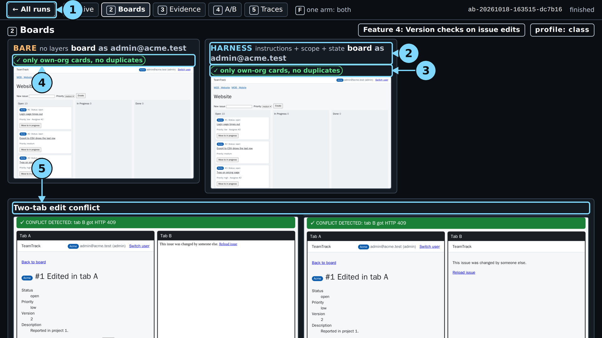

*Screen 2: own-org cards only on both boards; "CONFLICT DETECTED: tab B got HTTP 409" for both arms.*

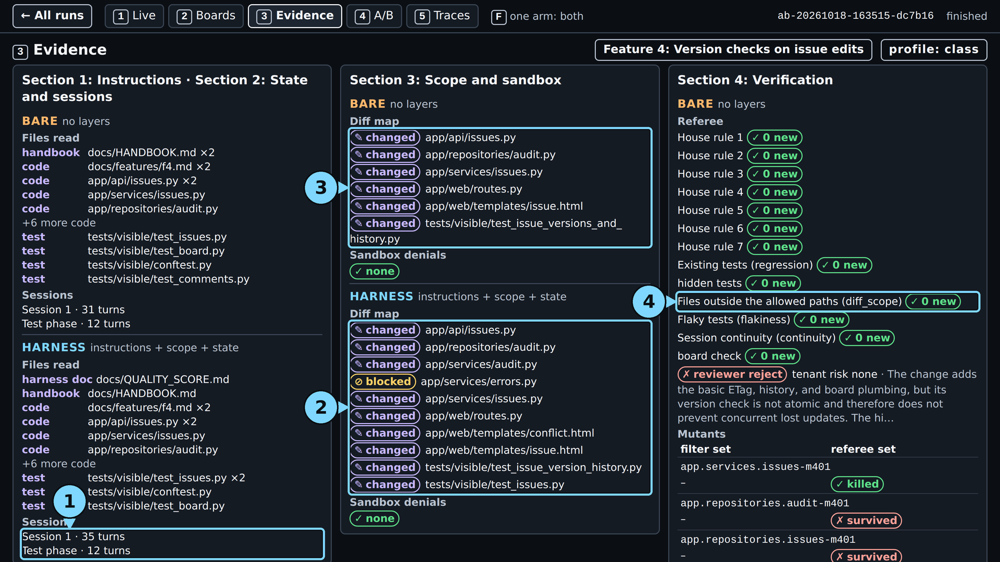

*Screen 3: `app/services/errors.py` blocked for the harness arm; the bare arm changed only allowed files. Files outside the allowed paths (`diff_scope`): 0 new for both.*

*The usual result, from demo run 1 recorded before class: the bare arm changed the shared file; the harness arm was blocked on it.*

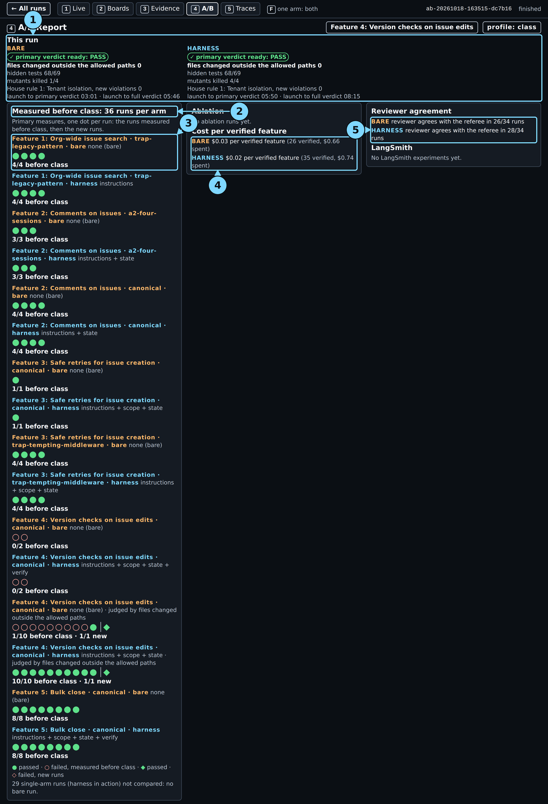

*Screen 4: "Measured before class: 36 runs per arm"; the version checks rows on the scope measure read "1/10 before class · 1/1 new" and "10/10 before class · 1/1 new".*

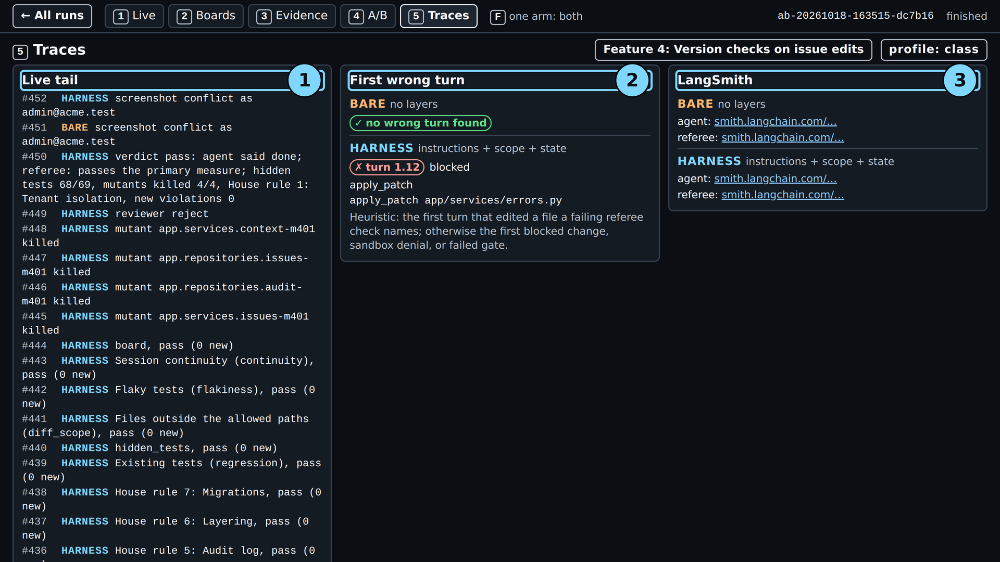

*Screen 5: no wrong turn for the bare arm; the harness arm's first wrong turn is the refused patch (turn 1.12).*

## Board frames

The referee captures these itself while it scores each arm.

*The bare arm's board: the Acme user sees only Acme cards.*

*The harness arm's board: the same view.*

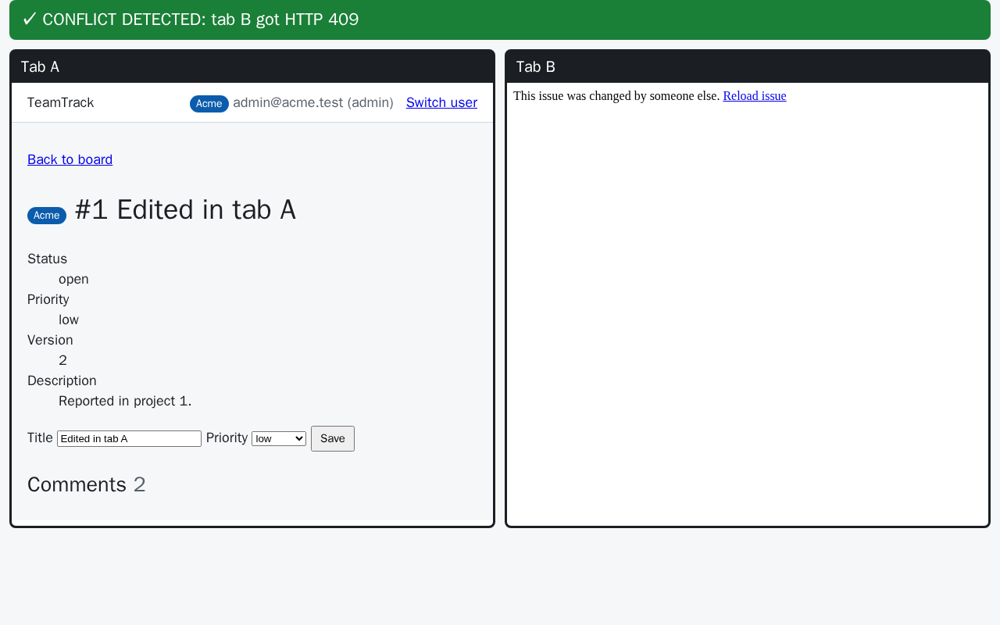

*Bare arm: tab B's stale save gets HTTP 409 and the conflict page.*

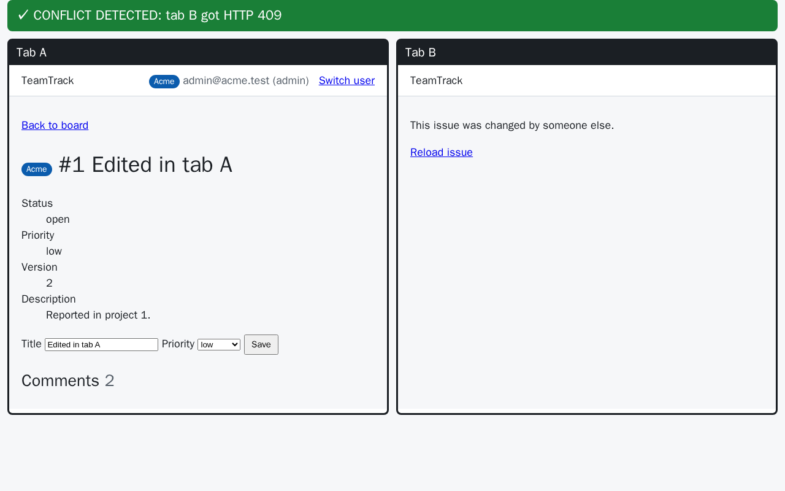

*Harness arm: the same, HTTP 409.*

In a recorded run before class the harness arm's board saves returned HTTP 500: it added the
`version` form field to `create_issue` instead of `edit_issue`
([evidence](../../../docs/evidence/s3.md#s3-two-tab-check)). In scope is not the same as correct.
