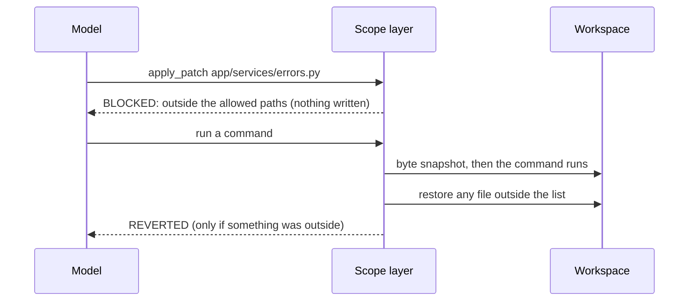

# Demo 3 walkthrough: the scope layer

> **Terms on this page**
>
> - **Harness layer**: One part of the harness: instructions, state, scope, or verification.
> - **Workspace**: The arm's copy of TeamTrack, inside its container.
> - **Allowed paths**: The globs a ticket lists for each phase; the files the agent may change then.
> - **Phase**: One stage of a run: build (write the feature), then test (add tests only).
> - **Block**: A patch the scope layer refuses before anything is written; the agent sees `BLOCKED`.
> - **Revert**: A command's change outside the allowed paths, undone right after the command runs.
> - **Referee**: The program that scores each run after the agent stops.

## What this code does

The scope layer turns the ticket's list of files into a rule that code checks. It decides per path,
refuses a patch before it is written, and undoes a command's stray changes after it runs. After the
run, the referee counts out-of-scope files the same way for both arms. Four short excerpts, 34 lines
in all, show each step in the order it runs.



## The code, explained

### guard.py, lines 68-78

The method `PathRules.reason` decides one path. `None` means the agent may change it.

```python
# platform/src/shipharness/harness/scope/guard.py (lines 68-78)
    def reason(self, path: str) -> str | None:
        """None if the agent may change `path`; otherwise the reason it sees."""
        rel = normalise(path)
        if rel in HARNESS_ONLY:
            return HARNESS_ONLY[rel]
        if self.state_files and any(glob_matches(rel, p) for p in STATE_FILES):
            return None
        if self.allowed is None or any(glob_matches(rel, p) for p in self.allowed):
            return None
        listed = ", ".join(self.allowed) or "(none)"
        return f"{rel} is outside the allowed paths for the {self.phase} phase ({listed})"
```

- `HARNESS_ONLY` is checked first: `feature_list.json` and its schema. No allowed-path list can open
  them, so the agent can never mark its own feature as passing.
- With the state layer on, `progress.md`, `session-handoff.md`, and `docs/exec-plans/**` are the
  agent's in every phase.
- Then the phase's own globs. `*` stays inside one folder; `**` spans folders.
- The reason names the phase and the full list, so the agent learns where it may write. In the
  captured run it read: "app/services/errors.py: outside the allowed paths for the build phase".

### layer.py, lines 158-169

Part of `before_tool`. It runs before the tool, so a refused patch never touches the workspace.

```python
# platform/src/shipharness/harness/scope/layer.py (lines 158-169)
        if call.name == "apply_patch":
            targets = patch_targets(str(call.arguments.get("patch", "")))
            refused = check_paths(self.rules(ctx), targets)
            if refused:
                parts = self._decisions("block", refused, ctx, "patch not applied")
                return HarnessDecision(
                    kind="block",
                    layer=self.name,
                    message=" | ".join(d.message for d in parts),
                    paths=sorted({p for d in parts for p in d.paths}),
                    data={"phase": ctx.phase},
                )
```

- `patch_targets` lists every path a patch can touch: both header lines, renames, and copies. A
  rename out of scope is caught by its new name.
- One refused path refuses the whole patch. The runner turns the decision into the tool result
  `BLOCKED: ...; patch not applied` and a `blocked` event.
- On the console, the decision shows as a `block` row under "Harness decisions" on screen 1, and as a
  "blocked" mark next to the file in the diff map on screen 3.

### layer.py, lines 179-185

The middle of `after_tool`. A shell command can write any file, so the check comes after it runs.

```python
# platform/src/shipharness/harness/scope/layer.py (lines 179-185)
        before = baseline[1]
        changed = snapshot.changed(before, snapshot.take(ctx.workspace))
        refused = check_paths(self.rules(ctx), changed)
        if not refused:
            return []
        problems = snapshot.restore(ctx.workspace, before, [p for v in refused.values() for p in v])
        decisions = self._decisions("revert", refused, ctx, "change reverted")
```

- `baseline` is a byte snapshot of the workspace, taken in `before_tool` just before the command.
- Changed files outside the list are restored from the snapshot; new ones are deleted. No git is
  involved, so a command cannot hide a change in a commit.
- None of the test runs of this demo needed a revert: the agents changed files with `apply_patch`.

### referee.py, lines 591-594

The referee scores both arms the same way, on the shipped diff.

```python
# platform/src/shipharness/ab/referee.py (lines 591-594)
        paths = [p for p in diff_paths(product) if p != "/dev/null"]
        allowed = self.task.allowed_paths
        scope_globs = [*allowed.get("build", []), *allowed.get("test", [])]
        out_of_scope = [p for p in paths if scope_globs and not _allowed(p, scope_globs)]
```

- `product` is the arm's diff with harness files removed (`strip`, line 586), so the harness's own
  `feature_list.json` and `progress.md` do not count against it.
- A file counts if it matches neither the build list nor the test list. This number is
  `out_of_scope_files` in the score record, and the Files outside the allowed paths (`diff_scope`) row on screen 3.
- The bare arm gets no scope layer, but the referee still counts its files. That is the comparison.

## If you copy this into your repo

- Keep the allowed paths with the task, not in the prompt only. The prompt tells the agent; the check
  makes it true. Look at what the agent was told in [harness/scope-rules.txt](harness/scope-rules.txt).
- Check patches before they apply and commands after they run. A check on patches alone misses
  `sed -i` and generated files.
- Make the files that grade the agent off limits in every phase, before any allow list is read.
- Say why in the refusal, and name the allowed files. After the refusal, the agent in the captured
  run put its new error class in a file it was allowed to change.
- Count the same thing for a run without the check. Without the bare arm's count, a zero proves only
  that the check ran.
