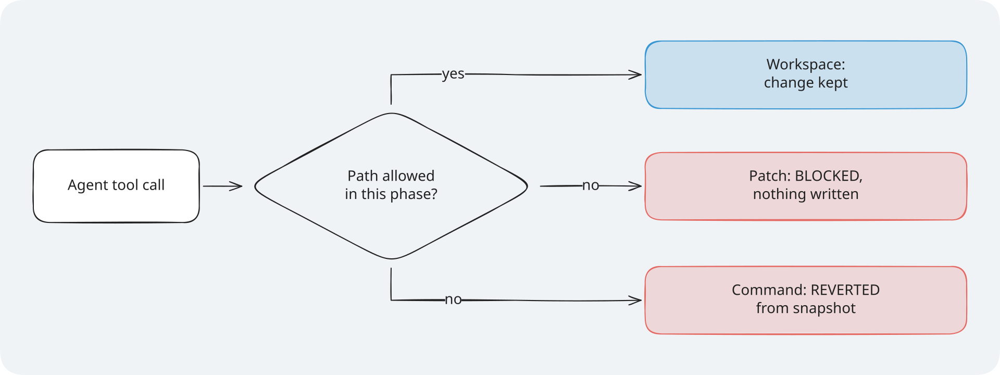
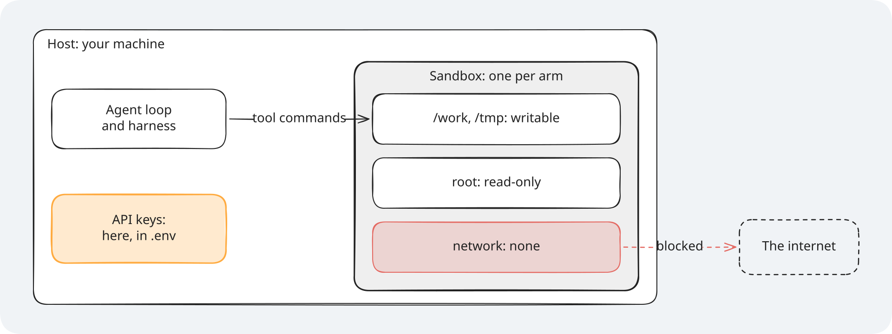
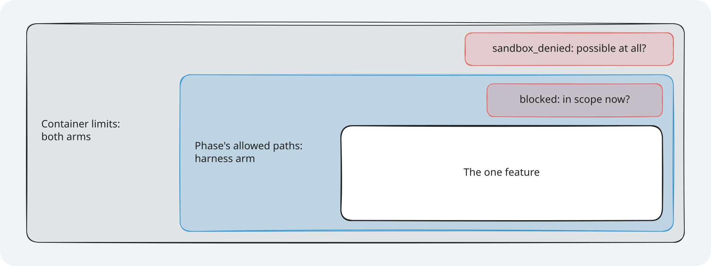
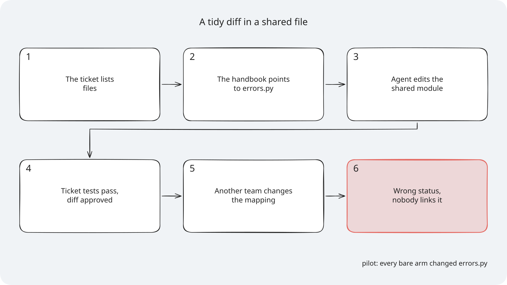
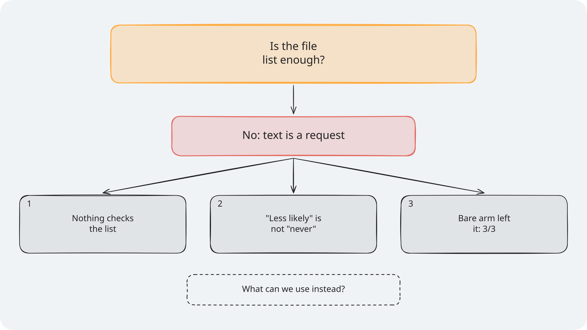
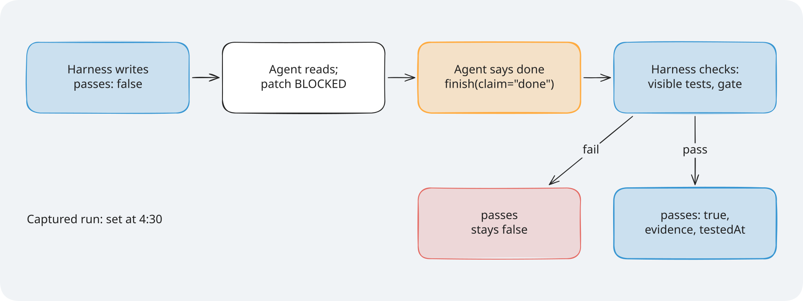
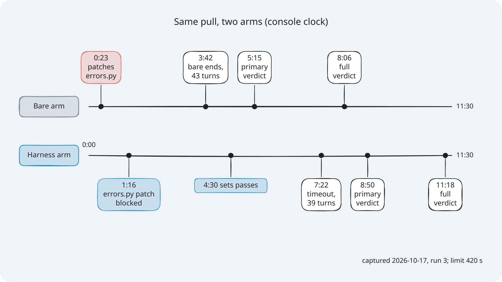
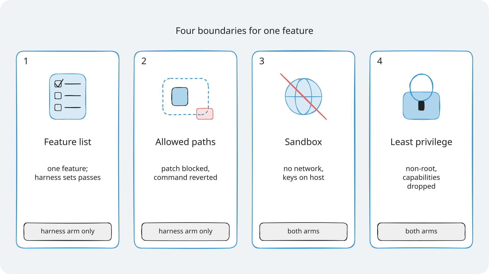

# Module 1: Harness Engineering for Coding Agents - Diagrams for Section 3: Scope and sandbox

The diagrams for Section 3, the scope layer and the sandbox. Each one has an `.excalidraw` source,
a `.png` at 2x for slides, and an `.svg` with the font embedded for pages. Colours, step frames,
editing, and licences are explained once, in [the course diagrams guide](../../docs/diagrams/README.md).
The diagram for the ticket of Feature 4: Version checks on issue edits, `optimistic-concurrency`, is
in that folder too, because Section 4: Verification uses it as well.

> **Terms on this page**
>
> - **Bare arm**: An agent run with the ticket and the repository, and no harness.
> - **Harness arm**: The same run with the harness turned on.
> - **Allowed paths**: The globs a ticket lists for each phase; the files the agent may change then.
> - **Block**: A patch the scope layer refuses before anything is written; the agent sees `BLOCKED`.
> - **Revert**: A command's change outside the allowed paths, undone right after the command runs.
> - **Sandbox**: The container every tool command runs in, the same for both arms.

## The diagrams

### The scope check

*A patch is checked before anything is written; a command is checked after it runs.*

- **What it teaches**: one check per tool call, and its two outcomes when the path is outside the list: `BLOCKED` and `REVERTED`.
- **Slide topic**: how the scope layer decides.
- **Files**: `scope-check-flow`.
- **Source**: `PathRules.reason` in `platform/src/shipharness/harness/scope/guard.py`, and
  `before_tool` / `after_tool` in `platform/src/shipharness/harness/scope/layer.py`.

### The sandbox boundary

*Only tool commands cross into the container; it has no network and never sees the keys.*

- **What it teaches**: what runs where, and what the container cannot reach.
- **Slide topic**: the sandbox.
- **Files**: `sandbox-boundary`.
- **Source**: `platform/sandbox/README.md` and `platform/src/shipharness/sandbox/policy.py`.

### Least privilege: two rings, two refusals

*The sandbox asks "possible at all?" for both arms; scope asks "in scope now?" for the harness arm only.*

- **What it teaches**: the scope layer and the sandbox as two rings of least privilege, each with its own refusal.
- **Slide topic**: least privilege, two refusals.
- **Files**: `least-privilege`.
- **Source**: `platform/src/shipharness/harness/scope/` (the `blocked` event),
  `platform/src/shipharness/sandbox/policy.py` and `events/models.py` (the `sandbox_denied` event),
  and `platform/sandbox/README.md`.

### Section 3 results

*On version checks the bare arm left the allowed paths in 3 of 3 runs and the harness arm in 0 of 3.*

- **What it teaches**: the one measured gap in the course, and the ticket where there was none.
- **Slide topic**: what we measured in Section 3.
- **Files**: `results-s3`.
- **Source**: [the Section 3 evidence](../../docs/evidence/s3.md).

### Failure story: a tidy diff in a shared file

*In the test runs before class, every bare arm changed app/services/errors.py.*

- **What it teaches**: how a reasonable edit outside the ticket breaks something later.
- **Slide**: "Problem statement: A tidy diff in a shared file".
- **Files**: `failure-story-s3`.
- **Source**: the slide's notes and [the Section 3 evidence](../../docs/evidence/s3.md).
- **How to edit**: open `failure-story-s3.excalidraw`, edit it, then export the PNG and the SVG (see [How to edit a diagram](../../docs/diagrams/README.md#how-to-edit-a-diagram)).

### Socratic build-up: is the file list enough?

*Frame 1 asks; frame 2 answers with the reasons.*

- **What it teaches**: why a written file list is only a request.
- **Slide**: "Scope: Is the ticket's file list enough?", frame N on build N.
- **Files**: `socratic-s3`, with step frames `socratic-s3-step-1` to `socratic-s3-step-2`.
- **Source**: [the Section 3 evidence](../../docs/evidence/s3.md) (the bare arm left the allowed paths in 3 of 3 runs).
- **How to edit**: open `socratic-s3.excalidraw`, edit it, then export the PNG and the SVG (see [How to edit a diagram](../../docs/diagrams/README.md#how-to-edit-a-diagram)).

### One feature at a time: feature_list.json

*Only the harness writes the file, from its own check.*

- **What it teaches**: the life of one feature entry and who may change it.
- **Slide**: "1) One feature at a time: `feature_list.json`".
- **Files**: `feature-list-lifecycle`.
- **Source**: `features.py`, `status.py`, `guard.py`, and `layer.py` in `platform/src/shipharness/harness/scope/`.
- **How to edit**: open `feature-list-lifecycle.excalidraw`, edit it, then export the PNG and the SVG (see [How to edit a diagram](../../docs/diagrams/README.md#how-to-edit-a-diagram)).

### Timeline of the captured demo-3 A/B

*Captured 2026-10-17 (run 3, alone), agent limit 420 s, console clock.*

- **What it teaches**: the same run in two lanes: the bare arm's edit and the harness arm's block.
- **Slide**: "What just happened: Same pull, two arms".
- **Files**: `timeline-s3`.
- **Source**: the captured demo-3 A/B in [the Section 3 evidence](../../docs/evidence/s3.md) and `demo/expected/terminal.txt`.
- **How to edit**: open `timeline-s3.excalidraw`, edit it, then export the PNG and the SVG (see [How to edit a diagram](../../docs/diagrams/README.md#how-to-edit-a-diagram)).

### Cheat sheet: four boundaries

*Two boundaries are the harness arm's; two hold for both arms.*

- **What it teaches**: the four boundaries of Section 3 on one page.
- **Slide**: "Cheat Sheet: Four boundaries for one feature".
- **Files**: `cheat-sheet-s3`.
- **Source**: `section-3-scope-sandbox/concepts.md`.
- **How to edit**: open `cheat-sheet-s3.excalidraw`, edit it, then export the PNG and the SVG (see [How to edit a diagram](../../docs/diagrams/README.md#how-to-edit-a-diagram)).
