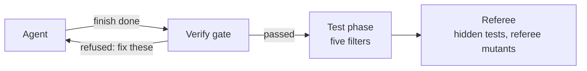

# Module 1: Harness Engineering for Coding Agents - Section 4: Verification

What proves the work is done: checks the agent does not control, and tests it never sees.

## The problem

**Illustrative scenario.** You ask a coding agent to stop lost updates on issue edits, with an `ETag`
and an `If-Match` header. The header is optional, so every existing test passes whether the check
works or not. The agent tests the happy path, sees a green suite, and reports that it is done. Review
approves a green build and a confident summary. After release, two people who edit one issue still
overwrite each other.

The cost is a shipped bug that every check approved, and a review that rested on the agent's word.

> **Terms on this page**
>
> - **Harness**: The files and code around the agent that decide what it sees and may do.
> - **Harness layer**: One part of the harness: instructions, state, scope, or verification.
> - **Bare arm**: An agent run with the ticket and the repository, and no harness.
> - **Harness arm**: The same run with the harness turned on.
> - **Referee**: The program that scores each run after the agent stops.
> - **Verify gate**: The checks that run in the agent's container when it claims done; a failure sends the claim back.
> - **Test filters**: Five checks a test from the test phase must pass to be kept.
> - **Hidden tests**: Tests the agent never sees; the referee runs them after the agent stops.
> - **Referee mutants**: Planted faults the agent never sees; the referee counts how many the shipped tests catch.
>
> All terms: [glossary](../docs/glossary.md).

## Why it happens

- Agents grade their own work too kindly. Anthropic's harness team found that "agents reliably skew
  positive when grading their own work."
  ([Anthropic, Harness design](https://www.anthropic.com/engineering/harness-design-long-running-apps))
- A later session sees progress and stops early: "a later agent instance would look around, see that
  progress had been made, and declare the job done."
  ([Anthropic, Effective harnesses](https://www.anthropic.com/engineering/effective-harnesses-for-long-running-agents))
- Green tests look like a finished job: "it is easy to see tests pass and assume the job is done,
  when this is rarely the case."
  ([Anthropic, C compiler](https://www.anthropic.com/engineering/building-c-compiler))
- Visible tests miss what held-out tests (the hidden tests above) catch: "while every frontier agent
  saturates the visible suite, reward hacking persists" ([SpecBench](https://arxiv.org/abs/2605.21384)).
  Reward hacking means passing the checks without doing the task they stand for.

## How this section fixes it

The verification layer stops trusting the claim. When the agent says done, a gate runs the visible
tests, the existing tests, TeamTrack's seven house rules (tenant isolation, roles, API conventions,
safe retries, audit log, layering, migrations), a board check, and a clean-state check, in the
agent's own container. Tests the agent writes in a short test phase are kept only if they pass five
filters. The referee then scores the work with hidden tests and planted faults the agent never sees.

The course also measures whether the layer helps. On the ticket for Feature 4: Version checks on
issue edits, with this model, it made no measurable difference: both arms failed every test run before class
([evidence](../docs/evidence/s4.md#section-4)). The concepts page explains why, and what the gate still
catches.

## How to work through this section

In class the section takes 45 minutes. It opens at 2:55 with the one poll of the class, a Live Zoom
Poll from 2:55 to 2:57 that picks the final feature. At 2:57 (minute 2) the live demo, `make show-4`,
and the final A/B launch, and they run while the concepts are taught. The final A/B is read in the
final block.

| Part | What it gives you | In class |
|---|---|---|
| [concepts.md](concepts.md) | The idea, how it works, what the course measured | Minutes 5-18 |
| [demo/](demo/README.md) | The live run of the harness arm, and how to read it | Poll for the final feature at minute 0; launch at minute 2; review at 27-42 |
| [demo/walkthrough.md](demo/walkthrough.md) | The gate's code, 38 lines explained | Minutes 18-28, on the DEMO slide |
| [assignment/](assignment/README.md) | Assignment 4: Verification. Soft-delete check, sixth filter, live run, portfolio | After class |
| [post-class-reading/](post-class-reading/README.md) | Four short readings on filters, mutants, evaluators, held-out tests | After class |
| [session-notes.md](session-notes.md) | What class showed, questions, what to try next | After class |

## Where next

- First time here? Install everything with [setup/](../setup/README.md), then run the
  [demo](demo/README.md).
- Already set up? Start with [concepts.md](concepts.md).
- Want a verify gate in your own repository? See [use-in-your-repo/](../use-in-your-repo/README.md).
- After this section: the [final project](../final-project/README.md).

## Sources

- Source 1: Harness design for long-running application development, <https://www.anthropic.com/engineering/harness-design-long-running-apps>, Prithvi Rajasekaran (Anthropic), 2026-03-24
- Source 2: Effective harnesses for long-running agents, <https://www.anthropic.com/engineering/effective-harnesses-for-long-running-agents>, Justin Young (Anthropic), 2025-11-26
- Source 3: Building a C compiler with a team of parallel Claudes, <https://www.anthropic.com/engineering/building-c-compiler>, Nicholas Carlini (Anthropic), 2026-02-05
- Source 4: SpecBench: Measuring Reward Hacking in Long-Horizon Coding Agents, <https://arxiv.org/abs/2605.21384>, Zhao, Srikanth, Wu, and Jiang (Weco AI), 2026-05-20
