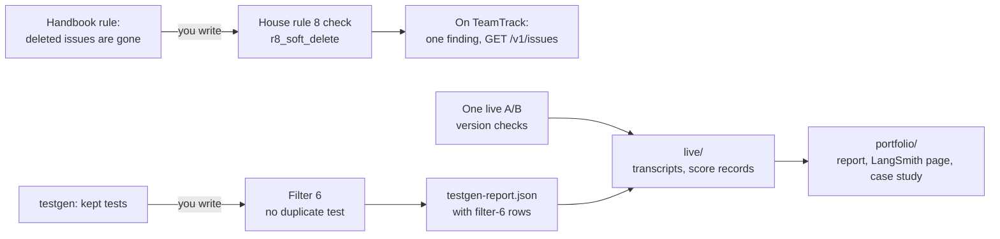

# Module 1: Harness Engineering for Coding Agents - Assignment 4: Verification

Try it yourself first. The full solution is in [./solution/](solution/) with a step-by-step walkthrough.

## The problem

**Illustrative scenario.** An agent adds an endpoint that lists a project's issues. It reads the
issues table without the soft-delete filter, sees the visible suite pass, and reports that it is
done. No visible test deletes an issue first, so nothing fails. After release, issues that users
deleted show up again. Meanwhile several generated tests check the same thing in the same way, so the
suite looks stronger than it is.

The gap is real in TeamTrack. Its handbook says that deleted issues "behave as if they do not exist
(404 on read, hidden from lists)". The seven house rules have checks; this rule has none. The legacy
`GET /v1/issues` handler already lists deleted issues.

Anthropic's compiler team names the trap: "it is easy to see tests pass and assume the job is done"
([Building a C compiler with a team of parallel Claudes](https://www.anthropic.com/engineering/building-c-compiler)). OpenAI's
harness team turns such rules into checks whose messages teach: "we write the error messages to
inject remediation instructions into agent context"
([Harness engineering](https://openai.com/index/harness-engineering/)).

> **Terms on this page**
>
> - **House rules**: TeamTrack's seven rules for every endpoint: tenant isolation, roles, API conventions, safe retries, audit log, layering, migrations.
> - **Soft delete**: Marking a row as deleted (`deleted_at`) instead of removing it.
> - **House rule 8: Deleted issues stay hidden**: The house rule you add: a soft-deleted issue answers 404 and never appears in a list.
> - **Check**: A shipharness program that probes every endpoint for one rule and reports findings.
> - **Baseline**: The findings on the unchanged checkpoint; a check counts only new ones.
> - **Test filters**: Five checks a test from the test phase must pass to be kept.
> - **Filter 6: No duplicate tests**: The filter you add: it discards a test that repeats another test.
> - **Bare arm**: An agent run with the ticket and the repository, and no harness.
> - **Harness arm**: The same run with the harness turned on.
> - **A/B**: Bare arm and harness arm on the same ticket, scored the same way.
> - **Live evidence**: The files your real runs wrote, collected into `live/`.

## What you'll build



You turn the soft-delete rule into a check for House rule 8 that finds deleted issues on any
endpoint, including endpoints an agent adds later. You add Filter 6, which discards a generated test
that repeats another test. Then you run filtered test generation and one A/B on Feature 4: Version
checks on issue edits live, keep
their files in `live/`, and write a short portfolio a reader can check. Everything lives in your implementation folder,
`starter/` by default. The exact requirements are in [SPEC.md](SPEC.md).

## Step by step

All commands run from the repository root. Steps 1 to 5 need no keys and no Docker.

1. **See where you start.** Run the self-check:

   ```bash
   make check-assignment-4
   ```

   Check: it prints one PASS or FAIL line per visible test, grouped by criterion, and fails by design
   on the unchanged starter. An excerpt (the full output names what each FAIL comes from; the group
   names, such as `F6-interface`, are the criterion ids of the grading table below):

   > Your output will differ: the paths, and later your own runs, change what these commands print.

   ```text
   [F6-interface]
     PASS test_filter_has_number_6_and_a_name
     FAIL test_filter_runs_inside_the_shipharness_pipeline: assert [False, False] == [False, True] ...
   ...
   self-check: FAILED (2/23 visible tests pass)
   Cost: $0.000000 (no model calls)
   ```

2. **Write the House rule 8 check, test first.** Write a failing test for `issue_param` in
   `starter/tests/`, then make it pass in `starter/a4_verification/r8_soft_delete.py`. Repeat for
   `judge`, then `soft_delete` in `adapter.py`, then `plan`. The starter's `TODO(A4-1)` to
   `TODO(A4-4)` comments mark each place to fill. Check: the `R8-` lines of the self-check pass.

3. **Run the check on TeamTrack.** Set the folder once, run the check, then run it again with the
   first result as the baseline (`m1-base` is the checkpoint tag of TeamTrack as shipped, before any
   course feature):

   ```bash
   mkdir -p .shipharness/a4
   export PYTHONPATH=section-4-verification/assignment/starter
   uv run python -m a4_verification.run_r8 --build platform/teamtrack --checkpoint m1-base --feature A4 > .shipharness/a4/r8-base.json
   uv run python -m a4_verification.run_r8 --build platform/teamtrack --checkpoint m1-base --feature A4 --baseline .shipharness/a4/r8-base.json
   ```

   Check: the first run reports exactly one finding, `GET /v1/issues` (`deleted_list`), and exits 3.
   With the baseline, the same finding is marked `"baseline": true` and the command exits 0.

4. **Seed your own violations.** On a copy of `platform/teamtrack/app`, drop a `deleted_at` filter or
   add an endpoint. Check: the check reports each one at the right endpoint, and nothing else.

5. **Write Filter 6, test first.** Write failing tests, then implement `normalized` and
   `NoDuplicateTest` in `dedup_filter.py` (`TODO(A4-5)` to `TODO(A4-7)`). Check: every self-check line
   passes except the portfolio, skill, and live ones.

6. **Run testgen live, once.** It needs your keys and makes model calls. Follow
   [SPEC.md, "Run the live step"](SPEC.md#run-the-live-step). Check: `live/testgen.txt` ends with a
   `Cost: $... (testgen, model gpt-6-luna)` line and says how many tests it kept.

7. **Run Filter 6 on the kept tests.** No model calls. `apply_filter --update-report` adds one
   filter-6 row per kept test to the report. Check: `live/testgen-report.json` has those rows.

8. **Run the A/B on Feature 4 live, once.** It needs your keys and Docker; both arms run in containers. Check:
   `live/ab.txt` ends with a `Cost:` line, and `live/scores/` holds two score records with the A/B's
   id. Never re-run for a nicer result: the step is graded on its files, not on which arm passed.

9. **Write the portfolio and your skill.** Fill the three files in `portfolio/` from your real
   output, and create one skill from `use-in-your-repo/skills/skill-template`. Check:
   `uv run shipharness skills validate <your folder>/skill` reports no errors.

10. **Submit.** Run `make check-assignment-4` until every line says PASS, then commit your folder,
    `live/` included, on your own branch.

## Grading criteria (100 points)

| Criterion | What earns the points | Points | Checked by |
|---|---|---|---|
| `R8-interface` | Registered through shipharness; runner, CLI exit codes, progress | 5 | Both |
| `R8-visible` | Finds the visible seeded violations | 9 | Self-check |
| `R8-hidden` | Finds the hidden seeded violations | 17 | Grader |
| `R8-no-false-positives` | Reports nothing a correct build does not violate | 8 | Both |
| `R8-baseline` | Stable detail keys: baselines and exemptions work | 7 | Both |
| `F6-interface` | Follows the filter protocol; runs inside the pipeline | 4 | Self-check |
| `F6-visible` | Correct on the visible candidate tests | 6 | Self-check |
| `F6-hidden` | Correct on the hidden candidate tests | 13 | Grader |
| `own-tests` | At least 8 tests of your own, all passing | 5 | Self-check |
| `skill` | One valid skill, renamed, no placeholders left | 6 | Self-check |
| `portfolio-evidence` | Evidence report: sections, commands, results table | 5 | Self-check |
| `portfolio-langsmith` | A trace link of your A/B, and the command | 2 | Self-check |
| `portfolio-case-study` | Case study: sections, one page | 3 | Self-check |
| `live-evidence` | Both live runs present, valid, and within the caps | 10 | Self-check |
| **Total** | | **100** | |

The criterion ids are the names the self-check and the grader print: the `R8-` ones grade your
check for House rule 8, and the `F6-` ones grade Filter 6. In the last column, "Self-check" rows
are scored by the visible tests alone (the grader re-runs them), "Grader" rows by hidden cases only,
and "Both" rows by visible and hidden cases.

`make check-assignment-4` runs the visible tests. The instructor's grader adds hidden seeded
violations and hidden candidate tests; it is not in this repository. Neither makes a model call. The
item-by-item rules are in [SPEC.md](SPEC.md#requirements).

## Solution walkthrough

The reference solution is a finished implementation folder in [solution/](solution/). Its
[SOLUTION.md](solution/SOLUTION.md) explains:

- why the House rule 8 check marks deleted rows with a title only they can contain, instead of
  looking for their ids;
- how it finds every endpoint from the app's schema, so new endpoints are covered;
- how Filter 6 compares tests as syntax trees, with local names renamed in order;
- what the live step produced, and the grade it earned.

Read it after your own attempt, and compare your choices with its alternatives.

## Sources

- Source 1: Building a C compiler with a team of parallel Claudes, <https://www.anthropic.com/engineering/building-c-compiler>, Nicholas Carlini (Anthropic), 2026-02-05
- Source 2: Harness engineering: leveraging Codex in an agent-first world, <https://openai.com/index/harness-engineering/>, Ryan Lopopolo (OpenAI), 2026-02-11
