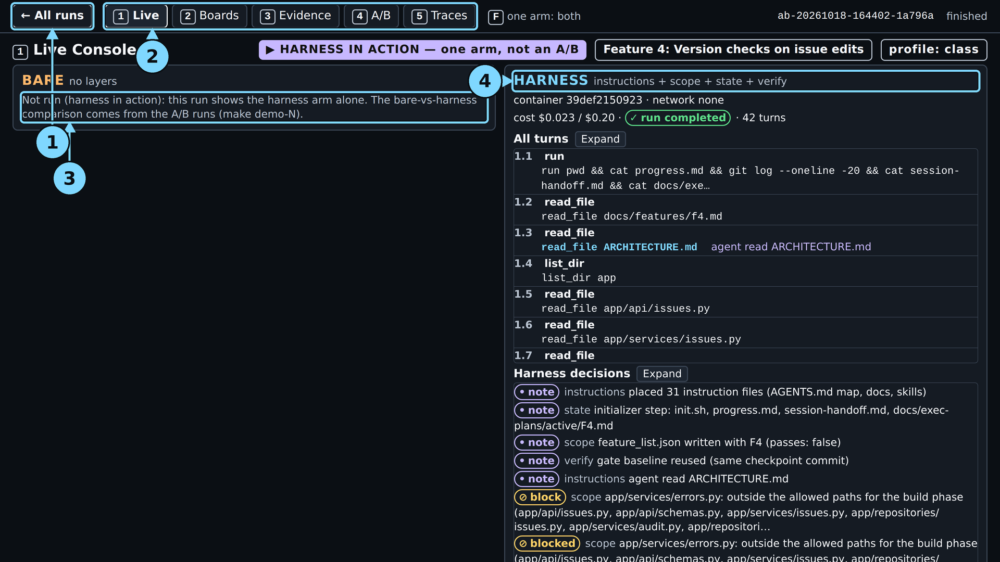
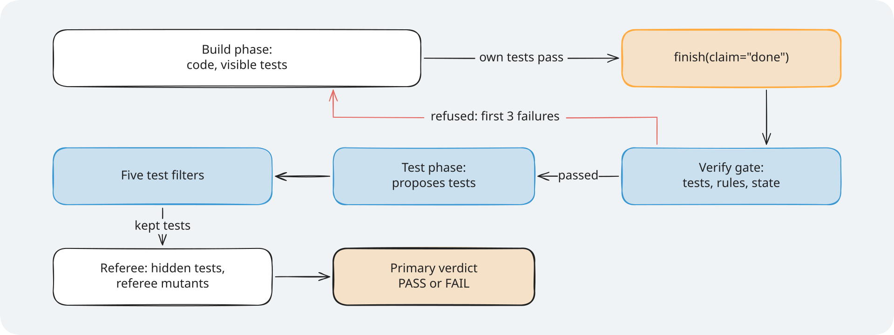
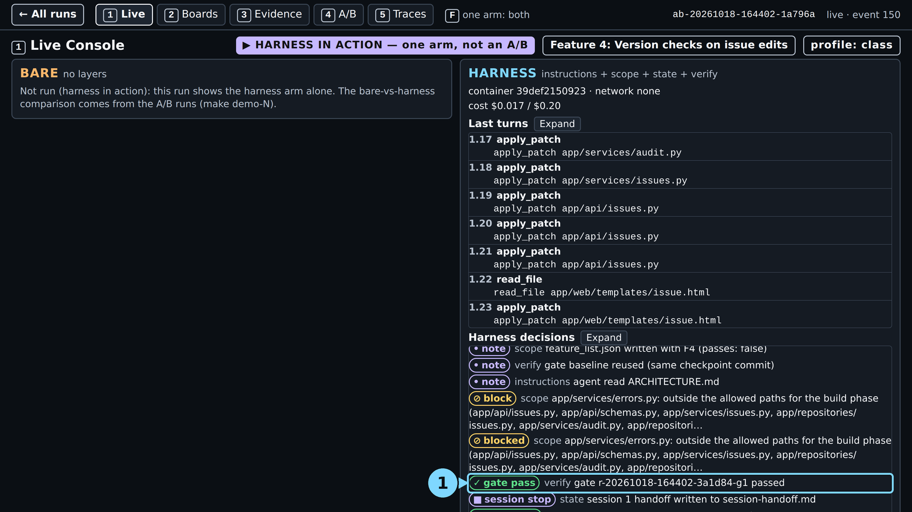
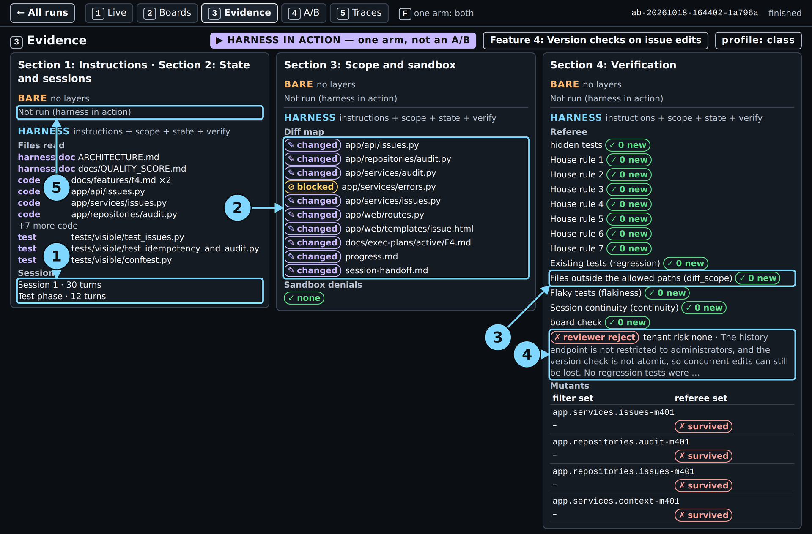
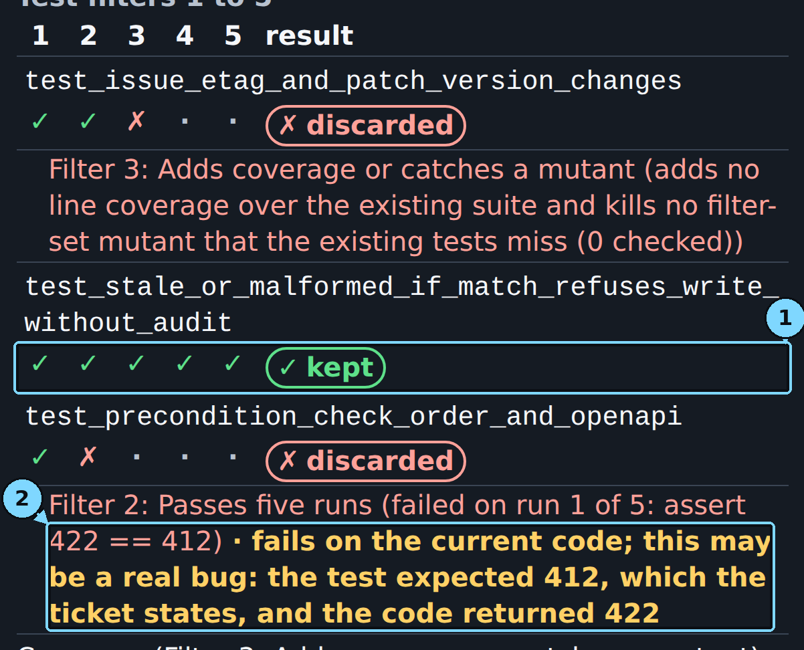
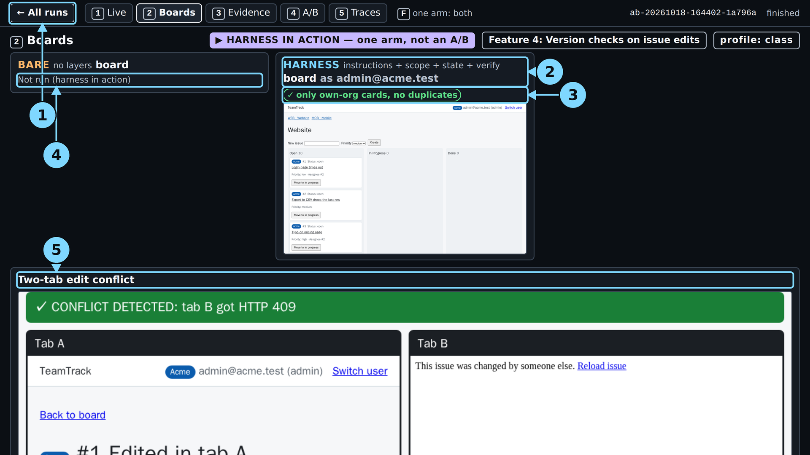
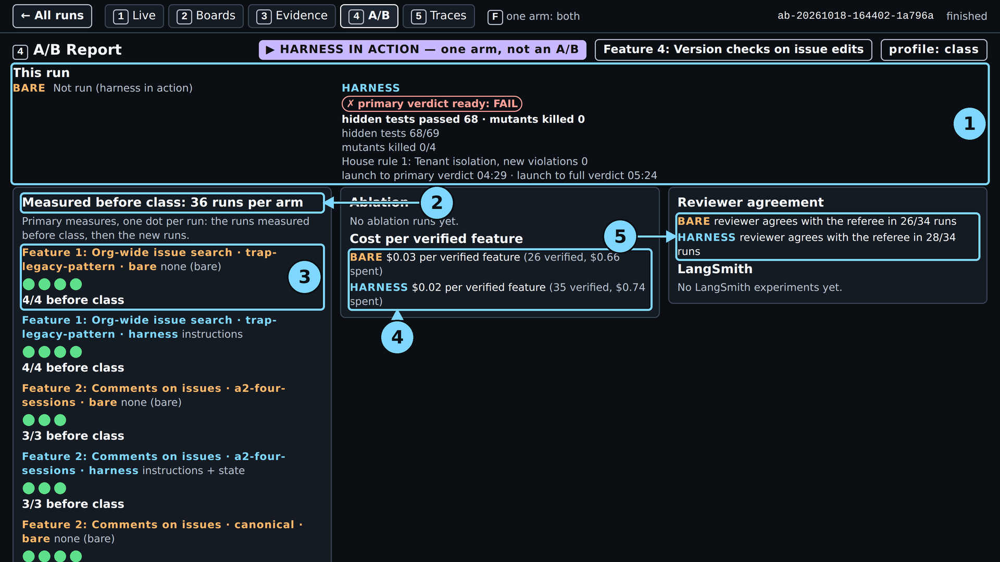
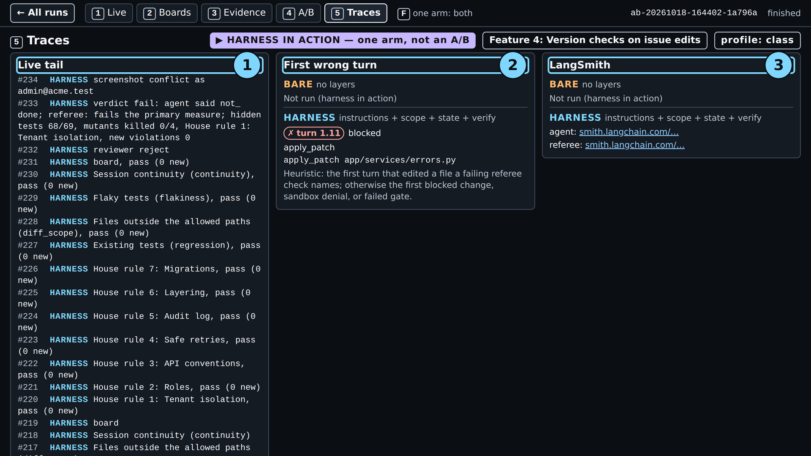
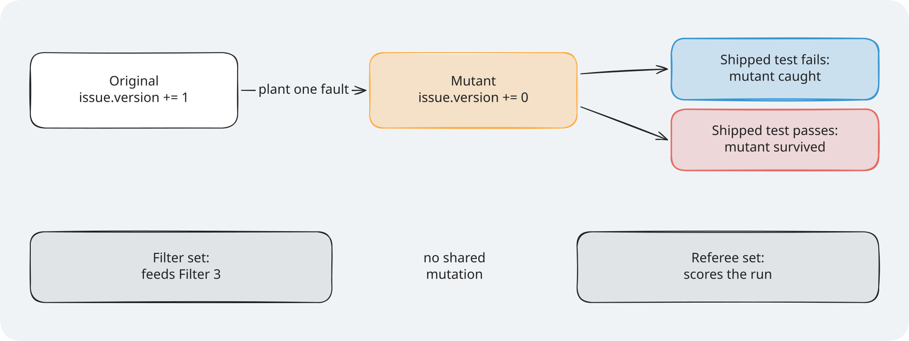
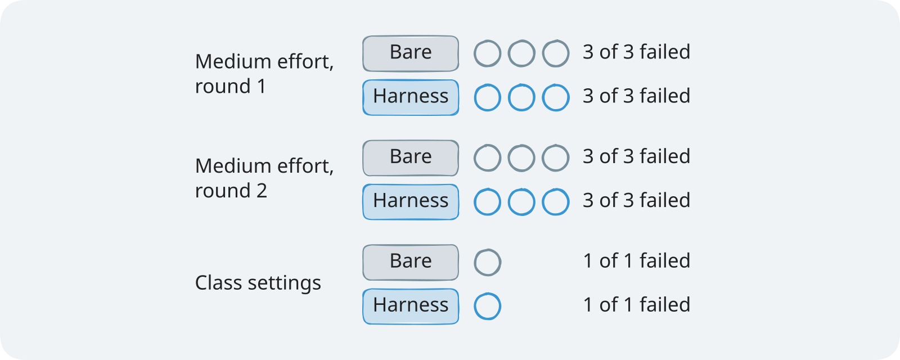

# Module 1: Harness Engineering for Coding Agents - Demo 4: The gate at work

## The problem

**Illustrative scenario.** A coding agent adds optimistic concurrency (refusing an edit made from a
stale copy) to issue edits: an `ETag` on read, and an `If-Match` check on write. The header is optional, so every existing test passes whether
the check works or not. The agent tests the happy path, sees a green suite, and reports done. After
release, two people who edit one issue still overwrite each other.

This demo gives a live agent that ticket. TeamTrack's ticket for Feature 4: Version checks on issue edits asks for `ETag`,
`If-Match`, and an issue history. The referee then scores the work with tests and planted faults the agent never sees.

> **Terms on this page**
>
> - **Harness arm**: The same run with the harness turned on.
> - **Bare arm**: An agent run with the ticket and the repository, and no harness.
> - **A/B**: Bare arm and harness arm on the same ticket, scored the same way.
> - **Referee**: The program that scores each run after the agent stops.
> - **Primary verdict**: The referee's answer to the one question the section asks.
> - **Full verdict**: The primary verdict plus every other check: hidden tests, mutants, review.
> - **Console**: The browser page that shows a run live, on five screens.
> - **Ticket**: The task the agent gets, written like a work ticket.
> - **Verify gate**: The checks that run in the agent's container when it claims done; a failure sends the claim back.
> - **Test phase**: A short second phase in which the agent writes tests for the feature it built.
> - **Test filters**: Five checks a test from the test phase must pass to be kept.
> - **Hidden tests**: Held-out tests: the agent never sees them; the referee runs them after the agent stops.
> - **Mutant**: A copy of the code with one small planted fault; a test that fails on it catches it.
> - **Referee mutants**: Planted faults the agent never sees; the referee counts how many the shipped tests catch.

## What you'll see

`make show-4` runs the harness arm alone, live, with all four layers. You watch the agent build the feature,
claim done, and pass the verify gate. Then it may write tests in the test phase, and the test
filters keep some and discard others. Last, the referee runs 69 hidden tests and 4 referee mutants.

> Your output will differ: run times, ids, and the agent's wording change on every run.

**Demo setting, not a comparison:** `make show-4` filters only the first three tests the test
phase proposes (`MAX_TESTS=3`); further tests are removed with the reason "not filtered" and count
as discarded. `make show-4 MAX_TESTS=` filters them all
([disclosure](../../docs/evidence/s4.md#s4-show-4-settings)).

Measured 2026-10-18, class profile, two runs that each ran alone: primary verdict 4:37 to 6:54
after launch, full verdict 5:32 to 8:02, command finished 5:33 to 8:03, $0.026 to $0.028. In the
demo guide's run the patch to `app/services/errors.py` was blocked 0:36 after launch, done claim
2:05, gate passed 3:07 on its first attempt, $0.0257. In its test phase the agent proposed no test
and said not done, so the filters had nothing to check ("kept 0, discarded 0") ([evidence](../../docs/evidence/general.md#guide-runs-2026-10-18)). Earlier the same
day, after the harness speed-up ([what changed](../../docs/evidence/general.md#demo-speed-2026-10-18)),
three runs gave a range: primary verdict 5:51 to 6:50, full verdict 6:51 to 8:26, $0.023 to $0.033
per run; their filter tables kept one test and discarded four, kept two, and discarded all four
([evidence](../../docs/evidence/general.md#demo-runs-after-the-speed-up)).



*The end of a real run: the harness arm completed in 42 turns. The gate pills and the verdict are further down the screen, below this frame.*

The lesson of the section in one screen: the gate checks what the agent can see, the referee what it cannot.

This is not an A/B. The course already compared both arms on this ticket: both failed the primary
measure in every test run ([evidence](../../docs/evidence/s4.md#section-4)). So class shows the verification layer
at work, and screen 4 shows the comparison.



*The order you watch on screen 1: gate, test phase, filters, then the referee.*

## Run it

Before the first run, follow [setup/](../../setup/README.md) until `make doctor` ends with
`result: + ready`, then run `make warm` once. Neither makes a model call.

Use two terminals, both in the repository root.

**Terminal 1, the console.** Leave it running:

```bash
make console
```

It prints the address to open:

```text
uv run shipharness console --port 8765
Console: http://127.0.0.1:8765/
Only warnings and errors print here; make console VERBOSE=1 (--verbose) logs each request.
```

Open `http://127.0.0.1:8765/` in your browser. On Windows, the Windows browser works.

**Class date or practice run.** A class run is traced to the LangSmith project of the class day, so
`.env` needs the day. Add this line to `.env` and replace YYYY-MM-DD with your class day:

```bash
SHIPHARNESS_CLASS_DATE=YYYY-MM-DD
```

Outside class, skip the date and add `PURPOSE=pilot` to the command in the next step instead.

**Terminal 2, the live run:**

```bash
./section-4-verification/demo/run.sh
```

The script checks your keys, Docker, and the class date, then runs `make show-4`. Outside class, run
`PURPOSE=pilot ./section-4-verification/demo/run.sh`. You can also call `make show-4` directly. At the end,
terminal 2 prints the arm's record line and the cost line. The live run of 2026-10-18 printed this
(the full capture is [expected/terminal.txt](expected/terminal.txt)):

```text
A/B <run id> (Feature 4: Version checks on issue edits, layers=['instructions', 'scope', 'state', 'verify'], profile=class, harness in action)
  harness  completed         agent said not done · hidden tests passed: 68; mutants killed: 0 · primary measure failed · hidden tests 68 of 69 · mutants killed 0 of 4 · reviewer reject · cost $0.0225
Cost: $0.025731 (this command: gpt-5.6-luna $0.003204, gpt-6-luna $0.022527; session $0.145965 of $2.50; build $0.145965 of $15.00 ($14.854035 left))
```

The arm line now names the claim of each phase, as screen 1 does: the run above, captured before
that change, reads "agent said: done (build) · not done (test phase)" today. The command exits with 0 when the arm completed, 2 when it ended `ABORTED`, and 1
on `ERROR`; this run exited 0. An aborted arm is still judged, so its record is complete. One run costs at most $0.24: the per-arm cap
plus the per-review cap.

**In class**, Section 4: Verification opens with the class poll, the only one of the day, from 2:55
to 2:57; it picks the final feature. At 2:57 the instructor launches `make show-4` and, in a third
terminal, the final A/B with `make final FEATURES=<poll winner>`, for example
`make final FEATURES=watchers`. The final runs beside this demo and is read in the
[final block](../../final-project/README.md).

**In the browser**, reload the run list. The new run is the top card: "Section 4: Verification", the feature, "harness in action", "running", and its start time. Click it and press `1`. Keys: `1` Live, `2` Boards, `3` Evidence, `4` A/B Report, `5` Traces, `F` one arm full screen; `H` or `Esc`, or "← All runs" at the top left, goes back to the run list.

### Files and links

- [run.sh](run.sh): the script that checks your setup and starts the run
- [walkthrough.md](walkthrough.md): the code behind the layer, explained
- [harness/](harness/): the files the layer gives the agent
- [expected/](expected/README.md): a captured run, the fallback when you cannot run it live
- [Evidence page](../../docs/evidence/s4.md): every run behind the results
- Console: [http://127.0.0.1:8765](http://127.0.0.1:8765) (after `make console`)

## What to watch

Screen 1, Live, shows the run as it goes: notes from all four layers, a blocked patch to
`app/services/errors.py`, the done claim and the gate pills, the test phase and its filters, then
the primary verdict and the full verdict
([evidence](../../docs/evidence/s4.md#s4-show-4-capture)). `F4 passes` on screen 1 means the harness
set the version checks feature as passing. A refused claim shows as "Gate refused 'done' (build
phase, attempt 1): ... → passed on attempt 2"; in the live run the gate passed at once.



*3:07: "gate pass", after the block at 0:36. Circle 1: the gate pass row.*

Then switch screens.

**Screen 3, Evidence.** Sessions read "Session 1 · 30 turns", then "Test phase · 12 turns". The
diff map shows `app/services/errors.py` ⊘ blocked. The Verification panel has one row per referee
check and, when the test phase proposes tests, the test filter table: one row per test, a mark per
filter, and the reason for each discard. In the live run the test phase proposed none, so there is
no filter table; all four referee mutants survived.



*Screen 3 of the live run. No test was proposed, so the filters had nothing to check.*

A recorded run before class (2026-10-18) proposed five tests and filtered three (`MAX_TESTS=3`):



*Recorded run: the discard by Filter 2: Passes five runs says "fails on the current code; this may be a real bug": the test expected 412, which the ticket states.*

**Screen 2, Boards.** After the run, the two-tab conflict panel: tab A saves, then tab B saves from
its stale form. Tab B gets HTTP 409 and a "changed by someone else" page.



*Screen 2. The board stops the lost update: tab B got HTTP 409. The bare arm reads Not run.*

**Screen 4, A/B Report.** "This run" at the top, then "Measured before class", one dot per run, per
feature and arm. Say: "Today's run is not a dot in the comparison."



*Screen 4. This run at the top: "primary verdict ready: FAIL", hidden tests 68/69, mutants killed 0/4. Below it, the runs before class, one dot each.*

**Screen 5, Traces.** The first wrong turn (turn 1.11, the blocked patch), the live tail, the links.



*Screen 5. Open a LangSmith link to see every model call of the run.*

## What the result means

The primary verdict answers one question: is the feature done, judged by checks the agent never saw?
It passes only when all 69 hidden tests pass and the shipped tests catch all 4 referee mutants. PASS means both
counts are full. FAIL with `hidden_passed` and `mutants_killed` tells you which count fell short.

A passed gate and a failed verdict can sit side by side. The gate runs the visible tests, the
existing tests, the seven house rules, the board, and clean state. It never runs the hidden tests or the referee
mutants, so they stay held out.

A recorded run before class (2026-10-18) shows why both are needed:

- The failing hidden test checks that a stale `If-Match` with an invalid body gives 412. The code
  gave 422.
- The agent had written a test for exactly that case. It failed: "assert 422 == 412". The test was
  right and the code was wrong.
- Filter 2 keeps only tests that pass, so it discarded that test. The filters keep regression tests
  (tests that guard current behaviour); they treat the current code as correct. ACH's authors name
  this limit: "it cannot detect existing faults residing in the code base"
  ([Meta, ACH](https://arxiv.org/abs/2501.12862)).
- The one kept test caught none of the 4 referee mutants.



*A referee mutant survives when no shipped test fails on it, as the passing test shows here.*

One run cannot compare arms. The comparison needs both arms, many times:

| Reading | What it looks like here | What the test runs found |
|---|---|---|
| Harness ahead | The harness arm passes both counts in more runs | Not seen |
| No measurable difference | Both arms pass, or fail, in about the same number of runs | Seen: every run failed in both arms |
| Bare ahead | The bare arm passes both counts in more runs | Not seen |

A FAIL here is not a verdict on the harness. In the test runs the bare arm failed too, and it twice
claimed done on work the referee failed. What the demo shows is how the gate and the filters change
what a "done" means, and where each one stops.

The [walkthrough](walkthrough.md) shows the gate's code.



*The test runs before class, one dot each: both arms failed all 7.*

## If it fails

| What you see | Why | What to do |
|---|---|---|
| `x OpenAI refused the key`, exit 2, no arm started | The key is missing or rejected | Fix `OPENAI_API_KEY`; rerun `make doctor` |
| `x SHIPHARNESS_CLASS_DATE is not set`, exit 2 | A class run needs the class day | Set it, or add `PURPOSE=pilot` |
| The arm ends `ERROR` with `docker run failed` | Docker is not running, or an image is missing | `sudo systemctl start docker`, then `make warm` |
| `make console` says `address already in use` | Another program holds port 8765 | `make console CONSOLE_PORT=8766` |
| The record line says `ABORTED: timeout` | The run hit a time limit | Keep the run; read its primary verdict as usual |
| No gate pills by the end | The agent never claimed done | Show the filter table and the referee counts |
| Every gate pill fails with `check runner failed` | The harness time limit ran out during the gate | Keep the run and say what happened |

The demo never falls back to a recording or a stand-in model. Still stuck? See
[docs/troubleshooting.md](../../docs/troubleshooting.md).

## Sources

- Source 1: Mutation-Guided LLM-based Test Generation at Meta, <https://arxiv.org/abs/2501.12862>, Foster et al. (Meta), 2025-01-22
