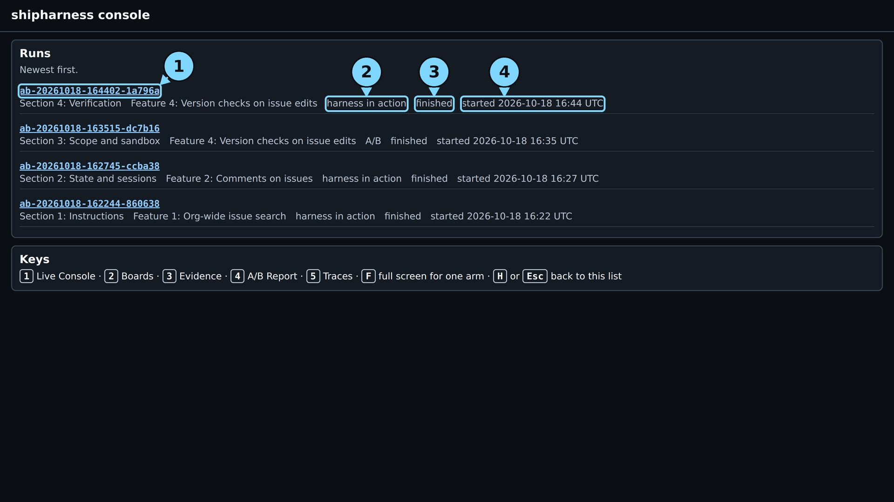
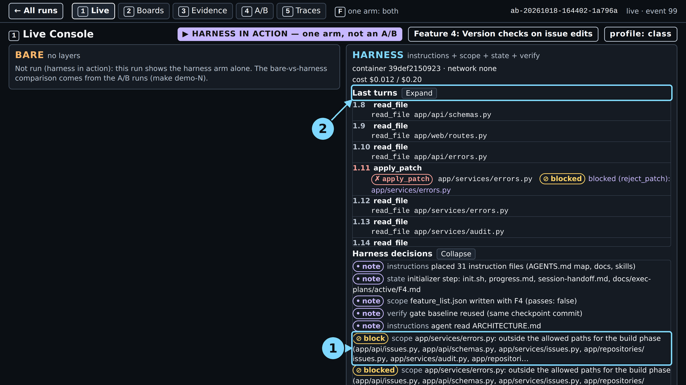
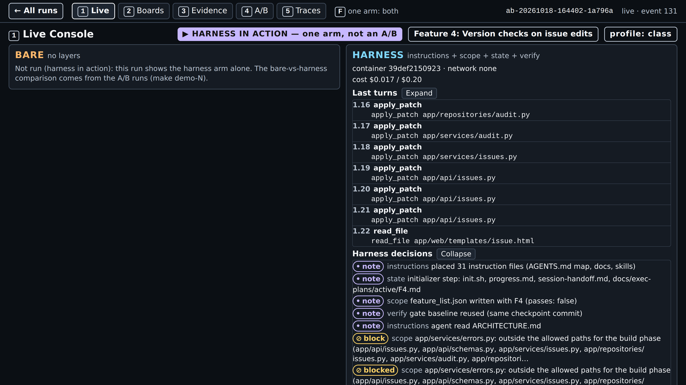
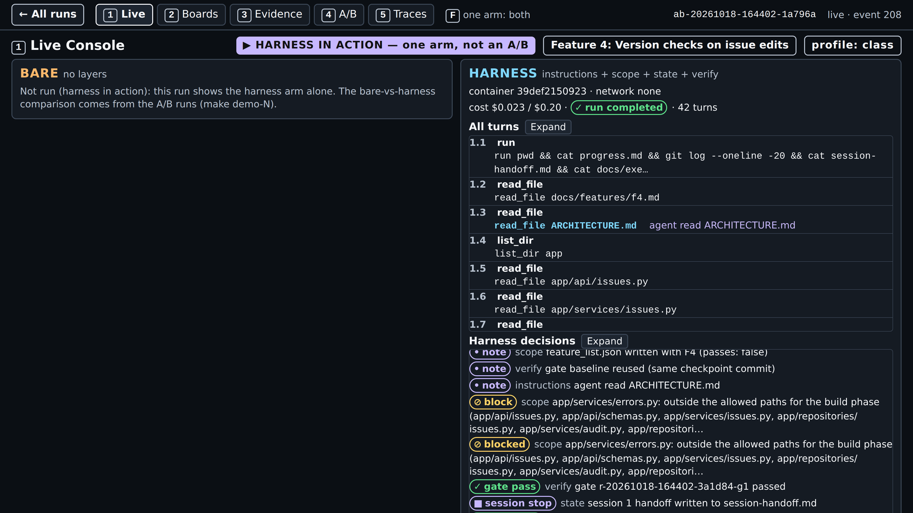

# Module 1: Harness Engineering for Coding Agents - Demo 4 expected output

This folder holds the output and the screenshots of one real `make show-4` run, the live run of
2026-10-18 for the demo guide, with the class settings (run id on the
[evidence page](../../../docs/evidence/s4.md#s4-show-4-capture)). Nothing here is
staged or edited, except where a line says it was cut. Use it to check that your run looks roughly
like this one, or to follow the demo without running it. When and how it was captured is in the
[evidence page](../../../docs/evidence/s4.md#s4-show-4-capture).

> **Terms on this page**
>
> - **Verify gate**: The checks that run in the agent's container when it claims done; a failure sends the claim back.
> - **Test filters**: Five checks a test from the test phase must pass to be kept.
> - **Referee**: The program that scores each run after the agent stops.
> - **Primary verdict**: The referee's answer to the one question the section asks.
> - **Full verdict**: The primary verdict plus every other check: hidden tests, mutants, review.
> - **Referee mutants**: Planted faults the agent never sees; the referee counts how many the shipped tests catch.

## Terminal output

| File | What it holds |
|---|---|
| `terminal.txt` | The command, the record line, the cost line, the start and end lines |

The start and end lines (with the wall time) are the capture script's; nothing is cut. The
`session` figure counts the three runs before it in the same session.

## Screenshots

All from `make console`; the four moment screens of screen 1 were taken while the run was live.
The numbered circles are the demo guide's callouts. Times count from the make command's launch.

> Your output will differ: run times, ids, and the agent's wording change on every run.

*The run list. Circles: 1 the run id, 2 the type, 3 the status, 4 the start time.*

*0:36: turn 1.11 tries to patch `app/services/errors.py`, outside the allowed files, and is blocked. Circle 1: the block row. Circle 2: the turn list.*

*2:05, at the done claim: the last turns patch the issue and audit files. The gate rows are below this frame.*

*3:07: the gate passes on its first attempt, and session 1 stops. Circle 1: gate pass.*

*4:37: the run completed in 42 turns; the gate pass and session stop rows show. The verdict pill is below this frame.*

*The end: 42 turns; the verdict is below this frame. Circles: 1 "← All runs", 2 the tabs, 3 the bare arm, not run, 4 the harness arm.*

*Screen 2: tab B's stale save gets HTTP 409, so the board stops the lost update.*

*Screen 3: "Session 1 · 30 turns", "Test phase · 12 turns"; no test proposed, so no filter table; all four referee mutants survived.*

*From a recorded run before class: one test kept after five filters; one stopped at Filter 3: Adds coverage or catches a mutant, one at Filter 2: Passes five runs.*

*Screen 4: the runs before class, one dot per run. This run's verdict is at the top, not a dot.*

*Screen 5: the first wrong turn is the blocked patch at turn 1.11; LangSmith links for agent and referee.*
