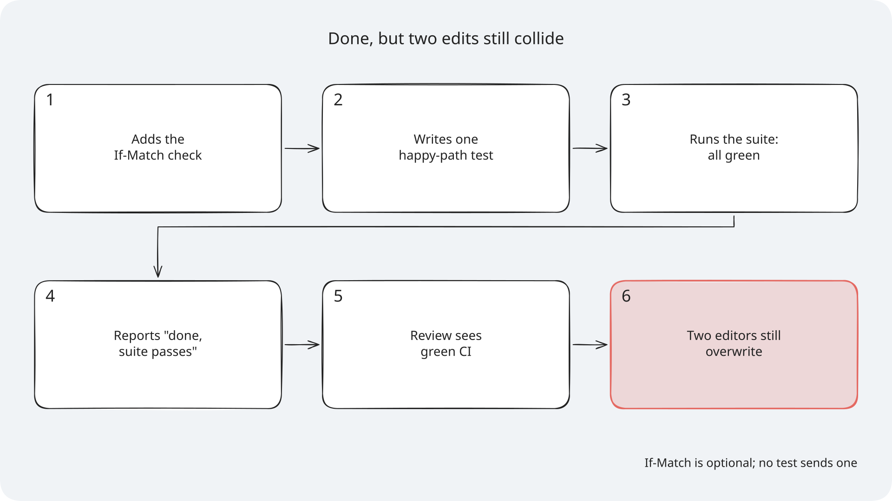
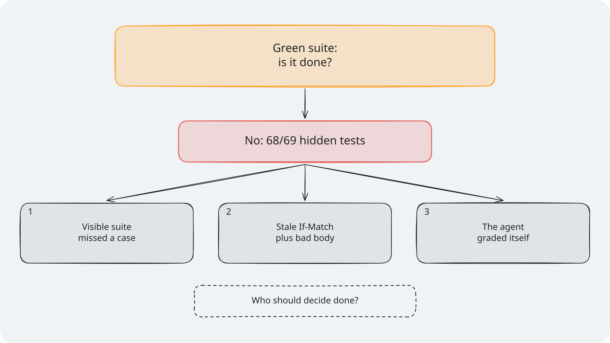
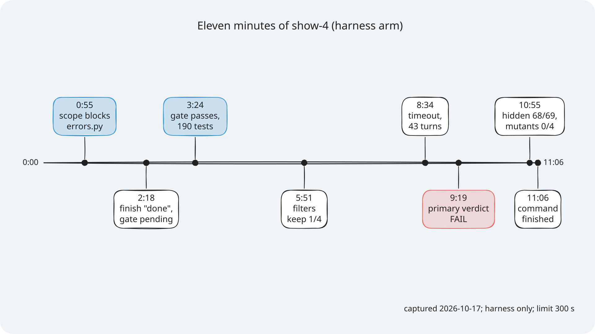
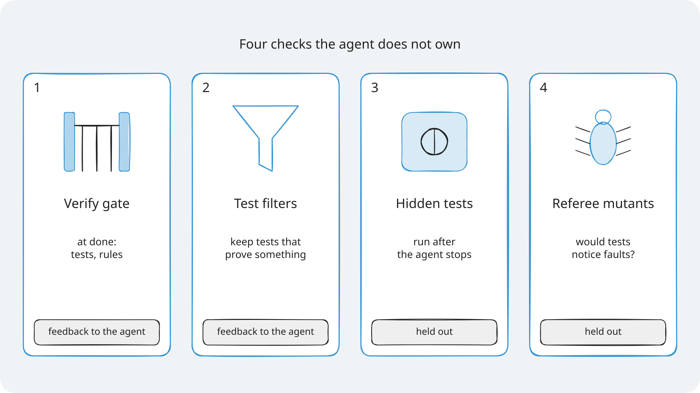

# Module 1: Harness Engineering for Coding Agents - Diagrams for Section 4: Verification

The diagrams for Section 4, the verification layer. Each one has an `.excalidraw` source, a `.png`
at 2x for slides, and an `.svg` with the font embedded for pages. Colours, step frames, editing,
and licences are explained once, in [the course diagrams guide](../../docs/diagrams/README.md). The
diagram for the ticket of Feature 4: Version checks on issue edits, `optimistic-concurrency`, is in
that folder too, because Section 3: Scope and sandbox uses it as well.

> **Terms on this page**
>
> - **Done claim**: The agent's call `finish(claim="done")`, which says the phase's work is complete.
> - **Verify gate**: The checks that run in the agent's container when it claims done; a failure sends the claim back.
> - **Test filters**: Five checks a test from the test phase must pass to be kept.
> - **Mutant**: A copy of the code with one small planted fault; a test that fails on it catches it.
> - **Referee mutants**: Planted faults the agent never sees; the referee counts how many the shipped tests catch.

## The diagrams

### The verification pipeline

*The agent's claim starts the checks; it never ends them.*

- **What it teaches**: the four checks, in the order they run, and who owns each one.
- **Slide topic**: from done claim to verdict, in three frames: frame 1 the build phase grading
  itself, frame 2 the test phase and the five filters, frame 3 the verify gate, the referee, and
  the primary verdict.
- **Files**: `verification-pipeline`, with step frames `verification-pipeline-step-1` to
  `verification-pipeline-step-3`.
- **Source**: `platform/src/shipharness/harness/verify/gate.py` and the five filters in
  `section-4-verification/concepts.md`.

### Mutation testing

*A shipped test that passes on the mutant would not catch a lost update.*

- **What it teaches**: what "a test catches a mutant" means, on a real Feature 4 referee mutant, and the two mutant sets.
- **Slide topic**: tests that prove something.
- **Files**: `mutation-testing`.
- **Source**: the Feature 4 mutants in `platform/teamtrack/mutants/features/f4.jsonl`
  (`app.services.issues-m401`, `app/services/issues.py` line 54).

### Section 4 results

*Both arms failed all 7 runs: no measurable difference on this task with this model.*

- **What it teaches**: a hard ticket on which no arm passed the primary measure.
- **Slide topic**: what we measured in Section 4.
- **Files**: `results-s4`.
- **Source**: [the Section 4 evidence](../../docs/evidence/s4.md).

### Failure story: done, but two edits still collide

*If-Match is optional, and no test sends a stale one.*

- **What it teaches**: how a green suite and a done claim can still miss the feature.
- **Slide**: "The problem: Done, but two edits still collide".
- **Files**: `failure-story-s4`.
- **Source**: the slide's notes and `platform/teamtrack/docs/features/f4.md`.
- **How to edit**: open `failure-story-s4.excalidraw`, edit it, then export the PNG and the SVG (see [How to edit a diagram](../../docs/diagrams/README.md#how-to-edit-a-diagram)).

### Socratic build-up: the suite is green, is it done?

*Frame 1 asks; frame 2 answers with the reasons.*

- **What it teaches**: why the agent's own green suite does not decide done.
- **Slide**: the Verification slide that asks whether a green suite means version checks are done, frame N on build N.
- **Files**: `socratic-s4`, with step frames `socratic-s4-step-1` to `socratic-s4-step-2`.
- **Source**: [the Section 4 evidence](../../docs/evidence/s4.md).
- **How to edit**: open `socratic-s4.excalidraw`, edit it, then export the PNG and the SVG (see [How to edit a diagram](../../docs/diagrams/README.md#how-to-edit-a-diagram)).

### Timeline of the captured show-4 run

*Captured 2026-10-17, harness arm only, agent limit then 300 s.*

- **What it teaches**: when the gate passed, what the filters kept, and when the verdicts came.
- **Slide**: "What just happened: eleven minutes of show-4".
- **Files**: `timeline-s4`.
- **Source**: the captured show-4 run in [the Section 4 evidence](../../docs/evidence/s4.md) and `demo/expected/terminal.txt`.
- **How to edit**: open `timeline-s4.excalidraw`, edit it, then export the PNG and the SVG (see [How to edit a diagram](../../docs/diagrams/README.md#how-to-edit-a-diagram)).

### Cheat sheet: four checks the agent does not own

*Two give feedback to the agent; two are held out.*

- **What it teaches**: the four checks of Section 4 on one page.
- **Slide**: "Cheat Sheet: four checks the agent does not own".
- **Files**: `cheat-sheet-s4`.
- **Source**: `section-4-verification/concepts.md`.
- **How to edit**: open `cheat-sheet-s4.excalidraw`, edit it, then export the PNG and the SVG (see [How to edit a diagram](../../docs/diagrams/README.md#how-to-edit-a-diagram)).
